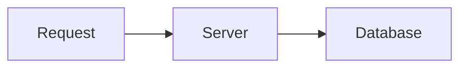

# Lesson template

Copy the skeleton below into a new lesson file and fill it in. Read `STYLE.md` first; every rule there applies.

Lessons are short: a 10 minute read, about 600 to 1000 words of prose, with a hard cap of 1200. Code, tables, the quiz and the lab don't count, but keep them lean too. The pilots ran long and the reader asked for harder cuts, so:

- One worked example. Add a second only when it shows something the first can't.
- At most 3 common mistakes, one or two sentences each.
- The Working with AI box: up to 8 words to use, 2 prompts, 3 or 4 checks.
- SQL lessons: at most 5 runner boxes outside the quiz and lab.
- The lab has at most 6 steps.
- Cut background, history and asides. If a detail is something the reader could look up or ask an AI for once they know the word, name it and move on. The aim is a solid general understanding, so leave out detail that a reader can look up or ask an AI for once they have the vocabulary.

## Section rules

| Section | What goes in it |
|---|---|
| Title and goal | Title in sentence case. One line: "After this you can ...". Then prerequisite links. |
| The idea | A concrete situation first, then the mental model in plain words. A Mermaid diagram where it helps. No formal definitions yet. |
| Key terms | Each term in bold once, with a plain-words definition. Keep it to the terms the lesson needs. |
| How it works | The mechanism, as a short explanation or numbered steps. Short code snippets that show the idea. |
| Worked examples | One or two, in example boxes. Example 1 is explained step by step and ends with a check (run it, print it, compare). |
| Common mistakes | One to four, in a warning box. Each shows the mistake, why it goes wrong and the fix. |
| Working with AI | A box with "Words to use", "Prompts to try" (2 or 3) and "What to check". See `STYLE.md`. |
| Quiz | 4 questions: concept, predict-the-output, debug or scenario. Each answer is collapsible. |
| Lab | A 10 to 20 minute hands-on task with a goal, time estimate, numbered steps, expected result and a collapsible full solution. Add a Cleanup step when the lab creates files, containers or cloud resources, or costs money. |
| Where this shows up | 1 to 3 short lines linking to later lessons or real uses. |

There is no summary at the end of a lesson. The chapter's `index.md` cheat sheet collects the rules, commands and tables.

## Numbering quiz questions

Each question is followed by its own answer box, which breaks a Markdown numbered list, and the site would restart every question at "1.". Write the numbers as plain text with an escaped dot instead: `2\. Question text`. This shows "2." on the site and in VS Code.

## Links to lessons that don't exist yet

Only link to pages that already exist. When you mention a planned lesson that hasn't been written, write its name in plain text and put the planned path in an HTML comment right after it, so the link can be added later by `tools/link_planned.py`:

```markdown
You will see this again in hash tables<!-- link: ../05-data-structures-and-algorithms/02-data-structures/04-hash-tables.md -->.
```

## Code in lessons

- Every fence names its language (see `STYLE.md`). Shell commands have no prompt character; output goes in a separate `text` block.
- Mark Windows (PowerShell) and WSL/Linux commands when it matters.
- Every snippet is run before commit. Never invent a flag or API.
- Use a plain fenced block in the page for short snippets. Use `<details class="code" markdown>` only for longer code that would interrupt the explanation.

## The SQL runner

SQL lessons can run queries in the browser against a sample database (PostgreSQL compiled to WebAssembly). Wrap a normal `sql` fence in a runner box. In VS Code it reads as plain SQL.

````markdown
<div class="sql-runner" data-db="shop" markdown>

```sql
SELECT name, city
FROM customers
ORDER BY name
LIMIT 5;
```

</div>
````

The `data-db` value is one of `shop` (customers, products, orders, order_items), `events` (signups and page views) or `warehouse` (a star schema). Every SQL block and every SQL solution is run by `node tools/check_sql.mjs` before commit.

To let the reader check an answer, give the runner a `data-solution` id and put the solution query, as the first `sql` block, in a solution box with that id. The Check button runs both queries and compares the results (row order counts only when the solution has `ORDER BY`).

````markdown
<div class="sql-runner" data-db="shop" data-solution="sol-1" markdown>

```sql
-- write your query here
SELECT 1;
```

</div>

<details class="solution" id="sol-1" markdown>
<summary>Solution</summary>

```sql
SELECT count(*) FROM customers;
```

</details>
````

Solution ids must be unique on the page. For a plain `sql` fence outside a runner (for example in a quiz answer), put `<!-- db: shop -->` on the line before it so `check_sql.mjs` knows which database to run it on. Put `<!-- sql: expect-error -->` before a block that is meant to fail.

## Skeleton

````markdown
# Lesson title

After this you can do one specific, concrete thing.

Before this: [prerequisite lesson](../path/to/lesson.md).

## The idea

A concrete situation the reader can picture. Then the mental model in plain words.



## Key terms

A **term** is its plain-words definition.

A **second term** is its plain-words definition.

## How it works

1. First step.
2. Second step.

```python
print("every snippet must run")
```

## Worked examples

<div class="example" markdown>

### Example 1: what it shows

Every step explained.

```bash
echo "commands have no prompt"
```

```text
commands have no prompt
```

Check: what to run or compare to confirm it.

</div>

<div class="example" markdown>

### Example 2: a variation

Less commentary than Example 1.

</div>

## Common mistakes

<div class="warning" markdown>

Watch out: the mistake, why it goes wrong, and the fix.

</div>

## Working with AI

<div class="ai" markdown>

Words to use: term one, term two, term three. They make a prompt precise.

Prompts to try:

- "A concrete prompt that uses the lesson's words and gives the AI the context it needs."
- "A second prompt, for example asking it to explain an error you pasted."

What to check:

- A specific failure mode, and how to verify it.
- Another specific failure mode, and how to verify it.

</div>

## Quiz

1\. Concept question.

<details class="solution" markdown>
<summary>Answer</summary>

The answer, with one line of reasoning.

</details>

2\. Predict the output of this code.

<details class="solution" markdown>
<summary>Answer</summary>

The output, and why.

</details>

3\. Debug or scenario question.

<details class="solution" markdown>
<summary>Answer</summary>

The answer.

</details>

4\. Fourth question.

<details class="solution" markdown>
<summary>Answer</summary>

The answer.

</details>

## Lab

<div class="lab" markdown>

### Lab: what you will build or do

Goal: one sentence. Time: about 15 minutes. Runs in: WSL (Ubuntu).

1. First step.
2. Second step.
3. Cleanup: remove what you created (and stop anything that costs money).

Expected result: what the reader should see.

```text
expected output
```

<details class="solution" markdown>
<summary>Solution</summary>

The full solution, with the commands or code.

</details>

</div>

## Where this shows up

- One later use, linked if the page exists.
````
