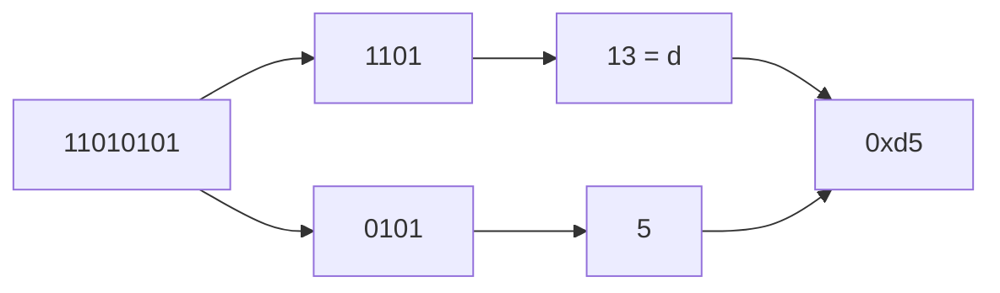

# Binary and hexadecimal

After this you can convert between decimal, binary and hexadecimal, and read a colour code or a permission mask without a calculator.

Before this: nothing. This is the first lesson.

## The idea

A CSS colour such as `#FF8800` and a Unix permission such as `0o755` look like codes. They are numbers written in other bases, because computers store everything as patterns of two states (on or off), and people need a short way to write those patterns down.

You already use a base: decimal has ten digits, and each position is worth ten times the one to its right. In `213` the 3 is worth 1, the 1 is worth 10 and the 2 is worth 100. Binary works the same way with two digits, and each position is worth twice the one to its right. Hexadecimal uses sixteen digits, and each position is worth 16 times the one to its right.

## Key terms

A **bit** is one binary digit, 0 or 1. It is the smallest piece of information a computer stores.

**Binary** (base 2) writes a number with the digits 0 and 1. The rightmost bit is worth $2^0 = 1$, the next $2^1 = 2$, then 4, 8, 16, and so on.

**Hexadecimal** (hex, base 16) writes a number with the digits 0 to 9 and then `a` to `f` for the values 10 to 15. Case does not matter: `ff` and `FF` are the same number.

A **nibble** is 4 bits. One hex digit stands for exactly one nibble, which is why hex is the usual short form for binary.

A **prefix** tells you the base when the digits alone would be ambiguous. In Python and most languages, `0b` means binary, `0o` means octal (base 8) and `0x` means hex. So `0b101` is 5, `0o17` is 15 and `0x1f` is 31.

## How it works

To read binary, add up the place values of the 1 bits. In the diagram, the 1 bits of `11010101` sit at 128, 64, 16, 4 and 1.

```text
position    7    6    5    4    3    2    1    0
value     128   64   32   16    8    4    2    1
bit         1    1    0    1    0    1    0    1
          128 + 64 +  0 + 16 +  0 +  4 +  0 +  1  =  213
```

To write a number in binary, divide by 2 repeatedly and collect the remainders. Read them from last to first:

1. $213 \div 2 = 106$ remainder 1.
2. $106 \div 2 = 53$ remainder 0.
3. Keep halving: 26 r 1, 13 r 0, 6 r 1, 3 r 0, 1 r 1, 0 r 1.
4. The remainders from last to first are `11010101`.

Hex is shorter because one hex digit covers four bits. As the diagram shows, split the bits into groups of four from the right and convert each group. In the other direction, expand each hex digit into four bits.



Bits also have operators. `&` (AND) keeps only the bits set in both inputs, `|` (OR) keeps bits set in either, `<<` shifts bits left (multiplies by 2 per step) and `>>` shifts right. A **bit mask** is a number used with `&` or `|` to read or set specific bits, which is how flags such as file permissions are stored.

```python
n = 213
print(bin(n), hex(n), oct(n))
print(int("11010101", 2), int("d5", 16))
print(f"{n:08b}  {n:02x}")
```

```text
0b11010101 0xd5 0o325
213 213
11010101  d5
```

## Worked examples

<div class="example" markdown>

### Example 1: decoding a colour

A web colour `#FF8800` is three bytes: red, green and blue, each two hex digits.

1. Split the code into `FF`, `88` and `00`.
2. `FF` is $15 \times 16 + 15 = 255$, the maximum for one byte, so red is full.
3. `88` is $8 \times 16 + 8 = 136$.
4. `00` is 0, so there is no blue. The colour is orange.

<details class="code" markdown>
<summary>In code</summary>

```python
color = "#FF8800"
print(tuple(int(color[i:i+2], 16) for i in (1, 3, 5)))
print(f"#{255:02X}{136:02X}{0:02X}")
```

```text
(255, 136, 0)
#FF8800
```

</details>

Check: the tuple matches the hand calculation, and formatting the three numbers back as hex gives the original code.

</div>

<div class="example" markdown>

### Example 2: flags in one number

Give read the value `0b100`, write `0b010` and execute `0b001`. A file that can be read and written has mode `READ | WRITE`, which is `0b110`. The test `mode & WRITE` is non-zero only if the write bit is set, and `mode & ~WRITE` clears it. The Unix mode `0o755` is these three-bit groups side by side: `111 101 101` (owner can do everything, others can read and execute).

```python
READ, WRITE, EXEC = 0b100, 0b010, 0b001
mode = READ | WRITE
print(f"{mode:03b}", bool(mode & WRITE), bool(mode & EXEC))
print(f"{mode & ~WRITE:03b}", f"{0o755:09b}")
```

```text
110 True False
100 111101101
```

</div>

## Common mistakes

<div class="warning" markdown>

Watch out: reading `10` as ten. In binary `10` is 2, and in hex it is 16. Only the prefix or the context tells you the base.

Watch out: mixing strings and numbers. `"FF"` is text and `0xFF` is the number 255; `"FF" == 255` is `False`. Convert text with `int("FF", 16)`, and turn a number into text with `hex()`, `bin()` or an f-string.

Watch out: dropping leading zeros. The byte `0x0a` and the number `0xa` are the same value, but a hex dump or colour code needs both digits, so format with `:02x`.

</div>

## Working with AI

<div class="ai" markdown>

Words to use: bit, nibble, hexadecimal, bit mask, shift, prefix `0x`, base.

Prompts to try:

- "Convert 0xB7 to binary and decimal, then show how to extract the high nibble and the low nibble in Python with a shift and a mask."
- "My function takes the mode 0o640. Write each permission group in binary and say who can read, write and execute."

What to check:

- Conversions done in the model's head. Recompute with `bin()`, `hex()` and `int(text, base)`.
- A missing prefix. `int("10", 16)` is 16 but `int("10")` is 10.
- Operator precedence in masks. In JavaScript and C, `x & 0xF == 0` means `x & (0xF == 0)`; Python orders them the other way. Parenthesize: `(x & 0xF) == 0`.

</div>

## Quiz

1\. What is the decimal value of `0b1011`, and what is it in hex?

<details class="solution" markdown>
<summary>Answer</summary>

$8 + 2 + 1 = 11$, and 11 is `b` in hex, so `0xb`.

</details>

2\. Predict the output: `print(0xA5 >> 4, 0xA5 & 0x0F)`.

<details class="solution" markdown>
<summary>Answer</summary>

`10 5`. The shift keeps the high nibble `a` (10), and the mask keeps the low nibble 5.

</details>

3\. A teammate ports `if mode & 0b010 == 0b010:` from Python to JavaScript as `if (mode & 0b010 == 0b010)`. With `mode = 0b110` the Python version is true but the JavaScript one is false. Why?

<details class="solution" markdown>
<summary>Answer</summary>

In JavaScript (and C), `==` binds tighter than `&`, so it computes `mode & (0b010 == 0b010)`, which is `mode & true`, that is `mode & 1`. That tests the lowest bit, not the write bit. Write `(mode & 0b010) === 0b010`.

</details>

4\. Why do people write bytes in hex instead of binary?

<details class="solution" markdown>
<summary>Answer</summary>

One hex digit is exactly four bits, so a byte is always two hex digits. That is far shorter to read than eight binary digits, and converting between them needs no arithmetic.

</details>

## Lab

<div class="lab" markdown>

### Lab: convert by hand, then check

Goal: write your own converters and compare them with the built-in ones. Time: about 15 minutes. Runs in: any terminal with Python 3.

1. Write `to_binary(n)` that uses the divide-by-2 method from this lesson and returns a string.
2. Write `from_binary(text)` that adds up place values, with no `int(text, 2)`.
3. Loop over `range(1000)` and assert that both functions agree with `bin()` and `int()`.
4. Print the nine-bit form of `0o640` and say in a comment who can read it.
5. Cleanup: nothing to remove.

Expected result: the script prints `ok` and then the mask.

```text
ok
110100000
```

<details class="solution" markdown>
<summary>Solution</summary>

```python
def to_binary(n):
    digits = ""
    while n > 0:
        digits = str(n % 2) + digits
        n //= 2
    return digits or "0"

def from_binary(text):
    total = 0
    for ch in text:
        total = total * 2 + int(ch)
    return total

for n in range(1000):
    assert to_binary(n) == bin(n)[2:]
    assert from_binary(to_binary(n)) == n
print("ok")
print(f"{0o640:09b}")  # owner read+write, group read, others nothing
```

</details>

</div>

## Where this shows up

- [Bits, bytes and units](02-bits-bytes-and-units.md) builds on this: how many values a given number of bits can hold.
- Colour codes in CSS, permission modes in Linux<!-- link: ../../02-operating-systems-and-linux/02-linux-command-line/03-users-groups-and-permissions.md -->, and the hex strings of hashes, IDs and memory addresses.
