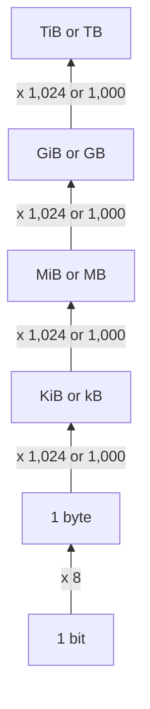
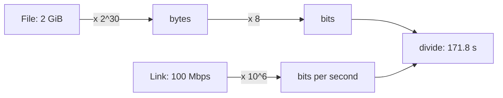

# Bits, bytes and units

After this you can say how many values a given number of bits can hold, tell KB from KiB and Mbps from MB/s, and convert between them correctly.

Before this: [binary and hexadecimal](01-binary-and-hexadecimal.md).

## The idea

You buy a 1 TB drive, plug it in and your computer says it holds 931 GB. You sign up for a 100 Mbps internet plan and a 2 GiB download takes almost three minutes, not the 20 seconds you expected. Nothing is broken in either case. The numbers use different units that look almost the same, and the gap between them is about 7% for drives and a factor of 8 for networks.

A computer stores data in **bits**, but it moves and addresses data in groups of 8 bits. Sizes are then written with prefixes that can mean powers of 10 or powers of 2. Knowing which one a number uses is the whole skill.

## Key terms

A **byte** is 8 bits. It is the smallest unit most computers can address, and it can hold $2^8 = 256$ different values (0 to 255).

With $n$ bits you can write $2^n$ different patterns. That number is the count of distinct values, not the largest value: the largest unsigned value is $2^n - 1$.

An **SI prefix** (kilo, mega, giga, tera) means a power of ten: 1 kB is 1,000 bytes and 1 MB is 1,000,000 bytes. An **IEC binary prefix** (kibi, mebi, gibi, tebi) means a power of two: 1 KiB is $2^{10} = 1{,}024$ bytes and 1 MiB is $2^{20} = 1{,}048{,}576$ bytes. The IEC names exist because the old habit of writing "KB" for 1,024 bytes clashed with the SI meaning; see [NIST on binary prefixes](https://physics.nist.gov/cuu/Units/binary.html).

**Bandwidth** is the amount of data a link carries per second. It is quoted in bits per second: **Mbps** is megabits (1,000,000 bits) per second. File sizes are quoted in bytes, so **MB/s** is megabytes per second.

The case of the letters matters: a lowercase `b` is bits and an uppercase `B` is bytes.

## How it works

Each step up the ladder multiplies by 8 once (bits to bytes) and then by 1,024 (binary) or 1,000 (decimal) at every rung.



The decimal and binary prefixes drift apart as the prefix grows:

| Prefix pair | Decimal (SI) | Binary (IEC) | Binary is larger by |
|---|---|---|---|
| kilo / kibi | 1,000 | 1,024 | 2.4% |
| mega / mebi | 1,000,000 | 1,048,576 | 4.9% |
| giga / gibi | 1,000,000,000 | 1,073,741,824 | 7.4% |
| tera / tebi | 1,000,000,000,000 | 1,099,511,627,776 | 10.0% |

Storage makers (drives, SSDs) use decimal prefixes. Memory uses binary sizes, because addresses are binary numbers: 32 address bits reach $2^{32} = 4{,}294{,}967{,}296$ bytes, which is 4 GiB. Operating systems differ in which prefix they show. Windows Explorer uses 1,024-based sizes but labels them "GB"; the labels in your tools may not tell you which one you are reading, so check the byte count.

To turn a link speed into a download time, convert both sides into bits first, as in the diagram, then divide.



```python
print(2**8, 2**16, 2**32)
print(f"{10**12 / 2**30:.2f} GiB")
```

```text
256 65536 4294967296
931.32 GiB
```

## Worked examples

<div class="example" markdown>

### Example 1: the 2 GiB download on a 100 Mbps plan

1. The file is $2 \times 2^{30}$ bytes, which is $2 \times 2^{30} \times 8$ bits.
2. The link carries $100 \times 10^6$ bits per second.
3. Divide: $\frac{2 \times 2^{30} \times 8}{100 \times 10^6} \approx 171.8$ seconds.
4. Check in bytes: 100 Mbps is $100 / 8 = 12.5$ MB/s, and $2 \times 2^{30} / (12.5 \times 10^6) \approx 171.8$ seconds, the same.

<details class="code" markdown>
<summary>In code</summary>

```python
size_bytes = 2 * 2**30
mbps = 100
print(f"{size_bytes * 8 / (mbps * 10**6):.1f} s")
print(f"{mbps / 8} MB/s")
print(f"{size_bytes / (mbps / 8 * 10**6):.1f} s")
```

```text
171.8 s
12.5 MB/s
171.8 s
```

</details>

Real downloads are a bit slower because of protocol overhead and the server's own limits. The estimate gives a lower bound.

</div>

<div class="example" markdown>

### Example 2: where the 931 GB went

A drive sold as 1 TB holds $10^{12}$ bytes. Divide by $2^{30}$ to count it in GiB: $10^{12} / 1{,}073{,}741{,}824 \approx 931.32$. No space is missing; the operating system divides by 1,024-based units and still writes "GB". Check: `10**12 / 2**30` gives `931.32` in the snippet above.

</div>

## Common mistakes

<div class="warning" markdown>

Watch out: mixing Mbps and MB/s. A 1 Gbps link moves at most 125 MB/s. A plan or a cloud limit quoted in bits looks eight times faster than the same number in bytes.

Watch out: using 1,000 where memory uses 1,024, or the reverse, and calling the result exact. In code that computes sizes, pick one and name it in the variable (`size_kib`, `size_mb`). A mismatch of 7% at gigabyte scale is enough to fail a limit check.

Watch out: confusing the number of values with the largest value. 8 bits hold 256 values, and the largest unsigned one is 255.

</div>

## Working with AI

<div class="ai" markdown>

Words to use: bit, byte, KiB, kB, Mbps, MB/s, bandwidth, address space.

Prompts to try:

- "My upload limit is 50 Mbps. How long does a 4.7 GB (decimal) file take? Show the unit conversion step by step and state your assumption about overhead."
- "This function converts bytes to a human-readable size. Does it use 1,000 or 1,024, and are the unit labels (KB or KiB) correct for that choice?"

What to check:

- Unit labels. If an answer says "MB" for a figure computed with 1,024, ask whether it means MiB.
- A factor of 8. Look for a place where bits and bytes are mixed without dividing or multiplying by 8.
- Round numbers presented as exact. Recompute with Python and compare.

</div>

## Quiz

1\. How many different values can 12 bits hold, and what is the largest unsigned value?

<details class="solution" markdown>
<summary>Answer</summary>

$2^{12} = 4096$ values, and the largest is $4095$.

</details>

2\. Predict the output: `print(2**30 / 10**9)`.

<details class="solution" markdown>
<summary>Answer</summary>

`1.073741824`. One GiB is about 7.4% larger than one GB.

</details>

3\. A cloud provider limits a function's response to 6 MB. Your response is 6,100,000 bytes. Is it over the limit?

<details class="solution" markdown>
<summary>Answer</summary>

It depends on the unit. Under 6 MB $= 6{,}000{,}000$ bytes it is over; under 6 MiB $= 6{,}291{,}456$ bytes it fits. Read the provider's documentation for which one it means.

</details>

4\. An upload of 300 MB must finish in 10 seconds. What connection speed in Mbps is needed, ignoring overhead?

<details class="solution" markdown>
<summary>Answer</summary>

$300 \times 8 = 2400$ megabits in 10 seconds, so 240 Mbps.

</details>

## Lab

<div class="lab" markdown>

### Lab: a size converter

Goal: write a function that shows a byte count in decimal and binary units, then use it on a real file. Time: about 15 minutes. Runs in: any terminal with Python 3.

1. Write `human(n, base)` that divides by `base` (1000 or 1024) until the value is below `base`, and returns text like `976.56 KiB`.
2. Write 1,000,000 bytes of zeros to a file named `sample.bin` and read its size with `os.path.getsize`.
3. Print the size with `human(size, 1000)` and `human(size, 1024)`.
4. Print how many seconds the file takes to send at 100 Mbps.
5. Cleanup: delete `sample.bin`.

Expected result:

```text
1000000
1.00 MB
976.56 KiB
0.080 s
```

<details class="solution" markdown>
<summary>Solution</summary>

```python
import os

def human(n, base):
    units = ["B", "kB", "MB", "GB", "TB"] if base == 1000 else ["B", "KiB", "MiB", "GiB", "TiB"]
    x = float(n)
    for u in units:
        if x < base or u == units[-1]:
            return f"{x:.2f} {u}"
        x /= base

with open("sample.bin", "wb") as f:
    f.write(bytes(1_000_000))
size = os.path.getsize("sample.bin")
print(size)
print(human(size, 1000))
print(human(size, 1024))
print(f"{size * 8 / 100e6:.3f} s")
os.remove("sample.bin")
```

</details>

</div>

## Where this shows up

- Memory and storage figures in [memory hierarchy and latency numbers](../02-hardware/04-memory-hierarchy-and-latency-numbers.md), where GiB/s and MB/s both appear.
- Cloud limits, file upload caps and database column sizes, where "MB" can mean either.
