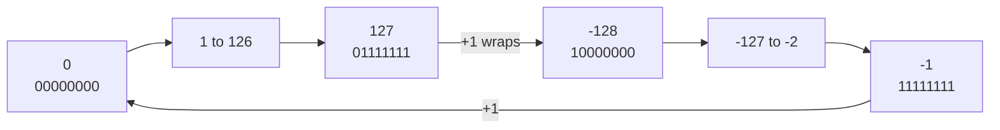

# Integers and two's complement

After this you can say how a computer stores negative numbers, give the range of an integer type from its width, and spot where a calculation can overflow.

Before this: [bits, bytes and units](02-bits-bytes-and-units.md).

## The idea

A program adds 1 to a 32-bit counter whose value is 2,147,483,647 and gets $-2{,}147{,}483{,}648$. A video game shows a player with a negative amount of health after a big hit. A program that runs on a 32-bit timestamp breaks on 19 January 2038. All three are the same bug: an integer stored in a fixed number of bits has run out of room.

In Python this almost never happens, because Python integers grow as needed. Most other languages (Java, C, Go, Rust, and the integer types in databases and file formats) use a fixed width, so you need to know what happens at the edge.

## Key terms

An **unsigned integer** with $n$ bits holds the values 0 to $2^n - 1$. For 8 bits that is 0 to 255.

A **signed integer** can also be negative. Almost all hardware stores it in **two's complement**: the top bit (the **sign bit**) is 1 for a negative number, and the value of a negative number is found by the rule below.

**Overflow** is a result that does not fit in the type's range. **Wraparound** is the usual outcome: the result is reduced modulo $2^n$, as if the counter rolled over.

A **fixed-width** integer has a set number of bits (8, 16, 32 or 64). An **arbitrary-precision** integer (Python `int`, JavaScript `BigInt`, Java `BigInteger`) uses as much memory as the value needs.

## How it works

In two's complement the top bit has a negative place value. The diagram shows `11111011` read that way, and negated from 5 by flipping every bit and adding 1.

```text
place     -128   64   32   16    8    4    2    1
bits         1    1    1    1    1    0    1    1
value     -128 + 64 + 32 + 16 +  8 +  0 +  2 +  1  =  -5

negate 5:  00000101  --flip-->  11111010  --add 1-->  11111011  (-5)
```

This design means the same adder circuit handles signed and unsigned numbers; only your reading of the bits differs.

An $n$-bit signed integer holds $-2^{n-1}$ to $2^{n-1} - 1$. There is one more negative value than positive ones, so negating the minimum value overflows back to itself.

The patterns form a ring, because adding 1 to the largest pattern lands on the smallest. That is wraparound.



| Width | Signed range | Unsigned range |
|---|---|---|
| 8 bits | $-128$ to 127 | 0 to 255 |
| 16 bits | $-32{,}768$ to 32,767 | 0 to 65,535 |
| 32 bits | $-2{,}147{,}483{,}648$ to 2,147,483,647 | 0 to 4,294,967,295 |
| 64 bits | $-9{,}223{,}372{,}036{,}854{,}775{,}808$ to 9,223,372,036,854,775,807 | 0 to 18,446,744,073,709,551,615 |

What a language does on overflow differs. Java and Go wrap silently. In C, signed overflow is undefined behaviour, so the compiler may assume it never happens. Rust panics in debug builds and wraps in release builds ([The Rust Book](https://doc.rust-lang.org/book/ch03-02-data-types.html), as of 2026). JavaScript has no 32-bit integer type for ordinary numbers, but its bitwise operators convert to 32 bits first.

## Worked examples

<div class="example" markdown>

### Example 1: 127 plus 1 in 8 bits

1. In binary, `01111111` plus `00000001` is `10000000`.
2. The sign bit is now 1, and the place value of that bit is $-128$, so the result reads as $-128$.
3. Arithmetically the answer was 128, which does not fit. The stored result is $128 - 256 = -128$.

<details class="code" markdown>
<summary>In code</summary>

```python
import ctypes
def to_signed(value, bits):
    value &= (1 << bits) - 1
    return value - (1 << bits) if value >> (bits - 1) else value

print(f"{-5 & 0xFF:08b}", to_signed(0b11111011, 8))
print(to_signed(127 + 1, 8), ctypes.c_int8(127 + 1).value)
print(ctypes.c_int32(2**31 - 1 + 1).value)
```

```text
11111011 -5
-128 -128
-2147483648
```

</details>

Check: the hand result matches both the helper (which masks to 8 bits, then subtracts $2^8$ when the sign bit is set) and `ctypes.c_int8`, which behaves like a C `int8_t`.

</div>

<div class="example" markdown>

### Example 2: averaging two big numbers

Two 32-bit counters hold 2,000,000,000 each. The average should be 2,000,000,000, but `(a + b) / 2` adds first, and the sum 4,000,000,000 does not fit in a signed 32-bit integer. It wraps to $-294{,}967{,}296$. Fix: `a + (b - a) / 2`, or use a wider type.

```python
a, b = 2_000_000_000, 2_000_000_000
print(to_signed(a + b, 32), (a + b) // 2)
```

```text
-294967296 2000000000
```

The second value is what Python gives, since its integers do not wrap.

</div>

## Common mistakes

<div class="warning" markdown>

Watch out: assuming Python's behaviour carries over. A calculation that is fine in Python can overflow in the same algorithm written in Java, or in a database column typed `integer`.

Watch out: using a 32-bit type for IDs, counts or timestamps that will grow. A signed 32-bit count of seconds since 1 January 1970 ends on 19 January 2038 at 03:14:07 UTC. Use 64 bits.

Watch out: mixing signed and unsigned in one comparison or subtraction. In C, `0u - 1` is a huge positive number, not $-1$.

</div>

## Working with AI

<div class="ai" markdown>

Words to use: two's complement, signed, unsigned, overflow, wraparound, bit width, `int32`, `BigInt`.

Prompts to try:

- "In Java, what does `Integer.MAX_VALUE + 1` evaluate to, and how do I make it throw instead? Show `Math.addExact`."
- "This binary search computes `mid = (lo + hi) / 2` on `int` indices. Can it overflow, and what is the safe form?"

What to check:

- The width. An answer must say 32-bit or 64-bit; the same code behaves differently at each.
- Claims about C overflow. Signed overflow is undefined behaviour, not guaranteed wraparound; unsigned does wrap.
- Test it. Print the value at the edge (`MAX`, `MAX + 1`, `MIN`) instead of trusting the explanation.

</div>

## Quiz

1\. What is the range of a signed 16-bit integer, and why is it not symmetric?

<details class="solution" markdown>
<summary>Answer</summary>

$-32{,}768$ to $32{,}767$. Zero uses one of the non-negative patterns, so there is one more negative value than positive.

</details>

2\. What is the 8-bit two's complement pattern for $-1$?

<details class="solution" markdown>
<summary>Answer</summary>

`11111111`. Flip `00000001` to `11111110` and add 1.

</details>

3\. A JavaScript snippet gives `2147483648 | 0` as $-2147483648$. Explain.

<details class="solution" markdown>
<summary>Answer</summary>

The bitwise `|` converts its operands to 32-bit signed integers first. 2,147,483,648 is $2^{31}$, which sets only the sign bit, so it reads as the most negative value.

</details>

4\. A log table stores a timestamp in a signed 32-bit column. Is that a problem, and by when?

<details class="solution" markdown>
<summary>Answer</summary>

Yes, if it stores seconds since 1970. The largest value is $2^{31} - 1$, which is 19 January 2038, 03:14:07 UTC. Use a 64-bit column.

</details>

## Lab

<div class="lab" markdown>

### Lab: find the edges

Goal: simulate fixed-width integers in Python and see wraparound. Time: about 15 minutes. Runs in: any terminal with Python 3.

1. Write `to_signed(value, bits)` as in Example 1.
2. For widths 8, 16 and 32, print the minimum, the maximum, and `maximum + 1` after wraparound.
3. Negate the 8-bit minimum with `to_signed(-(-128), 8)` and print it: negating the minimum gives the minimum.
4. Print the date and time of `2**31 - 1` seconds after 1970 in UTC, using `datetime.fromtimestamp(..., datetime.timezone.utc)`.
5. Cleanup: nothing to remove.

Expected result:

```text
8 -128 127 -128
16 -32768 32767 -32768
32 -2147483648 2147483647 -2147483648
-128
2038-01-19 03:14:07+00:00
```

<details class="solution" markdown>
<summary>Solution</summary>

```python
import datetime

def to_signed(value, bits):
    value &= (1 << bits) - 1
    return value - (1 << bits) if value >> (bits - 1) else value

for bits in (8, 16, 32):
    low = -(1 << (bits - 1))
    high = (1 << (bits - 1)) - 1
    print(bits, low, high, to_signed(high + 1, bits))
print(to_signed(-(-128), 8))
print(datetime.datetime.fromtimestamp(2**31 - 1, datetime.timezone.utc))
```

</details>

</div>

## Where this shows up

- [Floating point](04-floating-point.md) is the other way a computer stores numbers, and it has its own limits.
- Database column types such as `integer` and `bigint` in data types and constraints<!-- link: ../../10-databases-sql-and-postgres/03-schema-design/01-data-types-and-constraints.md -->, and the 64-bit counters in IDs and timestamps.
