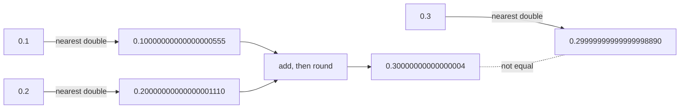

# Floating point

After this you can explain why `0.1 + 0.2` is not `0.3`, compare floats safely, and store money without rounding bugs.

Before this: [integers and two's complement](03-integers-and-twos-complement.md).

## The idea

Open a Python prompt and type `0.1 + 0.2`. The answer is `0.30000000000000004`. A shop's total comes out as 99.9999999999986 after adding ten cents a thousand times. Neither is a Python bug: JavaScript, Java, C and your database's `double precision` all give the same answers.

The cause is the storage format. A computer has a fixed number of bits for each number, so it cannot store every real number. It stores the nearest one it can. The value 0.1 has no exact binary form, in the same way that $1/3$ has no exact decimal form (0.3333...). The stored value is slightly off, and the error shows up when you print enough digits or compare for equality.

## Key terms

A **floating-point number** is stored as a sign, an exponent and a significand, like scientific notation in base 2: $(-1)^{\text{sign}} \times 1.\text{significand} \times 2^{\text{exponent}}$. The point "floats" because the exponent moves it.

**IEEE 754** is the standard that almost all hardware and languages follow. Its 64-bit format (**double**, also called binary64) splits the bits as shown below. That gives about 15 to 17 decimal digits of precision.

```text
 1 bit    11 bits       52 bits
+------+----------+-----------------+
| sign | exponent |   significand   |
+------+----------+-----------------+
  s       e              f           value = (-1)^s x 1.f x 2^(e - 1023)
```
 Python's `float` and JavaScript's `Number` are doubles. A 32-bit **float** has about 7 digits.

**Rounding error** is the difference between the number you meant and the nearest stored value. It is a few parts in $10^{16}$ for a double, and it can grow as you do more operations.

Special values: `inf` (overflow, or division by zero in some languages), `-inf`, and **NaN** ("not a number", the result of `0.0 * inf` or other undefined operations). NaN is not equal to anything, including itself.

A **decimal type** (Python `decimal.Decimal`, Java `BigDecimal`, SQL `numeric`) stores digits in base 10, so 0.1 is exact.

## How it works

You can see the stored value of 0.1. Python's `Decimal(0.1)` prints the exact number the double holds:

```python
from decimal import Decimal
print(f"{0.1:.20f}")
print(Decimal(0.1))
```

```text
0.10000000000000000555
0.1000000000000000055511151231257827021181583404541015625
```

In the diagram, the stored 0.1 and 0.2 are both a little too big, and their sum rounds to a different double than the one nearest 0.3, so `==` is `False`. For more on the format see the [Python tutorial on floating point](https://docs.python.org/3/tutorial/floatingpoint.html).



Three consequences follow:

1. Never compare floats with `==` unless you are comparing a value to the exact thing you stored. Use a tolerance: `math.isclose(a, b)`.
2. Integers are exact in a double only up to $2^{53}$ (9,007,199,254,740,992). Above that, neighbouring integers are no longer all representable, so `2**53 + 1` can silently equal `2**53`. This is why JavaScript has `Number.MAX_SAFE_INTEGER` and `BigInt`.
3. Adding a small number to a very large one can lose the small one: `1e16 + 1 == 1e16` is `True`.

## Worked examples

<div class="example" markdown>

### Example 1: comparing safely

1. Compute `0.1 + 0.2` and compare it with `0.3` using `==`.
2. Measure the gap: `abs(0.1 + 0.2 - 0.3)` is about $5.55 \times 10^{-17}$.
3. Compare with a tolerance instead. `math.isclose` uses a relative tolerance of $10^{-9}$ by default.

<details class="code" markdown>
<summary>In code</summary>

```python
import math
print(0.1 + 0.2, 0.1 + 0.2 == 0.3)
print(abs(0.1 + 0.2 - 0.3))
print(math.isclose(0.1 + 0.2, 0.3))
print(float("nan") == float("nan"), math.isnan(float("nan")))
```

```text
0.30000000000000004 False
5.551115123125783e-17
True
False True
```

</details>

Check: the gap is far below the tolerance, so `isclose` says `True`. For a test of "is this NaN?", use `math.isnan`, since `==` is always `False` for NaN.

</div>

<div class="example" markdown>

### Example 2: money

Add ten cents 1,000 times with floats, then with `Decimal`, then with integer cents. Then apply a 13% sales tax to \$19.99 and round half up.

```python
from decimal import Decimal, ROUND_HALF_UP
total = 0.0
for _ in range(1000):
    total += 0.10
print(total, sum(Decimal("0.10") for _ in range(1000)))
tax = (Decimal("19.99") * Decimal("0.13")).quantize(Decimal("0.01"), rounding=ROUND_HALF_UP)
print(tax, (1999 * 13 + 50) // 100)
```

```text
99.9999999999986 100.00
2.60 260
```

The float total is off. The `Decimal` total is exactly 100.00. The tax on \$19.99 is \$2.5987, which rounds to \$2.60; with integer cents the same result is 260 cents. Create `Decimal` values from strings: `Decimal(0.1)` copies the float's error. The two safe choices are `Decimal` and integer cents (store 1999, not 19.99); in a database use `numeric` or an integer column. The rounding rule is a business decision, so fix it in one place.

Check: `round(0.285, 2)` gives `0.28` for the float but `Decimal("0.285")` rounds half up to `0.29`, which is another reason to avoid floats for money.

</div>

## Common mistakes

<div class="warning" markdown>

Watch out: `==` on computed floats. A test such as `assert total == 0.3` fails for some inputs. Use `math.isclose` or `pytest.approx`.

Watch out: storing money in a float or in a JSON number that a JavaScript client parses as a double. Send amounts as integer cents or as strings.

Watch out: `Decimal(0.1)`. It faithfully copies the float's long tail. Write `Decimal("0.1")`.

</div>

## Working with AI

<div class="ai" markdown>

Words to use: IEEE 754, double, rounding error, epsilon, `isclose`, `Decimal`, `numeric`, integer cents.

Prompts to try:

- "My Python checkout code sums prices as floats and a test sometimes fails by 0.01. Rewrite it with integer cents, and show where to round the tax and which rounding mode to use."
- "In Postgres, what is the difference between `double precision` and `numeric(12,2)` for storing prices? Show a query where they differ."

What to check:

- Floats for currency in generated code. Look for `float`, `* 1.13` and `round(x, 2)` on money.
- `Decimal` built from a float instead of a string.
- Hard-coded tolerances such as `1e-9` used for values near zero, where a relative tolerance fails. Ask which tolerance and why.

</div>

## Quiz

1\. Why can't a double store 0.1 exactly?

<details class="solution" markdown>
<summary>Answer</summary>

It stores binary fractions, and 0.1 is $1/10$, which repeats forever in binary (0.0001100110011...). The stored value is the nearest double.

</details>

2\. Predict the output: `print(float("nan") == float("nan"))`.

<details class="solution" markdown>
<summary>Answer</summary>

`False`. NaN is not equal to any value, including itself.

</details>

3\. An invoice system stores prices as floats, and the total of 1,000 lines at \$0.10 comes out as \$99.99999999999. A colleague wants to `round()` the result. Is that enough?

<details class="solution" markdown>
<summary>Answer</summary>

It hides this symptom, but errors can land on a rounding boundary (as with `round(0.285, 2)`). Store integer cents or use `Decimal`/`numeric` and round once, with a stated rule.

</details>

4\. Predict: `print(2**53 + 1 == 2**53)` in Python, and `2**53 + 1 === 2**53` in JavaScript.

<details class="solution" markdown>
<summary>Answer</summary>

Python prints `False`, because its integers are exact. JavaScript gives `true`, because `Number` is a double and cannot represent $2^{53} + 1$. Use `BigInt` there.

</details>

## Lab

<div class="lab" markdown>

### Lab: three ways to add up a bill

Goal: add the same bill with floats, `Decimal` and cents, and compare. Time: about 15 minutes. Runs in: any terminal with Python 3.

1. Make a list of 1,000 prices of 0.10 (as `0.10`, `Decimal("0.10")` and `10` cents).
2. Add each list with a loop and print the three totals.
3. Print `total_float == 100.0` and `math.isclose(total_float, 100.0)`.
4. Print the exact value of the stored 0.1 with `Decimal(0.1)`.
5. Cleanup: nothing to remove.

Expected result:

```text
99.9999999999986 100.00 10000
False True
0.1000000000000000055511151231257827021181583404541015625
```

<details class="solution" markdown>
<summary>Solution</summary>

```python
import math
from decimal import Decimal

total_float = 0.0
total_decimal = Decimal("0")
total_cents = 0
for _ in range(1000):
    total_float += 0.10
    total_decimal += Decimal("0.10")
    total_cents += 10
print(total_float, total_decimal, total_cents)
print(total_float == 100.0, math.isclose(total_float, 100.0))
print(Decimal(0.1))
```

</details>

</div>

## Where this shows up

- Money in apps: integer cents or `numeric` in [data types and constraints](../../10-databases-sql-and-postgres/03-schema-design/01-data-types-and-constraints.md).
- Machine learning, where 32-bit and 16-bit floats trade precision for speed: [neural networks and deep learning](../../11-data-engineering-and-data-science/02-data-science-and-ml/07-neural-networks-and-deep-learning.md).
