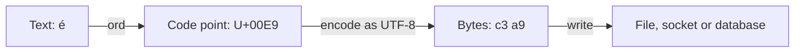

# Text, ASCII and Unicode

After this you can explain how text becomes bytes, predict how many bytes a string takes in UTF-8, and diagnose garbled text (mojibake).

Before this: [bits, bytes and units](02-bits-bytes-and-units.md).

## The idea

A user named Zoë signs up. The name is stored fine, then shows up on a receipt as `Zoë`. A string of 20 characters fails a database column limit of 20 bytes. A file written on one machine opens as nonsense on another.

A computer stores only numbers. To store text, everyone has to agree on which number means which character, and on how to turn those numbers into bytes. When two programs disagree on either, the result is garbled text. The disagreement is almost always about the second part, the encoding.

## Key terms

A **character set** assigns a number to each character. **ASCII** is the oldest common one: 128 characters, numbered 0 to 127, covering English letters, digits, punctuation and control codes. `A` is 65, `a` is 97, and `0` is 48.

**Unicode** is the standard that assigns a number, called a **code point**, to every character in most of the world's writing systems, plus symbols and emoji. Code points are written `U+` followed by hex digits: `U+0041` is `A`, `U+00E9` is `é`, and `U+1F600` is a smiley emoji. The first 128 code points match ASCII.

An **encoding** is a rule for turning code points into bytes. **UTF-8** uses 1 to 4 bytes per code point: 1 for ASCII, 2 for most European and Middle Eastern letters, 3 for most Asian scripts, 4 for emoji. It is the dominant encoding on the web and in Linux.

**Latin-1** (ISO 8859-1) and **cp1252** (Windows) are older encodings that use exactly one byte per character and cover only Western European letters.

**Mojibake** is text garbled by decoding bytes with a different encoding from the one used to write them.

## How it works

Text has three layers: characters, code points, and bytes. A program holds strings as characters and turns them into bytes only when it writes out. This is **encoding**; reading bytes back is **decoding**. Both steps need the same encoding name.



UTF-8 packs the code point's bits into the `x` slots of a template. The leading bits of the first byte say how long the character is.

```text
code points            byte 1     byte 2     byte 3     byte 4
U+0000  to U+007F      0xxxxxxx
U+0080  to U+07FF      110xxxxx   10xxxxxx
U+0800  to U+FFFF      1110xxxx   10xxxxxx   10xxxxxx
U+10000 to U+10FFFF    11110xxx   10xxxxxx   10xxxxxx   10xxxxxx

é = U+00E9 = 000 1110 1001  ->  110 00011  10 101001  =  c3 a9
```

```python
for ch in ["A", "\u00e9", "\u20ac", "\U0001F600"]:
    print(f"U+{ord(ch):04X}", len(ch), len(ch.encode("utf-8")), ch.encode("utf-8").hex(" "))
```

```text
U+0041 1 1 41
U+00E9 1 2 c3 a9
U+20AC 1 3 e2 82 ac
U+1F600 1 4 f0 9f 98 80
```

The columns are code point, characters, UTF-8 bytes, and the bytes in hex. The lengths differ: `len(text)` counts code points in Python, while the stored size is the byte length. A Chinese string of three characters is 9 bytes.

Two more traps are worth knowing by name. The same visible text can have more than one code-point sequence: `é` can be one code point (`U+00E9`) or `e` plus a combining accent (`U+0065 U+0301`). The two look identical but compare unequal until you **normalize** them (`unicodedata.normalize("NFC", s)`). And JavaScript counts UTF-16 units, not code points, so an emoji has `length` 2 there.

## Worked examples

<div class="example" markdown>

### Example 1: how `Zoë` happens

1. The server writes `é` as UTF-8, the two bytes `c3 a9`.
2. A reader decodes those bytes as Latin-1, where each byte is one character: `c3` is `Ã` and `a9` is `©`.
3. The text `café` now shows as `café`.
4. Reversing the mistake works when no bytes were lost: encode with the wrong codec to get the original bytes, then decode with the right one.

<details class="code" markdown>
<summary>In code</summary>

```python
s = "caf\u00e9"
bad = s.encode("utf-8").decode("latin-1")
print(len(s), len(s.encode("utf-8")))
print(bad)
print(bad.encode("latin-1").decode("utf-8"))
```

```text
4 5
café
café
```

</details>

Check: `café` has 4 characters and 5 bytes; the repair gives back the original. The pattern `Ã` followed by another odd symbol is the usual sign of UTF-8 read as Latin-1 or cp1252.

</div>

<div class="example" markdown>

### Example 2: an invalid byte

The byte `e9` is `é` in Latin-1, but on its own it is not valid UTF-8. Decoding `b"caf\xe9"` as UTF-8 raises `UnicodeDecodeError: 'utf-8' codec can't decode byte 0xe9 in position 3: unexpected end of data`. With `errors="replace"` Python substitutes `U+FFFD` (a replacement character) and carries on, which hides the bug and loses data. Fix the source: find which encoding the file really uses and name it.

</div>

## Common mistakes

<div class="warning" markdown>

Watch out: relying on the default encoding. Python's `open()` uses the system's default unless you give `encoding="utf-8"`, and on Windows that has been the locale's code page (cp1252 for most Western-language systems) rather than UTF-8. Python 3.15 changes the default to UTF-8 ([PEP 686](https://peps.python.org/pep-0686/), as of 2026), but code that must run on older versions should still name the encoding.

Watch out: truncating by bytes. Cutting a UTF-8 byte string at a fixed length can split a multi-byte character: `"naïve".encode("utf-8")[:3]` ends in half of `ï` and decodes with an error or a replacement character. Cut the string, not the bytes.

Watch out: assuming one character is one byte. A limit written in bytes (a database column, an HTTP header, a file format field) counts differently from a limit written in characters.

</div>

## Working with AI

<div class="ai" markdown>

Words to use: encoding, decoding, code point, UTF-8, mojibake, normalization, BOM, byte length.

Prompts to try:

- "This CSV exported from Excel on Windows shows `é` where `é` should be when I read it in Python with `pandas.read_csv`. List the likely encodings, and show how to detect and fix it."
- "My Postgres column is `varchar(10)` and users enter names with accents and emoji. Is the limit counted in characters or bytes? Show a query that confirms it."

What to check:

- Advice to ignore errors (`errors="ignore"`). It deletes data; ask for the real encoding.
- A claim that `len(s)` is the byte size. It is the code-point count in Python; use `len(s.encode("utf-8"))`.
- A guessed encoding. Verify by decoding a sample and looking at the text.

</div>

## Quiz

1\. How many bytes does `€` (U+20AC) take in UTF-8?

<details class="solution" markdown>
<summary>Answer</summary>

Three: `e2 82 ac`.

</details>

2\. Predict the output: `print("café".encode("utf-8").decode("latin-1"))`.

<details class="solution" markdown>
<summary>Answer</summary>

`café`. The two UTF-8 bytes `c3 a9` are read as the two Latin-1 characters `Ã` and `©`.

</details>

3\. A form allows 30 characters and stores names in a column that holds 30 bytes. What breaks?

<details class="solution" markdown>
<summary>Answer</summary>

Names with non-ASCII letters can be longer than 30 bytes while being under 30 characters, so they are rejected or truncated. Make the column limit characters, or leave room in bytes.

</details>

4\. Two strings both display as `é` but `==` returns `False`. Why, and what fixes it?

<details class="solution" markdown>
<summary>Answer</summary>

One is the single code point `U+00E9`, the other is `e` plus a combining accent. Normalize both with `unicodedata.normalize("NFC", ...)` before comparing.

</details>

## Lab

<div class="lab" markdown>

### Lab: byte lengths and a mojibake repair

Goal: measure how strings turn into bytes and repair a garbled string. Time: about 15 minutes. Runs in: any terminal with Python 3.

1. For the strings `"hello"`, `"caf\u00e9"`, `"\u65e5\u672c\u8a9e"` and `"\U0001F600"`, print `ascii(s)`, the character count and the UTF-8 byte count.
2. Encode `"caf\u00e9"` with `latin-1` and `cp1252` and print the bytes. Do they match the UTF-8 bytes?
3. Take the garbled string `"Zo\u00c3\u00ab"` and recover the original text.
4. Compare `"caf\u00e9"` with `"cafe\u0301"` (the second is `e` plus a combining accent) before and after NFC normalization.
5. Cleanup: nothing to remove.

Expected result:

```text
'hello' 5 5
'caf\xe9' 4 5
'\u65e5\u672c\u8a9e' 3 9
'\U0001f600' 1 4
b'caf\xe9' b'caf\xe9' b'caf\xc3\xa9'
Zoë
False True
```

<details class="solution" markdown>
<summary>Solution</summary>

```python
import unicodedata

for s in ["hello", "caf\u00e9", "\u65e5\u672c\u8a9e", "\U0001F600"]:
    print(ascii(s), len(s), len(s.encode("utf-8")))
e = "caf\u00e9"
print(e.encode("latin-1"), e.encode("cp1252"), e.encode("utf-8"))
print("Zo\u00c3\u00ab".encode("latin-1").decode("utf-8"))
a, b = "caf\u00e9", "cafe\u0301"
print(a == b, a == unicodedata.normalize("NFC", b))
```

Step 3 works because `Ã` and `«` encode in Latin-1 to the original bytes `c3 ab`, which are UTF-8 for `ë`.

</details>

</div>

## Where this shows up

- [Strings and formatting](../../03-programming-fundamentals/01-python-basics/05-strings-and-formatting.md) and [files and I/O](../../03-programming-fundamentals/01-python-basics/07-files-and-io.md), where you pass `encoding="utf-8"`.
- HTTP headers such as `Content-Type: text/html; charset=utf-8`, and tokens in [tokens, embeddings and context windows](../../15-ai-and-llms/01-how-llms-work/02-tokens-embeddings-and-context-windows.md), where many tokenizers work on UTF-8 bytes.
