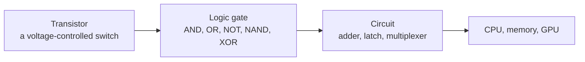

# Transistors and logic gates

After this you can explain how a computer turns electrical switches into logic, and read a truth table for the basic gates.

Before this: [bits, bytes and units](../01-bits-and-data/02-bits-bytes-and-units.md).

## The idea

Think of a light switch that you flip with electricity instead of a finger. A small voltage on one wire decides whether current can flow between two other wires. Chain two such switches in series and the lamp is on only when both are on. Put them side by side and the lamp is on when either is on. That is the whole trick: a computer is a very large number of these switches wired together.

The switch is the **transistor**. Everything above it in this book, from integers to Python, is built from transistors combined into gates, gates into adders and memory, and those into a CPU.



## Key terms

A **transistor** is a semiconductor device with three connections. A voltage on the control connection (the gate terminal) switches the path between the other two on or off.

A **bit** is stored as a voltage level: a high voltage reads as 1 and a low voltage reads as 0. The exact voltages depend on the chip, and a signal only has to be well above or well below the switching threshold.

A **logic gate** is a small circuit of transistors that takes one or two input bits and produces one output bit, according to a fixed rule.

A **truth table** lists the output of a gate for every combination of inputs.

A **CMOS** circuit is the design almost all chips use today. It pairs two kinds of transistor (n-type and p-type) so that, once an output has settled, almost no current flows. Power is mostly spent when outputs change.

## How it works

The simplest gate is NOT, which outputs 1 when its one input is 0 and 0 when it is 1. One transistor connects the output to ground when the input is high, and a resistor or a second transistor connects the output to the supply voltage otherwise. High in gives low out. Switches in series give an AND-style path, and switches in parallel give an OR-style path (see the diagram). The CMOS versions invert the result, which is why the natural gates are NAND and NOR, not AND and OR.

```text
series: AND                      parallel: OR
supply --[a]--[b]-- output       supply --+--[a]--+-- output
on only if a AND b                        +--[b]--+
                                 on if a OR b
```

| Gate | Output is 1 when | Inputs 00 | 01 | 10 | 11 |
|---|---|---|---|---|---|
| AND | both inputs are 1 | 0 | 0 | 0 | 1 |
| OR | at least one input is 1 | 0 | 1 | 1 | 1 |
| NAND | not both inputs are 1 | 1 | 1 | 1 | 0 |
| NOR | both inputs are 0 | 1 | 0 | 0 | 0 |
| XOR | the inputs differ | 0 | 1 | 1 | 0 |

NAND is **universal**: every other gate can be built from NAND gates alone. NOT is a NAND with both inputs tied together. AND is a NAND followed by a NOT. OR is a NAND of two NOTs. XOR takes a few more. Chip designers use this idea, but they pick whatever is cheapest for the design, so the claim is about what is possible, not about how real chips are drawn.

Two properties matter for later lessons. A gate is not instant: each takes a few picoseconds to settle (its **propagation delay**), and a path through many gates sets how fast the clock can run. And each gate dissipates a little heat every time it switches, so a chip that switches billions of gates billions of times per second needs a fan.

## Worked examples

<div class="example" markdown>

### Example 1: building gates from NAND

We want to build NOT, AND, OR and XOR using only a NAND function, then check them against Python's own operators.

1. Define NAND: the output is 0 only when both inputs are 1.
2. NOT of `a` is `nand(a, a)`: if `a` is 1 the output is 0, and if `a` is 0 the output is 1.
3. AND is NOT of NAND, and OR is NAND of the two NOTs.
4. XOR is "OR, but not both": AND the OR with the NAND.

<details class="code" markdown>
<summary>In code</summary>

```python
def nand(a, b):
    return 0 if (a and b) else 1

def not_(a):
    return nand(a, a)

def and_(a, b):
    return not_(nand(a, b))

def or_(a, b):
    return nand(not_(a), not_(b))

def xor(a, b):
    return and_(or_(a, b), nand(a, b))

print("a b | nand and or xor")
for a in (0, 1):
    for b in (0, 1):
        print(a, b, "|", nand(a, b), "   ", and_(a, b), "  ", or_(a, b), " ", xor(a, b))
```

```text
a b | nand and or xor
0 0 | 1     0    0   0
0 1 | 1     0    1   1
1 0 | 1     0    1   1
1 1 | 0     1    1   0
```

</details>

Check: each column matches the table above. The `and`, `or` and `xor` columns use only the `nand` function underneath, so the table above is a consequence of NAND alone.

</div>

## Common mistakes

<div class="warning" markdown>

Watch out: thinking a bit is a number inside the chip. A bit is a voltage that circuits read as high or low. Memory and wires hold the voltages; the meaning of 1 and 0 as numbers, letters or colours comes from the layers above.

Watch out: reading a gate as software. A gate has no steps. All its outputs follow its inputs continuously, and every gate in a circuit works at the same time. Code runs one step after another; hardware does not.

</div>

## Working with AI

<div class="ai" markdown>

Words to use: transistor, logic gate, truth table, NAND, CMOS, propagation delay.

Prompts to try:

- "Explain how a CMOS NAND gate is built from four transistors, and say which pair is in series and which in parallel."
- "Write a Python function for XOR that uses only NAND, and give a truth table so I can check it."

What to check:

- Gate counts and circuit diagrams. Ask for the truth table of the circuit and verify each row by hand or in code.
- Mix-ups between NAND and NOR, or between XOR and OR. The last row (1, 1) is where they differ.
- Claims about transistor counts or sizes that have no source and a year.

</div>

## Quiz

1\. What does a transistor do in a logic circuit, and why are NAND and NOR the natural gates in CMOS?

<details class="solution" markdown>
<summary>Answer</summary>

It acts as a switch controlled by a voltage. In CMOS, one transistor pair naturally gives an inverted output (high in, low out), so a series or parallel arrangement gives NAND or NOR directly, while AND and OR need an extra inverter.

</details>

2\. Fill in the XOR column for inputs 00, 01, 10, 11.

<details class="solution" markdown>
<summary>Answer</summary>

0, 1, 1, 0. XOR is 1 exactly when the inputs differ.

</details>

3\. A colleague says you cannot build an AND gate without an AND transistor circuit. What is wrong with that?

<details class="solution" markdown>
<summary>Answer</summary>

NAND is universal. AND is a NAND followed by a NOT, and NOT is a NAND with its inputs tied together, so two NAND gates make an AND.

</details>

4\. Predict: with the functions from Example 1, what does `or_(0, 1)` return, and how many `nand` calls does it make?

<details class="solution" markdown>
<summary>Answer</summary>

It returns 1. It makes 3 NAND calls: one for each `not_` and one for the final `nand`.

</details>

## Lab

<div class="lab" markdown>

### Lab: gates and a NAND count

Goal: confirm that gates built from NAND match Python's bit operators, and count the NAND gates each needs. Time: about 10 minutes. Runs in: any terminal with Python 3.

1. Save the functions from Example 1 as `gates.py`.
2. Add a loop that asserts `and_(a, b) == (a & b)`, and the same for `or_` with `|`, `xor` with `^` and `not_` with `1 - a`, over every input.
3. Change `nand` to count its calls in a global `calls`, reset the counter before each gate, and print how many NAND calls NOT, AND, OR and XOR take.
4. Cleanup: nothing to remove.

Expected result: no assertion error, and the counts 1, 2, 3 and 6.

```text
all gates match
NOT 1, AND 2, OR 3, XOR 6
```

<details class="solution" markdown>
<summary>Solution</summary>

```python
calls = 0

def nand(a, b):
    global calls
    calls += 1
    return 0 if (a and b) else 1

def not_(a):
    return nand(a, a)

def and_(a, b):
    return not_(nand(a, b))

def or_(a, b):
    return nand(not_(a), not_(b))

def xor(a, b):
    return and_(or_(a, b), nand(a, b))

for a in (0, 1):
    for b in (0, 1):
        assert and_(a, b) == (a & b)
        assert or_(a, b) == (a | b)
        assert xor(a, b) == (a ^ b)
        assert not_(a) == 1 - a
print("all gates match")

def count(f, *args):
    global calls
    calls = 0
    f(*args)
    return calls

print(f"NOT {count(not_, 1)}, AND {count(and_, 1, 1)}, OR {count(or_, 1, 0)}, XOR {count(xor, 1, 0)}")
```

A hardware XOR can be built from 4 NAND gates by reusing one intermediate result. This version recomputes it, so it uses 6.

</details>

</div>

## Where this shows up

- [Boolean algebra and circuits](02-boolean-algebra-and-circuits.md) combines gates into adders and memory.
- The bitwise operators `&`, `|`, `^` and `~` in every language are these gates applied to each bit of two integers.
