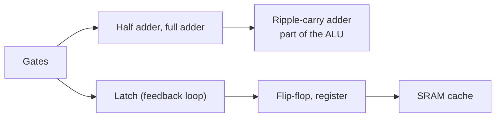
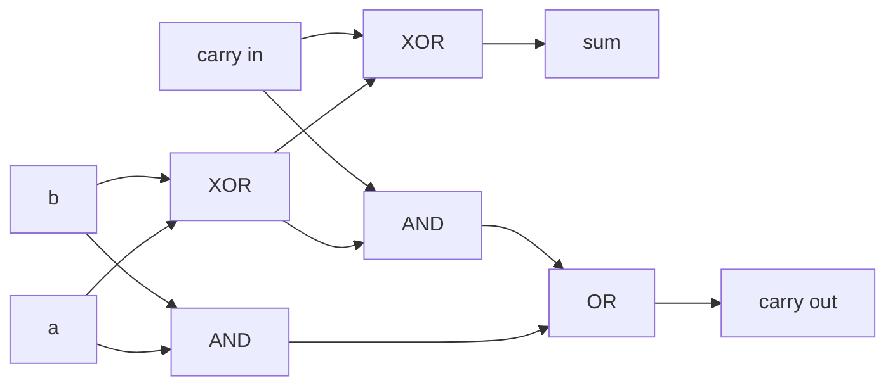

# Boolean algebra and circuits

After this you can describe how gates add two numbers and how a loop of gates remembers a bit, and say what flip-flops, registers and RAM cells are.

Before this: [transistors and logic gates](01-transistors-and-logic-gates.md), and [integers and two's complement](../01-bits-and-data/03-integers-and-twos-complement.md).

## The idea

Add 7 and 5 in binary on paper: `0111 + 0101`. You go right to left, add a column, write a digit and carry a 1 into the next column. A circuit does the same thing, with one small circuit per column and a wire carrying the 1 from each column to the next. That circuit is built from the gates in the last lesson.

The second half of the lesson is stranger. Gates alone only compute: the output depends on the current inputs and nothing else. Feed a gate's output back into its own input, though, and the circuit can hold a value. That loop is the smallest piece of memory.



## Key terms

**Boolean algebra** is the algebra of values that are only 0 or 1, with the operations AND, OR and NOT. It is the maths of gates: every circuit has an equivalent expression, and rewriting the expression gives an equivalent circuit.

A **half adder** adds two bits and outputs a sum bit and a carry bit. A **full adder** adds two bits plus a carry-in and outputs a sum and a carry-out. A **ripple-carry adder** chains full adders, with each carry-out feeding the next carry-in.

The **ALU** (arithmetic logic unit) is the part of the CPU that adds, subtracts, compares and applies bitwise operations. An adder is its core.

A **latch** is a circuit that holds one bit by feeding gate outputs back into inputs. A **flip-flop** is a latch that changes only on the edge of a clock signal. A **register** is a row of flip-flops, one per bit, that stores a whole word.

**SRAM** (static RAM) stores each bit in a latch of about six transistors. **DRAM** (dynamic RAM) stores each bit as charge on a tiny capacitor behind one transistor.

## How it works

Boolean algebra writes AND as multiplication, OR as addition (where $1 + 1 = 1$) and NOT with a bar. Two rules, De Morgan's laws, show up in real code whenever you simplify a condition:

$$\overline{a \cdot b} = \bar{a} + \bar{b} \qquad \overline{a + b} = \bar{a} \cdot \bar{b}$$

In words: "not (a and b)" is "(not a) or (not b)", and "not (a or b)" is "(not a) and (not b)".

Adding. A half adder's sum is `a XOR b` and its carry is `a AND b`. The full adder needs a third input, the carry-in $c_{in}$:

$$s = a \oplus b \oplus c_{in} \qquad c_{out} = ab + c_{in}(a \oplus b)$$



A ripple-carry adder for 8 bits chains 8 of these. Its weakness is timing: bit 7 cannot settle until the carry has rippled through bits 0 to 6. Real CPUs use faster designs (carry-lookahead adders) that compute carries in parallel. A carry out of the top bit means the sum did not fit, which is integer overflow.

Remembering. The simplest latch is two NOR gates, each taking the other's output as one input. With set $S = 1$ the output $Q$ becomes 1; with reset $R = 1$ it becomes 0; with both 0 the loop holds whatever it had. A flip-flop adds a clock so that all the bits in a register change at the same instant. Registers made of flip-flops are the fastest storage in a computer.

Memory is the same idea at scale. An SRAM cell is a latch plus access transistors; it is fast and needs no refreshing, but a cell takes about six transistors, so SRAM is used for CPU caches. A DRAM cell is one transistor and one capacitor, so it is much denser and cheaper per bit, which is why main memory is DRAM. The charge leaks away, so the memory controller must keep rewriting every row (refresh).

## Worked examples

<div class="example" markdown>

### Example 1: adding 200 and 100 with gates

We want to add two 8-bit numbers using only the one-bit logic of a full adder.

1. Split each number into bits, starting at bit 0 (the least significant bit).
2. For each position, give the full adder the two bits and the carry from the previous position (0 at the start). It returns a sum bit and a new carry.
3. Put the sum bits together as the result. The carry out of bit 7 is a ninth bit that does not fit in 8 bits.

<details class="code" markdown>
<summary>In code</summary>

```python
def full_adder(a, b, carry_in):
    s = a ^ b ^ carry_in
    carry_out = (a & b) | (carry_in & (a ^ b))
    return s, carry_out

def ripple_add(x, y, bits=8):
    carry = 0
    result = 0
    for i in range(bits):
        a = (x >> i) & 1
        b = (y >> i) & 1
        s, carry = full_adder(a, b, carry)
        result |= s << i
    return result, carry

print(ripple_add(200, 100))
```

```text
(44, 1)
```

</details>

The result is 44 with a carry out of 1. Check: 200 + 100 = 300, and $300 = 256 + 44$. The carry stands for the 256 that no longer fits in 8 bits, so an 8-bit register holds 44. This is wraparound, as in [integers and two's complement](../01-bits-and-data/03-integers-and-twos-complement.md).

</div>

<div class="example" markdown>

### Example 2: a latch holding a bit

Two NOR gates, each fed by the other's output, make an SR latch. Pulse set, then release, and the 1 stays. Pulse reset, then release, and the 0 stays.

<details class="code" markdown>
<summary>In code</summary>

```python
def nor(a, b):
    return 0 if (a or b) else 1

class SRLatch:
    def __init__(self):
        self.q, self.q_bar = 0, 1

    def step(self, s, r):
        # two cross-coupled NOR gates; repeat until the outputs stop changing
        for _ in range(4):
            self.q = nor(r, self.q_bar)
            self.q_bar = nor(s, self.q)
        return self.q

latch = SRLatch()
for s, r in [(1, 0), (0, 0), (0, 1), (0, 0)]:
    print(f"S={s} R={r} -> Q={latch.step(s, r)}")
```

```text
S=1 R=0 -> Q=1
S=0 R=0 -> Q=1
S=0 R=1 -> Q=0
S=0 R=0 -> Q=0
```

</details>

The second and fourth lines have the same inputs (both 0) and different outputs. That is memory: the output depends on history as well as the present inputs.

</div>

## Common mistakes

<div class="warning" markdown>

Watch out: saying "the CPU adds one bit at a time". A ripple-carry adder is one circuit, and all its full adders work simultaneously. What is slow is waiting for the carry to settle, not stepping through bits.

Watch out: mixing up RAM types. CPU caches are SRAM (fast, small). Main memory is DRAM (dense, refreshed). Neither keeps data without power.

</div>

## Working with AI

<div class="ai" markdown>

Words to use: full adder, carry, ALU, latch, flip-flop, register, SRAM, DRAM.

Prompts to try:

- "Show the truth table for a full adder and the Boolean expressions for sum and carry-out. Then check them against Python's `+` for all 8 input rows."
- "Explain the difference between a latch and an edge-triggered D flip-flop, and say why CPUs use flip-flops."

What to check:

- Truth tables. Recompute the carry column; a common error is a carry-out that ignores the carry-in.
- Circuit descriptions that call a latch "a gate with memory". The memory comes from the feedback loop, not from any single gate.
- Statements about cache or RAM size and speed without a year and source. Compare with the [memory hierarchy lesson](04-memory-hierarchy-and-latency-numbers.md).

</div>

## Quiz

1\. Why can a loop of gates store a value when a single gate cannot?

<details class="solution" markdown>
<summary>Answer</summary>

A single gate's output depends only on its current inputs. In a loop, the output feeds back as an input, so the circuit can settle into one of two stable states and stay there after the set and reset inputs return to 0.

</details>

2\. Add `0111` and `0101` with a ripple-carry adder. List the sum and carry at each bit, starting at bit 0.

<details class="solution" markdown>
<summary>Answer</summary>

Bit 0: 1 + 1 = sum 0, carry 1. Bit 1: 1 + 0 + 1 = sum 0, carry 1. Bit 2: 1 + 1 + 1 = sum 1, carry 1. Bit 3: 0 + 0 + 1 = sum 1, carry 0. The result is `1100`, which is 12 (7 + 5).

</details>

3\. A design review says "use SRAM for the 32 GB main memory, it is faster". What do you say?

<details class="solution" markdown>
<summary>Answer</summary>

SRAM needs about six transistors per bit, so 32 GB would cost far more and take much more chip area than DRAM. Systems use a small amount of SRAM as cache and a large amount of DRAM as main memory.

</details>

4\. Use De Morgan's law to rewrite `not (logged_in and has_permission)` in terms of OR.

<details class="solution" markdown>
<summary>Answer</summary>

`(not logged_in) or (not has_permission)`.

</details>

## Lab

<div class="lab" markdown>

### Lab: test an adder against every input

Goal: check the ripple-carry adder against Python's `+` for all 8-bit inputs, then see the delay problem. Time: about 15 minutes. Runs in: any terminal with Python 3.

1. Save the `full_adder` and `ripple_add` functions from Example 1 as `adder.py`.
2. Loop over every `x` and `y` from 0 to 255. Assert that `total + (carry << 8) == x + y`.
3. Print the result of `ripple_add(255, 1)` and say which bit the carry travelled through.
4. Cleanup: nothing to remove.

Expected result: no assertion error, and `(0, 1)` for the last call, because the carry ripples through all eight bits.

```text
all 65536 pairs match
(0, 1)
```

<details class="solution" markdown>
<summary>Solution</summary>

```python
for x in range(256):
    for y in range(256):
        total, carry = ripple_add(x, y)
        assert total + (carry << 8) == x + y
print("all 65536 pairs match")
print(ripple_add(255, 1))
```

255 + 1 sets bit 0 and generates a carry at every position, so the carry-out of bit 7 is the last signal to settle. This is the worst case for a ripple-carry adder and the reason faster adders exist.

</details>

</div>

## Where this shows up

- [The CPU](03-the-cpu.md) uses the ALU and registers described here.
- Integer overflow and two's complement wraparound in [integers and two's complement](../01-bits-and-data/03-integers-and-twos-complement.md) is the adder's carry-out being dropped.
