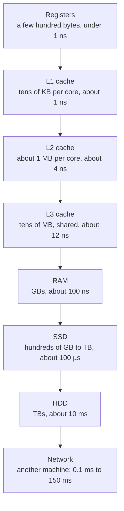

# Memory hierarchy and latency numbers

After this you can estimate how long a program spends waiting on memory, disk or the network, and say why one layout of data is faster than another.

Before this: The CPU<!-- link: 03-the-cpu.md --> and bits, bytes and units<!-- link: ../01-bits-and-data/02-bits-bytes-and-units.md -->.

## The idea

Suppose an endpoint loads 10,000 rows and the page takes eight seconds. The loop that handles each row is short, so the CPU is not the problem. The time goes to waiting: for data to come back from a database, from a disk, or from a service on another machine.

A CPU can finish an instruction in well under a nanosecond, but it can only work on data it already holds. Data that sits farther away takes longer to fetch, and the difference between the nearest and farthest place is nearly nine orders of magnitude. Computers hide this gap by keeping several layers of storage. Each layer is smaller, faster and more expensive per byte than the one below it, and each one holds copies of the data most likely to be needed soon.



The sizes are typical for a current laptop or desktop. Moving down the diagram, capacity grows and speed drops.

## Key terms

A **register** is a storage slot inside the CPU that instructions read and write directly.

A **cache** is a small, fast memory that holds copies of data from a slower memory. **L1**, **L2** and **L3** are the cache levels, numbered from the closest and smallest to the farthest and largest. A **cache hit** means the data was in the cache; a **cache miss** means it was not, and the CPU has to fetch it from the next level down.

**Latency** is the time from asking for data to receiving the first piece of it. **Bandwidth** (also called throughput) is how much data per second can flow once it has started. A **round trip** is a request plus its response, so its time is the latency in both directions.

A **cache line** is the fixed-size block, 64 bytes on most x86 chips, that moves between memory and cache. The CPU never fetches a single byte; it fetches the whole line around it.

**Locality** is the tendency of programs to reuse data they just used (**temporal locality**) and to use data near data they just used (**spatial locality**). Caches only work because real programs have both.

## The latency numbers

The list known as "latency numbers every programmer should know" goes back to a table of timings on [Peter Norvig's page](https://norvig.com/21-days.html), which Jeff Dean later popularised in talks. Its figures date from the early 2000s. Colin Scott's [interactive version](https://colin-scott.github.io/personal_website/research/interactive_latency.html) extrapolates them by year. A more recent source is Simon Eskildsen's [napkin-math](https://github.com/sirupsen/napkin-math), measured on cloud virtual machines. L3 latency is not in those lists; the figure below comes from [Chips and Cheese's cache tests](https://chipsandcheese.com/p/previewing-meteor-lake-at-ces).

Treat every value as an order of magnitude, not a measurement of your machine. A different CPU, SSD model or cloud region can move a number by two or three times. What matters is the ratio between rows.

The last column is the human-scale version: it multiplies every time by one billion, so 1 ns becomes 1 second.

| Operation | Approximate time (as of 2026) | If 1 ns were 1 second |
|---|---|---|
| One CPU cycle, register access | 0.3 ns | 0.3 seconds |
| L1 cache hit | 1 ns | 1 second |
| L2 cache hit | 4 ns | 4 seconds |
| L3 cache hit | 12 ns | 12 seconds |
| RAM random read | 100 ns | 1.7 minutes |
| SSD random read | 100 µs | 1.2 days |
| Round trip inside one data centre | 500 µs | 5.8 days |
| HDD seek and read | 10 ms | 116 days |
| Round trip within one continent | 40 ms | 1.3 years |
| Round trip across the Atlantic | 90 ms | 2.9 years |

The data-centre row uses Dean's 500 µs; napkin-math lists 100 µs for the same availability zone. Either way it is close to the SSD row: asking a nearby server for something costs about as much as reading from a disk.

Bandwidth tells a different story. Reading sequentially, one thread can pull about 20 GiB/s from RAM, about 4 GiB/s from a fast SSD and about 200 MiB/s from an HDD (napkin-math). A home gigabit link carries about 125 MB/s.

Latency and bandwidth combine in one rule: the time to move data is roughly the latency plus the size divided by the bandwidth. A single 8 KiB read from an SSD is dominated by latency (100 µs against about 2 µs of transfer). Reading 1 GiB is dominated by bandwidth (about 250 ms against 100 µs). So many small requests cost far more than one large request of the same total size.

## How it works

When the CPU needs a value, it checks L1. On a miss it checks L2, then L3, then RAM, and the data it finds is copied into each cache on the way back. Since a miss loads a whole 64-byte line, the next few neighbouring values arrive for free.

That is why access pattern matters. Spatial locality means walking through memory in order: one miss pays for the next 7 integers of 8 bytes each. The CPU also notices sequential patterns and fetches ahead before the program asks. Temporal locality means keeping a small working set that fits in cache, so the same lines are hit again and again.

The same idea repeats at every layer:

- An array stores its elements side by side, so a loop over it moves through cache lines in order. A linked list stores each element in a separate node, reached by following a pointer, so each step can be a miss and the CPU cannot fetch ahead because it does not know the next address until it has loaded the current node. Both take time proportional to $n$ in Big O terms, but the array's constant is much smaller. See arrays and dynamic arrays<!-- link: ../../05-data-structures-and-algorithms/02-data-structures/01-arrays-and-dynamic-arrays.md --> and linked lists<!-- link: ../../05-data-structures-and-algorithms/02-data-structures/02-linked-lists.md -->.
- A database index is a small, sorted structure that finds a row in a few reads instead of scanning the table. Scanning a large table from disk reads many pages; an index lookup reads a handful. See indexes<!-- link: ../../10-databases-sql-and-postgres/04-postgres-in-depth/01-indexes.md -->.
- An in-memory cache such as Redis keeps frequently used results in RAM, so the application skips a slow query. It still sits across the network, so each lookup costs a round trip of roughly 100 µs to 1 ms, not 100 ns. See Redis and caching<!-- link: ../../10-databases-sql-and-postgres/05-databases-in-apps/04-redis-and-caching.md -->.

## Worked examples

<div class="example" markdown>

### Example 1: a million reads from three places

We want to estimate the time for 1 million independent random reads from RAM, from an SSD, and from a service in the same data centre, with each read waiting for the previous one.

1. Pick a latency for each: 100 ns for RAM, 100 µs for an SSD random read, 500 µs for a round trip in the data centre (the table above).
2. Multiply each latency by $10^6$ reads. Work in nanoseconds: RAM is $10^6 \times 100 = 10^8$ ns, which is 0.1 s.
3. The SSD is $10^6 \times 10^5$ ns $= 10^{11}$ ns, which is 100 s.
4. The network is $10^6 \times 5 \times 10^5$ ns $= 5 \times 10^{11}$ ns, which is 500 s, about 8 minutes.

Check by running the arithmetic:

<details class="code" markdown>
<summary>In code</summary>

```python
reads = 1_000_000
latency_ns = {
    "RAM random read": 100,
    "SSD random read": 100_000,
    "Network round trip in a data centre": 500_000,
}
for name, ns in latency_ns.items():
    seconds = reads * ns / 1e9
    print(f"{name:36} {seconds:>7,.1f} s")
```

```text
RAM random read                          0.1 s
SSD random read                        100.0 s
Network round trip in a data centre    500.0 s
```

</details>

The ratios are 1 : 1,000 : 5,000. The estimate assumes the reads happen one at a time. An SSD can serve many requests at once, and a program can send many network requests at once, so a well-written batch job would finish much sooner. The sequential figure is what a naive loop pays, which is the point of the example.

</div>

<div class="example" markdown>

### Example 2: the endpoint that makes one call per row

The page that took eight seconds loads 10,000 orders, then calls a pricing service once per order, and the service is in the same data centre. At 500 µs per call the waiting alone is $10{,}000 \times 0.0005 = 5$ s, before the service does any work. If the service had a batch endpoint that returns 10,000 prices in one request, the cost would be one round trip plus transfer time, a few milliseconds. The fix is to batch, or to cache prices that rarely change. Check: the 10,000 calls at 500 µs each is 5 s, which matches most of the eight seconds the page took. The same shape appears in code that runs one database query per item, known as the N+1 query problem<!-- link: ../../10-databases-sql-and-postgres/05-databases-in-apps/02-orms-and-migrations.md -->.

</div>

## Common mistakes

<div class="warning" markdown>

Watch out: treating the table as exact. These are orders of magnitude from different machines and different years. Use them to decide whether a design is plausible, then measure your own system. A claim like "this will take 3.2 ms" cannot come from this table; "this is in the milliseconds, not the nanoseconds" can.

Watch out: assuming a cache always helps. A cache only helps when the same data is reused. A loop that reads each item once, with no pattern the CPU can predict, misses on nearly every access. The same holds one level up: a Redis cache with a low hit rate adds a network round trip to every request and saves little.

</div>

## Working with AI

<div class="ai" markdown>

Words to use: latency, bandwidth, cache miss, locality, round trip, N+1 queries. They make a prompt precise.

Prompts to try:

- "This Django endpoint takes 6 seconds for 2,000 rows. It runs one SQL query per row and one HTTP call to an internal service per row. Using about 0.5 ms per same-data-centre round trip, estimate how much of the 6 seconds is waiting on round trips, and show your arithmetic."
- "Here is a profile of my Python loop. Is the time dominated by CPU work or by memory access? List what extra measurement I would need to tell the two apart."
- "You said a Redis cache will make this 100 times faster. The database query takes 20 ms and Redis lookups take 0.5 ms. What hit rate do I need for that claim to hold?"

What to check:

- Numbers without a unit or a source. Ask the AI where each figure comes from, then compare it with the table above. A claim that a network call takes "microseconds" or a RAM read takes "milliseconds" is off by a factor of 1,000.
- Arithmetic that mixes ns, µs and ms. Redo the multiplication yourself, as in Example 1.
- A speed-up claim larger than the ratio of the two latencies involved. If a lookup drops from 20 ms to 0.5 ms, no hit rate gives more than a 40 times speed-up.
- Advice to add a cache or an index with no measurement. Time the real code first, since the slow part is often elsewhere.
- Claims that one data structure is faster "because of cache" when Big O is the real difference. Both effects exist; ask which one applies at your input size.
- Plausible but untested code. Run it, and time it with `time.perf_counter()` or a profiler, not by reading it.

</div>

## Quiz

1\. What is the difference between latency and bandwidth? Which one dominates the time to send 200 bytes to a server, and which one dominates the time to download 5 GB?

<details class="solution" markdown>
<summary>Answer</summary>

Latency is the delay before the first byte arrives; bandwidth is how many bytes per second flow afterwards. For 200 bytes the transfer time is tiny, so latency dominates. For 5 GB the transfer takes seconds, so bandwidth dominates.

</details>

2\. Using the table, about how many times slower is one SSD random read than one RAM random read? What is it on the human scale, with 100 ns as 100 seconds?

<details class="solution" markdown>
<summary>Answer</summary>

About 1,000 times slower: 100 µs divided by 100 ns is 1,000. On the human scale, 100 seconds becomes 100,000 seconds, which is about 1.2 days.

</details>

3\. A service makes 3,000 sequential HTTP calls to another service in the same data centre, each with a 500 µs round trip, and the page takes about 2 seconds. A teammate says to rewrite the loop in a faster language. What do you say?

<details class="solution" markdown>
<summary>Answer</summary>

The waiting is $3000 \times 0.0005 = 1.5$ s, which is most of the 2 seconds, so a faster language leaves it almost unchanged. Reduce the number of round trips: batch the requests, send them concurrently, or cache the results.

</details>

4\. Why might summing a list of integers in shuffled order be slower than summing it in order, even though both do the same number of additions?

<details class="solution" markdown>
<summary>Answer</summary>

The additions are the same, but the memory access pattern is not (spatial locality). In order, each cache line serves several consecutive elements and the CPU can fetch ahead. In shuffled order, most accesses land on a line that is not in cache, so most of them wait on RAM.

</details>

## Lab

<div class="lab" markdown>

### Lab: in order versus shuffled

Goal: measure the cost of random memory access with a Python script, and read the result honestly. Time: about 15 minutes. Runs in: any terminal with Python 3.

1. Save the script below as `locality.py`. It builds 5 million integers, then sums them by index in order and in shuffled order, once with a list and once with an `array`.
2. Run `python locality.py` (or `python3` on Linux and macOS). Each case takes a few seconds.
3. Write down the four times and the two ratios. Your numbers will differ from the expected result below.
4. Change `N` to `20_000` and run again. Predict first: will the ratio grow or shrink? The times will be about a millisecond, so expect some noise.
5. Cleanup: nothing to remove. Delete `locality.py` if you do not need it.

```python
import random
import time
from array import array

N = 5_000_000

def total_by_index(data, order):
    total = 0
    for i in order:
        total += data[i]
    return total

def best_of(f, *args, repeats=3):
    best = float("inf")
    for _ in range(repeats):
        start = time.perf_counter()
        f(*args)
        best = min(best, time.perf_counter() - start)
    return best

indexes = list(range(N))
random.seed(1)
shuffled = indexes[:]
random.shuffle(shuffled)

# The index sequences are arrays, so reading them is sequential in both runs.
in_order = array("q", indexes)
shuffled = array("q", shuffled)

for name, data in [("list", list(range(N))), ("array", array("q", range(N)))]:
    t_seq = best_of(total_by_index, data, in_order)
    t_rnd = best_of(total_by_index, data, shuffled)
    print(f"{name:5} in order: {t_seq:.3f} s   shuffled: {t_rnd:.3f} s   ratio: {t_rnd / t_seq:.1f}x")
```

Expected result: the shuffled runs are slower, by a smaller factor than the 100 to 1 gap between an L1 hit and a RAM read in the table. The output below is from the author's Windows 11 PC (AMD Ryzen 5 5600G, 16 MB L3 cache, Python 3.14).

```text
list  in order: 0.194 s   shuffled: 1.294 s   ratio: 6.7x
array in order: 0.250 s   shuffled: 0.611 s   ratio: 2.4x
```

<details class="solution" markdown>
<summary>Solution</summary>

Why the gap is only 2 to 7 times, not 100 times: Python runs many bytecode instructions for each loop step, about 50 ns in order, and that interpreter work is the same in both runs. The shuffled run adds the memory wait on top. In the `array` case the extra is about $(0.611 - 0.250)/5{,}000{,}000 \approx 72$ ns per element, close to one RAM latency of roughly 100 ns (the CPU overlaps some of the wait with other work). In compiled code the in-order loop costs far less per element, so the same RAM wait would give a much larger ratio.

Why the list is hit harder: a Python `list` stores pointers to integer objects, not the integers. A shuffled read follows a pointer to a random place in the list, then another to a random integer object, so it has two likely misses per element. An `array("q")` stores the 8-byte integers themselves, so it has one.

Why `N = 20_000` brings the ratio close to 1: 20,000 integers fit in L1 and L2 cache, so shuffled access hits cache almost every time. The pattern only matters once the data is larger than the cache. 5 million 8-byte values are 40 MB, more than the 16 MB L3 on this CPU, and the list's integer objects add roughly 140 MB more.

The index sequences are `array` objects in both runs on purpose. With a shuffled Python list as the index, reading the indexes would itself cause random access and the test would mix two effects.

</details>

</div>

## Where this shows up

- Choosing between an array and a linked list, in arrays and dynamic arrays<!-- link: ../../05-data-structures-and-algorithms/02-data-structures/01-arrays-and-dynamic-arrays.md -->, and Big O's hidden constants in Big O and runtime<!-- link: ../../05-data-structures-and-algorithms/01-analysis/01-big-o-and-runtime.md -->.
- Database indexes, Redis and caching strategies<!-- link: ../../14-software-and-system-design/02-system-design/03-caching-strategies.md -->, all of which are ways of avoiding a slower layer.
- Storage, I/O and buses<!-- link: 05-storage-io-and-buses.md --> continues with how data gets from a disk or a network card into memory.
