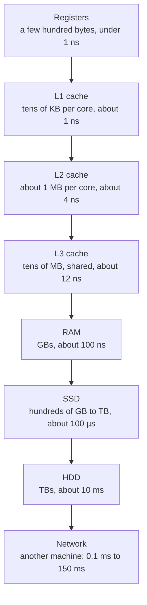
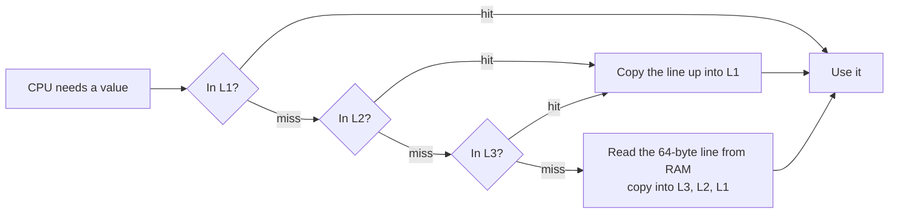

# Memory hierarchy and latency numbers

After this you can estimate how long a program spends waiting on memory, disk or the network, and say why one layout of data is faster than another.

Before this: The CPU<!-- link: 03-the-cpu.md --> and bits, bytes and units<!-- link: ../01-bits-and-data/02-bits-bytes-and-units.md -->.

## The idea

Suppose an endpoint loads 10,000 rows and the page takes eight seconds. The loop that handles each row is short, so the CPU is not the problem. The time goes to waiting: for data to come back from a database, a disk, or a service on another machine.

A CPU finishes an instruction in well under a nanosecond, but it can only work on data it already holds. The gap between the nearest and farthest data is nearly nine orders of magnitude, and computers hide it with layers of storage. Each layer is smaller, faster and more expensive per byte than the one below it, and holds copies of the data most likely to be needed soon.




## Key terms

A **register** is a storage slot inside the CPU that instructions read and write directly.

A **cache** is a small, fast memory that holds copies of data from a slower memory. **L1**, **L2** and **L3** are its levels, from closest and smallest to farthest and largest. A **cache hit** means the data was in the cache; a **cache miss** means it was not, and the CPU fetches it from the next level down.

**Latency** is the time from asking for data to receiving the first piece of it. **Bandwidth** is how much data per second can flow once it has started. A **round trip** is a request plus its response.

A **cache line** is the fixed-size block, 64 bytes on most x86 chips, that moves between memory and cache. The CPU never fetches a single byte; it fetches the whole line around it.

**Locality** is the tendency of programs to reuse data they just used (**temporal locality**) and to use data near it (**spatial locality**). Caches work because real programs have both.

## The latency numbers

The table follows "latency numbers every programmer should know" ([Norvig](https://norvig.com/21-days.html), popularised by Jeff Dean), updated with Simon Eskildsen's cloud measurements in [napkin-math](https://github.com/sirupsen/napkin-math) and [Chips and Cheese's cache tests](https://chipsandcheese.com/p/previewing-meteor-lake-at-ces) for L3. Treat every value as an order of magnitude; a different CPU, SSD or cloud region can move a number by two or three times. What matters is the ratio between rows. The last column multiplies every time by one billion, so 1 ns becomes 1 second.

| Operation | Approximate time (as of 2026) | If 1 ns were 1 second |
|---|---|---|
| One CPU cycle, register access | 0.3 ns | 0.3 seconds |
| L1 cache hit | 1 ns | 1 second |
| L2 cache hit | 4 ns | 4 seconds |
| L3 cache hit | 12 ns | 12 seconds |
| RAM random read | 100 ns | 1.7 minutes |
| SSD random read | 100 µs | 1.2 days |
| Round trip inside one data centre | 500 µs | 5.8 days |
| HDD seek and read | 10 ms | 116 days |
| Round trip within one continent | 40 ms | 1.3 years |
| Round trip across the Atlantic | 90 ms | 2.9 years |

A round trip inside a data centre costs about as much as an SSD read (Dean lists 500 µs, napkin-math 100 µs). Asking a nearby server for something is like reading from a disk.

Sequential reads follow a different rule: one thread can pull about 20 GiB/s from RAM and about 4 GiB/s from a fast SSD (napkin-math). The time to move data is roughly the latency plus the size divided by the bandwidth. An 8 KiB SSD read is dominated by latency (100 µs against about 2 µs of transfer); reading 1 GiB is dominated by bandwidth (about 250 ms against 100 µs). So many small requests cost far more than one large request of the same total size.

## How it works

When the CPU needs a value, it checks each level in turn, as in the diagram, and the line found is copied into the caches above it. Because a miss loads a whole 64-byte line, the next 7 integers of 8 bytes each arrive for free, and the CPU fetches ahead when it sees a sequential pattern.



The same idea repeats at every layer:

- An array stores its elements side by side, so a loop moves through cache lines in order. A linked list reaches each element through a pointer, so each step can be a miss, and the CPU cannot fetch ahead. Both take time proportional to $n$, but the array's constant is much smaller. See arrays and dynamic arrays<!-- link: ../../05-data-structures-and-algorithms/02-data-structures/01-arrays-and-dynamic-arrays.md --> and linked lists<!-- link: ../../05-data-structures-and-algorithms/02-data-structures/02-linked-lists.md -->.
- A cache such as Redis keeps results in RAM, but across the network, so each lookup costs a round trip of roughly 100 µs to 1 ms, not 100 ns. See Redis and caching<!-- link: ../../10-databases-sql-and-postgres/05-databases-in-apps/04-redis-and-caching.md -->.

## Worked examples

<div class="example" markdown>

### Example 1: a million reads from three places

We want to estimate the time for 1 million independent random reads from RAM, from an SSD, and from a service in the same data centre, with each read waiting for the previous one.

1. Pick a latency for each from the table: 100 ns for RAM, 100 µs for an SSD, 500 µs for a data-centre round trip.
2. Multiply each by $10^6$ reads. RAM is $10^6 \times 100 = 10^8$ ns, which is 0.1 s.
3. The SSD is $10^6 \times 10^5$ ns $= 10^{11}$ ns, which is 100 s.
4. The network is $10^6 \times 5 \times 10^5$ ns $= 5 \times 10^{11}$ ns, which is 500 s, about 8 minutes.

Check by running the arithmetic:

<details class="code" markdown>
<summary>In code</summary>

```python
reads = 1_000_000
latency_ns = {
    "RAM random read": 100,
    "SSD random read": 100_000,
    "Network round trip in a data centre": 500_000,
}
for name, ns in latency_ns.items():
    seconds = reads * ns / 1e9
    print(f"{name:36} {seconds:>7,.1f} s")
```

```text
RAM random read                          0.1 s
SSD random read                        100.0 s
Network round trip in a data centre    500.0 s
```

</details>

The ratios are 1 : 1,000 : 5,000. The estimate assumes one read at a time, which is what a naive loop pays; sending many requests at once would finish much sooner. The slow page from the start fits this shape: 10,000 calls to a pricing service at 500 µs each is 5 s of the eight. In database code the same pattern is the N+1 query problem<!-- link: ../../10-databases-sql-and-postgres/05-databases-in-apps/02-orms-and-migrations.md -->.

</div>

## Common mistakes

<div class="warning" markdown>

Watch out: treating the table as exact. Use it to decide whether a design is plausible, then measure your own system. "This is in the milliseconds, not the nanoseconds" can come from the table; "this will take 3.2 ms" cannot.

Watch out: assuming a cache always helps. A Redis cache with a low hit rate adds a network round trip to every request and saves little.

</div>

## Working with AI

<div class="ai" markdown>

Words to use: latency, bandwidth, cache miss, locality, round trip, N+1 queries.

Prompts to try:

- "This Django endpoint takes 6 seconds for 2,000 rows. It runs one SQL query and one internal HTTP call per row. Using about 0.5 ms per same-data-centre round trip, estimate how much of the 6 seconds is waiting, and show your arithmetic."
- "You said a Redis cache will make this 100 times faster. The database query takes 20 ms and Redis lookups take 0.5 ms. What hit rate do I need for that claim to hold?"

What to check:

- Numbers without a unit or a source, and arithmetic that mixes ns, µs and ms. Compare each figure with the table and redo the multiplication, as in Example 1.
- A speed-up larger than the ratio of the two latencies involved. If a lookup drops from 20 ms to 0.5 ms, no hit rate gives more than a 40 times speed-up.
- Advice to add a cache or an index with no measurement. Time the real code first, with `time.perf_counter()` or a profiler.

</div>

## Quiz

1\. What is the difference between latency and bandwidth? Which one dominates the time to send 200 bytes to a server, and which one dominates the time to download 5 GB?

<details class="solution" markdown>
<summary>Answer</summary>

Latency is the delay before the first byte arrives; bandwidth is how many bytes per second flow afterwards. For 200 bytes the transfer time is tiny, so latency dominates. For 5 GB the transfer takes seconds, so bandwidth dominates.

</details>

2\. Using the table, about how many times slower is one SSD random read than one RAM random read? What is it on the human scale, with 100 ns as 100 seconds?

<details class="solution" markdown>
<summary>Answer</summary>

About 1,000 times slower: 100 µs divided by 100 ns is 1,000. On the human scale, 100 seconds becomes 100,000 seconds, which is about 1.2 days.

</details>

3\. A service makes 3,000 sequential HTTP calls to another service in the same data centre, each with a 500 µs round trip, and the page takes about 2 seconds. A teammate says to rewrite the loop in a faster language. What do you say?

<details class="solution" markdown>
<summary>Answer</summary>

The waiting is $3000 \times 0.0005 = 1.5$ s, which is most of the 2 seconds, so a faster language leaves it almost unchanged. Reduce the number of round trips: batch the requests, send them concurrently, or cache the results.

</details>

4\. Why might summing a list of integers in shuffled order be slower than summing it in order, even though both do the same number of additions?

<details class="solution" markdown>
<summary>Answer</summary>

The additions are the same, but the memory access pattern is not (spatial locality). In order, each cache line serves several consecutive elements and the CPU can fetch ahead. In shuffled order, most accesses land on a line that is not in cache, so most of them wait on RAM.

</details>

## Lab

<div class="lab" markdown>

### Lab: in order versus shuffled

Goal: measure the cost of random memory access with a Python script, and read the result honestly. Time: about 15 minutes. Runs in: any terminal with Python 3.

1. Save the script below as `locality.py`. It builds 5 million integers, then sums them by index in order and in shuffled order, once with a list and once with an `array`.
2. Run `python locality.py` (or `python3` on Linux and macOS). Each case takes a few seconds. Write down the four times and the two ratios; yours will differ from the expected result below.
3. Change `N` to `20_000` and run again. Predict first: will the ratio grow or shrink? The times will be about a millisecond, so expect some noise.
4. Cleanup: delete `locality.py` if you do not need it.

```python
import random
import time
from array import array

N = 5_000_000

def total_by_index(data, order):
    total = 0
    for i in order:
        total += data[i]
    return total

def best_of(f, *args, repeats=3):
    best = float("inf")
    for _ in range(repeats):
        start = time.perf_counter()
        f(*args)
        best = min(best, time.perf_counter() - start)
    return best

indexes = list(range(N))
random.seed(1)
shuffled = indexes[:]
random.shuffle(shuffled)

# The index sequences are arrays, so reading them is sequential in both runs.
in_order = array("q", indexes)
shuffled = array("q", shuffled)

for name, data in [("list", list(range(N))), ("array", array("q", range(N)))]:
    t_seq = best_of(total_by_index, data, in_order)
    t_rnd = best_of(total_by_index, data, shuffled)
    print(f"{name:5} in order: {t_seq:.3f} s   shuffled: {t_rnd:.3f} s   ratio: {t_rnd / t_seq:.1f}x")
```

Expected result: the shuffled runs are slower, by a smaller factor than the 100 to 1 gap between an L1 hit and a RAM read in the table. The output below is from the author's Windows 11 PC (AMD Ryzen 5 5600G, 16 MB L3 cache, Python 3.14).

```text
list  in order: 0.194 s   shuffled: 1.294 s   ratio: 6.7x
array in order: 0.250 s   shuffled: 0.611 s   ratio: 2.4x
```

<details class="solution" markdown>
<summary>Solution</summary>

Why the gap is only 2 to 7 times, not 100 times: Python runs many bytecode instructions per loop step, about 50 ns in order, and that interpreter work is the same in both runs. The shuffled run adds the memory wait on top. For the `array` the extra is about $(0.611 - 0.250)/5{,}000{,}000 \approx 72$ ns per element, close to one RAM latency (the CPU overlaps some of the wait with other work).

Why the list is hit harder: a Python `list` stores pointers to integer objects, not the integers. A shuffled read follows a pointer to a random place in the list, then another to a random integer object, so it has two likely misses per element. An `array("q")` stores the 8-byte integers themselves, so it has one.

Why `N = 20_000` brings the ratio close to 1: 20,000 integers fit in L1 and L2 cache, so shuffled access hits cache almost every time. At `N = 5_000_000` the `array` is 40 MB, more than the 16 MB L3 on this CPU, and the list's integer objects add roughly 140 MB more. The index sequences are `array` objects in both runs on purpose, so reading them is sequential and the test measures only the data access.

</details>

</div>

## Where this shows up

- Choosing between an array and a linked list, in arrays and dynamic arrays<!-- link: ../../05-data-structures-and-algorithms/02-data-structures/01-arrays-and-dynamic-arrays.md -->, and Big O's hidden constants in Big O and runtime<!-- link: ../../05-data-structures-and-algorithms/01-analysis/01-big-o-and-runtime.md -->.
- Database indexes, Redis and caching strategies<!-- link: ../../14-software-and-system-design/02-system-design/03-caching-strategies.md -->, all of which are ways of avoiding a slower layer.
- Storage, I/O and buses<!-- link: 05-storage-io-and-buses.md --> continues with how data gets from a disk or a network card into memory.
