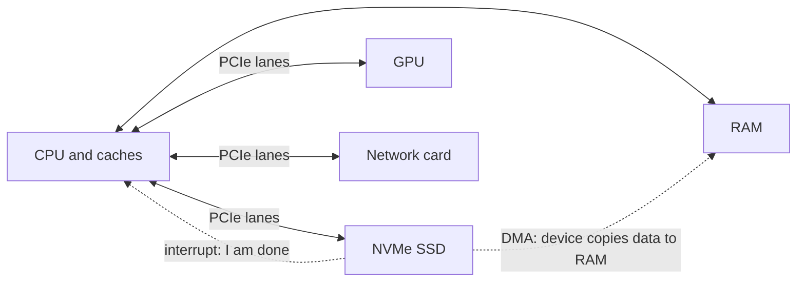
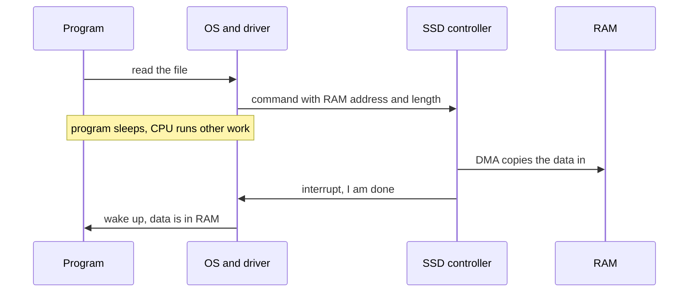

# Storage, I/O and buses

After this you can say how data gets between a disk, a network card and memory, and explain why an SSD, an HDD and RAM behave so differently.

Before this: [memory hierarchy and latency numbers](04-memory-hierarchy-and-latency-numbers.md).

## The idea

Your program calls `open("report.csv")` and reads a megabyte. The CPU does not know how to spin a disk or flip flash cells, and it should not sit idle while the disk works. Instead, a small controller on the device does the work, the CPU tells it what to do over a link, and the device announces when it has finished. The rest of this lesson is the vocabulary for those three parts: the device, the link and the announcement.



## Key terms

A **bus** is a set of wires, with a rule for using them, that carries data between parts of a computer. Fast links such as PCIe are point-to-point connections between two devices, but people still say "bus".

**PCIe** (PCI Express) is the standard link between the CPU and fast devices: GPUs, NVMe SSDs and network cards. A link has some number of **lanes**, written x1, x4, x16, and each lane carries data in both directions.

A **device controller** is the small processor on a device that manages it. A **driver** is the operating system code that talks to that controller.

An **interrupt** is a signal from a device telling the CPU to stop what it is doing and run a handler. **Polling** is the alternative: the CPU asks the device again and again whether it is ready.

**DMA** (direct memory access) lets a device read or write RAM itself, without the CPU copying each byte.

**Persistent** storage keeps data without power. RAM is volatile; disks and SSDs are persistent.

## How it works

HDD and SSD. A hard disk drive (HDD) stores bits magnetically on spinning platters. Reading a random spot means moving an arm to the right track and waiting for the platter to turn, which takes milliseconds. A solid-state drive (SSD) stores bits as charge in flash memory and has no moving parts, so a random read takes tens to hundreds of microseconds. Flash cells wear out after enough erases, so an SSD controller spreads writes across the chip. NVMe is the protocol that lets an SSD use PCIe and handle many requests in parallel; older SATA SSDs share a slower link with HDDs.

| Device | Random access time | Sequential throughput (as of 2026) |
|---|---|---|
| HDD | about 3 to 12 ms | about 100 to 300 MB/s |
| SATA SSD | about 0.5 ms | about 500 MB/s |
| NVMe SSD (PCIe 5.0) | about 0.05 to 0.1 ms | up to about 15,000 MB/s |

These come from [Wikipedia: Solid-state drive](https://en.wikipedia.org/wiki/Solid-state_drive); your drive differs. The sequential figure is for large files read in order. Many small random reads from one thread run far below it.

PCIe. The speed of a link is its per-lane speed times its lane count, and each generation roughly doubles the per-lane speed. Usable throughput per direction:

| PCIe version | Year | Per lane | x4 (typical SSD) | x16 (typical GPU) |
|---|---|---|---|---|
| 3.0 | 2010 | 0.985 GB/s | 3.9 GB/s | 15.8 GB/s |
| 4.0 | 2017 | 1.97 GB/s | 7.9 GB/s | 31.5 GB/s |
| 5.0 | 2019 | 3.94 GB/s | 15.8 GB/s | 63.0 GB/s |

Source: [Wikipedia: PCI Express](https://en.wikipedia.org/wiki/PCI_Express), as of 2026. The year is when the standard was released; hardware arrives later. A device runs at the speed of the slowest generation in the pair, so a PCIe 5.0 SSD in a 4.0 slot runs at 4.0 speed.

Interrupts and DMA. The diagram follows one disk read. The driver gives the device a RAM address and a length, and the OS puts the program to sleep and runs something else. The device copies the data into RAM itself (DMA), so the CPU does not move each byte, then raises one interrupt and the OS wakes the program. Polling avoids the interrupt but burns CPU time while waiting, so it makes sense only when the wait is very short or events are very frequent.



The OS also keeps recently read file data in RAM (the page cache). A second read of the same file often never reaches the disk, which makes disk timings hard to measure.

## Worked examples

<div class="example" markdown>

### Example 1: waiting by interrupt or by polling

We want to see the cost of polling. A background thread writes a byte into a pipe after 1 second. We wait for it twice: once with a blocking read, which sleeps until the OS wakes us, and once by polling in a loop. We then compare the CPU time used.

1. Create a pipe and start a timer that writes one byte after 1 s.
2. Call `os.read`, which blocks. The OS suspends the process, so no CPU time is used until the data arrives. This is the interrupt-style wait.
3. Repeat with the pipe in non-blocking mode and a loop that retries until the read succeeds.

<details class="code" markdown>
<summary>In code</summary>

```python
import os
import threading
import time

r, w = os.pipe()
threading.Timer(1.0, lambda: os.write(w, b"x")).start()   # data arrives after 1 s

start_cpu = time.process_time()
os.read(r, 1)                      # blocks: the OS wakes us when data arrives
print(f"blocking read: CPU time used {time.process_time() - start_cpu:.3f} s")

os.set_blocking(r, False)
threading.Timer(1.0, lambda: os.write(w, b"x")).start()
start_cpu = time.process_time()
while True:                        # polling: ask again and again
    try:
        os.read(r, 1)
        break
    except BlockingIOError:
        pass
print(f"polling loop:  CPU time used {time.process_time() - start_cpu:.3f} s")
```

```text
blocking read: CPU time used 0.000 s
polling loop:  CPU time used 1.016 s
```

</details>

Both waits take 1 s of real time. The blocking wait uses no CPU time, the polling loop uses all of the second. A pipe is not a device, but the OS handles it the same way: sleep until something wakes you. Check: print `time.perf_counter()` differences as well; both should show about 1 s.

</div>

## Common mistakes

<div class="warning" markdown>

Watch out: believing a "15,000 MB/s" drive makes every read fast. That is sequential throughput on large reads. A database doing one small random read at a time sees latency, about 100 µs even on a fast SSD.

Watch out: timing a file read twice and trusting the second number. The OS caches file contents in RAM, so the second read measures memory, not the disk.

</div>

## Working with AI

<div class="ai" markdown>

Words to use: NVMe, PCIe lane, DMA, interrupt, polling, page cache, throughput, latency.

Prompts to try:

- "I have an NVMe SSD on PCIe 4.0 x4 and a workload of 4 KiB random reads from one thread. Estimate throughput from latency, and explain why it is far below the drive's sequential rating."
- "Explain what `fsync` guarantees on Linux and when a program needs it, with an example of data lost without it."

What to check:

- Speed claims that confuse sequential and random access, or bits and bytes. Recompute from the units.
- Advice to "buy a faster SSD" for a problem that is really too many small queries or a missing index.
- Benchmark code that reads back a file it wrote a moment ago. The numbers reflect the page cache.

</div>

## Quiz

1\. Why is a random read from an HDD slower than from an SSD?

<details class="solution" markdown>
<summary>Answer</summary>

An HDD must move a mechanical arm to the right track and wait for the platter to rotate under it, which takes milliseconds. An SSD has no moving parts and reads flash electronically in microseconds.

</details>

2\. A PCIe 4.0 x4 link has a per-lane rate of about 1.97 GB/s per direction. What is the link's throughput, and what happens if the SSD is PCIe 5.0 but the slot is 4.0?

<details class="solution" markdown>
<summary>Answer</summary>

$4 \times 1.97 \approx 7.9$ GB/s per direction. The pair runs at the lower generation, so the PCIe 5.0 SSD is limited to PCIe 4.0 speed.

</details>

3\. What problem does DMA solve, and what tells the CPU that the transfer is finished?

<details class="solution" markdown>
<summary>Answer</summary>

Without DMA the CPU copies every byte between the device and RAM, which keeps it busy. With DMA the device moves the data itself, and an interrupt tells the CPU when it is done.

</details>

4\. A script reads a 2 GB file twice and the second read is five times faster. What is the most likely reason?

<details class="solution" markdown>
<summary>Answer</summary>

The OS kept the file in its page cache in RAM after the first read, so the second read did not touch the disk.

</details>

## Lab

<div class="lab" markdown>

### Lab: write speed, with and without fsync

Goal: measure how much faster a write looks when the OS buffers it, and what `fsync` does to the number. Time: about 10 minutes. Runs in: any terminal with Python 3, in a folder on the drive you want to test.

1. Save the script below as `disk.py`. It writes 256 MB twice, the second time calling `os.fsync`, then reads the file back and deletes it.
2. Run it twice with `python disk.py` (or `python3`). Write down all six numbers.
3. Explain the gap between the first two lines, and why the third line is not a disk speed.
4. Cleanup: the script removes `disk_test.bin`. Check that it is gone.

```python
import os
import time

SIZE_MB = 256
chunk = os.urandom(1024 * 1024)
path = "disk_test.bin"

start = time.perf_counter()
with open(path, "wb") as f:
    for _ in range(SIZE_MB):
        f.write(chunk)
buffered = time.perf_counter() - start

start = time.perf_counter()
with open(path, "wb") as f:
    for _ in range(SIZE_MB):
        f.write(chunk)
    f.flush()
    os.fsync(f.fileno())           # wait until the data reaches the device
synced = time.perf_counter() - start

start = time.perf_counter()
with open(path, "rb") as f:
    while f.read(1024 * 1024):
        pass
read = time.perf_counter() - start

os.remove(path)
print(f"write, no fsync: {SIZE_MB / buffered:8.0f} MB/s")
print(f"write + fsync:   {SIZE_MB / synced:8.0f} MB/s")
print(f"read back:       {SIZE_MB / read:8.0f} MB/s  (likely from the OS page cache)")
```

Expected result: the write without `fsync` looks fastest, the write with `fsync` is slower, and the read-back is fast because of the cache. The output below is from one run on the author's Windows 11 PC with an NVMe SSD; a second run gave 3646, 650 and 2683 MB/s, so expect a wide spread.

```text
write, no fsync:     2758 MB/s
write + fsync:       1180 MB/s
read back:           2815 MB/s  (likely from the OS page cache)
```

<details class="solution" markdown>
<summary>Solution</summary>

Without `fsync`, `close` returns once the OS has copied the data into its page cache; the disk write happens later. With `fsync` the program waits until the device reports the data is stored, so that line is nearer to the drive's real write speed (and varies with the drive's own cache and state). The read-back reads the file the OS cached a moment ago, so it measures RAM. To measure the disk's read speed you would need a file larger than RAM, or a freshly rebooted machine.

</details>

</div>

## Where this shows up

- [File systems](../../02-operating-systems-and-linux/01-os-concepts/04-file-systems.md) and [system calls and kernel mode](../../02-operating-systems-and-linux/01-os-concepts/05-system-calls-and-kernel-mode.md) cover what the OS does between `open` and the device.
- Database indexes and `fsync` settings, which decide whether a committed transaction survives a power cut.
- [GPUs and parallel hardware](06-gpus-and-parallel-hardware.md) hang off the same PCIe lanes.
