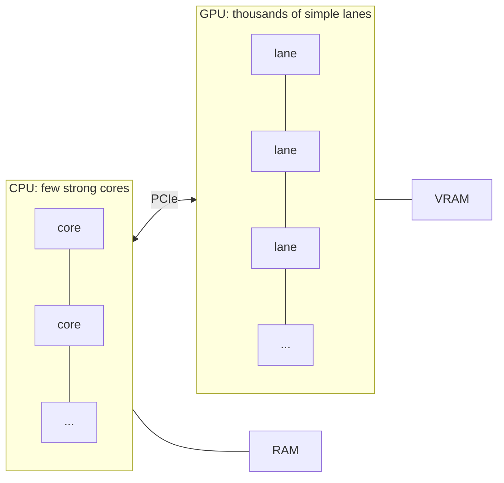

# GPUs and parallel hardware

After this you can explain what SIMD and a GPU are, say which workloads suit them, and estimate whether a model's weights fit in a GPU's memory.

Before this: [the CPU](03-the-cpu.md) and [storage, I/O and buses](05-storage-io-and-buses.md).

## The idea

Suppose you must brighten a 4K photo by adding 10 to every pixel. That is about 8 million pixels, and each one is independent of the others. A CPU core handles them one after another, very fast. A different design has thousands of slower, simpler workers, each handling a few pixels at the same moment. For this job the second design wins by a wide margin, and it is the design of a graphics processing unit.

A CPU is built to finish one instruction stream with low latency. A GPU is built to finish a huge amount of identical work with high throughput. The two are tuned for different problems, and a program usually uses both.



## Key terms

**SIMD** (single instruction, multiple data) means one instruction operates on several values at once. A CPU has wide vector registers, commonly 128 to 512 bits, and an instruction can add 4 to 16 `float32` values in one step.

A **GPU** (graphics processing unit) is a processor with thousands of simple arithmetic units, built for data-parallel work. Its programs are called **kernels**; the same kernel runs on a very large number of threads. NVIDIA calls the arithmetic units CUDA cores.

**VRAM** (video RAM) is the GPU's own memory, separate from the main RAM. A discrete GPU on a PCIe card has its own VRAM; many laptops and phones use an integrated GPU that shares main memory with the CPU.

**Data parallelism** means doing the same operation on many data items. **Throughput** is the amount of work finished per second, as opposed to latency, the time one piece of work takes.

## How it works

On a CPU, SIMD is mostly automatic: compilers and libraries such as NumPy use vector instructions inside a loop over an array. On a GPU, threads run in lockstep groups (32 threads on NVIDIA hardware, called a warp). A group executes one instruction at a time for all its threads. If threads in a group take different sides of an `if`, the hardware runs both sides in turn with some threads idle, so branch-heavy code is slow on a GPU.

GPUs began as graphics hardware. Drawing a frame means running the same small program for each of millions of pixels and vertices, with little dependence between them. Training and running a neural network is dominated by matrix multiplication: each output value is a sum of products, and millions of those sums are independent. The same hardware therefore suits graphics, scientific simulation, and AI. The work must be large and regular enough to fill thousands of lanes, otherwise a CPU is faster.

Moving data costs time too. A discrete GPU sits behind a PCIe link that carries about 63 GB/s per direction at PCIe 5.0 x16 (see [storage, I/O and buses](05-storage-io-and-buses.md)). VRAM is much faster than that link, so programs copy data in once, run many kernels, and copy only the result back. Copying a small array in, doing one cheap operation and copying it back is often slower than staying on the CPU.


VRAM size is often the real limit for AI. A model's weights must sit in VRAM to run quickly, and the amount is the number of parameters times the bytes per parameter. The consumer flagship GeForce RTX 5090 has 32 GB of GDDR7 and 21,760 CUDA cores (as of 2026, per [NVIDIA](https://www.nvidia.com/en-us/geforce/graphics-cards/50-series/rtx-5090/)). A mainstream desktop CPU has 6 to 16 cores (see [the CPU lesson](03-the-cpu.md)). The two counts are not comparable one for one: a CUDA core is far simpler than a CPU core.

## Worked examples

<div class="example" markdown>

### Example 1: does a model fit in 32 GB of VRAM?

We want to know whether the weights of a 7 billion-parameter model and a 70 billion-parameter model fit in 32 GB.

1. Bytes per parameter: 2 for 16-bit numbers, 0.5 for 4-bit quantized numbers (weights stored with fewer bits).
2. Weights in GB = parameters in billions times bytes per parameter.
3. Compare with 32 GB. Leave room: the runtime also needs memory for activations and the context (the KV cache), so the weights alone should fit with margin.

<details class="code" markdown>
<summary>In code</summary>

```python
vram_gb = 32
for params_b in (7, 70):
    for name, bytes_each in (("16-bit", 2), ("4-bit", 0.5)):
        gb = params_b * bytes_each          # billions of parameters x bytes each = GB
        fits = "fits" if gb <= vram_gb else "does not fit"
        print(f"{params_b:>2}B model, {name:6}: {gb:6.1f} GB of weights, {fits} in {vram_gb} GB")
```

```text
 7B model, 16-bit:   14.0 GB of weights, fits in 32 GB
 7B model, 4-bit :    3.5 GB of weights, fits in 32 GB
70B model, 16-bit:  140.0 GB of weights, does not fit in 32 GB
70B model, 4-bit :   35.0 GB of weights, does not fit in 32 GB
```

</details>

The 7B model fits easily. The 70B model does not fit even at 4 bits, so it needs several GPUs, or CPU RAM with a large speed penalty. Check: 70 billion times 0.5 byte is 35 billion bytes, which is 35 GB, more than 32.

</div>

## Common mistakes

<div class="warning" markdown>

Watch out: assuming a GPU speeds up any program. It helps with large, regular, data-parallel work. Small inputs, branchy code and code that moves data across PCIe constantly can run slower than on the CPU.

Watch out: comparing a GPU's thousands of cores with a CPU's dozen. They do different amounts of work per core. Compare time on the actual task.

Watch out: treating "fits in VRAM" as "weights fit". Context length, batch size and the framework add memory on top of the weights.

</div>

## Working with AI

<div class="ai" markdown>

Words to use: SIMD, data parallelism, kernel, VRAM, PCIe transfer, quantization, throughput.

Prompts to try:

- "I have 16 GB of VRAM. I want to run a 13 billion-parameter model locally in Python. Estimate the weight memory at 16-bit and 4-bit quantization, and say what else uses VRAM."
- "This NumPy loop is slow. Rewrite it with vectorized operations and explain what part of the speed-up is SIMD and what part is removing the Python interpreter."

What to check:

- Memory estimates that leave out the KV cache and activations. Ask for them separately and compare with the actual usage in `nvidia-smi` (a tool that comes with NVIDIA drivers).
- GPU code with no copy cost mentioned. Ask what is copied, how often, and in which direction.
- Benchmark claims of "100x faster" with no stated input size or baseline. Rerun at your size.
- Library and function names. Check them against the PyTorch or CUDA docs for your installed version.

</div>

## Quiz

1\. What is SIMD, in one sentence, and where would you meet it in Python?

<details class="solution" markdown>
<summary>Answer</summary>

One instruction applies the same operation to several values at once. You meet it indirectly through NumPy, whose array operations use the CPU's vector instructions.

</details>

2\. Why are matrix multiplications such a good fit for a GPU?

<details class="solution" markdown>
<summary>Answer</summary>

Each output value is an independent sum of products, so millions of them can be computed at the same time with the same instructions and regular memory access.

</details>

3\. A 13 billion-parameter model is stored in 16-bit numbers. About how much VRAM do its weights need, and does it fit on a 16 GB card?

<details class="solution" markdown>
<summary>Answer</summary>

$13 \times 2 = 26$ GB, so it does not fit on 16 GB. At 4 bits the weights are $13 \times 0.5 = 6.5$ GB, which fits with some room.

</details>

4\. Your script copies a 1 MB array to the GPU, adds 1 to each element and copies it back. It is slower than NumPy on the CPU. Why?

<details class="solution" markdown>
<summary>Answer</summary>

The work is tiny, so the time goes to the two transfers over PCIe and to starting the kernel. The GPU's thousands of lanes are barely used. The fix is to keep data on the GPU and do much more work per transfer.

</details>

## Lab

<div class="lab" markdown>

### Lab: vectorized versus looped

Goal: see how much faster data-parallel code runs on one CPU when it uses vector operations. Time: about 10 minutes. Runs in: any terminal with Python 3 and NumPy (`pip install numpy`).

1. Save the script below as `parallel_lab.py`. It does `a * b + 1` over 10 million `float32` numbers with a Python loop and with NumPy, then times a 2000 by 2000 matrix multiplication.
2. Run `python parallel_lab.py` (or `python3`).
3. Compute how many floating-point operations the matrix multiply does (`2 * n**3`) and the GFLOP/s the script prints. Compare with your CPU's number of cores.
4. If you have an NVIDIA GPU and PyTorch, run `torch.cuda.is_available()` and `torch.cuda.get_device_properties(0).total_memory` to read your VRAM. This step is optional.
5. Cleanup: nothing to remove.

```python
import time
import numpy as np

N = 10_000_000
rng = np.random.default_rng(1)
a = rng.random(N, dtype=np.float32)
b = rng.random(N, dtype=np.float32)

start = time.perf_counter()
out_loop = [x * y + 1.0 for x, y in zip(a.tolist(), b.tolist())]
t_loop = time.perf_counter() - start

start = time.perf_counter()
out_vec = a * b + 1.0
t_vec = time.perf_counter() - start
print(f"Python loop: {t_loop:.3f} s")
print(f"NumPy:       {t_vec:.3f} s   ({t_loop / t_vec:.0f}x faster)")
print("same result:", np.allclose(out_loop, out_vec))

n = 2000
m1 = rng.random((n, n), dtype=np.float32)
m2 = rng.random((n, n), dtype=np.float32)
start = time.perf_counter()
m1 @ m2
t = time.perf_counter() - start
print(f"{n}x{n} matrix multiply: {t:.3f} s, {2 * n**3 / t / 1e9:.0f} GFLOP/s")
```

Expected result: NumPy is tens of times faster than the loop, and the matrix multiply runs at hundreds of GFLOP/s. The output below is from the author's Windows 11 PC (AMD Ryzen 5 5600G, Python 3.14, NumPy 2.5.4); yours will differ.

```text
Python loop: 1.095 s
NumPy:       0.018 s   (61x faster)
same result: True
2000x2000 matrix multiply: 0.036 s, 449 GFLOP/s
```

<details class="solution" markdown>
<summary>Solution</summary>

Most of the 61 times is not SIMD. The Python loop pays interpreter overhead on every element (type checks, object creation), and NumPy runs a compiled loop over raw `float32` values, using vector instructions where it can. Splitting the gain between the two needs a compiled baseline.

The matrix multiply does $2 \times 2000^3 = 1.6 \times 10^{10}$ operations, which is 16 billion. At 0.036 s that is about 450 GFLOP/s on a 6-core CPU, because NumPy's library uses SIMD and all cores. A high-end GPU does the same multiplication much faster, since it has far more arithmetic units and memory bandwidth, but only once the data is already in VRAM.

</details>

</div>

## Where this shows up

- Running and training machine-learning models, where VRAM size decides which models you can load. See from ML to transformers<!-- link: ../../15-ai-and-llms/01-how-llms-work/01-from-ml-to-transformers.md -->.
- Cloud instance types with GPUs, in cloud models and regions<!-- link: ../../13-devops-and-cloud/03-aws/01-cloud-models-and-regions.md -->.
- Parallelism in software: processes, threads and scheduling<!-- link: ../../02-operating-systems-and-linux/01-os-concepts/02-processes-threads-and-scheduling.md -->.
