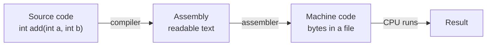

# Machine code and assembly

After this you can read a short assembly listing, say what a compiler turned your function into, and explain why a program built for one kind of CPU does not run on another.

Before this: [The CPU](../02-hardware/03-the-cpu.md) and [binary and hexadecimal](../01-bits-and-data/01-binary-and-hexadecimal.md).

## The idea

You push a Docker image built on an Apple Silicon laptop to a server and it fails with `exec format error`. Nothing is wrong with the code. The file contains instructions for a different kind of CPU.

A CPU does not understand Python, JavaScript or C. It understands short numbers that each mean "do this small operation". A program in its final form is a long sequence of those numbers, plus data. This chapter is about how your text becomes that sequence.



## Key terms

An **instruction set architecture** (**ISA**) is the list of instructions a family of CPUs understands, with the registers they use and how they are encoded as bytes. The two you meet are **x86-64** (most laptops, desktops and servers) and **ARM64** (phones, Apple Silicon, and many cloud servers).

**Machine code** is the bytes the CPU executes. Each instruction is one to fifteen bytes on x86-64 and always four bytes on ARM64.

**Assembly** is machine code written as text: one line per instruction, with a short name (a **mnemonic**) such as `mov` or `add`, and its operands. An **assembler** turns the text into bytes, and a **disassembler** turns bytes back into text.

A **register** is one of the CPU's few named storage slots (the top of the hierarchy you saw in the memory lesson<!-- link: ../02-hardware/04-memory-hierarchy-and-latency-numbers.md -->). On x86-64, `rax`, `rdi` and `rsi` are 64-bit registers, and `eax`, `edi` and `esi` are their lower 32 bits.

A **calling convention** is the agreement about where a function finds its arguments and leaves its result. On Linux and macOS x86-64 (the System V convention), the first two integer arguments arrive in `rdi` and `rsi` and the result goes in `eax` or `rax`. Windows uses `rcx` and `rdx` instead.

## How it works

Most instructions fall into four groups: move data between registers and memory (`mov`), do arithmetic (`add`, `sub`, `imul`), compare and jump (`cmp`, `jg`, `jmp`), and call and return (`call`, `ret`). A loop is a compare and a jump back. A function call is a `call` to the function's address and a `ret` at its end.

The same C function produces different assembly depending on the **optimization level**, a compiler flag. `-O0` means translate each line literally, which is easy to debug. `-O2` means rewrite the code to do the same work with fewer or cheaper instructions. Release builds use `-O2` or `-O3`.

Assembly has two spellings. Intel syntax writes the destination first (`mov eax, 5` puts 5 in `eax`). AT&T syntax, the default in GNU tools, writes it last (`movl $5, %eax`). This book uses Intel.

## Worked examples

<div class="example" markdown>

### Example 1: one addition, two ways

We compile this one-line function with Clang 18 for x86-64 Linux, once with `-O0` and once with `-O2`:

```c
int add(int a, int b) { return a + b; }
```

Step 1: at `-O0` the compiler stores each argument on the stack, then reloads them. Below is the disassembly, with the bytes the CPU reads.

```text
0:  55              push rbp
1:  48 89 e5        mov  rbp, rsp
4:  89 7d fc        mov  dword ptr [rbp - 0x4], edi
7:  89 75 f8        mov  dword ptr [rbp - 0x8], esi
a:  8b 45 fc        mov  eax, dword ptr [rbp - 0x4]
d:  03 45 f8        add  eax, dword ptr [rbp - 0x8]
10: 5d              pop  rbp
11: c3              ret
```

Step 2: read it in order, using the offsets on the left. Offsets 0 and 1 set up a stack frame, and offsets 4 and 7 save `edi` and `esi` into it, as the diagram shows. Offsets `a` and `d` load the first and add the second, leaving the sum in `eax`, where a caller expects a result. Offset 10 undoes the frame and `ret` returns. The whole function is 18 bytes.

```text
higher addresses
+-----------------+
| return address  |  pushed by the caller's call
+-----------------+
| saved rbp       |  <- rbp points here
+-----------------+
| a (from edi)    |  [rbp - 4]
+-----------------+
| b (from esi)    |  [rbp - 8]
+-----------------+
lower addresses
```

Step 3: at `-O2` the arguments never touch memory.

```text
0: 8d 04 37     lea eax, [rdi + rsi]
3: c3           ret
```

`lea` normally computes an address, but here the compiler uses it as a three-operand addition: `eax = rdi + rsi`. Four bytes in total.

Check: both versions return 5 for `add(2, 3)`; they differ in instructions and memory accesses. The lab reproduces both listings and runs the four `-O2` bytes from Python.

</div>

A bigger change appears with loops. At `-O2`, Clang compiles a loop that adds the numbers 1 to $n$ into a few instructions that compute $n(n+1)/2$ directly, with no loop at all. The lab shows it.

## Common mistakes

<div class="warning" markdown>

Watch out: reading the operands backwards. `mov eax, ebx` copies `ebx` into `eax` in Intel syntax, but `movl %eax, %ebx` copies `eax` into `ebx` in AT&T syntax. Pass `-masm=intel` to GCC or Clang to get Intel.

Watch out: expecting assembly to be portable. The same C function gives different assembly on ARM64, and on Windows x86-64 the arguments arrive in `rcx` and `rdx`. A listing is only meaningful with its ISA and operating system.

Watch out: judging speed from a `-O0` build. Unoptimized code is often several times slower than what you ship.

</div>

## Working with AI

<div class="ai" markdown>

Words to use: ISA, x86-64, ARM64, machine code, assembly, register, calling convention, optimization level.

Prompts to try:

- "Here is the output of `gcc -S -O2 -masm=intel` for my C function (pasted below). Explain each instruction in plain words and say which register holds each argument under the System V x86-64 calling convention."
- "My Docker image built on an M-series Mac fails on an x86-64 Linux server with `exec format error`. What is the cause, and how do I build an image for linux/amd64?"

What to check:

- Operand order. If the AI explains `mov a, b` as "copy a into b", confirm which syntax your listing uses.
- Architecture. An answer that names `rdi` and `rsi` is for x86-64 System V, not ARM64 or Windows. Compare with the flags you compiled with.
- Invented mnemonics or flags. Look up each instruction in the ISA manual (Intel's or Arm's) and each flag with `gcc --help` or `man gcc`.
- Claims that a change is "faster" with no measurement. Time it, as in the next lesson.

</div>

## Quiz

1\. What is an ISA, and why does an x86-64 program not run on an ARM64 CPU?

<details class="solution" markdown>
<summary>Answer</summary>

An ISA is the set of instructions, registers and byte encodings a CPU family understands. An x86-64 program's bytes encode x86-64 instructions, which an ARM64 CPU does not decode, so the loader refuses it (Linux reports `exec format error`).

</details>

2\. At `-O2`, `add` is `lea eax, [rdi + rsi]` then `ret`. What does `add(40, 2)` return, and which registers held the arguments?

<details class="solution" markdown>
<summary>Answer</summary>

It returns 42. The arguments were in `edi` (40) and `esi` (2), the lower halves of `rdi` and `rsi`, and the sum is left in `eax`.

</details>

3\. You compile with `-O0` for debugging, then benchmark that same binary and conclude the program is too slow. What is wrong with the method?

<details class="solution" markdown>
<summary>Answer</summary>

`-O0` keeps every variable in memory and skips optimizations, so it is not representative. Benchmark the build you ship, usually `-O2` or `-O3`.

</details>

4\. A function sums the numbers 1 to $n$ with a loop. At `-O2` its assembly has no jump back. Is the compiler wrong?

<details class="solution" markdown>
<summary>Answer</summary>

No. The compiler recognised the pattern and replaced the loop with the formula $n(n+1)/2$, which gives the same result. Only observable behaviour has to match.

</details>

## Lab

<div class="lab" markdown>

### Lab: read the compiler's output, then run raw bytes

Goal: see assembly for your own function and execute machine code you typed in. Time: about 15 minutes. Runs in: WSL (Ubuntu) for steps 1 to 3, Windows 11 for step 4.

1. In WSL, run `sudo apt install gcc` if needed. Save `add.c` (the function from Example 1) and `sum.c` (below).
2. Run `gcc -S -O0 -masm=intel -fno-asynchronous-unwind-tables -o - add.c`, then again with `-O2`. Ignore lines starting with a dot, and ignore an `endbr64` line if your Ubuntu adds one. Find the instructions from Example 1.
3. Predict, then check: compile `sum.c` with `-O0` and with `-O2`. Which one has a jump backwards?
4. In PowerShell, save `run_machine_code.py` (below) and run `python run_machine_code.py`. It copies four bytes into executable memory and calls them.
5. Cleanup: delete the files.

```c
int sum_to(int n) {
    int total = 0;
    for (int i = 1; i <= n; i++) total += i;
    return total;
}
```

```python
import ctypes
from ctypes import wintypes

code = bytes([0x8D, 0x04, 0x11, 0xC3])  # lea eax, [rcx + rdx] ; ret

k32 = ctypes.windll.kernel32
k32.VirtualAlloc.restype = ctypes.c_void_p
k32.VirtualAlloc.argtypes = [ctypes.c_void_p, ctypes.c_size_t, wintypes.DWORD, wintypes.DWORD]
buf = k32.VirtualAlloc(None, len(code), 0x3000, 0x40)  # commit, read/write/execute
ctypes.memmove(buf, code, len(code))
add = ctypes.CFUNCTYPE(ctypes.c_int, ctypes.c_int, ctypes.c_int)(buf)
print(add(2, 3), add(40, 2))
```

Expected result: step 4 prints the line below. In step 3 only the `-O0` listing jumps back to the loop header.

```text
5 42
```

<details class="solution" markdown>
<summary>Solution</summary>

The Python bytes use `rcx` and `rdx` because Windows x86-64 passes the first two arguments there. The Linux listing used `rdi` and `rsi`. This script only works on x86-64 Windows.

Clang 18 produced this for `sum.c` at `-O2` (GCC's output differs in details). Check that the arithmetic equals $n(n+1)/2$: with $n$ in `edi`, `(n-1)*(n-2)/2 + 2n - 1` simplifies to it.

```text
sum_to:
    test edi, edi
    jle  .LBB0_1
    lea  eax, [rdi - 1]
    lea  ecx, [rdi - 2]
    imul rcx, rax
    shr  rcx
    lea  eax, [rcx + 2*rdi]
    dec  eax
    ret
.LBB0_1:
    xor  eax, eax
    ret
```

</details>

</div>

## Where this shows up

- [Compilers, interpreters and JIT](02-compilers-interpreters-and-jit.md) shows the steps before assembly, and how Python and JavaScript avoid it.
- System calls and kernel mode<!-- link: ../../02-operating-systems-and-linux/01-os-concepts/05-system-calls-and-kernel-mode.md --> covers the special instruction a program uses to ask the operating system for something.
- Multi-architecture container builds in the Docker lessons: the `exec format error` above.
