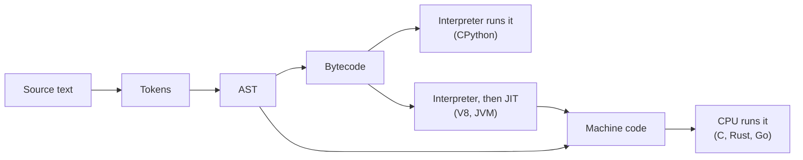
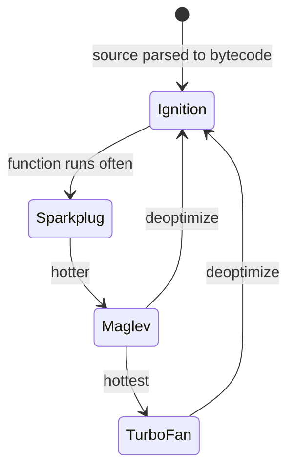

# Compilers, interpreters and JIT

After this you can follow a program from source text to running code, say which path Python, JavaScript, TypeScript and C take, and explain why the same loop runs at very different speeds in them.

Before this: [Machine code and assembly](01-machine-code-and-assembly.md).

## The idea

You write `price * 1.13` in Python, in TypeScript and in C. The CPU runs none of them directly. Each language has a program, a **compiler** or an **interpreter**, that turns your text into something that can run. All of them start the same way: read the text, break it into pieces, work out its structure. They split afterwards.



## Key terms

A **token** is the smallest meaningful piece of source text: a name, a number, an operator. A **lexer** (or tokenizer) splits the text into tokens.

A **parser** checks the tokens against the language's grammar and builds an **abstract syntax tree** (**AST**), a tree that shows how the pieces nest. In `price * 1.13` the multiplication is a node with two children. A syntax error is the parser failing.

**Bytecode** is a compact instruction list for a made-up machine, not a real CPU. A **virtual machine** (VM) is the program that runs it, such as CPython's interpreter loop or the JVM.

An **interpreter** runs a program by executing it step by step, without first producing machine code for the whole thing. An **ahead-of-time** (**AOT**) compiler translates everything to machine code before the program runs. A **just-in-time** (**JIT**) compiler translates to machine code while the program is running, usually only the parts that run often.

A **transpiler** translates one high-level language into another, such as TypeScript into JavaScript.

## How it works

"Compiled" and "interpreted" describe an implementation, not a language. The standard Python implementation, CPython, compiles your source to bytecode and then interprets that. It caches the bytecode in `.pyc` files under `__pycache__`. The bytecode is an implementation detail: [the `dis` documentation](https://docs.python.org/3/library/dis.html) warns that it can change between Python versions. CPython also has an experimental JIT, but it is not part of the default build ([PEP 744](https://peps.python.org/pep-0744/)).

C, Rust and Go use AOT compilation. You get an executable for one ISA and operating system, which is the `exec format error` from the last lesson. The compiler optimizes heavily but cannot see how the program is used at run time.

JavaScript engines mix both. V8, the engine in Chrome and Node.js, first compiles source to bytecode and runs it in an interpreter called Ignition, counting how often functions run. Hot functions move up through compiler tiers, as the diagram shows ([V8's Maglev post](https://v8.dev/blog/maglev)). The top tiers guess from what they observed, for example "`a` has always been a small integer here". If a guess turns out wrong, V8 throws the optimized code away and returns to the interpreter, which is called deoptimization. The JVM works the same way for Java.



TypeScript is a transpiler case. Its types exist only for the checker, and `tsc` writes plain JavaScript that has them removed. Node 24 can also run a `.ts` file directly by blanking out the types (**type stripping**), with no type checking at all ([Node's TypeScript docs](https://nodejs.org/docs/latest-v24.x/api/typescript.html), as of 2026). Syntax that needs generated code, such as `enum`, is not supported without a flag.

## Worked examples

<div class="example" markdown>

### Example 1: Python's front end, step by step

We look at `price * 1.13` as Python sees it, using the standard library.

```python
import ast
import dis
import io
import tokenize

for tok in tokenize.generate_tokens(io.StringIO("price * 1.13").readline):
    if tok.string.strip():
        print(tokenize.tok_name[tok.type], repr(tok.string))

print(ast.dump(ast.parse("price * 1.13", mode="eval"), indent=2))

def add_tax(price):
    return price * 1.13

dis.dis(add_tax)
```

Step 1: the tokenizer produces three tokens. Step 2: the parser builds a tree with the multiplication at the top and the name and the number below it. Step 3: `dis.dis` prints the bytecode CPython compiled for the function.

```text
NAME 'price'
OP '*'
NUMBER '1.13'
Expression(
  body=BinOp(
    left=Name(id='price', ctx=Load()),
    op=Mult(),
    right=Constant(value=1.13)))
 12           RESUME                   0

 13           LOAD_FAST_BORROW         0 (price)
              LOAD_CONST               0 (1.13)
              BINARY_OP                5 (*)
              RETURN_VALUE
```

Read the bytecode as a stack machine; 12 and 13 are source line numbers. `LOAD_FAST_BORROW` pushes the local variable `price` onto a stack, `LOAD_CONST` pushes the constant `1.13`, `BINARY_OP` pops both and pushes the product, and `RETURN_VALUE` returns the top of the stack. This is Python 3.14.4; older versions use different instruction names.

Check: run it with your Python version and compare. Then change `1.13` to `tax` (a global) and look at which `LOAD_` instruction replaces `LOAD_CONST`.

</div>

## Common mistakes

<div class="warning" markdown>

Watch out: saying "Python is interpreted, so there is no compile step". CPython compiles every module to bytecode first; a `SyntaxError` is raised at that step, before any line runs.

Watch out: timing a JIT language with one cold run or an unused result. The first calls run in the interpreter, and an optimizer may delete a computation whose result nobody reads. Run the code several times and use the result.

Watch out: assuming `node file.ts` checks types. It strips them and runs, so `total("4", 3)` prints 12 with no error. Run `tsc --noEmit` (in CI too) to get the type errors.

</div>

## Working with AI

<div class="ai" markdown>

Words to use: tokenizer, AST, bytecode, virtual machine, AOT, JIT, transpile, deoptimization.

Prompts to try:

- "This is `dis.dis` output from Python 3.14 for my function (pasted below). Explain each instruction and what is on the stack after it."
- "My Node 24 script is slow for its first 100 ms and fast after. Explain this with Ignition, Maglev and TurboFan, and show how to benchmark it correctly."

What to check:

- Bytecode from another Python version. Instruction names change between releases, so run `dis` yourself and compare.
- Flat claims like "Python is slow because it is interpreted". Ask for a measurement on your workload, and check whether the time is really in the interpreter or in a library call.
- Invented V8 or Node flags. List the real ones with `node --v8-options` and check Node's docs.
- A benchmark that never uses its result, or runs once. See the second mistake above.

</div>

## Quiz

1\. What is the difference between a token and an AST node? Which one fails on `x = = 3`?

<details class="solution" markdown>
<summary>Answer</summary>

A token is a piece of text with a type (name, number, operator). An AST node is a piece of structure built from tokens. Both `=` tokens are valid on their own, so the tokenizer accepts the line; the parser fails because the grammar has no rule that allows `=` directly after `=`.

</details>

2\. In the `dis` output, which instruction performs the multiplication, and where does its result go?

<details class="solution" markdown>
<summary>Answer</summary>

`BINARY_OP` with the `*` operator. It pops two values off the stack and pushes the product, which `RETURN_VALUE` then returns.

</details>

3\. A teammate runs `node api.ts` locally, sees no errors, and merges code that passes a string where a number is expected. What went wrong and what should CI run?

<details class="solution" markdown>
<summary>Answer</summary>

Node strips types and runs the code without checking them. CI should run the type checker, for example `tsc --noEmit`, so the mismatch fails the build.

</details>

4\. Why can the same loop be about 30 times faster in Node than in CPython?

<details class="solution" markdown>
<summary>Answer</summary>

V8 notices the loop is hot and compiles it to machine code, while CPython interprets bytecode instruction by instruction for every iteration. Details differ per workload, so measure.

</details>

## Lab

<div class="lab" markdown>

### Lab: time a hot loop in Python and Node

Goal: measure interpreter against JIT on the same loop and see V8 tier up. Time: about 15 minutes. Runs in: any terminal with Python 3 and Node 24.

1. Save `hot.py` and run `python hot.py`.
2. Save `hot.js` and run `node hot.js`. Write down both times.
3. Run `node --jitless hot.js`. This V8 option disables executable memory, so the JIT cannot run. Predict whether it will be faster or slower than step 2 and slower or faster than Python.
4. Run `node --trace-opt hot.js` and find the lines naming `sumMod7`. Debug flags like this can change between Node versions.
5. Run `node --print-bytecode --print-bytecode-filter=sumMod7 hot.js` and read Ignition's bytecode for the loop.
6. Cleanup: delete the two files.

```python
import time

def sum_mod7(n):
    total = 0
    for i in range(n):
        total += i % 7
    return total

for run in range(3):
    start = time.perf_counter()
    result = sum_mod7(10_000_000)
    print(f"run {run + 1}: {time.perf_counter() - start:.3f} s  result={result}")
```

```javascript
function sumMod7(n) {
  let total = 0;
  for (let i = 0; i < n; i++) total += i % 7;
  return total;
}

for (let run = 1; run <= 3; run++) {
  const start = performance.now();
  const result = sumMod7(10_000_000);
  console.log(`run ${run}: ${((performance.now() - start) / 1000).toFixed(3)} s  result=${result}`);
}
```

Expected result: the pattern, not the exact times. The output below is from the author's Windows 11 PC (AMD Ryzen 5 5600G, Python 3.14.4, Node 24.15.0). Python took about 0.35 s per run, Node about 0.012 s, and `--jitless` Node about 0.1 s to 0.16 s (repeat runs vary).

```text
python hot.py     run 1: 0.332 s  result=29999994
node hot.js       run 1: 0.012 s  result=29999994
node --jitless    run 1: 0.105 s  result=29999994
```

<details class="solution" markdown>
<summary>Solution</summary>

Full JIT Node was about 30 times faster than Python. With the JIT off, V8 still ran about 2 to 3 times faster than CPython because its interpreter is cheaper per bytecode instruction, but about 9 times slower than with the JIT on. In step 4 the output includes a line like this, showing V8 marked the loop hot and compiled it to Maglev, and later to TurboFan:

```text
[marking <JSFunction sumMod7 ...> for optimization to MAGLEV, ... reason: hot and stable]
```

In step 5 the loop body shows `ModSmi [7]`, `Add` and `JumpLoop`, the same shape as Python's bytecode but for V8's own virtual machine. Both languages give the same result, 29999994, so the comparison is fair.

</details>

</div>

## Where this shows up

- [TypeScript](../../08-front-end/02-javascript-and-typescript/04-typescript.md) and Node.js and its runtime<!-- link: ../../09-back-end/01-servers-and-apis/02-nodejs-and-its-runtime.md --> build on this lesson.
- [Big O and runtime](../../05-data-structures-and-algorithms/01-analysis/01-big-o-and-runtime.md) counts steps; this lesson explains why each step costs different amounts in different languages.
- Profilers and "why is the first request slow" questions in production usually come down to JIT warm-up and caches.
