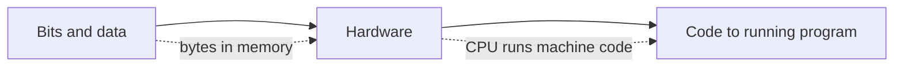

# How computers work

How information is stored as bits, how the hardware runs it, and how the code you write becomes a running program.

Before this folder: Nothing. This is the start.

This folder explains what a computer does with the code you write. Everything is stored as bits, so you start with how numbers, text, images and files become bytes, and why some numbers (floating point) are only approximate. Then you see the hardware that runs those bytes: logic gates, the CPU, memory and storage, and why reading from each has a very different cost.

The last chapter connects your source code to the machine: how it becomes machine code, and the difference between compiling, interpreting and JIT. When an AI tool says "this overflows", "this is cache-unfriendly" or "this runs in an interpreter", this folder is the vocabulary behind it.

This is the first folder, so nothing comes before it. [Operating systems and Linux](../02-operating-systems-and-linux/index.md) builds on the hardware picture, and later folders such as data structures and algorithms use the memory and latency numbers.

### How to use this folder

- Keep the Bits and data and Hardware cheat sheets open when you read about overflow, rounding or latency elsewhere in the book.
- The GPUs and parallel hardware lesson is optional on a first read.
- Most labs run in Python. The machine code lab compiles C with `gcc` in WSL (Ubuntu).

<!-- lessons:start -->
## Lessons

### 1. [Bits and data](01-bits-and-data/index.md)

1. [Binary and hexadecimal](01-bits-and-data/01-binary-and-hexadecimal.md)
2. [Bits, bytes and units](01-bits-and-data/02-bits-bytes-and-units.md)
3. [Integers and two's complement](01-bits-and-data/03-integers-and-twos-complement.md)
4. [Floating point](01-bits-and-data/04-floating-point.md)
5. [Text, ASCII and Unicode](01-bits-and-data/05-text-ascii-and-unicode.md)
6. [Files, images and sound as bytes](01-bits-and-data/06-files-images-and-sound-as-bytes.md)

### 2. [Hardware](02-hardware/index.md)

1. [Transistors and logic gates](02-hardware/01-transistors-and-logic-gates.md)
2. [Boolean algebra and circuits](02-hardware/02-boolean-algebra-and-circuits.md)
3. [The CPU](02-hardware/03-the-cpu.md)
4. [Memory hierarchy and latency numbers](02-hardware/04-memory-hierarchy-and-latency-numbers.md)
5. [Storage, I/O and buses](02-hardware/05-storage-io-and-buses.md)
6. [GPUs and parallel hardware](02-hardware/06-gpus-and-parallel-hardware.md) (optional)

### 3. [From code to running program](03-code-to-running-program/index.md)

1. [Machine code and assembly](03-code-to-running-program/01-machine-code-and-assembly.md)
2. [Compilers, interpreters and JIT](03-code-to-running-program/02-compilers-interpreters-and-jit.md)

<!-- lessons:end -->
