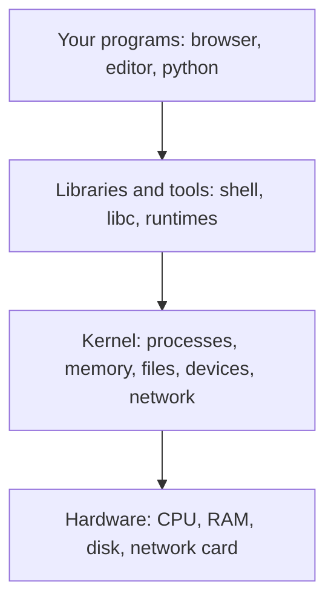

# What an OS and kernel do

After this you can say what the operating system does for your program, name the kernel in Linux, Windows and macOS, and explain why "Ubuntu" and "Linux" are not the same thing.

Before this: [The CPU](../../01-how-computers-work/02-hardware/03-the-cpu.md) and the [memory hierarchy](../../01-how-computers-work/02-hardware/04-memory-hierarchy-and-latency-numbers.md).

## The idea

Your Python script calls `print("hi")`. Somewhere below that line, bytes reach a terminal window, while a browser, a music player and a build tool are running on the same machine. None of them know about each other, none of them fight over the screen, and none of them can read the others' memory.

That is the operating system's job. Hardware is shared, fiddly and different on every machine. The **operating system** (OS) is the software layer that hides those differences and shares the hardware between programs safely. A program asks for what it needs (a file, some memory, a network connection) and the OS decides whether to say yes.



## Key terms

The **kernel** is the core of the OS. It is the one program that runs with full access to the hardware, and every other program reaches the hardware only by asking it.

**Kernel space** is where the kernel's code runs, with the CPU in a privileged mode. **User space** is where ordinary programs run, with the CPU in a restricted mode that blocks direct access to devices and to other programs' memory. The next lessons return to this split.

A **driver** is kernel code that knows how to talk to one kind of device, such as a disk controller, a Wi-Fi chip or a GPU.

A **distribution** (distro) is a complete OS built around the Linux kernel: the kernel plus a shell, system libraries, a package manager and a set of default programs. Ubuntu, Debian and Fedora are distributions.

## How it works

The kernel does five jobs, and each one gets its own lesson in this chapter.

| Job | What the kernel does | Lesson |
|---|---|---|
| Processes | Starts programs and shares the CPU between them | [Processes, threads and scheduling](02-processes-threads-and-scheduling.md) |
| Memory | Gives each program its own private address space | [Memory and virtual memory](03-memory-and-virtual-memory.md) |
| Files | Turns blocks on a disk into named files and folders | [File systems](04-file-systems.md) |
| Devices | Hides each device behind drivers and a common interface | this lesson |
| Access | Checks who may do what, and offers services through system calls | [System calls and kernel mode](05-system-calls-and-kernel-mode.md) |

The kernel is also what keeps programs apart. A browser tab that crashes takes down its own process, not the machine, because the kernel stopped it from writing outside its own memory.

### One kernel, many names

"Linux" strictly means the kernel, first written by Linus Torvalds and now developed in the open ([kernel.org](https://www.kernel.org/)). What people install is a distribution. Ubuntu, Debian and Fedora differ in package manager, release schedule and defaults, but they run the same kind of kernel, so a Linux program usually runs on any of them.

Windows and macOS are not Linux-based. Windows uses the NT kernel. macOS uses XNU, the kernel of Apple's Darwin system, which grew from Unix ideas, so macOS and Linux have a similar command line and similar system calls while sharing no kernel code. This is why a shell script written on a Mac mostly works on a server running Linux, and a Windows batch file does not.

### Why your laptop probably runs two kernels

WSL 2 runs a real Linux kernel inside a lightweight virtual machine that Windows manages behind the scenes ([Microsoft Learn](https://learn.microsoft.com/en-us/windows/wsl/compare-versions)). When you open Ubuntu in WSL on Windows 11, Windows is the host OS and a second kernel is running beside it. Docker Desktop on Windows and macOS does the same, because containers share a Linux kernel and need one to [run](../../13-devops-and-cloud/01-containers/01-vms-vs-containers.md).

<details class="code" markdown>
<summary>In code</summary>

Python asks the OS what it is running on. This works on any operating system.

```python
import os, platform

print("system: ", platform.system())
print("release:", platform.release())
print("cpus:   ", os.cpu_count())
print("my pid: ", os.getpid())
```

```text
system:  Windows
release: 11
cpus:    12
my pid:  6284
```

On a Linux machine `system` prints `Linux`, and on a Mac it prints `Darwin`, the name of Apple's base system. Your `cpus` and `my pid` will differ.

</details>

## Worked examples

<div class="example" markdown>

### Example 1: finding the layers on a Linux machine

In WSL (Ubuntu), three commands name the kernel and the distribution:

```bash
uname -sr
grep PRETTY_NAME /etc/os-release
ps -p 1 -o comm=
```

```text
Linux 6.6.87.2-microsoft-standard-WSL2
PRETTY_NAME="Ubuntu 24.04.2 LTS"
systemd
```

1. `uname -sr` prints the kernel's name and release ([uname(1)](https://manpages.ubuntu.com/manpages/noble/man1/uname.1.html)). The kernel is Linux, and the `microsoft-standard-WSL2` suffix shows Microsoft built it.
2. `/etc/os-release` names the distribution, here Ubuntu. Same kernel family, different layer.
3. Process 1 is the first program the kernel starts. It starts everything else; on current Ubuntu that is `systemd`.

Check: the kernel version and the Ubuntu version are unrelated numbers. Update one and the other does not move with it. Your output will have different numbers.

</div>

## Common mistakes

<div class="warning" markdown>

Watch out: saying "Linux" when you mean a distribution. "It works on Linux" is a weak claim, because Ubuntu and Alpine ship different C libraries and different package tools. Name the distribution and its version in bug reports and prompts.

Watch out: assuming user-space tools are the OS. `bash`, `ls` and `python` run in user space like any other program. They ask the kernel for work.

</div>

## Working with AI

<div class="ai" markdown>

Words to use: kernel, user space, distribution, driver, host OS, WSL 2, system call. They tell an assistant which layer your problem is in.

Prompts to try:

- "I'm on Windows 11 using WSL 2 with Ubuntu 24.04. Explain which kernel runs my Python script, which commands show the kernel and the distribution, and what Docker Desktop adds."
- "This install command is for Debian. I'm on Fedora. What changes: the package manager, the package names, or the kernel?"

What to check:

- Commands for the wrong distribution. `apt` belongs to Debian and Ubuntu, `dnf` to Fedora. Run `cat /etc/os-release` before pasting.
- Advice that treats macOS as Linux. Flags differ (BSD-style `sed -i ''` against GNU `sed -i`), so check `man` on your machine.
- Claims that a kernel-level feature exists everywhere. Features such as `/proc` are Linux-only, and they do not exist on Windows or macOS.

</div>

## Quiz

1\. In one sentence each: what is the difference between the kernel and the operating system?

<details class="solution" markdown>
<summary>Answer</summary>

The kernel is the core program with full hardware access. The operating system is the kernel plus the libraries, tools and default programs around it. People often say "OS" for both.

</details>

2\. A teammate says "our server runs Linux 22.04". What is wrong with that statement?

<details class="solution" markdown>
<summary>Answer</summary>

22.04 is an Ubuntu release number, not a kernel version. The kernel has its own number (for example 5.15 or 6.8), and the statement leaves out the distribution name. Say "Ubuntu 22.04" and read the kernel from `uname -r`.

</details>

3\. You run `python -c "import platform; print(platform.system())"` in PowerShell and in WSL on the same laptop. What do you expect, and why?

<details class="solution" markdown>
<summary>Answer</summary>

`Windows` in PowerShell and `Linux` in WSL, because WSL 2 runs a separate Linux kernel and each Python asks its own kernel.

</details>

4\. Why can one crashing program not overwrite another program's memory?

<details class="solution" markdown>
<summary>Answer</summary>

User-space programs run in a restricted CPU mode, and the kernel gives each process its own address space. A bad write outside that space is stopped by the CPU and the kernel ends that process.

</details>

## Lab

<div class="lab" markdown>

### Lab: meet your kernel

Goal: ask the OS what it is, see that every process gets its own number, and compare two kernels on one laptop. Time: about 10 minutes. Runs in: Python on any OS, then WSL (Ubuntu) for step 3.

1. Save the "In code" script above as `whoami_os.py` and run it with `python whoami_os.py`.
2. Run two short Python processes and compare their process IDs.

   ```bash
   python -c "import os; print(os.getpid())"
   python -c "import os; print(os.getpid())"
   ```

   ```text
   5604
   17328
   ```

3. In WSL (Ubuntu), run the commands from Example 1. Compare the `system` value from step 1 with the output of `uname -s`.

Expected result: two different PIDs in step 2, and `Windows` (or `Darwin`) in step 1 against `Linux` in step 3.

<details class="solution" markdown>
<summary>Solution</summary>

The PIDs differ because each `python` command is a new process, and the kernel gives out a fresh number to each. Two kernels are on your machine: the host's and the one in the WSL virtual machine.

</details>

</div>

## Where this shows up

- Every container, VM and cloud server you meet later rests on the kernel boundary: [VMs vs containers](../../13-devops-and-cloud/01-containers/01-vms-vs-containers.md).
- The Linux command line chapter works in user space on top of this kernel, starting with [shell and terminal basics](../02-linux-command-line/01-shell-and-terminal-basics.md).
