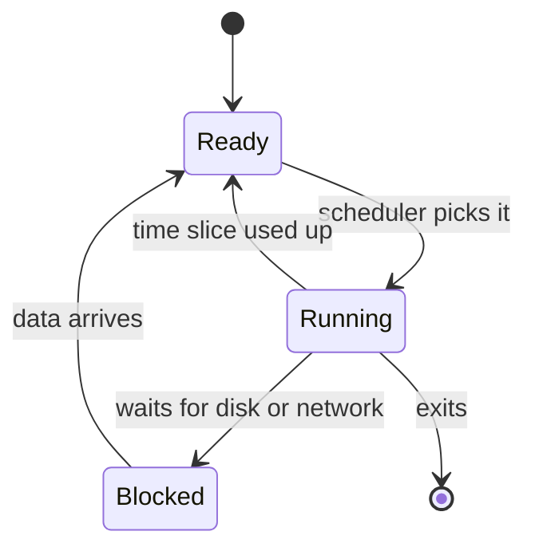

# Processes, threads and scheduling

After this you can say what a process and a thread are, why a machine with 12 cores runs hundreds of programs, and which of threads or processes helps a slow task in Python.

Before this: [What an OS and kernel do](01-what-an-os-and-kernel-do.md).

## The idea

You start a build, and the laptop still plays music and responds to the mouse. A CPU core runs one instruction stream at a time, yet dozens of programs seem to move at once. The kernel creates this effect by switching: it lets one program run for a few milliseconds, pauses it, lets another run, and repeats so quickly that all of them look alive.

Two things need names. The running copy of a program, with its own memory and open files, is one thing. The independent line of execution inside it is another. A browser is a good picture: each tab is often its own process, and inside a tab several threads render, run JavaScript and fetch data.

## Key terms

A **process** is a running program: its own address space (private memory), its open files, and at least one thread. The kernel names each process with a number, the **PID** (process ID). The process that started it is its **parent**.

A **thread** is one line of execution inside a process. It has its own stack and CPU registers, and it shares the process's memory and open files with the other threads.

The **scheduler** is the part of the kernel that decides which thread runs on which core, and for how long.

A **context switch** is the kernel pausing one thread and starting another. It saves the old thread's registers, loads the new one's, and often makes the CPU caches less useful for a moment.

**Concurrency** means several tasks are in progress during the same period, even on one core. **Parallelism** means several tasks are literally running at the same instant, which needs several cores.

## How it works

A thread is always in one of three states: running on a core, ready (able to run, waiting for a core) or blocked (waiting for something, such as a disk read or a network reply). Only ready threads compete for the CPU.



The scheduler takes a ready thread, lets it run for a **time slice** (a few milliseconds is typical), then takes it off the core if others are waiting. A thread that blocks gives up its slice at once. This is why a program that waits on the network wastes almost no CPU, and why a program that loops without waiting uses one full core.

Processes and threads trade isolation against cost. Processes cannot touch each other's memory, so a crash in one is contained, but sharing data needs explicit channels such as pipes or sockets. Threads share memory directly, which makes sharing easy and bugs hard: two threads changing the same variable without coordination is a race condition. Creating a thread and switching between threads costs less than doing the same with processes.

### The GIL in one line

The CPython interpreter has a **global interpreter lock** (GIL) that lets only one thread run Python bytecode at a time, so threads speed up waiting but not computing. A free-threaded build with the GIL turned off exists since Python 3.13, and the default build still has it ([Python docs](https://docs.python.org/3/howto/free-threading-python.html), as of 2026).

<details class="code" markdown>
<summary>In code</summary>

A new process gets its own copy of the variables, so its change stays private. A thread shares its process's variables. Save this as `share.py`:

```python
import os, threading, multiprocessing as mp

counter = 0

def bump():
    global counter
    counter += 1
    print("worker", os.getpid(), "sees", counter)

if __name__ == "__main__":
    p = mp.Process(target=bump)
    p.start(); p.join()
    print("after process:", counter)

    t = threading.Thread(target=bump)
    t.start(); t.join()
    print("after thread: ", counter)
```

```text
worker 6160 sees 1
after process: 0
worker 16928 sees 1
after thread:  1
```

The child process changed its own copy, so the main program still sees 0. The thread changed the shared variable, so the main program sees 1, and the thread reports the same PID as the main program (16928), because it is not a separate process. Your PIDs will differ.

</details>

## Worked examples

<div class="example" markdown>

### Example 1: which pool speeds up which task

Two kinds of work, and two kinds of pool. `ThreadPoolExecutor` runs workers as threads in one process. `ProcessPoolExecutor` runs them as separate processes ([concurrent.futures](https://docs.python.org/3/library/concurrent.futures.html)).

```python
import time
from concurrent.futures import ThreadPoolExecutor, ProcessPoolExecutor

def count(n):
    while n:
        n -= 1

def timed(pool_cls, label):
    start = time.perf_counter()
    with pool_cls(max_workers=4) as pool:
        list(pool.map(count, [20_000_000] * 4))
    print(f"{label:11s} {time.perf_counter() - start:.2f} s")

if __name__ == "__main__":
    start = time.perf_counter()
    for _ in range(4):
        count(20_000_000)
    print(f"{'one thread':11s} {time.perf_counter() - start:.2f} s")
    timed(ThreadPoolExecutor, "4 threads")
    timed(ProcessPoolExecutor, "4 processes")
```

```text
one thread  1.60 s
4 threads   1.59 s
4 processes 0.55 s
```

1. The task is pure computing: a loop with no waiting. It is CPU-bound.
2. Four threads take as long as one, because the GIL lets one thread compute at a time. Switching adds a little overhead.
3. Four processes each have their own interpreter and GIL, so they run in parallel on four cores. The gain is under 4x because starting processes costs time.

Check: on a machine with one core the processes would not win either. Print `os.cpu_count()` to see how many cores you have.

</div>

<div class="example" markdown>

### Example 2: when threads do help

The same pool, now with a task that waits, such as a network call:

```python
import time
from concurrent.futures import ThreadPoolExecutor

def wait(_):
    time.sleep(1)                     # stands in for a network or disk wait

start = time.perf_counter()
with ThreadPoolExecutor(max_workers=4) as pool:
    list(pool.map(wait, range(4)))
print(f"4 waits of 1 s on 4 threads: {time.perf_counter() - start:.1f} s")
```

```text
4 waits of 1 s on 4 threads: 1.0 s
```

A sleeping thread is blocked, and CPython releases the GIL while it waits. All four waits overlap. This is concurrency without parallelism in the computing sense.

</div>

## Common mistakes

<div class="warning" markdown>

Watch out: using threads for CPU-bound Python and expecting a speed-up. Use processes (`multiprocessing`, `ProcessPoolExecutor`), or move the hot loop into native code such as NumPy.

Watch out: on Windows and macOS, `multiprocessing` starts a fresh interpreter that imports your file again. Without `if __name__ == "__main__":` around the start-up code, it can launch processes forever or raise a `RuntimeError`.

Watch out: confusing a PID with a thread. A PID names a process, and the kernel can reuse it after the process exits. Never store one as a permanent identifier.

</div>

## Working with AI

<div class="ai" markdown>

Words to use: process, thread, PID, context switch, CPU-bound, I/O-bound, race condition, GIL. They tell an assistant what kind of waiting you have.

Prompts to try:

- "My Python 3.13 script resizes 500 images in a loop and takes 4 minutes on a 12-core machine. Is it CPU-bound or I/O-bound? Show me how to test that, then parallelise it with `ProcessPoolExecutor` and explain what gets copied between processes."
- "Two threads update a shared dict and I sometimes lose updates. Name the problem, show a minimal reproduction and the smallest fix."

What to check:

- Threads suggested for CPU-bound Python. Time it: a speed-up of about 1x means the GIL is the limit.
- A shared-memory fix that adds `time.sleep` instead of a lock. Sleeping hides a race condition, it does not remove it.
- Missing `if __name__ == "__main__":` guard in multiprocessing code.
- Arguments or results that cannot be pickled (open files, locks, lambdas). Processes send data by copying it, so check what crosses the boundary.

</div>

## Quiz

1\. A machine has 4 cores and 300 processes. How do all of them make progress?

<details class="solution" markdown>
<summary>Answer</summary>

Most are blocked, waiting for input or events. The scheduler time-slices the ready ones across the 4 cores and context-switches between them, so each gets turns.

</details>

2\. What does each print, and why?

```python
import threading

x = []
t = threading.Thread(target=lambda: x.append(1))
t.start(); t.join()
print(len(x))
```

<details class="solution" markdown>
<summary>Answer</summary>

`1`. The thread shares the process's memory, so its append is visible to the main thread. A `multiprocessing.Process` would print `0`, because the child appends to its own copy.

</details>

3\. A web scraper fetches 200 pages one at a time and takes 4 minutes. Threads or processes?

<details class="solution" markdown>
<summary>Answer</summary>

Threads (or `asyncio`). The task is I/O-bound: the time goes to waiting for the network, the GIL is released during the wait, and threads are cheaper than processes. Keep the pool small so you do not hammer the site.

</details>

4\. What is the difference between concurrency and parallelism?

<details class="solution" markdown>
<summary>Answer</summary>

Concurrency is several tasks in progress over the same period, possible on one core by switching. Parallelism is several tasks running at the same instant, which needs several cores.

</details>

## Lab

<div class="lab" markdown>

### Lab: threads, processes and the GIL

Goal: measure which of threads and processes speeds up a CPU task and a waiting task. Time: about 15 minutes. Runs in: Python on any OS; step 5 uses WSL (Ubuntu).

1. Save the script from Example 1 as `cpu_bound.py` and run it. Write down the three times.
2. Change `20_000_000` to `5_000_000` and run again. Does the processes' advantage shrink? Process start-up has a fixed cost, so small tasks gain less.
3. Save the script from Example 2 as `waiting.py` and run it. Change `max_workers` to 2 and predict the time before you run it.
4. Save the script from "In code" as `share.py` and run it. Confirm that the process line has a different PID from the main program and that the thread line has the same one.
5. In WSL (unverified): run `sleep 60 &` then `ps -o pid,ppid,stat,comm -p $!`. The `PPID` column shows the parent PID of your `sleep`; `kill $!` ends it.

Expected result: step 1 shows the processes faster, step 3 with `max_workers=2` takes about 2.0 s, and `share.py` prints a counter of 0 after the process and 1 after the thread.

<details class="solution" markdown>
<summary>Solution</summary>

With 2 workers, the 4 one-second waits run as two rounds of two, so about 2 s. In step 5, the parent of `sleep` is your shell, so the `PPID` equals the shell's PID (`echo $$` prints it).

</details>

</div>

## Where this shows up

- Managing processes from the shell: processes and signals<!-- link: ../02-linux-command-line/05-processes-and-signals.md -->.
- The same idea of "wait without burning a core" drives async JavaScript and the event loop<!-- link: ../../08-front-end/02-javascript-and-typescript/03-async-javascript-and-the-event-loop.md -->.
