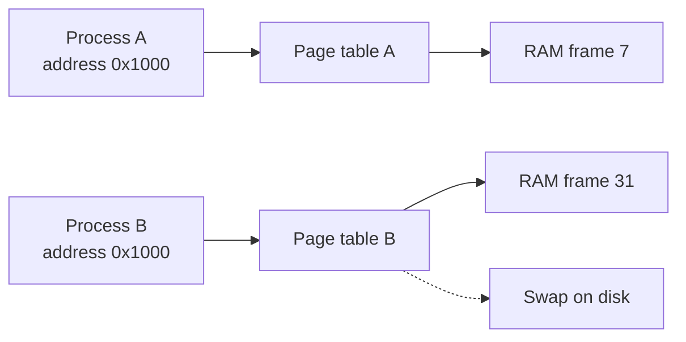

# Memory and virtual memory

After this you can explain why every program thinks it owns all the memory, what a page fault and swap are, why Linux sometimes kills a process, and the difference between the stack and the heap.

Before this: [Processes, threads and scheduling](02-processes-threads-and-scheduling.md) and the [memory hierarchy](../../01-how-computers-work/02-hardware/04-memory-hierarchy-and-latency-numbers.md).

## The idea

On a laptop with 16 GB of RAM, a browser, an editor, a database and your script are all running. Each was promised a huge, private, continuous block of memory, and together they asked for far more than 16 GB. Nothing breaks, at least at first.

The trick is that the addresses a program uses are not real RAM locations. They are made-up addresses that the kernel and the CPU translate, and the kernel hands out real RAM only for the parts a program actually touches.



Both processes use the address `0x1000`, and each reaches a different place in RAM. That is the whole idea of virtual memory.

## Key terms

**Virtual memory** is the address space each process sees. The CPU's memory management unit (MMU) translates every virtual address to a physical RAM address, using tables the kernel maintains.

A **page** is a fixed-size chunk of virtual memory, usually 4096 bytes (4 KiB). RAM is split into frames of the same size, and the **page table** records which frame backs which page.

A **page fault** happens when a program touches a page that has no frame behind it yet. The CPU stops the program and calls the kernel, which either maps a frame and resumes the program, or ends the program if the address was never valid.

**Swap** is disk space the kernel uses as overflow for pages that are not in use. Moving a page there frees its RAM frame for something else.

The **OOM killer** is the Linux kernel's last resort when RAM and swap are both exhausted: it picks a process and ends it, so the machine keeps running. OOM stands for out of memory.

## How it works

1. A program asks for memory. The kernel records a range of virtual addresses as valid but gives out no RAM yet.
2. The program writes to a page for the first time. The CPU raises a page fault, the kernel picks a free frame, fills it with zeros, updates the page table and resumes the program. The program never notices.
3. When RAM runs low, the kernel picks pages that have not been used for a while and writes them to swap, or drops them if a copy already exists on disk, such as pages that came from a program file.
4. If the program later touches a swapped-out page, a page fault pulls it back from disk. This is a **major** fault, and it costs roughly the disk-versus-RAM gap from the memory hierarchy lesson. A fault that needs no disk read is a **minor** fault.
5. If a machine thrashes (spends its time moving pages in and out), everything slows down. If swap also fills, the OOM killer ends the process it scores worst, usually the biggest one.

So a program can hold far more address space than RAM; its **resident set size** (RSS) counts only the pages actually in RAM. A Linux machine can also look 95% full while healthy, because the kernel uses spare RAM as a disk cache and gives it back on demand.

### Stack and heap

Each process's address space has two main areas for data. The **stack** holds a function call's local variables and return address; it grows when a function is called and shrinks when it returns. It is fast and small, often a few megabytes per thread. The **heap** holds data that must outlive one call, such as a list that a function builds and returns. It is large, and it is managed by the program or its runtime.

Endless recursion fills the stack (a stack overflow). Heap data that is never released grows until the OOM killer arrives (a memory leak). Python keeps its objects on the heap and limits recursion to 1000 calls by default, so it raises a `RecursionError` before the real stack is gone ([sys.getrecursionlimit](https://docs.python.org/3/library/sys.html#sys.getrecursionlimit)).

<details class="code" markdown>
<summary>In code</summary>

Python's `mmap` module asks the OS for a block of virtual memory. This runs on any operating system.

```python
import mmap

print("page size:", mmap.PAGESIZE, "bytes")
buf = mmap.mmap(-1, 256 * 1024 * 1024)   # reserve 256 MiB; no RAM handed out yet
```

```text
page size: 4096 bytes
```

On some systems, for example macOS on Apple silicon, the page size is 16384 bytes.

</details>

## Worked examples

<div class="example" markdown>

### Example 1: seeing page faults in the clock

We reserve 256 MiB, then write one byte to every page, twice. The first pass takes a page fault per page. The second finds the frames ready. Save this as `faults.py`:

```python
import mmap, time

SIZE = 256 * 1024 * 1024
page = mmap.PAGESIZE
buf = mmap.mmap(-1, SIZE)
pages = SIZE // page

def touch():
    start = time.perf_counter()
    for i in range(pages):
        buf[i * page] = 1          # one byte per page
    return time.perf_counter() - start

first = touch()
second = touch()
print(f"first pass:  {first:.3f} s")
print(f"second pass: {second:.3f} s")
print(f"first / second: {first / second:.1f}x")
```

```text
first pass:  0.071 s
second pass: 0.003 s
first / second: 21.4x
```

1. `mmap.mmap(-1, SIZE)` reserves the address range. Memory use barely moves yet.
2. The first loop writes into 65,536 pages (256 MiB divided by 4096 bytes). Each write faults, and the kernel supplies a zeroed frame.
3. The second loop does the same writes with no faults, so the difference is the cost of the faults.

Check: the ratio changes from run to run and machine to machine, but the first pass should be many times slower. If both passes take the same time, the Python loop dominates on that machine; try a bigger `SIZE`.

</div>

<div class="example" markdown>

### Example 2: the stack runs out, the heap does not

```python
import sys

def depth(n):
    return depth(n + 1)

print("limit:", sys.getrecursionlimit())
try:
    depth(0)
except RecursionError as e:
    print("RecursionError:", e)

data = [0] * 10_000_000
print("list of 10 million slots:", sys.getsizeof(data) // 1_000_000, "MB")
```

```text
limit: 1000
RecursionError: maximum recursion depth exceeded
list of 10 million slots: 80 MB
```

Recursion stops after 1000 calls, while the heap holds an 80 MB list without trouble (each of the 10 million slots is an 8-byte pointer).

</div>

## Common mistakes

<div class="warning" markdown>

Watch out: reading "free memory" from `free -h` or Task Manager and panicking. Linux fills spare RAM with cache. The `available` column is the number to read.

Watch out: blaming only your program for an OOM kill. A container can have a [lower memory limit](../../13-devops-and-cloud/01-containers/01-vms-vs-containers.md) than the machine, so a process can die on a half-empty host. The kernel log shows who was killed and why.

Watch out: raising the recursion limit to "fix" a `RecursionError`. A bigger limit can overflow the real stack and crash the interpreter. Rewrite the recursion as a loop.

</div>

## Working with AI

<div class="ai" markdown>

Words to use: virtual memory, page fault, swap, resident set size (RSS), OOM killer, stack, heap, memory leak. They separate "uses a lot of address space" from "uses a lot of RAM".

Prompts to try:

- "My Python service on Ubuntu 24.04 in Docker is killed with exit code 137 after about two hours, and memory use in `docker stats` rises steadily. Explain the OOM killer, how I confirm it, and how I find a leak with `tracemalloc`."
- "Explain the difference between virtual size and RSS in `top` output for a process using `mmap`."

What to check:

- Advice to "add more swap" as the fix for a leak. Swap delays the kill and makes the service slow; the leak is still there.
- Claims that deleting a Python variable returns memory to the OS. The interpreter often keeps freed memory for reuse, so RSS may not drop.
- Memory numbers with no unit or no source (virtual, resident, or limit). Ask which one a number is.

</div>

## Quiz

1\. Two processes both print the address of a variable and get `0x7ffd1000`. Do they share it?

<details class="solution" markdown>
<summary>Answer</summary>

No. Addresses are virtual and per process. The page tables map the same number to different frames in RAM.

</details>

2\. A script allocates 20 GB with `mmap` on a 16 GB machine and then writes nothing. Does it fail?

<details class="solution" markdown>
<summary>Answer</summary>

Often not. The kernel reserves address space but supplies RAM only on first write. Whether the allocation is refused depends on the OS and its overcommit settings (Linux often allows it). Writing to all of it would force swapping and then the OOM killer.

</details>

3\. A service shows "Killed" in its terminal and exit code 137, with no Python traceback. What is the likely cause?

<details class="solution" markdown>
<summary>Answer</summary>

The kernel sent `SIGKILL` (signal 9; 128 + 9 = 137), most often the OOM killer. A process cannot catch `SIGKILL`, so no traceback appears. Check the kernel log (`dmesg`) or the container's memory limit.

</details>

4\. Where does each live: a function's loop counter, and a list returned by the function?

<details class="solution" markdown>
<summary>Answer</summary>

The loop counter is a local, tied to the call, so it belongs to the stack (in CPython the name lives in the call's frame). The list must outlive the call, so it is allocated on the heap.

</details>

## Lab

<div class="lab" markdown>

### Lab: watching memory behave

Goal: time page faults, hit the recursion limit, and read real memory numbers from Linux. Time: about 15 minutes. Runs in: Python on any OS; steps 4 and 5 use WSL (Ubuntu).

1. Run `faults.py` from Example 1 three times. Write down the ratio each time.
2. Change `SIZE` to `64 * 1024 * 1024` and run it again. Predict the first-pass time before you look (about a quarter of the old one).
3. Run the script from Example 2. Change the list to `[0] * 100_000_000` and watch the machine's memory use in Task Manager while it runs.
4. In WSL (unverified): run `free -h`, then `grep -E 'VmSize|VmRSS' /proc/self/status`. VmSize is virtual size and VmRSS is resident memory ([proc_pid_status(5)](https://man7.org/linux/man-pages/man5/proc_pid_status.5.html)). The second command inspects the `grep` process itself.
5. In WSL (unverified): run `swapon --show` and `cat /proc/self/oom_score` ([swapon(8)](https://manpages.ubuntu.com/manpages/noble/man8/swapon.8.html), [proc_pid_oom_score(5)](https://man7.org/linux/man-pages/man5/proc_pid_oom_score.5.html)). An empty `swapon` output means no swap is configured.

Expected result: in step 1 the first pass is always many times slower than the second, and in step 4 `VmSize` is far larger than `VmRSS`.

<details class="solution" markdown>
<summary>Solution</summary>

Steps 1 to 3 are the code from the lesson. In step 3 the 800 MB list shows up in Task Manager only because every slot is written when the list is created. In step 4, `VmSize` includes everything mapped (libraries, reserved ranges), while `VmRSS` counts the pages currently in RAM.

</details>

</div>

## Where this shows up

- Memory limits for containers in [VMs vs containers](../../13-devops-and-cloud/01-containers/01-vms-vs-containers.md).
- Why arrays beat linked structures in practice: [arrays and dynamic arrays](../../06-data-structures-and-algorithms/02-data-structures/01-arrays-and-dynamic-arrays.md).
