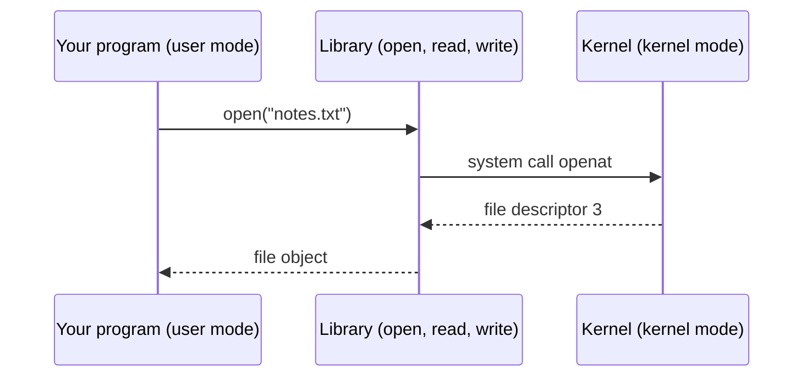

# System calls and kernel mode

After this you can explain how a program asks the kernel for work, name the common system calls, and use `strace` to see which ones a program makes.

Before this: [What an OS and kernel do](01-what-an-os-and-kernel-do.md) and [File systems](04-file-systems.md).

## The idea

A program that reads a file cannot touch the disk itself. The CPU would stop it, because ordinary programs run in a restricted mode that blocks direct access to devices. Yet `open("notes.txt")` works in every language. Something carries the request across the boundary, the kernel does the work, and the answer comes back.

That crossing is a system call. Every useful thing a program does, from printing to opening a socket to starting another program, ends in one or more of them. If you can watch the system calls, you can see what a program really does, whatever language it is written in.



## Key terms

**Kernel mode** is the CPU state in which the kernel runs, with unrestricted access to hardware and memory. **User mode** is the restricted state in which every other program runs. The CPU enforces the difference.

A **system call** (syscall) is a request from a user program to the kernel for a service, made through a special CPU instruction that switches into kernel mode, runs a fixed kernel function and switches back. The Linux manual describes it as the fundamental interface between an application and the kernel ([syscalls(2)](https://man7.org/linux/man-pages/man2/syscalls.2.html)).

A **file descriptor** is a small integer that a process uses to refer to an open file, socket or pipe. By convention 0 is standard input, 1 is standard output and 2 is standard error.

**strace** is a Linux tool that runs a program and prints each system call it makes, with arguments and return value ([strace(1)](https://man7.org/linux/man-pages/man1/strace.1.html)).

## How it works

1. Your code calls a library function such as Python's `open()` or C's `fopen()`.
2. The library puts the call number and arguments in registers and runs the CPU's syscall instruction.
3. The CPU switches to kernel mode and jumps to a fixed entry point in the kernel. A program cannot jump anywhere else in the kernel.
4. The kernel checks the arguments and the caller's permissions, does the work, and stores a result. A failure returns an error code such as "no such file".
5. The CPU switches back to user mode and the library returns the result to your code.

Programs rarely write syscalls by hand; the language runtime and the C library wrap them. The common ones are worth recognising by name:

| Group | Calls | What they do |
|---|---|---|
| Files | `openat`, `read`, `write`, `close` | open a file, move bytes, release it |
| Processes | `fork`/`clone`, `execve`, `wait4`, `exit_group` | create a process, run a program in it, wait, finish |
| Memory | `mmap`, `brk` | get more virtual memory |
| Network | `socket`, `connect`, `accept`, `send`, `recv` | talk over a network |

Crossing the boundary costs more than an ordinary function call: the CPU switches mode, checks arguments and may disturb caches. One call is cheap, hundreds of thousands are not, which is why libraries buffer. Python's `print` and `file.write` gather small writes in memory and send one big `write` to the kernel.

Windows has the same split, but programs go through the Windows API (`CreateFileW` and similar). The idea carries over; the names and `strace` do not.

<details class="code" markdown>
<summary>In code</summary>

Python's `os.open`, `os.write` and `os.close` are thin wrappers over the system calls of the same names, while the built-in `open()` adds buffering. This runs on any OS.

```python
import os

fd = os.open("demo.txt", os.O_WRONLY | os.O_CREAT | os.O_TRUNC)
print("file descriptor:", fd)
os.write(fd, b"hello\n")
os.close(fd)
os.remove("demo.txt")
```

```text
file descriptor: 3
```

Descriptors 0, 1 and 2 are already taken by standard input, output and error, so the first new file normally gets the next free number. 

</details>

## Worked examples

<div class="example" markdown>

### Example 1: what a system call costs

We write 200,000 single bytes two ways: one `os.write` system call per byte, and Python's buffered file, which batches them. Save this as `syscost.py`:

```python
import os, time, tempfile

N = 200_000
path = os.path.join(tempfile.gettempdir(), "syscall_demo.bin")

start = time.perf_counter()
fd = os.open(path, os.O_WRONLY | os.O_CREAT | os.O_TRUNC)
for _ in range(N):
    os.write(fd, b"x")                  # one system call per byte
os.close(fd)
raw = time.perf_counter() - start

start = time.perf_counter()
with open(path, "wb") as f:             # buffered: few system calls
    for _ in range(N):
        f.write(b"x")
buffered = time.perf_counter() - start

print(f"{N} os.write calls:  {raw:.3f} s")
print(f"{N} buffered writes: {buffered:.3f} s")
print(f"ratio: {raw / buffered:.0f}x")
os.remove(path)
```

```text
200000 os.write calls:  0.552 s
200000 buffered writes: 0.015 s
ratio: 36x
```

1. The first loop makes 200,000 system calls, each with a mode switch.
2. The second loop makes 200,000 calls too, but to a Python method that copies the byte into a buffer in user space. The kernel is entered only a few dozen times.
3. The work (200,000 bytes) is the same, so the gap is the cost of crossing into the kernel.

Check: the ratio depends on the OS, the file system and antivirus software. It should still be many times above 1. If it is near 1, something between you and the kernel is batching the writes.

</div>

<div class="example" markdown>

### Example 2: watching a program with strace

In WSL (Ubuntu), unverified. Trace only the file-related calls of `cat`:

```bash
echo "mybox" > hostname.txt
strace -e trace=openat,read,write cat hostname.txt
```

```text
openat(AT_FDCWD, "hostname.txt", O_RDONLY) = 3
read(3, "mybox\n", 131072)              = 6
write(1, "mybox\n", 6)                  = 6
read(3, "", 131072)                     = 0
```

`strace` also prints lines for loading libraries first; these four are the ones to find. Reading the lines top to bottom: `cat` opens the file and gets descriptor 3. It asks for up to 131,072 bytes and gets 6. It writes those 6 bytes to descriptor 1, standard output, which is your terminal. It reads again, gets 0 bytes (end of file) and stops. The exact numbers and extra lines vary by system. Other useful options from the man page: `-c` prints a summary of calls and time, `-f` follows child processes, `-o file` writes the trace to a file, and `-p PID` attaches to a running process.

Check: change the file name to one that does not exist. The `openat` line then ends in `= -1 ENOENT (No such file or directory)`, which is the error a program turns into its own error message.

</div>

## Common mistakes

<div class="warning" markdown>

Watch out: assuming slow I/O code is slow because of the language. Many tiny reads and writes mean many system calls. Batch them with buffering or larger reads.

Watch out: pasting a trace publicly. It shows file paths, arguments and sometimes secrets such as tokens.

Watch out: reading `strace -c` output as the program's whole run time. It shows time inside system calls, not time spent computing in user space.

</div>

## Working with AI

<div class="ai" markdown>

Words to use: system call, kernel mode, user mode, file descriptor, `strace`, `ENOENT`, `EACCES`, buffered I/O. They let an assistant explain an error at the level where it happened.

Prompts to try:

- "Here is the output of `strace -f -e trace=openat,execve ./deploy.sh` on Ubuntu 24.04: (paste). The script says 'command not found' but I can see the file. Which call failed and with which error code?"
- "My Python program writes 50 million tiny lines and is slow. Show the system-call pattern this creates and how buffering or batching changes it."

What to check:

- Error names. `ENOENT` is a missing path, `EACCES` is a permission failure, and they send you to different fixes. Compare the AI's reading against the raw `strace` line.
- Invented `strace` options. Run `strace --help` or `man strace` before using a flag.
- Advice that applies `strace` to Windows or macOS. macOS uses other tools (`dtruss`, `fs_usage`) and Windows uses Process Monitor.

</div>

## Quiz

1\. Why can a normal program not read the disk directly?

<details class="solution" markdown>
<summary>Answer</summary>

It runs in user mode, where the CPU blocks direct device access. It must ask the kernel through a system call, and the kernel can check permissions before it acts.

</details>

2\. In the `strace` line `read(3, "hello\n", 4096) = 6`, what do 3, 4096 and 6 mean?

<details class="solution" markdown>
<summary>Answer</summary>

3 is the file descriptor to read from, 4096 is the largest number of bytes the program asked for, and 6 is the number of bytes actually returned.

</details>

3\. A trace ends with `openat(AT_FDCWD, "/etc/app/config.yml", O_RDONLY) = -1 ENOENT (No such file or directory)`. What does it tell you?

<details class="solution" markdown>
<summary>Answer</summary>

The program looked for `/etc/app/config.yml`, and the kernel could not find that path. The program reads the wrong path or the file is missing. A permissions problem would show `EACCES` instead.

</details>

4\. Why is a Python loop doing `os.write(fd, b"x")` 200,000 times much slower than `f.write(b"x")` on a buffered file?

<details class="solution" markdown>
<summary>Answer</summary>

Each `os.write` crosses into the kernel and back. The buffered file collects the bytes in user space and makes only a few system calls.

</details>

## Lab

<div class="lab" markdown>

### Lab: put a number on the kernel boundary, then watch it

Goal: measure syscall cost in Python, then watch real system calls with `strace`. Time: about 15 minutes. Runs in: Python on any OS; steps 4 and 5 use WSL (Ubuntu) and are unverified.

1. Run `syscost.py` from Example 1 twice. Note the ratio.
2. Change `N` to `1_000_000`. Does the ratio hold? Predict first.
3. Wrap the buffered loop in `open(path, "wb", buffering=0)` and run it again. This turns buffering off; predict which row it now resembles.
4. In WSL, run `echo hi > a.txt` and `strace -c cat a.txt`. The summary table lists each system call, how often it ran and how long it took.
5. Run `strace -e trace=openat cat a.txt 2>&1 | tail -3`, then repeat with `cat missing.txt` and compare the last `openat` line. Cleanup: `rm a.txt`.

Expected result: raw `os.write` stays many times slower than buffered writes, and the unbuffered file in step 3 lands close to the raw time. In step 5, the missing file ends in `ENOENT`.

<details class="solution" markdown>
<summary>Solution</summary>

With `buffering=0`, each `f.write` goes straight to the kernel, so the time matches the raw `os.write` loop. `strace` writes its trace to standard error, so `2>&1` joins it to the pipe for `tail`.

</details>

</div>

## Where this shows up

- Processes and signals<!-- link: ../02-linux-command-line/05-processes-and-signals.md --> uses `kill`, which is a system call, and `strace -p` is a standard way to see why a process hangs.
- Containers share the host kernel, so the system calls they can make matter: [VMs vs containers](../../13-devops-and-cloud/01-containers/01-vms-vs-containers.md).
