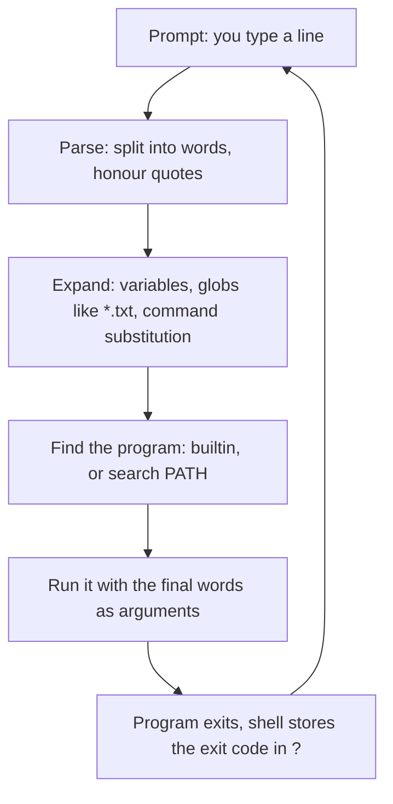

# Shell and terminal basics

After this you can read a command line, say what the shell does to it before the program runs, quote an argument correctly, and use the exit code to tell whether a command worked.

Before this: [What an OS and kernel do](../01-os-concepts/01-what-an-os-and-kernel-do.md) and [Setting up your machine](../../00-start-here/setting-up-your-machine.md).

## The idea

You type `ls *.txt` and get a list of files. You never wrote the file names, so something turned `*.txt` into `a.txt b.txt` before `ls` saw it. That something is the shell, and knowing what it does to your line explains most "why did the command do that?" moments.

Three layers are easy to confuse. The **terminal** is the window: it shows text and sends your keystrokes on. The **shell** is the program inside it that reads a line, interprets it and starts other programs. On Ubuntu the shell is **Bash**. The programs it starts (`ls`, `grep`, `python`) are separate executables, and each one asks the kernel for what it needs through system calls, as in [system calls and kernel mode](../01-os-concepts/05-system-calls-and-kernel-mode.md).


## Key terms

A **command** is the first word of a line: a program's name, a shell **builtin** such as `cd`, or an alias. Words after it are **arguments**. An **option** (or flag) is an argument that starts with `-` and changes behaviour: `ls -l` or `ls --all`. Short options combine, so `ls -la` means `ls -l -a`.

The **prompt** is the text the shell prints when it waits, for example `you@machine:~$`. The `~` is your home directory and `$` means a normal user (`#` means root). The **exit code** is the number a program returns when it ends: 0 means success, anything else means some kind of failure.

## How it works

For each line, the shell does the same steps in the same order, as in the diagram.



Expansion is the step that surprises people. The program never sees `*.txt`; it sees the list the shell built. A **glob** is a pattern the shell expands against file names: `*` matches any run of characters, `?` one character, `[ab]` one of the listed characters. A pattern that matches nothing stays as typed in Bash, so the program gets the literal text.

**Quoting** controls expansion. Double quotes stop word splitting and globbing but still expand `$variables`. Single quotes stop everything. Unquoted, a space separates arguments. A backslash escapes one character.

```bash
NAME=Ada
echo "Hello $NAME"
echo 'Hello $NAME'
```

```text
Hello Ada
Hello $NAME
```

The special variable `$?` holds the exit code of the last command. Programs follow the convention in [Bash's manual](https://www.gnu.org/software/bash/manual/bash.html#Exit-Status): 0 is success, and 1 to 125 are the program's own errors. `grep` uses 1 for "ran fine, found nothing", which is not a failure of the program.

Typing less is part of using the shell well. Press Tab to complete a name (twice lists the choices). The up arrow recalls earlier lines, `history` lists them, and Ctrl-R searches them: type part of an old command and press Ctrl-R again for the next match. Ctrl-C stops the running command, Ctrl-L clears the screen, and Ctrl-D at an empty prompt ends the shell.

To learn a command, `man ls` opens its manual page (arrow keys to scroll, `/word` to search, `q` to quit). Most commands also print a shorter summary with `--help`. `type ls` tells you whether a name is a builtin, an alias or a file on disk.

## Worked examples

<div class="example" markdown>

### Example 1: what the shell does to a line

In a folder with the files `a.txt`, `b.txt`, `notes.md` and `my file.txt`:

```bash
ls *.txt
echo *.txt
echo "*.txt"
```

```text
a.txt
b.txt
my file.txt
a.txt b.txt my file.txt
*.txt
```

1. In `ls *.txt` the shell expands the glob. `ls` receives three arguments and prints three lines.
2. `echo *.txt` shows the expansion directly: `echo` only prints the words it was given.
3. Double quotes switch globbing off, so `echo` receives the literal `*.txt`.

Now the space in `my file.txt`:

```bash
ls my file.txt
echo "exit code: $?"
ls "my file.txt"
```

```text
ls: cannot access 'my': No such file or directory
ls: cannot access 'file.txt': No such file or directory
exit code: 2
my file.txt
```

Unquoted, the shell split the name into two arguments. Quoting kept it as one. Check: `echo $?` after a failing command prints a non-zero number, after a working one it prints 0.

</div>

## Common mistakes

<div class="warning" markdown>

Watch out: forgetting quotes around a variable that holds a file name. `rm $file` with `file="my report.txt"` removes two files named `my` and `report.txt`. Write `rm "$file"`.

Watch out: reading `$?` late. It holds the exit code of the most recent command only, so `echo hi; echo $?` prints 0 even if an earlier command failed. Save it (`code=$?`) right away if you need it.

Watch out: pasting a command from the web with a trailing `sudo` or `rm` you do not understand. Read it, and run `man` or `--help` on each part first.

</div>

## Working with AI

<div class="ai" markdown>

Words to use: shell, terminal, builtin, argument, option, glob, quoting, exit code, `PATH`.

Prompts to try:

- "Explain this Bash line word by word, say which part the shell expands before the program runs, and give the exit codes I can expect: `find . -name '*.log' -mtime +7 -print`."
- "This command works in my terminal but my script says 'No such file or directory' for a file with a space in its name. Here is the line: (paste). Fix the quoting and explain each change."

What to check:

- A flag the command does not have. Run `command --help` or `man command` and find the flag.
- Quoting that changes meaning: single quotes where a variable must expand, or no quotes around a variable that can contain spaces.
- Commands written for macOS (BSD `sed -i ''`) or for PowerShell instead of Bash on Ubuntu.
- Anything with `sudo`, `rm -rf` or `> file` that you did not ask for.

</div>

## Quiz

1\. What is the difference between a terminal and a shell?

<details class="solution" markdown>
<summary>Answer</summary>

The terminal is the window that displays text and passes keystrokes along. The shell is the program inside it that reads lines and starts other programs. You can run a different shell in the same terminal.

</details>

2\. What does this print, assuming `a.txt` and `b.txt` exist and nothing else ends in `.txt`?

```bash
echo '*.txt' "*.txt" *.txt
```

<details class="solution" markdown>
<summary>Answer</summary>

`*.txt *.txt a.txt b.txt`. Single and double quotes both stop the glob, so the first two words stay literal. Only the unquoted one expands.

</details>

3\. `grep error app.log` prints nothing and `echo $?` prints 1. Did the command fail?

<details class="solution" markdown>
<summary>Answer</summary>

`grep` ran correctly and found no match, which it reports with exit code 1. An exit code of 2 would mean a real error, such as a missing file.

</details>

4\. Your script runs `cp $src /backup` and breaks when the path is `/home/me/My Photos`. Why, and what is the fix?

<details class="solution" markdown>
<summary>Answer</summary>

The unquoted variable is split at the space into two arguments, `/home/me/My` and `Photos`. Write `cp "$src" /backup`.

</details>

## Lab

<div class="lab" markdown>

### Lab: watch the shell expand your line

Goal: predict, then confirm, what the shell passes to programs. Time: about 15 minutes. Runs in: WSL (Ubuntu).

1. Make a scratch folder with four files, one with a space in its name.

   ```bash
   mkdir ~/shell-lab && cd ~/shell-lab
   touch a.txt b.txt notes.md "my file.txt"
   ```

2. Predict, then run, each line. Use `echo` to see the words the shell built.

   ```bash
   echo *.txt
   echo "*.txt"
   echo ??.txt
   echo [ab].txt
   NAME=Ada; echo "$NAME" '$NAME'
   ```

3. Cause two errors and read the exit codes.

   ```bash
   ls nosuch; echo "exit: $?"
   ls my file.txt; echo "exit: $?"
   ```

4. Use `man ls` to find which option sorts by modification time, newest first, then run `ls -lt`. Press Ctrl-R, type `echo`, and recall an earlier line.
5. Cleanup:

   ```bash
   cd ~ && rm -r ~/shell-lab
   ```

Expected result: `echo ??.txt` prints the literal `??.txt` because no file has a two-character name before `.txt`. Both `ls` errors show exit code 2.

<details class="solution" markdown>
<summary>Solution</summary>

`echo *.txt` prints `a.txt b.txt my file.txt`. `[ab].txt` prints `a.txt b.txt`. The option for newest first is `-t`. The `my file.txt` error lists `my` and `file.txt` as two missing files; `ls "my file.txt"` works.

</details>

</div>

## Where this shows up

- The next lesson, [files and navigation](02-files-and-navigation.md), uses these commands to move around the file system.
- Quoting and exit codes come back in [shell scripting and cron](09-shell-scripting-and-cron.md), and `PATH` in [environment variables and path](08-environment-variables-and-path.md).
