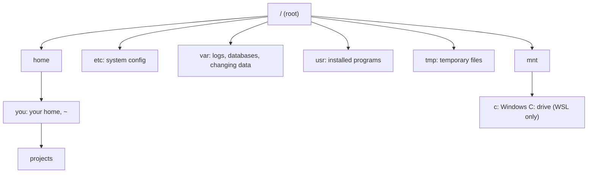

# Files and navigation

After this you can move around a Linux file system, create, copy, move and delete files and folders, find a file by name, read a long file in pieces, and avoid the commands that delete things for good.

Before this: [Shell and terminal basics](01-shell-and-terminal-basics.md) and [File systems](../01-os-concepts/04-file-systems.md).

## The idea

On Windows you have drives: `C:\`, `D:\`. Linux has one tree. Everything, including other disks and USB sticks, hangs off a single root called `/`. A disk is attached ("mounted") at some folder in the tree, so there is no `D:`.



Your **home directory** (`~`, also `$HOME`) is where your files live: `/home/you`. System-wide configuration is in `/etc`, logs and service data in `/var`, programs in `/usr` and `/bin`. In Linux, directories are also files, and devices appear as files under `/dev`, which is why the same commands work on all of them.

## Key terms

The **working directory** is the folder the shell is currently "in"; commands without a full path start from it. An **absolute path** begins with `/` and names a place from the root: `/home/you/projects/app`. A **relative path** does not, and is read from the working directory: `projects/app`. Two special names work in any directory: `.` is the current one and `..` is its parent.

A **hidden file** has a name that starts with a dot, such as `.bashrc`. `ls` skips them unless you add `-a`.

## How it works

These commands cover most daily work. Add `-v` or run with `--help` to see more.

| Command | What it does |
|---|---|
| `pwd` | print the working directory |
| `cd path` | change directory (`cd` alone or `cd ~` goes home, `cd -` goes back) |
| `ls -la` | list all files, long format: type and mode, owner, size, date, name |
| `mkdir -p a/b/c` | make a folder and any missing parents |
| `touch f` | create an empty file, or update its modification time |
| `cp -r src dst` | copy a folder and its contents (`-r` is needed for folders) |
| `mv old new` | move or rename |
| `rm f`, `rm -r dir` | delete a file, or a folder and everything in it |
| `cat f` | print a whole file |
| `less f` | page through a file: space for next page, `/word` to search, `q` to quit |
| `head -n 5 f`, `tail -n 5 f` | the first or last lines; `tail -f f` keeps showing new lines as they are added |
| `du -sh dir` | total size of a folder, human-readable |
| `df -h` | free and used space on each mounted disk |
| `find dir -name "*.py"` | search below `dir` for names matching the pattern |

`find` is the command to learn properly. It walks a folder tree and tests each entry: `find . -type f -name "*.log" -size +10M` finds files ending in `.log` larger than 10 MB. Quote the pattern so the shell does not expand it first, as in the previous lesson.

`mv` does two jobs. In the same folder, it renames. Into another folder, it moves. There is no separate rename command, and `mv` overwrites an existing target without asking.

**Deleting is permanent.** `rm` does not use a recycle bin; it removes the directory entry and the space is reused. `rm -r` repeats that for everything below, with no confirmation. `rm -i` asks first.

```bash
cd ~/sandbox
ls -la project
```

```text
total 0
drwxr-xr-x 1 you users 0 Oct 25 23:01 .
drwxr-xr-x 1 you users 0 Oct 25 23:01 ..
drwxr-xr-x 1 you users 0 Oct 25 23:01 docs
drwxr-xr-x 1 you users 0 Oct 25 23:01 src
```

The `.` and `..` entries are the folder itself and its parent. The leading `d` means directory; the rest of the first column is the permission mode from [users, groups and permissions](03-users-groups-and-permissions.md).

## WSL and the Windows drive

In WSL, Windows drives appear under `/mnt`: `C:\Users\you` is `/mnt/c/Users/you`. From Windows, your Linux files are at `\\wsl$\Ubuntu` (the current form is `\\wsl.localhost\Ubuntu`). Keep project files in the Linux home, not under `/mnt/c`: Microsoft recommends storing files in the file system of the tools that use them, because cross-system access is slower ([WSL file systems](https://learn.microsoft.com/en-us/windows/wsl/filesystems)). `explorer.exe .` opens the current Linux folder in Windows Explorer.

## Worked examples

<div class="example" markdown>

### Example 1: build, copy, rename, find

```bash
mkdir -p project/src project/docs
touch project/src/main.py project/src/util.py
cp project/src/main.py project/src/copy.py
mv project/src/copy.py project/src/old.py
ls project/src
find . -name "*.py"
```

```text
main.py
old.py
util.py
./project/src/main.py
./project/src/old.py
./project/src/util.py
```

1. `mkdir -p` made `project`, `src` and `docs` in one command.
2. `cp` made a second file, and `mv` renamed it: the same file, a new name.
3. `find . -name "*.py"` started at `.` and printed every match with its path.

Check: `ls project/src` shows three files and no `copy.py`.

</div>

<div class="example" markdown>

### Example 2: ask before deleting

```bash
rm -ri project/docs
```

```text
rm: descend into directory 'project/docs'? n
```

With `-i` it stops at each step and waits for `y` or `n`. For a risky delete, run `ls` or `find` with the same path first, and read what will go.

</div>

## Common mistakes

<div class="warning" markdown>

Watch out: `rm -rf` with a variable or a space in the wrong place. `rm -rf $DIR/` with an empty `DIR` becomes `rm -rf /`, and `rm -rf ~ /tmp/x` (a stray space) deletes your whole home. Run `ls` on the exact path first, keep the `-f` off unless you need it, and quote variables.

Watch out: `mv a b` overwrites `b` silently if it exists, and `cp` does too. Use `-i`, or `-n` to never overwrite.

Watch out: working in `/mnt/c` for Linux projects. Everything works but file operations are slow, and permissions and line endings behave oddly. Use `~/projects`.

</div>

## Working with AI

<div class="ai" markdown>

Words to use: absolute path, relative path, working directory, home directory, mount point, `find -type`, recursive.

Prompts to try:

- "On Ubuntu, write a `find` command that lists files under `~/projects` larger than 100 MB, modified in the last 30 days, ignoring any `node_modules` folder. Explain each part and show how to test it before deleting anything."
- "Explain the output of `df -h` and `du -sh *` on my server (paste both). Which folder is using my disk?"

What to check:

- Any `rm -rf`, `find ... -delete` or `mv` on a broad path. Replace the action with `ls` or `echo` first and read the list.
- Relative paths in an answer that assume a working directory you are not in. Run `pwd`.
- Unquoted glob patterns in `find -name`.
- Windows paths (`C:\...`) in a Linux command, or `/mnt/c` used where the Linux home would do.

</div>

## Quiz

1\. You are in `/home/you/projects`. Give two ways to reach `/home/you/projects/app/src`.

<details class="solution" markdown>
<summary>Answer</summary>

The relative path `cd app/src`, or the absolute path `cd /home/you/projects/app/src`. `cd ~/projects/app/src` works too.

</details>

2\. What is the difference between `cp -r a b` and `mv a b` when `b` is an existing folder?

<details class="solution" markdown>
<summary>Answer</summary>

Both put `a` inside `b`. `cp -r` leaves `a` where it was and makes a copy. `mv` removes it from the old place.

</details>

3\. You ran `touch .env` and `ls` shows nothing. Where is it?

<details class="solution" markdown>
<summary>Answer</summary>

A name starting with a dot is hidden. `ls -a` or `ls -la` shows it.

</details>

4\. Your disk is full. Which two commands find which disk and which folder?

<details class="solution" markdown>
<summary>Answer</summary>

`df -h` shows free space per mounted disk. Then `du -sh /var/* | sort -h` (or `du -sh *` in a folder) shows how large each entry is, so you can descend into the biggest one.

</details>

## Lab

<div class="lab" markdown>

### Lab: build, navigate and tidy a project folder

Goal: use each core command on a throwaway tree. Time: about 15 minutes. Runs in: WSL (Ubuntu).

1. Build the tree and add content.

   ```bash
   mkdir -p ~/sandbox/project/src ~/sandbox/project/docs
   cd ~/sandbox
   touch project/src/main.py project/src/util.py project/docs/readme.txt
   for i in 1 2 3 4 5 6 7 8 9 10 11 12; do echo "line $i"; done > long.txt
   ```

2. Navigate with a relative, then an absolute path, then go back.

   ```bash
   cd project/src && pwd
   cd /home/$USER/sandbox && pwd
   cd -
   ```

3. Copy the whole project, rename the docs folder in the copy, and compare.

   ```bash
   cd ~/sandbox
   cp -r project backup
   mv backup/docs backup/documentation
   ls -R
   ```

4. Find every `.py` file, then read the long file in pieces.

   ```bash
   find ~/sandbox -name "*.py"
   head -n 3 long.txt
   tail -n 2 long.txt
   du -sh ~/sandbox
   ```

5. Look at your Windows files from Linux: `ls /mnt/c/Users`.
6. Cleanup:

   ```bash
   cd ~ && rm -r ~/sandbox
   ```

Expected result: step 3 shows `backup/documentation` and `project/docs`; step 4 finds four `.py` files (two in `project`, two in `backup`).

<details class="solution" markdown>
<summary>Solution</summary>

The commands in the steps are the solution. `head -n 3` prints `line 1` to `line 3`, `tail -n 2` prints `line 11` and `line 12`.

</details>

</div>

## Where this shows up

- [Pipes, redirection and text tools](04-pipes-redirection-and-text-tools.md) combines `find`, `head` and `tail` with other commands.
- Paths decide which file a program opens, which you meet again in Python's [files and I/O](../../03-programming-fundamentals/01-python-basics/07-files-and-io.md).
