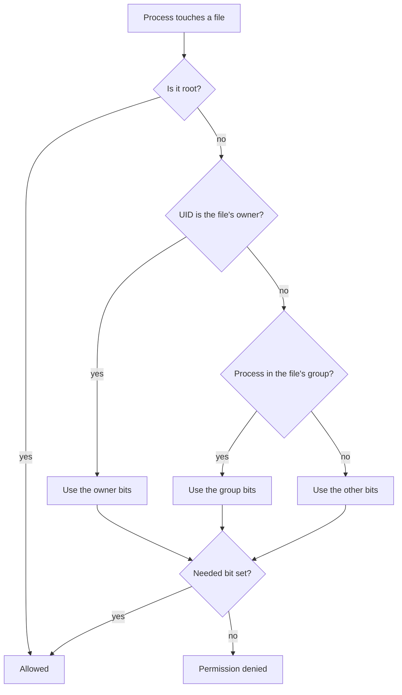

# Users, groups and permissions

After this you can read an `ls -l` line, change who may read, write or run a file with `chmod` and `chown`, and fix a "Permission denied" error without reaching for `chmod 777`.

Before this: Shell and terminal basics<!-- link: 01-shell-and-terminal-basics.md --> and Files and navigation<!-- link: 02-files-and-navigation.md -->.

## The idea

You deploy a small web app to a server. It fails with `Permission denied` when it tries to write its log file. Your first thought is to make the file open to everyone. That works, and it is also how a hole in one program becomes a hole in the whole machine.

Linux answers "who may do what to this file?" with a small, fixed model. Every process runs as one user. Every file has one owner, one group and nine permission bits that say what the owner, the group and everybody else may do. When a process touches a file, the kernel compares the process's identity with the file's owner and group and checks the matching bits.

## Key terms

A **user** is an identity that processes run as. Each user has a name and a numeric **UID**; the kernel works with the number. The user **root** has UID 0 and bypasses almost every permission check.

A **group** is a named set of users with a numeric **GID**. A user has one primary group (given to new files they create) and any number of supplementary groups.

The **owner** of a file is the user recorded in its metadata. Everyone who is neither the owner nor in the file's group is **other**. The **mode** is the nine permission bits (read, write, execute for owner, group and other).

**sudo** runs one command as another user, by default root, if policy allows it.

## How it works

Accounts live in `/etc/passwd`, one line per user, and groups in `/etc/group` ([passwd(5)](https://manpages.ubuntu.com/manpages/noble/man5/passwd.5.html), [group(5)](https://manpages.ubuntu.com/manpages/noble/man5/group.5.html)). The `x` in the password field means the hashed password is in `/etc/shadow`, which only root can read.

```text
alice:x:1001:1002::/home/alice:/bin/bash
devteam:x:1001:alice,bob
```

The first line reads: login name, password placeholder, UID 1001, primary GID 1002, comment (empty), home directory, login shell. The second: group name, placeholder, GID 1001, members `alice` and `bob`. On Debian and Ubuntu, regular users get UIDs from 1000 up and system accounts such as `www-data` get lower ones ([Debian Policy, section 9.2.2](https://www.debian.org/doc/debian-policy/ch-opersys.html)). The command `id` shows who you are.

Each class (owner, group, other) gets three bits, which mean different things on a file and on a directory.

| Bit | Value | On a file | On a directory |
|---|---|---|---|
| `r` | 4 | read the contents | list the names inside |
| `w` | 2 | change the contents | create, delete or rename entries (also needs `x`) |
| `x` | 1 | run it as a program | enter it, and reach things inside by name |

The kernel picks the first class that matches and uses only its bits, as in the diagram. If you own the file, the owner bits apply, even when the group bits are more generous.



`ls -l` shows the result; use `ls -ld` on a directory to see the directory itself.

```text
-rwxr-x--- 1 alice devteam 1842 Oct 25 09:14 deploy.sh
```

The first character is the type (`-` file, `d` directory, `l` symbolic link). The next nine are the mode, as the diagram lays out. Then come the link count, owner, group, size, time and name.

```text
type   owner   group   other
 -     r w x   r - x   - - -
       4 2 1   4 0 1   0 0 0
        = 7     = 5     = 0     ->  octal 750
```

`chmod` changes the mode ([chmod(1)](https://manpages.ubuntu.com/manpages/noble/man1/chmod.1.html)). The symbolic form names who (`u`, `g`, `o`, `a`), an operator (`+`, `-`, `=` for set exactly) and the bits. The octal form writes each class as one digit, adding 4, 2 and 1, so `rw-` is 6 and `r-x` is 5, as in the layout above.

```bash
chmod g+w notes.txt
chmod u=rwx,g=rx,o= deploy.sh
chmod 640 notes.txt
```

| Octal | Symbolic | Typical use |
|---|---|---|
| `755` | `rwxr-xr-x` | programs and directories anyone may use |
| `644` | `rw-r--r--` | ordinary files |
| `600` | `rw-------` | private keys and secrets |
| `750` | `rwxr-x---` | owner full access, group may read and enter |

`chown owner:group file` changes both, `chown :group file` changes only the group, and `-R` recurses ([chown(1)](https://manpages.ubuntu.com/manpages/noble/man1/chown.1.html)). You will usually write `sudo chown`. `sudo command` asks for your own password. Stay a normal user otherwise: a typo in `rm` as root runs with no checks, and files you create as root later give your normal user "Permission denied" in its own project.

Two settings affect new files. The **umask** is a mask of bits removed from the mode a program asks for (usually 666 for files, 777 for directories); with the common `022`, new files are `644` and directories `755`. The **setgid** bit on a directory (`chmod g+s`, or a leading `2` in octal) makes new files inside take the directory's group, which a shared folder needs. It shows as `s` in the group execute position.

Two places this matters in practice. OpenSSH ignores a private key that other users can read, printing `Permissions 0644 ... are too open` ([ssh(1)](https://manpages.ubuntu.com/manpages/noble/man1/ssh.1.html)); the fix is `chmod 600 ~/.ssh/id_ed25519`. And a web server runs as a dedicated user, usually `www-data` on Ubuntu, so a bug in it exposes only what that user can touch. This habit is called least privilege, and the security chapter returns to it in [security mindset and threat modelling](../../12-security/01-web-security/01-security-mindset-and-threat-modelling.md).

## Worked examples

<div class="example" markdown>

### Example 1: why can this person not write?

Three lines from `ls -l`, and a user `bob` in the group `devteam`.

```text
-rw-r--r-- 1 alice devteam   0 Oct 25 09:35 notes.txt
-rw-rw---- 1 alice devteam 212 Oct 25 09:40 plan.txt
-rwxr-xr-x 1 root  root    906 Oct 20 16:02 backup.sh
```

1. `notes.txt`: bob is not the owner, but his group matches, so the group bits `r--` apply. He can read it, not write it.
2. `plan.txt`: the group bits are `rw-`, so bob can read and write. Other users get `---`.
3. `backup.sh`: bob is not root and not in group `root`, so the other bits `r-x` apply. He can read and run it, not change it.

Check: the lab reproduces the first case. Bob's write to a file like `notes.txt` is denied until the group write bit is added.

</div>

## Common mistakes

<div class="warning" markdown>

Watch out: `chmod 777` lets every user and program on the machine write and run the file. It hides the real problem (wrong owner, wrong group, or a missing bit on a parent directory) and lets any compromised process overwrite the file. Find which class applies and add the one bit that is missing.

Watch out: a wrong path in `chmod -R` or `chown -R` can change thousands of files, and a recursive `chmod 644` strips `x` from directories, which locks you out of them. Run `ls -ld` on the target first.

Watch out: `usermod -G devteam bob` without `-a` replaces all of bob's supplementary groups. Use `usermod -aG`. Group changes also apply only to new login sessions.

</div>

## Working with AI

<div class="ai" markdown>

Words to use: owner, group, other, mode bits, UID and GID, setgid, least privilege, `sudo -u`.

Prompts to try:

- "I get `Permission denied` when my service (running as user `deploy`) writes to `/var/app/logs/app.log` on Ubuntu 24.04. Here is `ls -ld /var/app/logs`, `ls -l /var/app/logs/app.log` and `id deploy`: (paste). Which permission class applies, and what is the smallest change that fixes it?"
- "Explain the output of `namei -l /srv/teamdata/notes.txt` line by line, and tell me which directory in the path blocks user `bob`."

What to check:

- `chmod 777`, `chmod -R 777` or "run it as root" as the fix. Ask for the smallest change: one bit, one group membership, or one `chown`.
- A `chown` or `chmod` on a path wider than the problem, such as `/var`, `/etc` or `~`.
- Whether the answer considers every directory on the path. A `644` file is still unreachable if a parent directory lacks `x` for you; `namei -l path` shows each level.
- Whether the user in the answer is the user the process runs as (the service's configuration shows it), not your own login.

</div>

## Quiz

1\. Read this line. Who can read the file, who can write it, and can anyone run it?

```text
-rw-r----- 1 deploy www-data 512 Oct 25 09:50 .env
```

<details class="solution" markdown>
<summary>Answer</summary>

The owner `deploy` has `rw-`, so can read and write. Members of group `www-data` have `r--`, so can read only. Everyone else has `---`. No class has `x`, so nobody can run it as a program. The mode is `640`.

</details>

2\. Convert `rwxr-x---` to octal, and `644` to symbolic form.

<details class="solution" markdown>
<summary>Answer</summary>

`rwx` is 4 + 2 + 1 = 7, `r-x` is 4 + 1 = 5, `---` is 0, so `750`. For `644`: 6 is `rw-`, 4 is `r--`, 4 is `r--`, so `rw-r--r--`.

</details>

3\. You copy a private key to a new server and `ssh` prints "Permissions 0644 ... are too open" and then asks for a password. What happened and what is the fix?

<details class="solution" markdown>
<summary>Answer</summary>

The group and other bits let other users read the key, so OpenSSH ignored the key and fell back to password login. Run `chmod 600 ~/.ssh/id_ed25519` (use your key's file name). If the `.ssh` directory itself is loose, `chmod 700 ~/.ssh` as well.

</details>

4\. You ran `sudo usermod -aG devteam bob` and bob, who is logged in, still gets "Permission denied" on the shared folder. The folder is `drwxrws--- root devteam`. What is the likely cause?

<details class="solution" markdown>
<summary>Answer</summary>

A process gets its group list when the login session starts. Bob's open terminal still has the old list, so `id` in that terminal will not show `devteam`. Bob logs out and back in (or starts a new session), and then the group bits apply.

</details>

## Lab

<div class="lab" markdown>

### Lab: a shared folder and a permission-denied fix

Goal: build a folder shared by a group, test access as three different users, fix a denied write, then remove everything. Time: about 20 minutes. Runs in: WSL (Ubuntu). Your own account needs `sudo`, as set up in [Setting up your machine](../../00-start-here/setting-up-your-machine.md).

The commands create users with no passwords, so nobody can log in as them. You test them with `sudo -u`, which runs one command as another user.

1. Create the group and three users. Only `alice` and `bob` join the group; `carol` is the outsider.

   ```bash
   cd /tmp
   sudo groupadd devteam
   sudo useradd -m -s /bin/bash alice
   sudo useradd -m -s /bin/bash bob
   sudo useradd -m -s /bin/bash carol
   sudo usermod -aG devteam alice
   sudo usermod -aG devteam bob
   id alice
   ```

   ```text
   uid=1001(alice) gid=1002(alice) groups=1002(alice),1001(devteam)
   ```

2. Make the shared folder. Root owns it, the group is `devteam`, and the mode `2770` means full access for owner and group, none for others, plus setgid.

   ```bash
   sudo mkdir /srv/teamdata
   sudo chown root:devteam /srv/teamdata
   sudo chmod 2770 /srv/teamdata
   ls -ld /srv/teamdata
   ```

   ```text
   drwxrws--- 2 root devteam 4096 Oct 25 09:30 /srv/teamdata
   ```

3. Test access. Alice creates a file with an explicit umask of `022`; bob lists the folder; carol tries to.

   ```bash
   sudo -u alice sh -c 'umask 022 && touch /srv/teamdata/notes.txt'
   sudo -u bob ls -l /srv/teamdata
   sudo -u carol ls /srv/teamdata
   ```

   ```text
   total 0
   -rw-r--r-- 1 alice devteam 0 Oct 25 09:35 notes.txt
   ls: cannot open directory '/srv/teamdata': Permission denied
   ```

   The file's group is `devteam`, not `alice`, because of setgid. Carol is blocked by the `---` other bits on the folder.

4. Trigger the error. Bob tries to append a line. The `sh -c` makes the redirect happen as bob rather than as you.

   ```bash
   sudo -u bob sh -c 'echo "bob was here" >> /srv/teamdata/notes.txt'
   ```

   ```text
   sh: 1: cannot create /srv/teamdata/notes.txt: Permission denied
   ```

5. Diagnose, then fix. Run `ls -l /srv/teamdata/notes.txt` and `sudo -u bob id`: bob's groups include `devteam`, the file's group is `devteam`, so the group class applies, and its bits are `r--`. The group write bit is the one missing thing. Fix it as the file's owner, then retry.

   ```bash
   sudo -u alice chmod g+w /srv/teamdata/notes.txt
   sudo -u bob sh -c 'echo "bob was here" >> /srv/teamdata/notes.txt'
   sudo cat /srv/teamdata/notes.txt
   ```

   ```text
   bob was here
   ```

   The last command needs `sudo` because your own account is "other" for this folder, and the other bits are `---`.

6. Cleanup. Remove the users (and their home directories), the group and the folder.

   ```bash
   sudo userdel -r alice
   sudo userdel -r bob
   sudo userdel -r carol
   sudo groupdel devteam
   sudo rm -r /srv/teamdata
   ```

   `userdel` may print a line such as `userdel: alice mail spool (/var/mail/alice) not found`; that is harmless.

Expected result: carol is denied at step 3, bob is denied at step 4 and succeeds at step 5, and nothing from the lab remains after step 6.

<details class="solution" markdown>
<summary>Solution</summary>

The commands in steps 1 to 6 are the full solution. The first `bob` write fails because the group has `r--`; the second succeeds. The fix is one bit for one class, applied by the owner. Making the folder `777` would also have "worked" and would have let carol in.

</details>

</div>

## Where this shows up

- Generating and protecting keys in SSH and keys<!-- link: 10-ssh-and-keys.md -->, where mode `600` on the private key is checked on every connection.
- Dedicated users for services in Services, systemd and logs<!-- link: 07-services-systemd-and-logs.md -->, and the permission model underneath [file systems](../01-os-concepts/04-file-systems.md).
