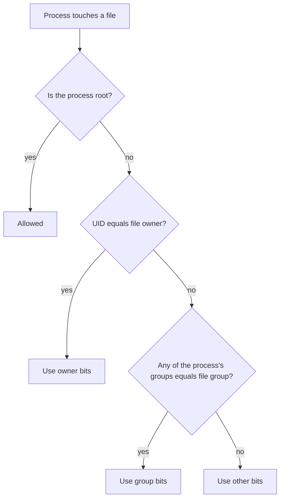

# Users, groups and permissions

After this you can read an `ls -l` line, change who may read, write or run a file with `chmod` and `chown`, and fix a "Permission denied" error without reaching for `chmod 777`.

Before this: Shell and terminal basics<!-- link: 01-shell-and-terminal-basics.md --> and Files and navigation<!-- link: 02-files-and-navigation.md -->.

## The idea

You deploy a small web app to a server. It starts, then fails with `Permission denied` when it tries to write its log file. Your first thought is to make the file open to everyone. That works, and it is also how a hole in one program becomes a hole in the whole machine.

Linux answers "who may do what to this file?" with a small, fixed model. Every process runs as one user. Every file has one owner and one group, and nine permission bits that say what the owner, the group and everybody else may do. When a process touches a file, the kernel compares the process's identity with the file's owner and group and checks the matching bits. The rest of this lesson is detail on that comparison.

## Key terms

A **user** is an identity that processes run as. Each user has a name and a numeric **UID** (user ID); the kernel works with the number. The user **root** has UID 0 and bypasses almost every permission check.

A **group** is a named set of users with a numeric **GID**. A user has one primary group (given to new files they create) and any number of supplementary groups. A file belongs to exactly one group.

The **owner** of a file is the user recorded in its metadata. Everyone who is neither the owner nor in the file's group is **other**. The **mode** is the file's nine permission bits (read, write, execute for owner, group and other).

**sudo** runs one command as another user, by default root, if the system's policy allows it.

## How it works

### Users and groups are lines in text files

Accounts live in `/etc/passwd`, one line per user, seven fields separated by colons. Groups live in `/etc/group`, four fields.

```text
alice:x:1001:1002::/home/alice:/bin/bash
devteam:x:1001:alice,bob
```

The first line reads: login name `alice`, password field `x` (the hashed password is in `/etc/shadow`, which only root can read), UID 1001, primary GID 1002, an empty comment field, home directory `/home/alice`, login shell `/bin/bash`. The second reads: group `devteam`, no group password, GID 1001, members `alice` and `bob`. Field lists: [passwd(5)](https://manpages.ubuntu.com/manpages/noble/man5/passwd.5.html) and [group(5)](https://manpages.ubuntu.com/manpages/noble/man5/group.5.html).

On Debian and Ubuntu, regular users get UIDs from 1000 up and system accounts (such as `www-data`) get lower ones ([Debian Policy, section 9.2.2](https://www.debian.org/doc/debian-policy/ch-opersys.html)). The command `id` shows who you are:

```bash
id
```

```text
uid=1000(you) gid=1000(you) groups=1000(you),4(adm),27(sudo),100(users)
```

### The three bits and the three classes

Each class (owner, group, other) gets three bits. The same bit means different things on a file and on a directory.

| Bit | Value | On a file | On a directory |
|---|---|---|---|
| `r` | 4 | read the contents | list the names inside |
| `w` | 2 | change the contents | create, delete or rename entries (also needs `x`) |
| `x` | 1 | run it as a program | enter it, and reach things inside by name |

The kernel picks one class, the first that matches, and uses only that class's bits. If you own the file, the owner bits apply, even when the group bits are more generous. If you are not the owner but one of your groups matches the file's group, the group bits apply. Otherwise the other bits apply. Root skips the check.



### Reading `ls -l`

`ls -l` prints one line per file; `ls -ld` on a directory shows the directory itself rather than its contents.

```text
-rwxr-x--- 1 alice devteam 1842 Oct 25 09:14 deploy.sh
```

The first character is the file type (`-` file, `d` directory, `l` symbolic link). The next nine are the mode: owner `rwx`, group `r-x`, other `---`. Then come the link count, owner, group, size in bytes, time and name.

### Changing the mode

`chmod` changes the mode. The symbolic form names who (`u`, `g`, `o`, `a`), an operator (`+` add, `-` remove, `=` set exactly) and the bits ([chmod(1)](https://manpages.ubuntu.com/manpages/noble/man1/chmod.1.html)):

```bash
chmod g+w notes.txt
chmod o-rwx notes.txt
chmod u=rwx,g=rx,o= deploy.sh
```

The octal form writes each class as one digit, adding 4 for read, 2 for write and 1 for execute. So `rw-` is 4 + 2 = 6 and `r-x` is 4 + 1 = 5.

| Octal | Symbolic | Typical use |
|---|---|---|
| `755` | `rwxr-xr-x` | programs and directories anyone may use |
| `644` | `rw-r--r--` | ordinary files |
| `600` | `rw-------` | private keys and secrets |
| `700` | `rwx------` | private directories such as `~/.ssh` |
| `750` | `rwxr-x---` | owner full access, group may read and enter |

<details class="code" markdown>
<summary>In code</summary>

Python's `stat` module converts between the two forms. This runs on any operating system.

```python
import stat

for mode in (0o755, 0o644, 0o600, 0o640):
    print(f"{mode:03o} -> {stat.filemode(0o100000 | mode)}")
```

```text
755 -> -rwxr-xr-x
644 -> -rw-r--r--
600 -> -rw-------
640 -> -rw-r-----
```

</details>

### Changing owner and group

`chown owner:group file` changes both, `chown :group file` changes only the group, and `chgrp group file` does the same ([chown(1)](https://manpages.ubuntu.com/manpages/noble/man1/chown.1.html), [chgrp(1)](https://manpages.ubuntu.com/manpages/noble/man1/chgrp.1.html)). You will usually write `sudo chown`. Add `-R` to recurse into a directory.

### sudo and why you don't work as root

`sudo command` runs one command as root and asks for your own password, not root's. You stay a normal user the rest of the time for three reasons. A typo in `rm` runs with no permission checks. Files you create as root end up owned by root, so your normal user later gets "Permission denied" in its own project. And the log names a person instead of "root". The command `sudo -l` lists what you may run ([sudo(8)](https://manpages.ubuntu.com/manpages/noble/man8/sudo.8.html)).

### umask

When a program creates a file it asks for a mode, usually 666 for files and 777 for directories. The **umask** is a mask of bits to remove from that request. With the common umask `022`, a new file gets `666` minus the group and other write bits, which is `644`, and a new directory gets `755`. Run `umask` to see yours. A shared folder that must be group-writable often needs `002` or an explicit `chmod`.

### Group inheritance with setgid

A new file normally takes the creator's primary group, which breaks shared folders. If you set the setgid bit on a directory (`chmod g+s`, or a leading `2` in octal), new files inside it take the directory's group instead. In `ls -l` it shows as `s` in the group execute position.

### Why SSH refuses a loose private key

A private key is a password in a file. OpenSSH ignores a private key file that is accessible by others ([ssh(1)](https://manpages.ubuntu.com/manpages/noble/man1/ssh.1.html)). If your key is `644`, other users on the machine can read it, so the client prints a warning like this one and does not use the key. The fix is `chmod 600 ~/.ssh/id_ed25519`.

```text
WARNING: UNPROTECTED PRIVATE KEY FILE!
Permissions 0644 for '/home/you/.ssh/id_ed25519' are too open.
It is required that your private key files are NOT accessible by others.
This private key will be ignored.
```

### Why web servers run as www-data

A web server reads requests from strangers, so assume someone will eventually find a bug in it. If it runs as root, that bug gives the attacker the whole machine. If it runs as a dedicated user with no other powers, the damage stops at what that user can touch. On Ubuntu that user is usually `www-data`; nginx takes its worker user from the `user` directive ([nginx docs](https://nginx.org/en/docs/ngx_core_module.html)). The Debian wiki adds that web content should not be owned by this user, or a compromised server could rewrite the site ([Debian wiki](https://wiki.debian.org/SystemGroups)). The server gets read access through the group or other bits, and write access only where it must. This habit is called least privilege, and the security chapter returns to it in security mindset and threat modelling<!-- link: ../../12-security/01-web-security/01-security-mindset-and-threat-modelling.md -->.

## Worked examples

<div class="example" markdown>

### Example 1: why can this person not write?

Three lines from `ls -l`, and a user named `bob` who belongs to the group `devteam`.

```text
-rw-r--r-- 1 alice devteam   0 Oct 25 09:35 notes.txt
-rw-rw---- 1 alice devteam 212 Oct 25 09:40 plan.txt
-rwxr-xr-x 1 root  root    906 Oct 20 16:02 backup.sh
```

1. `notes.txt`: bob is not the owner, but his group `devteam` matches, so the group bits `r--` apply. He can read it, not write it.
2. `plan.txt`: the group bits are `rw-`, so bob can read and write. Other users get `---`.
3. `backup.sh`: bob is not root and not in group `root`, so the other bits `r-x` apply. He can read and run it, not change it.

Check: steps 4 to 7 of the lab below reproduce the first case. Bob's write to a file like `notes.txt` is denied until the group write bit is added.

</div>

<div class="example" markdown>

### Example 2: execute on a directory

In WSL (Ubuntu), in your home directory:

```bash
mkdir -p permdemo/box
echo hi > permdemo/box/a.txt
chmod u=x permdemo/box
ls permdemo/box
cat permdemo/box/a.txt
```

```text
ls: cannot open directory 'permdemo/box': Permission denied
hi
```

The directory has `x` but no `r`, so you can reach a name you already know but cannot list what is inside. The reverse (`r` without `x`) shows names but opens nothing.

Check: `ls -ld permdemo/box` shows `d--x------` while the mode is `u=x`. Then put it back with `chmod u=rwx permdemo/box` and remove the demo with `rm -r permdemo`.

</div>

## Common mistakes

<div class="warning" markdown>

Watch out: `chmod 777` makes a file readable, writable and runnable by every user and every program on the machine. It hides the real problem (wrong owner, wrong group, or a missing bit on a parent directory) and creates a new one: any compromised process can now overwrite the file. Find which class applies and add the one bit that is missing.

Watch out: `chmod -R` and `chown -R` follow your typing, not your intent. A wrong path can change thousands of files, and a recursive `chmod 644` strips `x` from directories, which locks you out of them. Run `ls -ld` on the target first.

Watch out: `usermod -G devteam bob` without `-a` replaces all of bob's supplementary groups. Use `usermod -aG devteam bob`. Group changes also apply only to new login sessions.

Watch out: `sudo echo hi > /etc/file` fails because your own shell opens the file, not sudo. Use `sudo sh -c 'echo hi > /etc/file'`.

</div>

## Working with AI

<div class="ai" markdown>

Words to use: owner, group, other, mode bits, UID and GID, supplementary group, setgid, least privilege, `sudo -u`. They tell an assistant which layer of the model is failing.

Prompts to try:

- "I get `Permission denied` when my service (running as user `deploy`) writes to `/var/app/logs/app.log` on Ubuntu 24.04. Here is `ls -ld /var/app/logs`, `ls -l /var/app/logs/app.log` and `id deploy`: (paste). Which permission class applies, and what is the smallest change that fixes it?"
- "Explain the output of `namei -l /srv/teamdata/notes.txt` line by line, and tell me which directory in the path blocks user `bob`."

What to check:

- Reject `chmod 777`, `chmod -R 777` and "run it as root" as fixes. Ask for the smallest change: one bit, one group membership, or one `chown` to a dedicated user.
- Look for a `chown` or `chmod` on a path wider than the problem, such as `/var`, `/etc` or `~`.
- Check that the answer considers every directory on the path. A file can be `644` and still unreachable because a parent directory lacks `x` for you; `namei -l path` shows each level.
- Check that the user in the answer is the user the process runs as (the service's configuration shows it), not your own login.
- Verify any flag with `man` before you run it. `usermod` lines without `-a` are a common slip.

</div>

## Quiz

1\. Read this line. Who can read the file, who can write it, and can anyone run it?

```text
-rw-r----- 1 deploy www-data 512 Oct 25 09:50 .env
```

<details class="solution" markdown>
<summary>Answer</summary>

The owner `deploy` has `rw-`, so can read and write. Members of group `www-data` have `r--`, so can read only. Everyone else has `---`. No class has `x`, so nobody can run it as a program. The mode is `640`.

</details>

2\. Convert `rwxr-x---` to octal, and `644` to symbolic form.

<details class="solution" markdown>
<summary>Answer</summary>

`rwx` is 4 + 2 + 1 = 7, `r-x` is 4 + 1 = 5, `---` is 0, so `750`. For `644`: 6 is `rw-`, 4 is `r--`, 4 is `r--`, so `rw-r--r--`.

</details>

3\. You copy a private key to a new server and `ssh` prints "Permissions 0644 ... are too open" and then asks for a password. What happened and what is the fix?

<details class="solution" markdown>
<summary>Answer</summary>

The group and other bits let other users read the key, so OpenSSH ignored the key and fell back to password login. Run `chmod 600 ~/.ssh/id_ed25519` (use your key's file name). If the `.ssh` directory itself is loose, `chmod 700 ~/.ssh` as well.

</details>

4\. You ran `sudo usermod -aG devteam bob` and bob, who is logged in, still gets "Permission denied" on the shared folder. The folder is `drwxrws--- root devteam`. What is the likely cause?

<details class="solution" markdown>
<summary>Answer</summary>

A process gets its group list when the login session starts. Bob's open terminal still has the old list, so `id` in that terminal will not show `devteam`. Bob logs out and back in (or starts a new session), and then the group bits apply.

</details>

## Lab

<div class="lab" markdown>

### Lab: a shared folder and a permission-denied fix

Goal: build a folder shared by a group, test access as three different users, fix a denied write, then remove everything. Time: about 20 minutes. Runs in: WSL (Ubuntu). Your own account needs `sudo`, as set up in [Setting up your machine](../../00-start-here/setting-up-your-machine.md).

The commands create users with no passwords, so nobody can log in as them. You test them with `sudo -u`, which runs one command as another user.

1. Create the group and three users. Only `alice` and `bob` join the group; `carol` is the outsider.

   ```bash
   cd /tmp
   sudo groupadd devteam
   sudo useradd -m -s /bin/bash alice
   sudo useradd -m -s /bin/bash bob
   sudo useradd -m -s /bin/bash carol
   sudo usermod -aG devteam alice
   sudo usermod -aG devteam bob
   id alice
   getent group devteam
   ```

   ```text
   uid=1001(alice) gid=1002(alice) groups=1002(alice),1001(devteam)
   devteam:x:1001:alice,bob
   ```

2. Look at the account lines: `grep -E '^(alice|bob|carol):' /etc/passwd`. Find the UID, the home directory and the shell in each.

3. Make the shared folder. Root owns it, the group is `devteam`, and the mode `2770` means full access for owner and group, none for others, plus setgid.

   ```bash
   sudo mkdir /srv/teamdata
   sudo chown root:devteam /srv/teamdata
   sudo chmod 2770 /srv/teamdata
   ls -ld /srv/teamdata
   ```

   ```text
   drwxrws--- 2 root devteam 4096 Oct 25 09:30 /srv/teamdata
   ```

4. Test access. Alice creates a file with an explicit umask of `022`; bob lists the folder; carol tries to.

   ```bash
   sudo -u alice sh -c 'umask 022 && touch /srv/teamdata/notes.txt'
   sudo -u bob ls -l /srv/teamdata
   sudo -u carol ls /srv/teamdata
   ```

   ```text
   total 0
   -rw-r--r-- 1 alice devteam 0 Oct 25 09:35 notes.txt
   ls: cannot open directory '/srv/teamdata': Permission denied
   ```

   The file's group is `devteam`, not `alice`, because of setgid. Carol is blocked by the `---` other bits on the folder.

5. Trigger the error. Bob tries to append a line. The `sh -c` makes the redirect happen as bob rather than as you.

   ```bash
   sudo -u bob sh -c 'echo "bob was here" >> /srv/teamdata/notes.txt'
   ```

   ```text
   sh: 1: cannot create /srv/teamdata/notes.txt: Permission denied
   ```

6. Diagnose before you change anything. You need the file's mode and bob's groups.

   ```bash
   ls -l /srv/teamdata/notes.txt
   sudo -u bob id
   ```

   Bob's `id` lists `devteam`, and the file's group is `devteam`, so the group class applies. Its bits are `r--`: the group write bit is missing. That is the one thing to fix.

7. Fix it as the file's owner, with the smallest change, then retry.

   ```bash
   sudo -u alice chmod g+w /srv/teamdata/notes.txt
   sudo -u bob sh -c 'echo "bob was here" >> /srv/teamdata/notes.txt'
   sudo cat /srv/teamdata/notes.txt
   ```

   ```text
   bob was here
   ```

   The last command needs `sudo` because your own account is "other" for this folder, and the other bits are `---`. Without `sudo`, `cat` prints "Permission denied", which is the same rule that stopped carol.

8. Cleanup. Remove the users (and their home directories), the group and the folder. `userdel -r` removes a user's same-name private group when it is empty.

   ```bash
   sudo userdel -r alice
   sudo userdel -r bob
   sudo userdel -r carol
   sudo groupdel devteam
   sudo rm -r /srv/teamdata
   getent passwd alice bob carol; getent group devteam; ls /srv
   ```

   `userdel` may print a line such as `userdel: alice mail spool (/var/mail/alice) not found`; that is harmless. The last line should print nothing for the users and the group.

Expected result: carol is denied at step 4, bob is denied at step 5 and succeeds at step 7, and nothing from the lab remains after step 8.

<details class="solution" markdown>
<summary>Solution</summary>

The whole lab in one block. The `cat` at the end uses `sudo` because the folder is closed to your own account.

```bash
cd /tmp
sudo groupadd devteam
sudo useradd -m -s /bin/bash alice
sudo useradd -m -s /bin/bash bob
sudo useradd -m -s /bin/bash carol
sudo usermod -aG devteam alice
sudo usermod -aG devteam bob
sudo mkdir /srv/teamdata
sudo chown root:devteam /srv/teamdata
sudo chmod 2770 /srv/teamdata
sudo -u alice sh -c 'umask 022 && touch /srv/teamdata/notes.txt'
sudo -u bob ls -l /srv/teamdata
sudo -u carol ls /srv/teamdata
sudo -u bob sh -c 'echo "bob was here" >> /srv/teamdata/notes.txt'
sudo -u alice chmod g+w /srv/teamdata/notes.txt
sudo -u bob sh -c 'echo "bob was here" >> /srv/teamdata/notes.txt'
sudo cat /srv/teamdata/notes.txt
sudo userdel -r alice
sudo userdel -r bob
sudo userdel -r carol
sudo groupdel devteam
sudo rm -r /srv/teamdata
```

The first `bob` write fails (group has `r--`), the second succeeds. The fix is one bit for one class, applied by the owner. Making the folder `777` would also have "worked" and would have let carol in.

</details>

</div>

## Where this shows up

- Generating and protecting keys in SSH and keys<!-- link: 10-ssh-and-keys.md -->, where mode `600` on the private key is checked on every connection.
- Dedicated users for services in Services, systemd and logs<!-- link: 07-services-systemd-and-logs.md -->, and the permission model underneath file systems<!-- link: ../01-os-concepts/04-file-systems.md -->.
- Containers: a process that runs as root inside a container is still a risk, which the Docker lessons return to.
