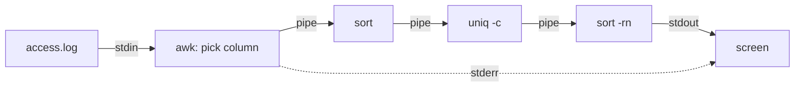

# Pipes, redirection and text tools

After this you can send a command's output to a file or into another command, keep errors separate from results, and answer questions about a log file with a short pipeline of small tools.

Before this: [Shell and terminal basics](01-shell-and-terminal-basics.md) and [Files and navigation](02-files-and-navigation.md).

## The idea

A web server wrote 10,000 lines to `access.log`. Which visitors made the most requests? No single command answers that, but five tiny ones do when you connect them: pick the column, sort it, count the repeats, sort the counts, show the top. Linux tools are built to be chained this way, so each does one job on plain text.

Every process starts with three open streams, which come from the process model in [processes, threads and scheduling](../01-os-concepts/02-processes-threads-and-scheduling.md). **Standard input** (stdin, number 0) is where it reads. **Standard output** (stdout, 1) is where results go. **Standard error** (stderr, 2) is where error messages go. By default stdin is your keyboard and the other two are your screen. The shell can rewire them before the program starts.



## Key terms

A **redirection** points a stream at a file instead of the terminal. A **pipe** (`|`) connects the stdout of one command directly to the stdin of the next; the kernel holds the bytes in a small buffer between them, and both programs run at the same time. A **filter** is a command that reads stdin and writes stdout, so it fits in a pipe.

## How it works

| Syntax | Meaning |
|---|---|
| `cmd > file` | stdout to `file`, replacing it |
| `cmd >> file` | stdout appended to `file` |
| `cmd < file` | stdin read from `file` |
| `cmd 2> file` | stderr to `file` |
| `cmd > file 2>&1` | stdout and stderr both to `file` |
| `cmd1 \| cmd2` | stdout of `cmd1` into stdin of `cmd2` |
| `cmd > /dev/null` | throw output away |

Order matters in `> file 2>&1`: it reads "send stdout to the file, then send stderr to wherever stdout now goes". Written the other way round, stderr still goes to the screen. The shell sets all of this up before the program starts, so a program cannot tell whether its output goes to a screen, a file or a pipe ([Bash manual: redirections](https://www.gnu.org/software/bash/manual/bash.html#Redirections)).

The core filters:

| Tool | Does |
|---|---|
| `grep pat` | keep lines that match (`-i` ignore case, `-n` line numbers, `-v` invert, `-r` search folders, `-c` count) |
| `sort` | sort lines (`-n` numeric, `-r` reverse, `-u` unique) |
| `uniq -c` | collapse adjacent repeated lines and count them; input must be sorted first |
| `wc -l` | count lines |
| `cut -d, -f2` | take field 2 using `,` as the separator |
| `tr a-z A-Z` | translate or delete characters |
| `sed 's/old/new/'` | replace the first match on each line (`g` for all, `-n '2,3p'` prints lines 2 to 3) |
| `awk '{print $1}'` | print the first whitespace-separated field |
| `xargs cmd` | turn input lines into arguments of `cmd` |
| `tee file` | copy stdin to a file and to stdout |

`awk` is a full language, but one line of it, `awk '{print $1}'`, covers most of what you need: `$1` is the first field, `$NF` the last and `$(NF-1)` the one before it. `sed` and `grep` use patterns called regular expressions, taught in [regular expressions](../../04-developer-tools-and-workflow/02-project-plumbing/04-regular-expressions.md); here plain words are enough.

## Worked examples

<div class="example" markdown>

### Example 1: who made the most requests?

The file `access.log` has ten lines like this:

```text
203.0.113.5 - - [25/Oct/2026:09:01:12] "GET /index.html" 200 512
```

Build the pipeline one stage at a time, running it after each addition.

```bash
awk '{print $1}' access.log | sort | uniq -c | sort -rn
```

```text
      5 203.0.113.5
      3 198.51.100.7
      2 192.0.2.44
```

1. `awk '{print $1}'` prints the first field of each line: the address.
2. `sort` puts equal addresses next to each other, which `uniq` needs.
3. `uniq -c` collapses each run and puts its count in front.
4. `sort -rn` sorts those counts numerically, largest first.

Check: `wc -l access.log` gives 10, and 5 + 3 + 2 is 10.

</div>

<div class="example" markdown>

### Example 2: status codes, errors and tee

The status code is the second-to-last field:

```bash
awk '{print $(NF-1)}' access.log | sort | uniq -c | sort -rn
grep -n '" 500 ' access.log
```

```text
      6 200
      2 500
      2 404
5:192.0.2.44 - - [25/Oct/2026:09:03:02] "POST /login" 500 0
7:192.0.2.44 - - [25/Oct/2026:09:04:25] "POST /login" 500 0
```

Both server errors are POSTs to `/login` from one address. To keep a copy while still watching the result, put `tee` in the pipe: `grep ' 500 ' access.log | tee errors.txt | wc -l`.

Separating the streams:

```bash
ls nosuch access.log > both.txt 2>&1
cat both.txt
```

```text
ls: cannot access 'nosuch': No such file or directory
access.log
```

`xargs` is for commands that take arguments but not stdin: `find . -name "*.tmp" | xargs rm` builds one `rm` command from the list. Names with spaces break it; use `find . -name "*.tmp" -print0 | xargs -0 rm`.

</div>

## Common mistakes

<div class="warning" markdown>

Watch out: `sort file > file`. The shell empties the file before `sort` reads it, so you lose the data. Write to a different file, then move it back.

Watch out: `uniq -c` without `sort` first. It only collapses neighbours, so the counts come out wrong without an error.

Watch out: `>` instead of `>>`. A single `>` replaces the file every time. Use `>>` for logs.

</div>

## Working with AI

<div class="ai" markdown>

Words to use: stdin, stdout, stderr, pipe, redirect, filter, field separator, `-print0`.

Prompts to try:

- "Here are five lines of my nginx access log: (paste). Write one pipeline that prints the ten most requested paths with counts, using only `awk`, `sort`, `uniq` and `head`. Explain each stage."
- "Why does `cmd > out.txt 2>&1` capture errors but `cmd 2>&1 > out.txt` does not?"

What to check:

- Run the pipeline on a small sample first. Wrong field numbers are the usual failure: print `$1`, `$2` and so on until you see the column you want.
- `uniq` without `sort`, or `sort` without `-n` on numbers (it puts 10 before 9).
- `xargs rm`, `-delete` or `sed -i` (edits files in place). Replace the dangerous part with `echo` or remove `-i` and read the output.
- GNU-only options on macOS, or a log format different from the one you pasted.

</div>

## Quiz

1\. What are the three standard streams, and which one does `2>` redirect?

<details class="solution" markdown>
<summary>Answer</summary>

stdin (0), stdout (1) and stderr (2). `2>` redirects stderr.

</details>

2\. What does this print?

```bash
printf 'b\na\nb\n' | sort | uniq -c
```

<details class="solution" markdown>
<summary>Answer</summary>

```text
      1 a
      2 b
```

`sort` gives `a b b`, then `uniq -c` counts each run.

</details>

3\. A script runs `./deploy.sh > log.txt` and the log is empty, but the terminal shows errors. Why?

<details class="solution" markdown>
<summary>Answer</summary>

The errors are on stderr, which `>` does not redirect. Use `./deploy.sh > log.txt 2>&1`.

</details>

4\. Write a pipeline that counts the lines containing `ERROR` (any case) in `app.log`.

<details class="solution" markdown>
<summary>Answer</summary>

`grep -i error app.log | wc -l`, or `grep -ic error app.log`.

</details>

## Lab

<div class="lab" markdown>

### Lab: analyse a log file

Goal: answer three questions about a log using pipelines. Time: about 15 minutes. Runs in: WSL (Ubuntu).

1. Make a folder and the log.

   ```bash
   mkdir ~/logs-lab && cd ~/logs-lab
   cat > access.log <<'EOF'
   203.0.113.5 - - [25/Oct/2026:09:01:12] "GET /index.html" 200 512
   203.0.113.5 - - [25/Oct/2026:09:01:13] "GET /style.css" 200 128
   198.51.100.7 - - [25/Oct/2026:09:02:40] "GET /index.html" 200 512
   198.51.100.7 - - [25/Oct/2026:09:02:41] "GET /missing.png" 404 0
   192.0.2.44 - - [25/Oct/2026:09:03:02] "POST /login" 500 0
   203.0.113.5 - - [25/Oct/2026:09:04:19] "GET /index.html" 200 512
   192.0.2.44 - - [25/Oct/2026:09:04:25] "POST /login" 500 0
   198.51.100.7 - - [25/Oct/2026:09:05:01] "GET /api/items" 200 2048
   203.0.113.5 - - [25/Oct/2026:09:05:30] "GET /missing.png" 404 0
   203.0.113.5 - - [25/Oct/2026:09:06:02] "GET /index.html" 200 512
   EOF
   wc -l access.log
   ```

2. Which address made the most requests? Use the pipeline from Example 1.
3. How many requests got a 404? Use `grep -c`.
4. Which paths are requested most? The path is field 6.

   ```bash
   awk '{print $6}' access.log | sort | uniq -c | sort -rn | head -3
   ```

   ```text
         4 /index.html"
         2 /missing.png"
         2 /login"
   ```

5. Save the 500 lines to a file and keep the count on screen: `grep ' 500 ' access.log | tee errors.txt | wc -l`.
6. Cleanup:

   ```bash
   cd ~ && rm -r ~/logs-lab
   ```

Expected result: `203.0.113.5` has 5 requests, there are 2 lines with 404, and `errors.txt` holds 2 lines.

<details class="solution" markdown>
<summary>Solution</summary>

`grep -c ' 404 ' access.log` prints 2. The trailing quote in `/index.html"` comes from the log format; `tr -d '"'` would remove it.

</details>

</div>

## Where this shows up

- Reading service logs with `journalctl` in [services, systemd and logs](07-services-systemd-and-logs.md), and running scripts from cron in [shell scripting and cron](09-shell-scripting-and-cron.md).
- Python reads the same three streams in [files and I/O](../../03-programming-fundamentals/01-python-basics/07-files-and-io.md).
