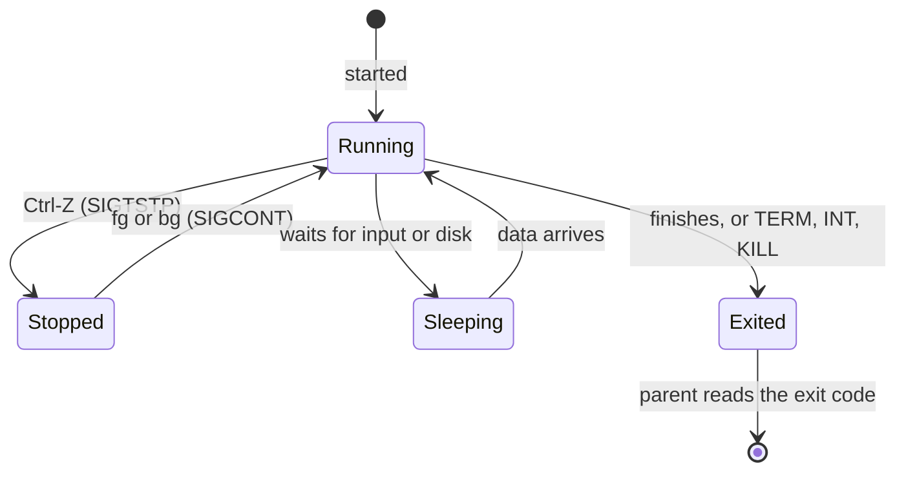

# Processes and signals

After this you can list what is running, find a stuck program, stop it politely or by force, run something in the background, and read an exit code such as 137.

Before this: [Shell and terminal basics](01-shell-and-terminal-basics.md), [Pipes, redirection and text tools](04-pipes-redirection-and-text-tools.md) and [Processes, threads and scheduling](../01-os-concepts/02-processes-threads-and-scheduling.md).

## The idea

Your dev server hangs, the terminal prints nothing, and Ctrl-C does nothing. Or a script you started over SSH dies when the connection drops. Both are about the same two things: finding the process, and sending it a message the right way.

A process is a running program, identified by a **PID** (process ID). Every process except the first has a parent, and the shell is the parent of the commands you run. A **signal** is a small numbered message the kernel delivers to a process. Most signals can be caught: the program runs its own handler, often to clean up before exiting. Two cannot be caught or ignored, `SIGKILL` and `SIGSTOP`, because the kernel needs a way to stop a process that ignores everything else.



## Key terms

A **foreground** job owns the terminal: it receives your keystrokes. A **background** job runs without the keyboard; start one by ending the line with `&`. A **job** is a process (or pipeline) the current shell manages, numbered `%1`, `%2`.

A **daemon** is a process that runs in the background with no terminal, usually started by the system. **Zombie** is the state of a process that has exited but whose parent has not yet read its exit code; it uses no CPU or memory beyond a table entry.

## How it works

`ps aux` lists every process: user, PID, CPU and memory use, state, start time and the command line. `ps aux | grep python` finds one by name (the `grep` itself will appear in the list). `top` shows the same list live, sorted by CPU, and `htop` is a friendlier version you install with `apt` in the next lessons. In `top`, `q` quits and `M` sorts by memory. `pgrep -f name` prints just the PIDs ([ps(1)](https://manpages.ubuntu.com/manpages/noble/man1/ps.1.html)).

Signals you send by hand:

| Signal | Number | Sent by | Meaning |
|---|---|---|---|
| `SIGINT` | 2 | Ctrl-C | interrupt: stop what you are doing |
| `SIGTSTP` | 20 | Ctrl-Z | pause (suspend) from the terminal |
| `SIGHUP` | 1 | terminal closing | "hang up"; daemons often treat it as "reload config" |
| `SIGTERM` | 15 | `kill PID` | polite request to terminate; can be caught |
| `SIGKILL` | 9 | `kill -9 PID` | the kernel removes the process, no cleanup |
| `SIGCONT` | 18 | `fg`, `bg` | resume a paused process |

Numbers are for Linux on x86 and Arm ([signal(7)](https://manpages.ubuntu.com/manpages/noble/man7/signal.7.html)). `kill` sends `SIGTERM` unless you name another signal, so `kill 4321` is the polite one. Try it first and give the program a few seconds to clean up: flush files, close database connections, remove lock files. Use `kill -9` only if that fails, because the process then cannot clean up at all.

**Job control** is the shell's way of moving jobs between foreground and background. Run `sleep 300 &` to start one in the background, `jobs` to list them, `fg %1` to bring one forward, Ctrl-Z to pause the foreground job, and `bg` to let a paused job continue in the background.

A background job still belongs to the terminal. When the terminal closes, the shell sends `SIGHUP` to its jobs and they end. `nohup cmd &` starts a command that ignores `SIGHUP` and writes output to `nohup.out`. For anything that must stay running, use a service ([services, systemd and logs](07-services-systemd-and-logs.md)) or `tmux`, not a background job.

The kernel reports how a process ended in its exit code. A normal exit uses 0 to 255 as the program chose. A process killed by signal $n$ shows as $128 + n$ in the shell, so Ctrl-C gives 130 ($128 + 2$), `SIGTERM` gives 143 and `SIGKILL` gives 137 ([Bash manual](https://www.gnu.org/software/bash/manual/bash.html#Exit-Status)). Exit code 137 in a container log usually means the process was killed with `SIGKILL`, often by the kernel's out-of-memory killer when the process used too much memory (see [memory and virtual memory](../01-os-concepts/03-memory-and-virtual-memory.md)).

## Worked examples

<div class="example" markdown>

### Example 1: start, list, stop

```bash
sleep 300 &
sleep 301 &
jobs
kill %1
jobs
```

```text
[1] 915
[2] 916
[1]-  Running                    sleep 300 &
[2]+  Running                    sleep 301 &
[1]-  Terminated                 sleep 300 &
[2]+  Running                    sleep 301 &
```

1. `&` starts each command in the background and prints the job number and PID.
2. `jobs` shows both running. The `+` marks the current job and `-` the previous one.
3. `kill %1` sends `SIGTERM` to job 1 (a `%` means a job number, not a PID). The next `jobs` reports it as `Terminated`.

Check: `kill %2` to remove the other, then `jobs` prints nothing. The first two lines come from a real run; the `Terminated` line is what an interactive Bash on Linux prints, and the wording can differ slightly.

</div>

<div class="example" markdown>

### Example 2: exit codes of a killed process

```bash
sleep 100 & pid=$!
kill -TERM $pid; wait $pid; echo "exit=$?"
sleep 100 & pid=$!
kill -KILL $pid; wait $pid; echo "exit=$?"
```

```text
exit=143
exit=137
```

`$!` is the PID of the last background job and `wait` collects its exit code: $128 + 15$ and $128 + 9$.

</div>

## Common mistakes

<div class="warning" markdown>

Watch out: reaching for `kill -9` first. The process cannot close files or release locks, which can leave a corrupt file or a lock that blocks the next start. Send plain `kill`, wait, then escalate.

Watch out: killing by name with `pkill` or `killall` on a shared machine. It matches every process with that name, including other people's. Find the PID with `ps` and kill that one.

Watch out: expecting a `&` job to survive closing the terminal. Use `nohup`, `tmux` or a service.

</div>

## Working with AI

<div class="ai" markdown>

Words to use: PID, parent process, signal, `SIGTERM`, `SIGKILL`, foreground and background, zombie, exit code.

Prompts to try:

- "My Node process on Ubuntu 24.04 ignores Ctrl-C. Give me the steps to find its PID, stop it gracefully, and escalate only if needed. Explain what each signal does."
- "A container exited with code 137. List the possible causes in order of likelihood and the command to confirm each."

What to check:

- `kill -9` as the first suggestion, or `killall`/`pkill` patterns broad enough to hit other processes. Print the PIDs with `pgrep` first.
- Mixed-up numbers: exit code 137 is 128 plus 9, not 137 signals. Compute it.
- Advice for macOS (`ps -ef` differences, `launchctl`) in a Linux question.

</div>

## Quiz

1\. What is the difference between `SIGTERM` and `SIGKILL`?

<details class="solution" markdown>
<summary>Answer</summary>

`SIGTERM` is a request the process can catch and handle, so it can clean up. `SIGKILL` is carried out by the kernel and cannot be caught or ignored, so the process gets no chance to clean up.

</details>

2\. A script exits with code 130. What happened?

<details class="solution" markdown>
<summary>Answer</summary>

$130 - 128 = 2$, so it ended from signal 2, `SIGINT`, which is what Ctrl-C sends.

</details>

3\. You run `python server.py &`, close the terminal, and the server is gone. Why, and what are two fixes?

<details class="solution" markdown>
<summary>Answer</summary>

Closing the terminal sent `SIGHUP` to its jobs. Start it with `nohup python server.py &` so it ignores the hangup, or better, run it as a systemd service or inside `tmux`.

</details>

4\. You pressed Ctrl-Z in the middle of a long command. How do you finish it in the background?

<details class="solution" markdown>
<summary>Answer</summary>

Run `bg` to resume it in the background (`jobs` shows it as Running), or `fg` to bring it back to the foreground.

</details>

## Lab

<div class="lab" markdown>

### Lab: find and stop a process

Goal: start background work, inspect it, stop it two ways. Time: about 10 minutes. Runs in: WSL (Ubuntu).

1. Start two sleepers and list them.

   ```bash
   sleep 600 &
   sleep 601 &
   jobs
   ps aux | grep "[s]leep"
   ```

   The brackets in `[s]leep` stop `grep` from matching its own line.
2. Pause the first with `fg %1`, then Ctrl-Z, then `bg %1`. Check `jobs`.
3. Stop job 1 politely: `kill %1`. Read its status with `jobs`.
4. Find the second by PID and force it: `pgrep -f "sleep 601"`, then `kill -9 PID` with that number. Confirm with `echo $?` after `wait PID` in a fresh job if you like.
5. Run `sleep 600`, press Ctrl-C, and print `echo $?`.
6. Cleanup: `kill $(jobs -p)` removes anything left; `jobs` should print nothing.

Expected result: step 5 prints 130.

<details class="solution" markdown>
<summary>Solution</summary>

`ps aux` shows lines for `sleep 600` and `sleep 601` in state `S` (sleeping). After `kill %1`, `jobs` shows `Terminated`. Ctrl-C ends `sleep 600` with exit code 130.

</details>

</div>

## Where this shows up

- A service manager restarts crashed processes for you in [services, systemd and logs](07-services-systemd-and-logs.md).
- Signals are how Docker stops a container (`SIGTERM`, then `SIGKILL`), in [Docker images and Dockerfiles](../../13-devops-and-cloud/01-containers/02-docker-images-and-dockerfiles.md).
