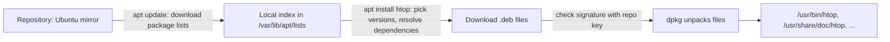

# Packages with apt

After this you can install, update and remove software on Ubuntu with `apt`, say where it came from and where its files went, and judge whether adding a third-party repository is worth the risk.

Before this: [Files and navigation](02-files-and-navigation.md), [Users, groups and permissions](03-users-groups-and-permissions.md) and [Pipes, redirection and text tools](04-pipes-redirection-and-text-tools.md).

## The idea

You need `htop` on a fresh server. On Windows you would find a website, download an installer and click through it. On Ubuntu you run one command, and the system fetches the program, the libraries it needs, and records what it installed so it can update or remove it cleanly.

The tool for this on Ubuntu and Debian is **APT**. It downloads **packages** (`.deb` files) from **repositories**, servers that hold thousands of them. A package bundles the program's files, a name and version, and a list of other packages it depends on. APT resolves the list, so installing one package may install several.



## Key terms

A **package** is an archive of files plus metadata (name, version, dependencies). A **repository** is a server with packages and a signed index of them. A **dependency** is another package a package needs. The **package index** is your machine's local copy of the repository's list of available packages and versions. **dpkg** is the low-level tool that unpacks one `.deb` file; APT sits on top and handles downloading and dependencies ([apt(8)](https://manpages.ubuntu.com/manpages/noble/man8/apt.8.html)).

## How it works

The commands you need are few.

| Command | Does |
|---|---|
| `sudo apt update` | refresh the package index (installs nothing) |
| `sudo apt upgrade` | install newer versions of what is already installed |
| `apt search word` | search names and descriptions |
| `apt show name` | version, size, dependencies, description |
| `sudo apt install name` | install a package and its dependencies |
| `sudo apt remove name` | remove the program, keep config files |
| `sudo apt purge name` | remove the program and its config files |
| `sudo apt autoremove` | remove dependencies nothing needs any more |
| `dpkg -L name` | list the files a package installed |
| `dpkg -S /usr/bin/htop` | which package owns this file |

The one that confuses people is `update` against `upgrade`. `update` only downloads the lists, so the machine learns what is available. `upgrade` acts on that knowledge. An `install` after a long gap without `update` can fail with "Unable to locate package" or fetch an old version that has since been replaced, so run `sudo apt update` first. APT needs root because it writes under `/usr` and `/var`, so you use `sudo` ([users, groups and permissions](03-users-groups-and-permissions.md)).

Packages place files in standard locations: programs in `/usr/bin`, libraries in `/usr/lib`, configuration in `/etc`, documentation in `/usr/share/doc`, and data in `/var`. This is why `dpkg -L` can show you everything a package put on the machine.

### Repositories and trust

Where APT looks is set in `/etc/apt/sources.list.d/`; on Ubuntu 24.04 the main file is `ubuntu.sources` ([Ubuntu documentation](https://documentation.ubuntu.com/server/how-to/software/package-management/)). Ubuntu's own repositories are signed, and APT checks each index and package against the matching public key, so a tampered download is rejected. These are the same ideas as the signatures in [public key encryption and signatures](../../12-security/02-cryptography/03-public-key-encryption-and-signatures.md).

Many projects (Docker, Node.js, PostgreSQL) publish their own repository because Ubuntu's version is older. Adding one means saving the vendor's signing key and adding a source line. When you do, you are telling the machine to trust that vendor to run code as root on every update, because package install scripts run as root. Follow the vendor's official page, put the key in its own file, and never paste a `curl ... | sudo bash` you have not read.

A **PPA** (Personal Package Archive) is a repository hosted by a Launchpad user, added with `add-apt-repository ppa:name/path`. It is convenient and unreviewed: the owner can change what it ships at any time. Prefer Ubuntu's repositories or the vendor's own, and use a PPA only for a project you trust.

**Snap** is a second packaging system Ubuntu ships: `sudo snap install name` installs a self-contained app that updates itself. Use the `apt` version when both exist, unless you have a reason not to.

On WSL the first thing to run is `sudo apt update && sudo apt upgrade`, because the Windows installer does not do it.

## Worked examples

<div class="example" markdown>

### Example 1: install, inspect, remove

```bash
sudo apt update
apt show tree
sudo apt install tree
dpkg -L tree | head -4
dpkg -S /usr/bin/tree
sudo apt remove tree
```

1. `update` refreshes the index so `install` sees current versions.
2. `apt show tree` prints the version, size and dependencies before you commit.
3. After `install`, `dpkg -L tree` lists the files, starting with `/usr/bin/tree`. `dpkg -S /usr/bin/tree` answers the opposite question and prints `tree: /usr/bin/tree`.
4. `remove` deletes the program; `purge` would also delete its config.

Check: run `tree --version` after step 3 (it works) and again after `remove` (it prints `command not found`). These commands need Linux, so the exact output is not reproduced here.

</div>

## Common mistakes

<div class="warning" markdown>

Watch out: running `apt install` without `apt update` first on a fresh machine, then reading "Unable to locate package" as "the package does not exist".

Watch out: `sudo apt install` with `-y` on a package name you typed from memory. A typo can pull in a different package. Read the list APT prints before you answer yes.

Watch out: pasting a "one-line install" from a blog that adds a repository key and source, then running `apt upgrade`. You have just given that site root on your machine. Use the vendor's documentation.

</div>

## Working with AI

<div class="ai" markdown>

Words to use: package, repository, dependency, package index, signing key, PPA, `dpkg`, `apt purge`.

Prompts to try:

- "On Ubuntu 24.04, I need PostgreSQL 16. Show the official way from the PostgreSQL docs, explain where the key and the source file go, and how I remove it later."
- "I get 'E: Unable to locate package xyz' on WSL Ubuntu. List causes in order and the command that checks each."

What to check:

- `apt-key add`, which is deprecated, or keys placed in a shared keyring. Keys now go in their own file referenced by the source.
- Commands for the wrong distribution (`yum`, `dnf`, `brew`, or a Debian-only repository path). Check `lsb_release -a`.
- A repository, PPA or `curl | bash` that the answer does not link to an official page. Open the vendor's own install page and compare.
- A package name that does not exist: confirm with `apt search` or `apt show`.

</div>

## Quiz

1\. What does `apt update` do, and what does it not do?

<details class="solution" markdown>
<summary>Answer</summary>

It downloads the current package lists from the repositories. It installs or upgrades nothing.

</details>

2\. How do you find out which package installed `/usr/bin/curl`?

<details class="solution" markdown>
<summary>Answer</summary>

`dpkg -S /usr/bin/curl`.

</details>

3\. `sudo apt install foo` says "Unable to locate package foo" on a new WSL install. What do you try first?

<details class="solution" markdown>
<summary>Answer</summary>

`sudo apt update`, because a fresh install may have no package index yet. Then check the spelling with `apt search foo`.

</details>

4\. A tutorial says to add a PPA to get a newer tool. What do you weigh before doing it?

<details class="solution" markdown>
<summary>Answer</summary>

A PPA's owner can ship any code that then installs and updates as root. Check whether Ubuntu's repositories, the vendor's official repository or a downloaded release is enough, and whether you trust the owner.

</details>

## Lab

<div class="lab" markdown>

### Lab: install and fully remove a package

Goal: install a tool, see where it landed, remove it completely. Time: about 10 minutes. Runs in: WSL (Ubuntu).

1. Refresh the index and read about the package.

   ```bash
   sudo apt update
   apt show tree
   ```

2. Install it and run it on your home folder.

   ```bash
   sudo apt install tree
   tree -L 1 ~
   ```

3. List its files and find its owner.

   ```bash
   dpkg -L tree
   dpkg -S $(which tree)
   ```

4. Find where the repositories are defined.

   ```bash
   ls /etc/apt/sources.list.d/
   ```

5. Cleanup: remove the package, its config and unused dependencies.

   ```bash
   sudo apt purge tree
   sudo apt autoremove
   which tree
   ```

Expected result: `which tree` prints nothing and exits with code 1 after step 5.

<details class="solution" markdown>
<summary>Solution</summary>

`dpkg -L tree` includes `/usr/bin/tree` and a man page under `/usr/share/man/man1/`. The sources listing on Ubuntu 24.04 shows `ubuntu.sources`.

</details>

</div>

## Where this shows up

- Language package managers (`pip`, `npm`) repeat the idea of a registry plus dependency resolution; see [package managers and dependencies](../../04-developer-tools-and-workflow/02-project-plumbing/01-package-managers-and-dependencies.md).
- Containers install software with `apt` in a Dockerfile: [Docker images and Dockerfiles](../../13-devops-and-cloud/01-containers/02-docker-images-and-dockerfiles.md).
