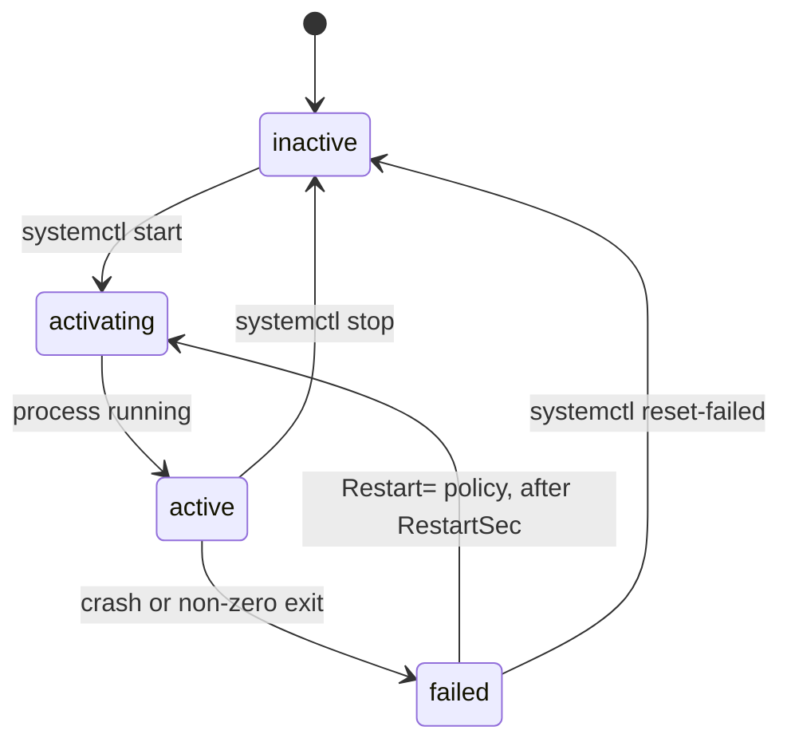

# Services, systemd and logs

After this you can run your own program as a service that starts at boot and restarts after a crash, check its state with `systemctl`, and read its logs with `journalctl`.

Before this: [Users, groups and permissions](03-users-groups-and-permissions.md), [Pipes, redirection and text tools](04-pipes-redirection-and-text-tools.md) and [Processes and signals](05-processes-and-signals.md).

## The idea

You start your web app with `python app.py &` over SSH. It works until you log out, the server reboots, or the app crashes at 3 a.m. Nothing restarts it and its output is gone. A background job (previous lesson) belongs to your login session; a production process should belong to the system.

On most Linux distributions, including Ubuntu, that system is **systemd**. It is the first process the kernel starts (PID 1) and it starts, supervises and stops everything else. You describe a program in a small text file, a **unit file**, and systemd runs it as a **service**: as a chosen user, with a restart policy, with its output collected in one log.



## Key terms

A **unit** is anything systemd manages, described by a file: a `.service` (a program), a `.timer` (a schedule), a `.socket` and others. A **service** is a unit that runs a process. **Enabled** means the unit starts at boot; **active** means it is running now. They are independent: a service can be active but not enabled.

The **journal** is systemd's log store. It collects stdout and stderr of every service, with timestamps, and `journalctl` reads it.

## How it works

`systemctl` is the control command ([systemctl(1)](https://manpages.ubuntu.com/manpages/noble/man1/systemctl.1.html)).

| Command | Does |
|---|---|
| `systemctl status name` | state, PID, recent log lines |
| `sudo systemctl start name` / `stop` / `restart` | change the running state now |
| `sudo systemctl reload name` | ask the program to re-read config, if it supports it |
| `sudo systemctl enable name` | start at boot (`enable --now` also starts it now) |
| `sudo systemctl disable name` | do not start at boot |
| `sudo systemctl daemon-reload` | re-read unit files after you edit one |
| `systemctl list-units --failed` | what is broken |

Your own units live in `/etc/systemd/system/`. This file runs a small app:

```ini
[Unit]
Description=My web app
After=network.target

[Service]
User=webapp
WorkingDirectory=/opt/webapp
ExecStart=/usr/bin/python3 -m http.server 8080 --bind 127.0.0.1
Restart=on-failure
RestartSec=3

[Install]
WantedBy=multi-user.target
```

`[Unit]` holds the description and ordering (`After=`). `[Service]` says how to run it. `User=` runs it as a dedicated account that owns only its own folder, the least-privilege habit from [users, groups and permissions](03-users-groups-and-permissions.md). `ExecStart=` needs the full path to the program; systemd has no shell and does not search your `PATH`. `Restart=on-failure` restarts the service after a non-zero exit, a signal or a timeout, but not after a clean stop. `[Install]` says which target pulls the service in when you run `enable`; `multi-user.target` is the normal boot state of a server.

The journal is read with `journalctl` ([journalctl(1)](https://manpages.ubuntu.com/manpages/noble/man1/journalctl.1.html)): `journalctl -u name` for one unit, `-f` to follow new lines like `tail -f`, `--since "10 minutes ago"` to limit time, `-n 50` for the last 50 lines, and `-p err` for errors only. Because the output is text, the pipes from the earlier lesson apply: `journalctl -u webapp --since today | grep -c ERROR`. An app that writes to stdout and stderr and lets systemd collect it needs no log-file code of its own.

### systemd on WSL

As of 2026, WSL supports systemd on current WSL versions from the Microsoft Store. To enable it, add `[boot]` then `systemd=true` to `/etc/wsl.conf`, then run `wsl.exe --shutdown` in PowerShell and reopen Ubuntu ([Microsoft: advanced settings](https://learn.microsoft.com/en-us/windows/wsl/wsl-config)). Check that it works with `ps -p 1 -o comm=`, which should print `systemd`. If `wsl --version` is not recognised, update WSL first.

## Worked examples

<div class="example" markdown>

### Example 1: a service that restarts itself

1. Create the account and folder: `sudo useradd --system --home /opt/webapp --shell /usr/sbin/nologin webapp` and `sudo mkdir -p /opt/webapp`.
2. Save the unit file above as `/etc/systemd/system/webapp.service`.
3. Load and start it: `sudo systemctl daemon-reload` then `sudo systemctl enable --now webapp`.
4. Check: `systemctl status webapp` shows `active (running)` and a main PID. `curl -s localhost:8080 | head -3` returns an HTML directory listing.
5. Crash it on purpose: `sudo kill -9 <main PID>`. Wait three seconds and run `status` again. It is `active (running)` with a new PID, because `SIGKILL` counts as a failure and `Restart=on-failure` applies.
6. Read the story: `journalctl -u webapp -n 20` shows the process being killed and started again.

Check: the new PID differs from the old one. These commands need Linux with systemd, so their output is not reproduced here.

</div>

## Common mistakes

<div class="warning" markdown>

Watch out: editing a unit file and forgetting `sudo systemctl daemon-reload`. systemd keeps using the old copy, and `status` warns that the unit changed on disk.

Watch out: a relative or bare command in `ExecStart=` (`python app.py`). Use the full path, found with `which python3`.

Watch out: running the service as root because it is easier. A bug in the app then has root. Make a dedicated user and give it only the folder it needs.

</div>

## Working with AI

<div class="ai" markdown>

Words to use: unit file, service, `ExecStart`, `Restart=on-failure`, enabled and active, journal, `daemon-reload`, least privilege.

Prompts to try:

- "Write a systemd unit for a Node.js app at /opt/api/server.js on Ubuntu 24.04. Run it as a dedicated user, restart on failure, load environment variables from /etc/api.env, and log to the journal. Explain each line."
- "My service shows 'failed (Result: exit-code)'. Here is `systemctl status` and `journalctl -u api -n 30`: (paste). What is the cause?"

What to check:

- `User=root`, or a `ProtectSystem`/`Environment` line you do not understand. Look up each directive in `man systemd.service` or `man systemd.exec`.
- A non-existent directive or section name. Run `systemd-analyze verify /etc/systemd/system/name.service`.
- Missing `daemon-reload` and `enable` steps.
- Secrets written inside the unit file, which anyone can read. Keep them in a file with mode `600` (see [config, environment variables and secrets](../../04-developer-tools-and-workflow/02-project-plumbing/02-config-env-vars-and-secrets.md)).

</div>

## Quiz

1\. What is the difference between `enable` and `start`?

<details class="solution" markdown>
<summary>Answer</summary>

`start` runs the service now. `enable` makes it start at boot. `enable --now` does both.

</details>

2\. What does `Restart=on-failure` do when the process exits with code 0?

<details class="solution" markdown>
<summary>Answer</summary>

Nothing: a clean exit is not a failure, so the service stays stopped. Use `Restart=always` if it should restart in that case too.

</details>

3\. You changed `ExecStart=` and `restart` still runs the old command. Why?

<details class="solution" markdown>
<summary>Answer</summary>

systemd has not re-read the file. Run `sudo systemctl daemon-reload`, then restart.

</details>

4\. Show the last 100 lines of the service `api` from the past hour that contain `ERROR`.

<details class="solution" markdown>
<summary>Answer</summary>

`journalctl -u api --since "1 hour ago" | grep ERROR | tail -n 100`.

</details>

## Lab

<div class="lab" markdown>

### Lab: run a web server as a service

Goal: create a service, break it, watch it recover, then remove it. Time: about 20 minutes. Runs in: WSL (Ubuntu) with systemd enabled (see above).

1. Create the user and folder, as in Example 1.
2. Write the unit file with `sudo tee`:

   ```bash
   sudo tee /etc/systemd/system/webapp.service > /dev/null <<'EOF'
   [Unit]
   Description=My web app
   After=network.target

   [Service]
   User=webapp
   WorkingDirectory=/opt/webapp
   ExecStart=/usr/bin/python3 -m http.server 8080 --bind 127.0.0.1
   Restart=on-failure
   RestartSec=3

   [Install]
   WantedBy=multi-user.target
   EOF
   ```

3. Start it: `sudo systemctl daemon-reload && sudo systemctl enable --now webapp`. Run `systemctl status webapp` and `curl -s localhost:8080 | head -3`.
4. Kill it with `sudo kill -9 $(systemctl show -p MainPID --value webapp)`, wait 4 seconds, and run `status` again. Note the changed PID.
5. Follow the journal while you request a page: `journalctl -u webapp -f`, and in a second terminal `curl -s localhost:8080 > /dev/null`. A request line appears. Stop following with Ctrl-C.
6. Cleanup:

   ```bash
   sudo systemctl disable --now webapp
   sudo rm /etc/systemd/system/webapp.service
   sudo systemctl daemon-reload
   sudo userdel webapp
   sudo rm -r /opt/webapp
   ```

Expected result: after step 4 the service is running again under a new PID, and after step 6 `systemctl status webapp` says the unit could not be found.

<details class="solution" markdown>
<summary>Solution</summary>

The commands above are the full solution. If `systemctl` says "System has not been booted with systemd as init", enable systemd in `/etc/wsl.conf` and restart WSL.

</details>

</div>

## Where this shows up

- Production servers on EC2 run your app this way: [deploying an app to EC2](../../13-devops-and-cloud/03-aws/08-deploying-an-app-to-ec2.md).
- Log levels, metrics and alerts build on the journal in [logging, metrics and monitoring](../../13-devops-and-cloud/04-operations/01-logging-metrics-and-monitoring.md).
