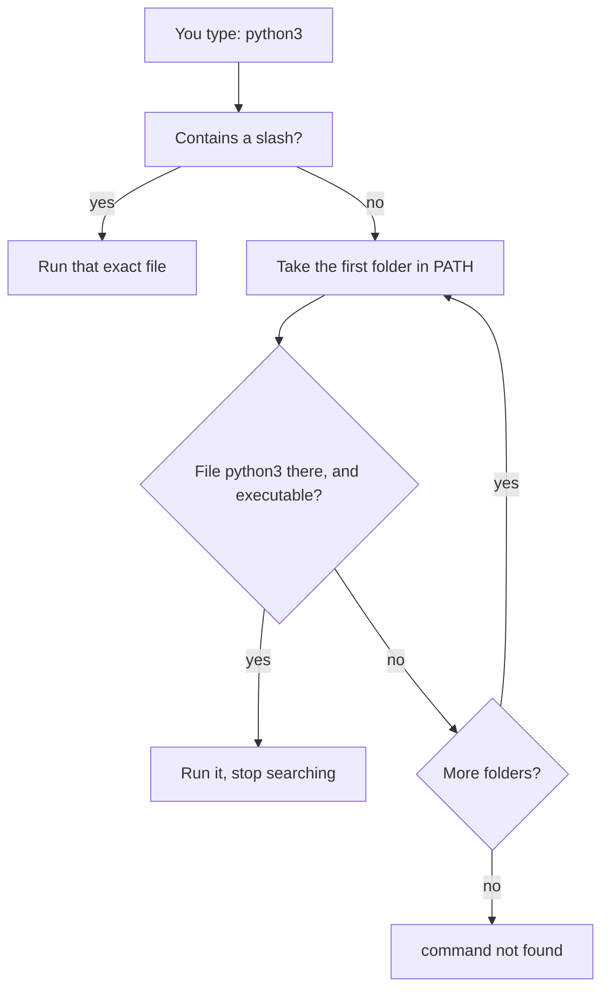

# Environment variables and path

After this you can set and read environment variables, explain how the shell finds a command through `PATH`, add a folder to `PATH` safely and permanently, and fix "command not found" or "wrong version" problems.

Before this: [Shell and terminal basics](01-shell-and-terminal-basics.md), [Files and navigation](02-files-and-navigation.md) and [Processes and signals](05-processes-and-signals.md).

## The idea

You install a tool and run it: `command not found`. Or you install a second version of Python and `python3 --version` still prints the old one. Both are about the **environment**: a set of named strings that every process carries, and the most important one, `PATH`, which tells the shell where to look for programs.

When a process starts another, it hands over a copy of its environment. That is how settings travel from your shell into every program you run, without being typed each time.



## Key terms

An **environment variable** is a name and a string value stored in a process's environment, such as `HOME=/home/you`. A **shell variable** is a variable that exists only in the current shell. **Exporting** a shell variable (`export NAME=value`) copies it into the environment of every program started afterward. By convention the names are upper case.

`PATH` is an environment variable holding a list of folders separated by colons. The shell searches them from left to right.

## How it works

`env` prints the environment, and `echo "$HOME"` prints one variable. A variable set with `NAME=value` is local to the shell. A child process, such as a script you run, only sees it after `export`.

```bash
export GREETING=hello
bash -c 'echo "child sees: $GREETING"'
LOCAL=x
bash -c 'echo "child sees LOCAL: [$LOCAL]"'
```

```text
child sees: hello
child sees LOCAL: []
```

You can also set a variable for one command only, by placing it in front: `VAR=once bash -c 'echo $VAR'` prints `once`, and `$VAR` is empty again afterward. The child gets a copy, so a program can never change your shell's variables; `export` in a script does not affect the shell that ran it. `unset NAME` removes a variable.

Common variables: `HOME` (your home directory), `USER`, `SHELL`, `PWD`, `EDITOR` and `PATH`. Programs also read their own: a Python app might read `DATABASE_URL`. This is the usual way to pass configuration into a program, and also where secrets often live; how to handle that is taught in [config, environment variables and secrets](../../04-developer-tools-and-workflow/02-project-plumbing/02-config-env-vars-and-secrets.md). Do not put a password on a command line: it shows up in `ps` and your history. Environment variables are visible in `/proc` to your own user and to root, so they are not a vault either.

### Finding a command

`type -a name` lists every match in lookup order, and `which name` prints the first. Order matters: if two folders hold a program with the same name, the earlier folder wins. That is why a newly installed version can be ignored. The shell also remembers lookups; after moving a program run `hash -r`.

Put a script or tool on `PATH` by adding its folder at the end of the list or the front:

```bash
export PATH="$HOME/bin:$PATH"
```

This puts `~/bin` first and keeps the old value after it. Always include `$PATH` in the new value, or you replace the list and then even `ls` is not found. Put a folder at the front only when you mean it to override the system's version; at the end it can only add programs. Never add `.` (the current folder): then `ls` in a downloaded folder could run a malicious file named `ls`.

### Where to make it permanent

An `export` typed in a terminal lasts until that shell exits. To keep it, write the line into a startup file. Bash reads `~/.bashrc` for each interactive shell you open, and `~/.profile` once for a login shell ([Bash manual: startup files](https://www.gnu.org/software/bash/manual/bash.html#Bash-Startup-Files)). On Ubuntu `~/.profile` already adds `~/bin` and `~/.local/bin` to `PATH` if the folders exist, and also loads `~/.bashrc`. The simple rule: put `PATH` and aliases in `~/.bashrc`, then open a new terminal or run `source ~/.bashrc` to apply the change now.

WSL adds your Windows `PATH` entries to the Linux `PATH` by default, so `explorer.exe` and `code` work from Ubuntu ([WSL interop setting](https://learn.microsoft.com/en-us/windows/wsl/wsl-config)). It also means a Windows `python.exe` can be found when you wanted Linux Python; `type -a python3` shows which.

## Worked examples

<div class="example" markdown>

### Example 1: two programs with the same name

Make two folders, each with a program called `hi`, and put them on `PATH` in different orders.

```bash
PATH=/tmp/bin1:/tmp/bin2:$PATH
hi
type -a hi
PATH=/tmp/bin2:/tmp/bin1:$PATH
hi
```

```text
from bin1
hi is /tmp/bin1/hi
hi is /tmp/bin2/hi
from bin2
```

1. With `bin1` first, the shell finds `/tmp/bin1/hi` and stops.
2. `type -a` shows both candidates, in the order searched.
3. Reversing the order reverses the winner. `PATH` order picks the program.

Check: after deleting both folders, `hi` prints `command not found` (run `hash -r` first, since the shell may remember the old location).

</div>

## Common mistakes

<div class="warning" markdown>

Watch out: `PATH=$HOME/bin` instead of `PATH=$HOME/bin:$PATH`. It replaces the list, and nothing else is found until you open a new shell.

Watch out: editing `~/.bashrc` and expecting the open terminal to change. Run `source ~/.bashrc`.

Watch out: a variable assigned without `export`. It works in your shell and is empty inside the script or program.

</div>

## Working with AI

<div class="ai" markdown>

Words to use: environment variable, `export`, `PATH`, login shell, `~/.bashrc`, `~/.profile`, `type -a`, `source`.

Prompts to try:

- "On Ubuntu under WSL, `python3 --version` shows 3.10 after I installed 3.12 into `~/.local/bin`. Here is the output of `type -a python3` and `echo $PATH`: (paste). Why, and what is the smallest fix?"
- "Which startup file should I put an `export` in so that both new terminals and my cron jobs see it? Explain the difference."

What to check:

- A suggested `export PATH=...` that leaves out `$PATH`, or adds `.`.
- A secret written into `~/.bashrc`, which every program you start inherits and which may end up in backups or screenshots.
- `sudo` and the environment: `sudo` resets most variables, so a variable set for you may be missing in `sudo command`. Check with `sudo env | grep NAME`.

</div>

## Quiz

1\. What is the difference between `X=1` and `export X=1`?

<details class="solution" markdown>
<summary>Answer</summary>

`X=1` sets a shell variable that only the current shell sees. `export X=1` also puts it in the environment of every program started afterward.

</details>

2\. `PATH=/opt/tools:/usr/bin` and both folders hold `node`. Which runs when you type `node`?

<details class="solution" markdown>
<summary>Answer</summary>

`/opt/tools/node`, because the shell takes the first match from left to right.

</details>

3\. After `PATH=$HOME/bin`, `ls` says command not found. What happened and how do you recover?

<details class="solution" markdown>
<summary>Answer</summary>

The assignment replaced the whole list with one folder, so `/usr/bin` is gone. Open a new terminal to reset it, or run `PATH=/usr/local/bin:/usr/bin:/bin` for now. The correct line is `PATH="$HOME/bin:$PATH"`.

</details>

4\. You added `export API_KEY=abc` to `~/.bashrc` and your script run by cron cannot see it. Why?

<details class="solution" markdown>
<summary>Answer</summary>

Cron does not start an interactive shell, so it does not read `~/.bashrc`. Set the variable inside the script, in the crontab, or load a protected file from the script (see [shell scripting and cron](09-shell-scripting-and-cron.md)).

</details>

## Lab

<div class="lab" markdown>

### Lab: your own bin folder on PATH

Goal: create a command that runs from anywhere. Time: about 10 minutes. Runs in: WSL (Ubuntu).

1. Make the folder and a script.

   ```bash
   mkdir -p ~/bin
   printf '#!/usr/bin/env bash\necho "hello from my own command"\n' > ~/bin/hello
   chmod +x ~/bin/hello
   ```

2. Try it: `hello` (this may fail). Then `~/bin/hello` (works, since it has a slash).
3. Check `echo "$PATH"`. On Ubuntu, `~/bin` is added by `~/.profile` only for a new login shell if the folder existed when it started. If it is missing, add it for now with `export PATH="$HOME/bin:$PATH"`, then run `hello` and `type -a hello`.
4. Make it permanent: append `export PATH="$HOME/bin:$PATH"` to `~/.bashrc` (skip if already on `PATH`), and run `source ~/.bashrc`.
5. Pass a setting: `GREETING=hi hello` still prints the same text, since the script ignores it. Change the script to print `"${GREETING:-hello}"`, and compare with and without `GREETING=hi` in front.
6. Cleanup: remove `~/bin/hello`, delete any line you added to `~/.bashrc`, and run `source ~/.bashrc`.

Expected result: `hello` runs from any folder in step 3 or 4.

<details class="solution" markdown>
<summary>Solution</summary>

The script after step 5 is:

```bash
#!/usr/bin/env bash
echo "${GREETING:-hello} from my own command"
```

`${GREETING:-hello}` means "the value of `GREETING`, or `hello` if it is empty or unset".

</details>

</div>

## Where this shows up

- Configuration by environment variable is the norm for apps: see [config, environment variables and secrets](../../04-developer-tools-and-workflow/02-project-plumbing/02-config-env-vars-and-secrets.md).
- Python's virtual environments work by putting their folder at the front of `PATH`, in [modules, packages, pip and venv](../../03-programming-fundamentals/01-python-basics/08-modules-packages-pip-and-venv.md).
