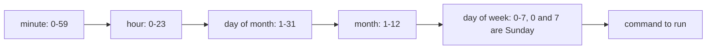

# Shell scripting and cron

After this you can write a short Bash script that fails safely, run it on a schedule with cron, capture its output, and tell when a task has outgrown the shell.

Before this: [Shell and terminal basics](01-shell-and-terminal-basics.md), [Pipes, redirection and text tools](04-pipes-redirection-and-text-tools.md) and [Environment variables and path](08-environment-variables-and-path.md).

## The idea

You back up a project folder by hand every Friday: run `tar`, name the file with the date, delete old copies. A **shell script** is those same commands saved in a file so you run one thing instead of five. **Cron** then runs that file at set times with nobody logged in.

Scripts are glue: they start programs, pass them files, and check whether they worked. The rule for this lesson is that a script should stop at the first problem instead of carrying on with bad data.

## Key terms

A **shebang** is the first line, `#!/usr/bin/env bash`, which tells the kernel which interpreter runs the file. A script needs the execute bit (`chmod +x`) and is run as `./backup.sh`. A **positional parameter** is an argument passed to the script: `$1` is the first, `$#` the count, `"$@"` all of them, each kept as a separate word.

**cron** is a service that runs commands on a schedule. A **crontab** is a user's table of scheduled jobs, edited with `crontab -e` and listed with `crontab -l` ([crontab(5)](https://manpages.ubuntu.com/manpages/noble/man5/crontab.5.html)).

## How it works

Start every script with a safety line:

```bash
#!/usr/bin/env bash
set -euo pipefail
```

`set -e` exits when a command fails. `set -u` treats an unset variable as an error, so a typo like `$DESTT` stops the script instead of expanding to nothing. `set -o pipefail` makes a pipeline fail if any stage fails, not just the last. Without it `false | true` reports success.

The building blocks are few:

```bash
name="Ada"                       # no spaces around =
if [ -d "$dir" ]; then echo yes; else echo no; fi   # test: -d dir, -f file, -z empty
for f in *.log; do echo "$f"; done
greet() { echo "hi $1"; }        # a function, called as: greet Ada
today=$(date +%Y-%m-%d)          # capture a command's output
exit 1                           # end the script with an exit code
```

Quote every variable (`"$dir"`). Send error messages to stderr with `>&2`, so they do not mix with output. Use exit code 0 for success and non-zero for failure, because the caller (you, cron, a CI job) decides what to do from the code, as in [shell and terminal basics](01-shell-and-terminal-basics.md).

### Cron

A crontab line has five time fields and then the command. The diagram shows the order and the allowed values.



A `*` means every value, `*/5` every fifth, `1-5` a range, and `1,15` a list. Some schedules:

| Line | Runs |
|---|---|
| `*/5 * * * * cmd` | every 5 minutes |
| `0 2 * * * cmd` | every day at 02:00 |
| `30 9 * * 1-5 cmd` | at 09:30, Monday to Friday |
| `0 0 1 * * cmd` | at midnight on the 1st of each month |
| `@reboot cmd` | once, when the machine starts |

A site such as crontab.guru translates a line into words, which is a good check. Cron uses the system's time zone, and servers are often set to UTC, so "02:00" may not be 02:00 in Ontario. Check with `date`.

Cron does not run in your login environment. It starts a minimal shell with a short `PATH` (usually `/usr/bin:/bin`), no `~/.bashrc`, and a different working directory. Use full paths to programs and files, or set variables at the top of the crontab. A literal `%` in a crontab command must be written `\%`, which matters for `date +%Y`. Anything the job prints is mailed to the user if the system has mail set up, and otherwise disappears, so send it to a log: `>> $HOME/backup.log 2>&1`, using the redirections from the pipes lesson.

WSL note: cron runs only while the `cron` service runs. With systemd on, `sudo systemctl enable --now cron` starts it, and WSL stops idle distributions, so a Windows laptop is a poor place for a job that must run at 02:00. That is what Windows Task Scheduler or a real server is for.

### When to leave the shell

A script is the right size while it is mostly "run these programs in order". Once you need data structures, JSON, real error handling, or more than about 50 to 100 lines, use Python, which you meet in [Python basics](../../03-programming-fundamentals/01-python-basics/01-values-types-and-variables.md). Bash quoting rules and silent failures cost more than they save.

## Worked examples

<div class="example" markdown>

### Example 1: a backup script

Save this as `backup.sh`. It takes a source and destination folder, writes a dated archive, and keeps the newest 7.

```bash
#!/usr/bin/env bash
set -euo pipefail

usage() { echo "usage: $0 SOURCE_DIR DEST_DIR" >&2; exit 2; }
[ "$#" -eq 2 ] || usage

src=$1
dest=$2
stamp=$(date +%Y-%m-%d)

if [ ! -d "$src" ]; then
  echo "error: $src is not a directory" >&2
  exit 1
fi

mkdir -p "$dest"
tar -czf "$dest/backup-$stamp.tar.gz" -C "$src" .
echo "wrote $dest/backup-$stamp.tar.gz"

# keep only the 7 newest backups
ls -1t "$dest"/backup-*.tar.gz | tail -n +8 | xargs -r rm --
```

Run it three ways after `chmod +x backup.sh`:

```bash
./backup.sh data out; echo "exit=$?"
./backup.sh; echo "exit=$?"
./backup.sh nodir out; echo "exit=$?"
```

```text
wrote out/backup-2026-10-26.tar.gz
exit=0
usage: ./backup.sh SOURCE_DIR DEST_DIR
exit=2
error: nodir is not a directory
exit=1
```

1. `[ "$#" -eq 2 ] || usage` checks the argument count. The error goes to stderr and the script exits with 2.
2. `-C "$src" .` makes `tar` work from inside the source, so the archive holds relative paths.
3. The last line lists archives newest first, skips the first 7, and removes the rest. `xargs -r` does nothing when the list is empty.

Check: `tar -tzf out/backup-*.tar.gz` lists the files you put in `data`.

To schedule it every night at 02:00, run `crontab -e` and add (use absolute paths):

```text
0 2 * * * /home/you/backup.sh /home/you/projects /home/you/backups >> /home/you/backup.log 2>&1
```

</div>

<div class="example" markdown>

### Example 2: what `set -u` and `pipefail` catch

```bash
bash -c 'set -u; echo "$undefined_var"; echo after'
bash -c 'false | true; echo "no pipefail: $?"'
bash -c 'set -o pipefail; false | true; echo "pipefail: $?"'
```

```text
bash: line 1: undefined_var: unbound variable
no pipefail: 0
pipefail: 1
```

The first script stops before printing `after`. The last two show a failing stage hidden unless `pipefail` is set.

</div>

## Common mistakes

<div class="warning" markdown>

Watch out: a script that works in your terminal and fails in cron. Cause: the short `PATH`, a relative path, or a missing environment variable. Use full paths and log the output.

Watch out: `rm -rf "$dir/"*` where `dir` can be empty. With `set -u` an unset `dir` stops the script, but an empty string does not; check `[ -n "$dir" ]` first.

Watch out: spaces in the assignment (`name = "Ada"`). Bash runs a command named `name`.

</div>

## Working with AI

<div class="ai" markdown>

Words to use: shebang, `set -euo pipefail`, exit code, positional parameter, crontab, cron expression, idempotent, `PATH`.

Prompts to try:

- "Write a Bash script for Ubuntu that takes a folder and a retention count, creates a dated `.tar.gz` backup, deletes older ones, logs to stderr, and exits non-zero on any failure. Use `set -euo pipefail` and quote all variables."
- "Explain this crontab line in words and tell me what could make it fail under cron but work in my terminal: `15 3 * * 1 /home/me/sync.sh`."

What to check:

- Unquoted variables, `ls | while read` loops that break on spaces, and parsing `ls` output. Use globs or `find -print0`.
- A destructive command (`rm`, `mv`, `>`) whose path comes from a variable. Test with `echo` in front.
- `%` unescaped in cron, and relative paths.
- A cron expression: verify the five fields against a translator or the table above.

</div>

## Quiz

1\. What do the three options in `set -euo pipefail` each do?

<details class="solution" markdown>
<summary>Answer</summary>

`-e` exits on a failing command, `-u` makes using an unset variable an error, and `pipefail` makes a pipeline fail if any stage fails.

</details>

2\. Write the cron line fragment for 06:45 on weekdays.

<details class="solution" markdown>
<summary>Answer</summary>

`45 6 * * 1-5`.

</details>

3\. A script called `deploy.sh "my app" prod` runs `echo $1 $2`. What is `$#`?

<details class="solution" markdown>
<summary>Answer</summary>

2: `my app` is one argument because of the quotes, and `prod` is the second. Note that the unquoted `$1` in the `echo` would split on the space, so quote it: `echo "$1" "$2"`.

</details>

4\. Your cron job runs `python3 report.py` and logs "No such file". It works by hand. Why?

<details class="solution" markdown>
<summary>Answer</summary>

Cron's working directory is not the script's folder. Use the full path (`python3 /home/you/report.py`) or `cd` into the folder first in the script.

</details>

## Lab

<div class="lab" markdown>

### Lab: a backup script and a cron job

Goal: write, test and schedule a script, then remove everything. Time: about 20 minutes. Runs in: WSL (Ubuntu). If cron is not installed, run `sudo apt install cron` first.

1. Make test data and the script.

   ```bash
   mkdir -p ~/cron-lab/data && cd ~/cron-lab
   echo "important" > data/a.txt
   ```

   Save the script from Example 1 as `~/cron-lab/backup.sh`, then `chmod +x backup.sh`.
2. Run it for each of the three cases in the example and compare the exit codes.
3. Make sure cron runs: `sudo systemctl enable --now cron` (needs systemd; see the previous lessons) or `sudo service cron start`.
4. Run `crontab -e` and add a job every minute:

   ```text
   * * * * * /home/YOU/cron-lab/backup.sh /home/YOU/cron-lab/data /home/YOU/cron-lab/out >> /home/YOU/cron-lab/cron.log 2>&1
   ```

   Replace `YOU` with the output of `whoami`. Wait two minutes, then `cat ~/cron-lab/cron.log` and `ls ~/cron-lab/out`.
5. Cleanup: run `crontab -e` and delete the line (or `crontab -r` if you have no other jobs), then `rm -r ~/cron-lab`.

Expected result: the log contains `wrote ...backup-DATE.tar.gz` lines, one per run (the same file name is overwritten within a day).

<details class="solution" markdown>
<summary>Solution</summary>

If nothing appears, check `systemctl status cron`, then look for the error in `~/cron-lab/cron.log` or `journalctl -u cron`. A missing log usually means a wrong path.

</details>

</div>

## Where this shows up

- Scheduled jobs are the simplest form of a data pipeline; see [ETL and ELT](../../11-data-engineering-and-data-science/01-data-engineering/index.md) for the next step up.
- CI pipelines are lists of shell commands with the same exit-code rules: [CI/CD concepts](../../13-devops-and-cloud/02-ci-cd/01-ci-cd-concepts.md).
