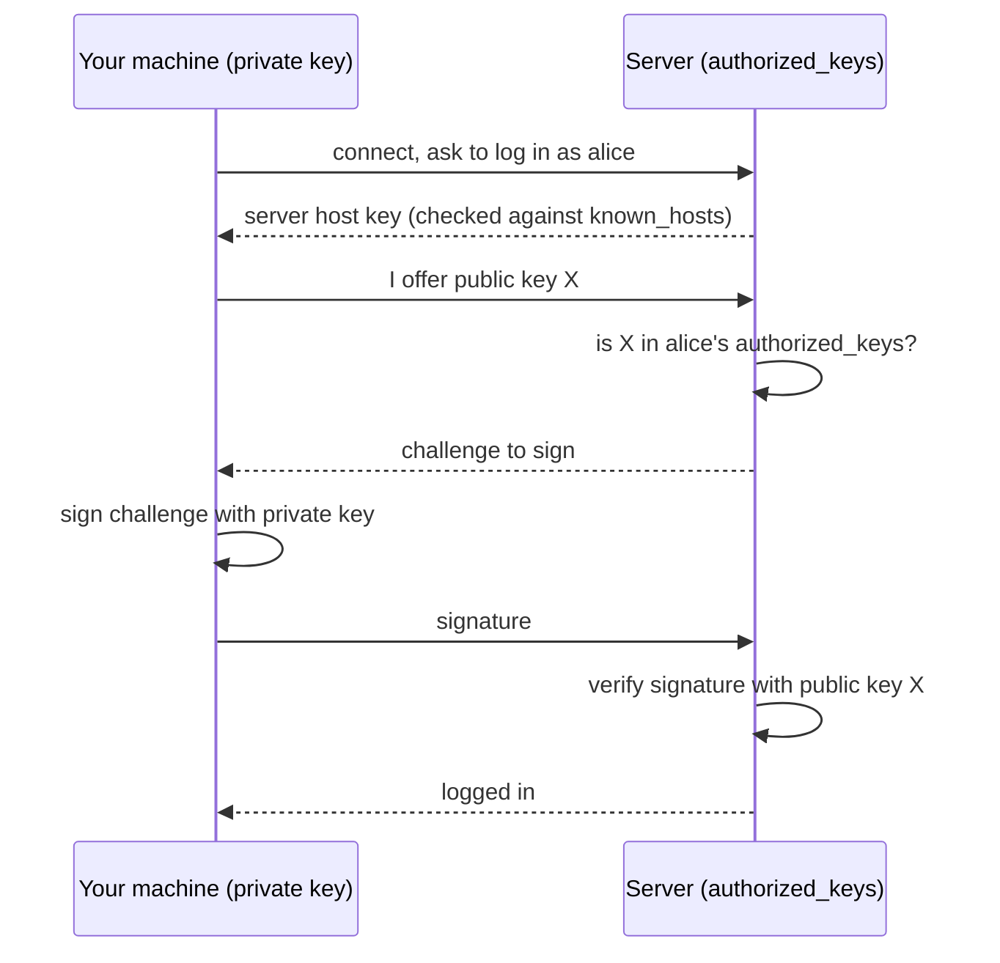

# SSH and keys

After this you can log in to a remote machine with `ssh`, create and use a key pair instead of a password, name your servers in `~/.ssh/config`, copy files with `scp` and `rsync`, and understand a host-key warning before you click past it.

Before this: [Users, groups and permissions](03-users-groups-and-permissions.md), [Files and navigation](02-files-and-navigation.md) and [Environment variables and path](08-environment-variables-and-path.md).

## The idea

Your app runs on a rented Linux server in a data centre. You have no keyboard attached to it, only the internet. **SSH** (Secure Shell) gives you a terminal on that machine over an encrypted connection, so the commands you have learned work on a server hundreds of kilometres away exactly as they do locally. The same protocol carries Git over SSH, which you set up in [setting up your machine](../../00-start-here/setting-up-your-machine.md).

Passwords on an internet-facing server get guessed constantly. SSH instead uses a **key pair**: two linked files made together. The **private key** stays on your machine and is never shared. The **public key** can be given to anyone; you put a copy on every server you want to enter. The server can check that you hold the private key without the key ever crossing the network.



## Key terms

An **SSH key pair** is a private key and its matching public key. The signature scheme behind the pair is the one taught in [public key encryption and signatures](../../12-security/02-cryptography/03-public-key-encryption-and-signatures.md). **Ed25519** is the modern default algorithm: short keys, fast, no size to choose.

`~/.ssh/authorized_keys` on the server lists the public keys allowed to log in as that user. `~/.ssh/known_hosts` on your machine lists the host keys of servers you have connected to before. A **host key** identifies the server itself, so you know you reached the right machine. A **fingerprint** is a short hash of a key, easy to compare by eye.

The **ssh-agent** is a background program that holds your decrypted private key in memory, so you type the passphrase once per session.

## How it works

Connect with `ssh user@host`, or `ssh -p 2222 user@host` for a non-default port. Add a command to run it and exit: `ssh user@host 'df -h'`.

Create a key with a passphrase (the passphrase encrypts the private key file on disk, so a stolen laptop alone is not enough):

```bash
ssh-keygen -t ed25519 -C "you@example.com"
```

```text
Generating public/private ed25519 key pair.
Your identification has been saved in ssh/id_ed25519
Your public key has been saved in ssh/id_ed25519.pub
The key fingerprint is:
SHA256:ykj1dxa0Xq+KeoJ63M9rHT+FiLml4wrvMjors2uWQ64 demo@example
```

This is the real output from OpenSSH 10.3 on Windows with the key written to a custom folder; you get `~/.ssh/id_ed25519` by default. The file `id_ed25519.pub` is one line you can share; the file without `.pub` never leaves your machine ([ssh-keygen(1)](https://manpages.ubuntu.com/manpages/noble/man1/ssh-keygen.1.html)).

```text
ssh-ed25519 AAAAC3NzaC1lZDI1NTE5AAAAIKi/BLriRMjyZLXu65ju7OEM... demo@example
```

Install the public key on the server with `ssh-copy-id user@host`, which appends it to `~/.ssh/authorized_keys`. Afterwards `ssh user@host` signs in without a password. Once key login works, a server administrator usually turns password login off in `/etc/ssh/sshd_config`.

### Permissions

OpenSSH refuses keys and files that other users can modify or read. On both sides:

```bash
chmod 700 ~/.ssh
chmod 600 ~/.ssh/id_ed25519 ~/.ssh/authorized_keys
```

This is the permission model from [users, groups and permissions](03-users-groups-and-permissions.md). The giveaway is `Permissions 0644 for '...' are too open` and a fall back to a password prompt.

### Config, agent and file copies

`~/.ssh/config` gives hosts short names and defaults:

```text
Host web
    HostName 203.0.113.10
    User alice
    Port 2222
    IdentityFile ~/.ssh/id_ed25519
```

After that, `ssh web` is enough, and `scp`, `rsync` and Git use the same names. Load the key into the agent with `eval "$(ssh-agent -s)"` and `ssh-add ~/.ssh/id_ed25519`; many desktops start the agent for you.

`scp file web:/home/alice/` copies a file; `scp -r dir web:path` a folder. `rsync -av dir/ web:/home/alice/dir/` copies only what changed, can resume, and is the better choice for repeated copies. A trailing slash on the source means "the contents of", so keep the habit consistent.

### Host keys

The first time you connect, `ssh` shows the server's fingerprint and asks whether to trust it. Say yes only when you can compare it with the real one, such as the cloud provider's console output. It is then saved in `known_hosts`. If the key later changes, `ssh` prints `WARNING: REMOTE HOST IDENTIFICATION HAS CHANGED!` and refuses to connect. Reinstalled servers and reused IP addresses cause this innocently. A man-in-the-middle attack causes it too, so check why before running `ssh-keygen -R host` to delete the old entry.

### Port forwarding

`ssh -L 5433:localhost:5432 web` makes port 5433 on your machine reach port 5432 on the server through the encrypted connection. It lets you use a database that listens only on the server's own loopback address, without opening it to the internet. Ports are covered in [ports and sockets](../../07-networking/01-how-the-internet-works/04-ports-and-sockets.md).

## Worked examples

<div class="example" markdown>

### Example 1: key, config and first login

1. Generate the key: `ssh-keygen -t ed25519 -C "you@example.com"`, accept the path, set a passphrase.
2. Install it: `ssh-copy-id alice@203.0.113.10`. The first connection shows the host fingerprint: compare it, type `yes`, then enter the password once.
3. Add the `Host web` block above to `~/.ssh/config`.
4. Log in: `ssh web`. It asks for the key passphrase (or nothing, with the agent running), not the server password.
5. Check: `ssh web 'whoami && hostname'` prints `alice` and the server's name, and `cat ~/.ssh/known_hosts` has a new line.

This needs a remote server, so the transcript is not reproduced; the lab does the same on your own machine.

</div>

## Common mistakes

<div class="warning" markdown>

Watch out: sharing or committing the wrong file. Only `*.pub` is shareable. A private key in a Git repository must be treated as stolen: remove it, create a new pair and replace it everywhere.

Watch out: pressing `yes` or deleting `known_hosts` entries to silence a changed-host-key warning without asking why.

Watch out: a key with no passphrase on a laptop you carry. Use a passphrase and the agent.

</div>

## Working with AI

<div class="ai" markdown>

Words to use: key pair, public and private key, `authorized_keys`, `known_hosts`, host key, ssh-agent, `ssh-copy-id`, port forwarding.

Prompts to try:

- "My `ssh -v alice@203.0.113.10` output ends with 'Permission denied (publickey)'. Here is the verbose output: (paste). List causes in order, and the command to check each on the client and on the server."
- "Write an `~/.ssh/config` for a bastion host and a private server behind it, using `ProxyJump`, and explain each line."

What to check:

- A command that turns off host checking (`StrictHostKeyChecking no`, `-o UserKnownHostsFile=/dev/null`). It silences the warning that protects you; do not keep it.
- RSA key suggestions with small sizes, or `.pem` handling for the wrong cloud, when Ed25519 would do. Match the provider's current docs.
- `chmod 777 ~/.ssh` or `chmod 644` on a private key.
- A private key pasted into a chat. Never paste it, only the `.pub` file or the error text.

</div>

## Quiz

1\. Which key file do you give to a server, and which never leaves your machine?

<details class="solution" markdown>
<summary>Answer</summary>

You give the public key (`id_ed25519.pub`). The private key (`id_ed25519`) stays on your machine.

</details>

2\. `ssh` prints `Permissions 0644 for '/home/me/.ssh/id_ed25519' are too open` and asks for a password. Fix?

<details class="solution" markdown>
<summary>Answer</summary>

`chmod 600 ~/.ssh/id_ed25519`. Other users could read the key, so OpenSSH ignores it.

</details>

3\. After rebuilding a server, `ssh` refuses with "REMOTE HOST IDENTIFICATION HAS CHANGED". What do you do?

<details class="solution" markdown>
<summary>Answer</summary>

Confirm the new host key came from your rebuild (compare the fingerprint with the provider's console). Then remove the old line with `ssh-keygen -R host` and connect again, accepting the new key.

</details>

4\. What does `rsync -av src/ web:dir/` do that `scp -r src web:dir` does not?

<details class="solution" markdown>
<summary>Answer</summary>

It sends only files that changed, so repeated runs are quick, and it can resume an interrupted copy. The trailing slash on `src/` copies its contents rather than the folder itself.

</details>

## Lab

<div class="lab" markdown>

### Lab: key login to your own machine

Goal: do a full key-based login without a remote server. Time: about 20 minutes. Runs in: WSL (Ubuntu). This installs an SSH server that listens on your machine; the cleanup removes it.

1. Install and start the server.

   ```bash
   sudo apt update && sudo apt install openssh-server
   sudo service ssh start
   ```

2. Make a separate lab key (no passphrase for the lab only) and authorize it.

   ```bash
   mkdir -p ~/.ssh && chmod 700 ~/.ssh
   ssh-keygen -t ed25519 -N "" -f ~/.ssh/lab_key
   cat ~/.ssh/lab_key.pub >> ~/.ssh/authorized_keys
   chmod 600 ~/.ssh/authorized_keys ~/.ssh/lab_key
   ```

3. Add a host alias.

   ```bash
   cat >> ~/.ssh/config <<'EOF'
   Host labhost
       HostName localhost
       User YOU
       IdentityFile ~/.ssh/lab_key
   EOF
   ```

   Replace `YOU` with the output of `whoami`.
4. Connect: `ssh labhost 'whoami && echo logged in with a key'`. Accept the host key the first time. Then `tail -2 ~/.ssh/known_hosts` to see the saved line.
5. Copy a file: `echo hi > t.txt && scp t.txt labhost:/tmp/ && ssh labhost cat /tmp/t.txt`.
6. Break it on purpose: `chmod 644 ~/.ssh/lab_key`, run `ssh labhost true`, read the warning, then fix it with `chmod 600`.
7. Cleanup: stop the server, remove it, and delete the lab key and entries.

   ```bash
   sudo service ssh stop
   sudo apt purge openssh-server
   rm ~/.ssh/lab_key ~/.ssh/lab_key.pub t.txt
   ```

   Then edit `~/.ssh/authorized_keys` to delete the line ending in your lab key's comment, edit `~/.ssh/config` to remove the `Host labhost` block, and run `ssh-keygen -R localhost`.

Expected result: step 4 prints your username and the message without asking for a password.

<details class="solution" markdown>
<summary>Solution</summary>

In step 6 the warning is `Permissions 0644 for '...lab_key' are too open`, followed by `Permission denied (publickey)`, since the key was ignored and no other method is allowed. `chmod 600` restores access.

</details>

</div>

## Where this shows up

- Reaching an EC2 instance uses a key pair from day one: [EC2](../../13-devops-and-cloud/03-aws/03-ec2.md).
- The same key login is how Git talks to GitHub: [GitHub, pull requests and code review](../../04-developer-tools-and-workflow/01-editor-and-git/04-github-pull-requests-and-code-review.md).
