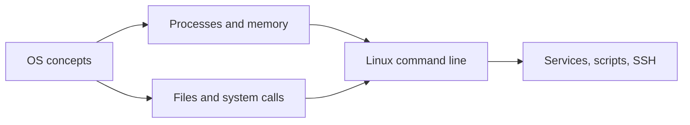

# Operating systems and Linux

What an operating system does, plus a working command-line toolkit for Linux, where most servers run.

Before this folder: How computers work.

This folder has two halves. The first explains what an operating system does: it runs processes and threads, gives each one virtual memory, manages files, and lets programs ask the kernel for services through system calls. The second teaches the Linux command line, where most servers run: navigating files, permissions, pipes, processes, packages, services, scripts and SSH.

AI tools produce shell commands constantly, and a wrong one can delete files or open a server to the world. Knowing what a permission string, a signal or a pipe means lets you read a suggested command before you run it.

It builds on [How computers work](../01-how-computers-work/index.md): the CPU, memory and storage you met there are what the OS shares out. It feeds [Programming fundamentals](../03-programming-fundamentals/index.md) (you will use the terminal daily), then [Networking](../07-networking/index.md) and [DevOps and cloud](../13-devops-and-cloud/index.md), which assume you are comfortable on a Linux box.

### How to use this folder

- The Linux labs assume WSL2 Ubuntu on Windows 11. Set it up before the second chapter.
- Keep the Linux command line cheat sheet open while you work in later folders.
- Practise the commands in a scratch directory, not in a folder with work you care about.

<!-- lessons:start -->
## Lessons

### 1. [Operating system concepts](01-os-concepts/index.md)

1. [What an OS and kernel do](01-os-concepts/01-what-an-os-and-kernel-do.md)
2. [Processes, threads and scheduling](01-os-concepts/02-processes-threads-and-scheduling.md)
3. [Memory and virtual memory](01-os-concepts/03-memory-and-virtual-memory.md)
4. [File systems](01-os-concepts/04-file-systems.md)
5. [System calls and kernel mode](01-os-concepts/05-system-calls-and-kernel-mode.md)

### 2. [Linux command line](02-linux-command-line/index.md)

1. Shell and terminal basics (not written yet)
2. Files and navigation (not written yet)
3. [Users, groups and permissions](02-linux-command-line/03-users-groups-and-permissions.md)
4. Pipes, redirection and text tools (not written yet)
5. Processes and signals (not written yet)
6. Packages with apt (not written yet)
7. Services, systemd and logs (not written yet)
8. Environment variables and path (not written yet)
9. Shell scripting and cron (not written yet)
10. SSH and keys (not written yet)

<!-- lessons:end -->
