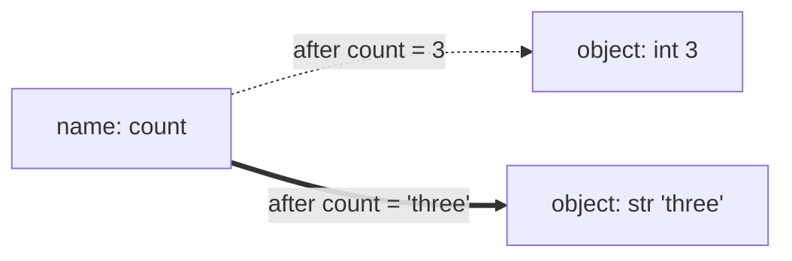
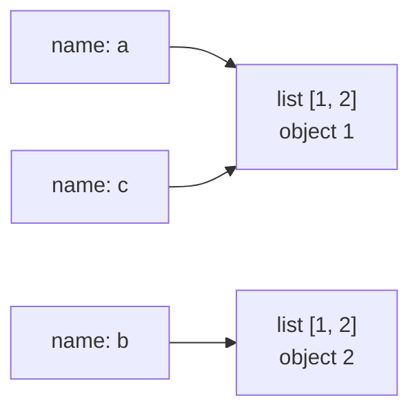

# Values, types and variables

After this you can predict what Python's numeric operators return, explain what a variable name actually is, and choose between `==` and `is`.

Before this: [Setting up your machine](../../00-start-here/setting-up-your-machine.md). For the float details, see [floating point](../../01-how-computers-work/01-bits-and-data/04-floating-point.md).

## The idea

You have written code in other languages, so this lesson skips "what is a variable" and goes straight to where Python differs. The snippets in this chapter were run on Python 3.14.4. Anything newer than 3.10 is labelled with the version that added it.

In C or Java, a variable is a box with a declared type, and assignment copies a value into the box. In Python, a variable is a **name** bound to an **object**. The object has the type; the name has none. Assignment makes the name point at an object, and nothing is copied.

```python
count = 3
count = "three"
print(count, type(count))
```

```text
three <class 'str'>
```



In the diagram, the dotted arrow is the old binding. The second assignment moves the arrow to a new object; the `int` is untouched, and the name never had a type.

Type annotations such as `price: int = "free"` are hints for editors and type checkers. The interpreter ignores them, so that line runs without complaint. [Type systems](../02-thinking-like-a-programmer/03-type-systems.md) covers what checkers add.

## Key terms

An **object** is a value in memory with an identity (`id()`), a type and some data. Everything is an object, including integers and functions.

An **expression** produces a value. A **statement** (`x = 5`, `if`, `def`) does something and produces none.

**Dynamic typing** means types are checked when an operation runs, not before. `"a" + 1` fails at that line, at run time, with a `TypeError`.

**Truthiness** is the boolean meaning of any object. It is covered in the next lesson.

## How it works

The built-in scalar types are `int`, `float`, `bool`, `str` and `NoneType` (the type of `None`, Python's "no value").

An `int` has no fixed size: it grows as needed, so `2**100` is exact and never overflows. A `float` is a 64-bit IEEE 754 double, the same as `double` elsewhere, so it has the same rounding behaviour. A `bool` is a subclass of `int`: `True` equals 1 and `False` equals 0.

Division has two operators. `/` always returns a float, even for `6 / 3`. `//` is floor division and rounds toward negative infinity, not toward zero. `%` is defined so that `a == (a // b) * b + a % b` always holds, which gives a non-negative result when the divisor is positive.

```python
print(7 / 2, 7 // 2, 7 % 2)
print(-7 // 2, -7 % 2, divmod(-7, 2))
print(2**100)
print(0.1 + 0.2, 0.1 + 0.2 == 0.3)
```

```text
3.5 3 1
-4 1 (-4, 1)
1267650600228229401496703205376
0.30000000000000004 False
```

For floats, compare with `math.isclose(a, b)`. For money, use integer cents or `decimal.Decimal` built from strings.

Conversion is explicit: `int("42")`, `float("2.5")`, `str(7)`. `int(3.99)` truncates to 3, and `int("4.2")` raises `ValueError`. `round()` uses banker's rounding: `round(2.5)` is 2 and `round(3.5)` is 4.

Two comparison operators matter. `==` asks whether two objects have equal values. `is` asks whether they are the same object. Use `is` only for `None` (`if x is None`), because there is exactly one `None`.

```python
a = [1, 2]
b = [1, 2]
c = a
print(a == b, a is b, a is c)
n = 1000
m = int("1000")
print(n == m, n is m)
```

```text
True False True
True False
```



In the diagram, `c = a` copied nothing, so `a` and `c` are two names for one list. `b` equals them but is a separate object, which is why `a == b` is `True` and `a is b` is `False`. The integers 1000 are likewise equal but separate. CPython happens to reuse small integers (about -5 to 256), so `is` on numbers sometimes appears to work, which is the worst kind of bug. Recent versions warn on `x is 5`. Aliasing gets its own lesson: [references, mutability and copying](../02-thinking-like-a-programmer/02-references-mutability-and-copying.md).

## Worked examples

<div class="example" markdown>

### Example 1: summing money three ways

We want the total of five prices. Floats are quick, but a total like this one drifts.

1. Convert each price string to a float and add: this is what a naive script does.
2. Convert to integer cents with `round(p * 100)`, add, then divide by 100 once.
3. Use `Decimal` built from the strings, so no binary rounding happens at all.

```python
from decimal import Decimal

prices = ["19.99", "5.01", "0.10", "0.20", "0.30"]
print(sum(float(p) for p in prices))
print(sum(round(float(p) * 100) for p in prices) / 100)
print(sum(Decimal(p) for p in prices))
```

```text
25.599999999999998
25.6
25.60
```

Check: the true total is 25.60, so the float version is off by about $2 \times 10^{-15}$. Printing hides this when you format to two places, but `==` on the total would fail. Since Python 3.12 (see [what's new](https://docs.python.org/3/whatsnew/3.12.html)), `sum()` on floats uses compensated summation, so `sum([0.1] * 10) == 1.0` is `True` while a `total += 0.1` loop gives `0.9999999999999999`. That makes float sums less predictable across code paths, not safer. Note that `Decimal(0.1)` (from a float) keeps the float's error; always pass a string.

</div>

## Common mistakes

<div class="warning" markdown>

Watch out: using `is` to compare values. `n is m` above is `False` for equal integers. Use `==`, and reserve `is` for `None`.

Watch out: `//` on negatives. `-7 // 2` is `-4`, not `-3`. If you port code from C, Java or JavaScript, `int(-7 / 2)` gives the truncating answer.

Watch out: assuming `/` returns an int when both operands are ints. In Python 2 it did; in Python 3 it returns a float, which then breaks list indexing with `TypeError`. Use `//`.

</div>

## Working with AI

<div class="ai" markdown>

Words to use: name binding, object identity, `==` versus `is`, floor division, `Decimal`, truthiness, dynamic typing.

Prompts to try:

- "In Python 3.12, what does `-7 // 2` return and why? Give the identity that relates `//` and `%` and check it with two negative examples."
- "I sum prices as floats and the total is 25.599999999999998. Show me the same calculation with integer cents and with `Decimal` built from strings, and say when each is the better choice."

What to check:

- Code that passes a float to `Decimal(...)`. The float's error is copied in; the argument should be a string.
- `is` used on strings, numbers or lists. Run it for two equal values you build separately.
- Division results used as indexes or counts. Run the code and print `type(x)`.
- Type annotations treated as enforcement. Run a type checker, or the code with a wrong type, to see.

</div>

## Quiz

1\. In one sentence, what is a Python variable?

<details class="solution" markdown>
<summary>Answer</summary>

A name bound to an object. The object has the type; assignment rebinds the name and copies nothing.

</details>

2\. Predict the output of `print(-9 // 4, -9 % 4, 9 / 3)`.

<details class="solution" markdown>
<summary>Answer</summary>

`-3 3 3.0`. Floor division rounds down from -2.25 to -3, the remainder satisfies $-9 = (-3)(4) + 3$, and `/` returns a float.

</details>

3\. A teammate writes `if total == 0.3:` after adding `0.1 + 0.2`, and the branch never runs. What do you change?

<details class="solution" markdown>
<summary>Answer</summary>

The sum is 0.30000000000000004. Use `math.isclose(total, 0.3)`, or keep the amounts as integers or `Decimal` if they are money.

</details>

4\. `x = 256; y = 256; print(x is y)` prints `True` in CPython, and the same with 1000 usually prints `False`. Why shouldn't you rely on either?

<details class="solution" markdown>
<summary>Answer</summary>

Reusing small integers is an implementation detail of CPython, not a language rule. `is` tests identity, and identity of equal numbers is not guaranteed. Use `==`.

</details>

## Lab

<div class="lab" markdown>

### Lab: predict, then run

Goal: find out which of your numeric predictions are wrong. Time: about 10 minutes. Runs in: any terminal with Python 3.

1. Write down, for each expression below, the value and the type you expect: `7 / 2`, `7 // 2`, `-7 // 2`, `-7 % 3`, `2 ** -1`, `True + 1`, `'5' * 3`, `0.1 * 3`, `round(2.5)`, `bool('False')`, `None == 0`.
2. Save the script below as `predict.py` and run `python predict.py`.
3. Mark each wrong prediction and say which rule from this lesson explains the result.
4. Add a line that sums `"0.10"` ten times as floats, then as `Decimal`, and print whether each equals 1.

```python
exprs = ["7 / 2", "7 // 2", "-7 // 2", "-7 % 3", "2 ** -1", "True + 1",
         "'5' * 3", "0.1 * 3", "round(2.5)", "bool('False')", "None == 0"]
for e in exprs:
    v = eval(e)
    print(f"{e:14} -> {v!r:8} {type(v).__name__}")
```

Expected result:

```text
7 / 2          -> 3.5      float
7 // 2         -> 3        int
-7 // 2        -> -4       int
-7 % 3         -> 2        int
2 ** -1        -> 0.5      float
True + 1       -> 2        int
'5' * 3        -> '555'    str
0.1 * 3        -> 0.30000000000000004 float
round(2.5)     -> 2        int
bool('False')  -> True     bool
None == 0      -> False    bool
```

<details class="solution" markdown>
<summary>Solution</summary>

`eval` is fine here because every string is written by you; never call it on user input. The usual surprises are `-7 // 2` (floors), `round(2.5)` (banker's rounding), and `bool('False')`, which is `True` because any non-empty string is truthy.

For step 4:

```python
from decimal import Decimal

f = 0.0
d = Decimal("0")
for _ in range(10):
    f += float("0.10")
    d += Decimal("0.10")
print(f == 1, d == 1)
```

```text
False True
```

</details>

</div>

## Where this shows up

- [Control flow](02-control-flow.md) uses truthiness and `is None` checks on every page.
- Aliasing bugs are the topic of [references, mutability and copying](../02-thinking-like-a-programmer/02-references-mutability-and-copying.md).
