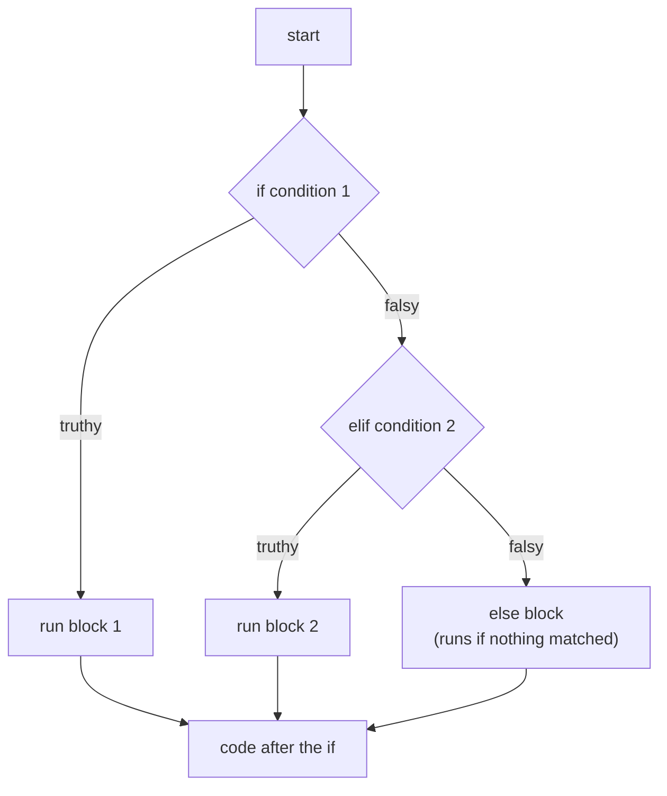
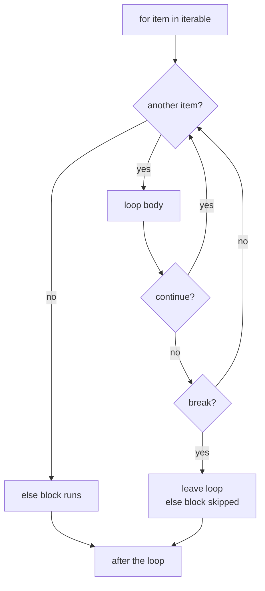

# Control flow

After this you can write Python branches and loops the way Python programmers do, predict which values count as false, and use `for ... else` and `match` where they fit.

Before this: [Values, types and variables](01-values-types-and-variables.md).

## The idea

Python marks blocks with indentation and a colon, not braces. The indentation is the syntax: use four spaces per level, because mixing tabs and spaces in one block raises a `TabError`. There is no `switch` before 3.10, no `do ... while`, and no C-style `for (i = 0; i < n; i++)` loop. Loops walk over things that can be iterated instead of counting indexes.

Conditions need no parentheses, the keywords are `if`, `elif` and `else`, and the logical operators are the words `and`, `or` and `not` (there is no `&&` or `!`). The `&` and `|` operators work on bits and bind more tightly than comparisons, so `a == 1 & b == 2` does not mean what a C programmer expects. Membership is `x in collection` and negated identity is `x is not None`. An empty block needs `pass`.



In the diagram, exactly one block runs, and the first true test wins; later `elif` conditions are never evaluated.

Two ideas carry most of the lesson. First, any object can be tested in an `if`, because every object has a truth value. Second, a `for` loop works on any **iterable**, so you usually don't need an index at all.

## Key terms

An **iterable** is any object you can loop over: lists, tuples, strings, dicts, sets, files, ranges and generators. An **iterator** is the object that produces the items one at a time. A `for` loop asks the iterable for an iterator and calls `next()` on it until it raises `StopIteration`.

**Truthiness** is the boolean meaning of any object when it appears in `if`, `while`, `and`, `or` or `not`. The **falsy** values are `False`, `None`, zero of any numeric type, and empty containers and strings. Everything else is truthy.

**Short-circuiting** means `and` and `or` stop at the first operand that decides the result, and they return that operand itself, not a bool.

## How it works

Truthiness catches working developers out in both directions, so look at it once.

```python
for value in [0, 0.0, "", [], {}, set(), None, "0", [0], " "]:
    print(f"{value!r:6} -> {bool(value)}")
```

```text
0      -> False
0.0    -> False
''     -> False
[]     -> False
{}     -> False
set()  -> False
None   -> False
'0'    -> True
[0]    -> True
' '    -> True
```

The idiom `if items:` tests for a non-empty list. It is wrong when `0` or `""` is a legitimate value: `retries or 3` replaces a deliberate `0` with 3. When you mean "is missing", write `if x is None`.

```python
def first_item(items):
    return items[0] if items else None

print(first_item([0]), first_item([]))
retries = 0
print(retries or 3, retries if retries is not None else 3)
print("" or "default", "x" and "y", 0 and 1 / 0)
print(1 < 5 < 10)
```

```text
0 None
3 0
default y 0
True
```

`0 and 1 / 0` never evaluates the division, because the left side is already falsy. Comparisons chain: `1 < 5 < 10` means `1 < 5 and 5 < 10`, evaluated with each operand once. The conditional expression is `a if cond else b`.

For loops, prefer these over index arithmetic: `enumerate(items, start=1)` for index and item, `zip(a, b)` for parallel sequences (it stops at the shortest; pass `strict=True` since 3.10 to raise on unequal lengths), and `range(start, stop, step)` for numbers, where `stop` is excluded. A loop may have an `else` block that runs only if the loop finished without `break`.



In the diagram, `continue` jumps back to ask for the next item, and only `break` skips the `else` block. A `while` loop has the same shape with its condition in place of "another item?".

```python
for n in range(2, 8):
    for d in range(2, n):
        if n % d == 0:
            break
    else:
        print(n, "is prime")
```

```text
2 is prime
3 is prime
5 is prime
7 is prime
```

Iterators are single-use: once exhausted they stay empty. `while` is for loops with no known length, and `while True` with a `break` is Python's replacement for `do ... while`.

```python
it = iter([10, 20])
print(next(it), next(it), next(it, "done"))
print(list(it))

lines = iter(["5", "x", "7", "quit", "9"])
total = 0
while True:
    line = next(lines)
    if line == "quit":
        break
    if not line.isdigit():
        continue
    total += int(line)
print(total)
```

```text
10 20 done
[]
12
```

The second `print` shows an empty list because `it` was already used up. The common version of this bug is looping twice over a generator or a file object and getting nothing the second time.

**Structural pattern matching** (`match`, added in Python 3.10) compares a value against shapes. It is more than a switch: patterns can destructure sequences, check types with `int()` or `str()`, add a guard with `if`, and bind names. A bare name in a pattern is a capture, not a comparison, and `_` matches anything.

The walrus operator `:=` (3.8) assigns inside an expression: `if (n := len(data)) > 2:`.

## Worked examples

<div class="example" markdown>

### Example 1: a command parser with match

We want to turn typed commands into replies.

1. Split the text into words, then match on the resulting list.
2. A pattern like `["go", direction]` matches exactly two words and binds the second to `direction`.
3. A guard (`if direction in (...)`) rejects values the pattern alone would accept. Order matters: the first case that matches wins.
4. `["go", *_]` catches every other `go` command, and `_` handles the rest.

```python
def handle(command):
    match command.split():
        case ["quit"]:
            return "bye"
        case ["go", direction] if direction in ("north", "south"):
            return f"going {direction}"
        case ["go", *_]:
            return "can't go there"
        case [] | [""]:
            return "say something"
        case _:
            return f"unknown: {command}"

for c in ["quit", "go north", "go up", "", "dance"]:
    print(repr(c), "->", handle(c))
```

```text
'quit' -> bye
'go north' -> going north
'go up' -> can't go there
'' -> say something
'dance' -> unknown: dance
```

Check: each input lands on the reply you predicted. Swap the second and third cases and rerun; `go north` now returns the wrong reply.

</div>

## Common mistakes

<div class="warning" markdown>

Watch out: changing a list while looping over it. The loop index keeps advancing, so items get skipped.

```python
nums = [2, 4, 6, 7]
for n in nums:
    if n % 2 == 0:
        nums.remove(n)
print(nums)
print([n for n in [2, 4, 6, 7] if n % 2])
```

```text
[4, 7]
[7]
```

Build a new list with a comprehension, or loop over a copy (`for n in nums[:]`).

Watch out: `if x:` when `0` or an empty string is valid input. Use `is None` for "missing".

Watch out: a name in a `case` is a capture. `case RED:` matches anything and rebinds `RED`. To match a constant, use a dotted name such as `Colour.RED` or a literal.

</div>

## Working with AI

<div class="ai" markdown>

Words to use: truthiness, falsy, iterable, short-circuit, `for ... else`, structural pattern matching, guard, `enumerate`.

Prompts to try:

- "Rewrite this C-style loop (pasted) in idiomatic Python 3.12 using `enumerate` and `zip`. Keep the behaviour the same for lists of unequal length and say what happens to the extra items."
- "Does `if not value:` treat `0`, `0.0` and `''` the same as `None` here? Show me a version that only checks for `None`."

What to check:

- `if x:` where the value could legitimately be `0` or an empty string. Run it with those inputs.
- A `match` that needs 3.10 or later when your project pins 3.9. Check `python --version`.
- A bare name in a `case` meant as a constant comparison.
- Index loops (`for i in range(len(xs))`) that could be `enumerate`. Ask for the reason if it keeps them.

</div>

## Quiz

1\. Name the falsy values of the built-in types.

<details class="solution" markdown>
<summary>Answer</summary>

`False`, `None`, numeric zero (`0`, `0.0`, `0j`), and empty strings, lists, tuples, dicts, sets and ranges. Everything else is truthy, including `"0"`, `[0]` and `" "`.

</details>

2\. What does `print(0 or "a", "" and "b", 3 and 4)` print?

<details class="solution" markdown>
<summary>Answer</summary>

`a  4`. That is `a`, then an empty string, then `4`. `or` returns the first truthy operand (or the last), `and` returns the first falsy operand (or the last).

</details>

3\. A loop searches for a value and prints "not found" after the loop, but it prints it even when the value was found. How do you fix it with `for ... else`?

<details class="solution" markdown>
<summary>Answer</summary>

Move the "not found" line into an `else` block attached to the `for`. It runs only when the loop ends without `break`, so put the `break` right after the "found" line.

</details>

4\. Why does `case Colour:` match every value in a `match` statement, and how do you fix it?

<details class="solution" markdown>
<summary>Answer</summary>

A bare name is a capture pattern: it always matches and binds the value to that name. Use a dotted name (`case Colour.RED:`) or a literal to compare against a constant.

</details>

## Lab

<div class="lab" markdown>

### Lab: classify values and find primes

Goal: use `match` with type and shape patterns, and `for ... else`. Time: about 15 minutes. Runs in: any terminal with Python 3.10 or later.

1. Write `describe(value)` using `match` so that `None` gives `"nothing"`, a bool gives `"bool ..."`, a negative number gives `"negative number"`, other numbers give `"number"`, blank text gives `"blank text"`, other text gives its length, a two-item list gives `"pair"`, a longer list gives how many more items it has, and `[]` gives `"empty list"`.
2. Predict the case order before you run it: where must `bool()` go relative to `int()`?
3. Print `describe` for `None, True, -2, 3.5, "  ", "hello", [1, 2], [1, 2, 3, 4], [], {}`.
4. Collect the primes below 30 with a `for ... else` loop that checks divisors up to the square root.

Expected result: the last line is `[2, 3, 5, 7, 11, 13, 17, 19, 23, 29]`, and `True` is reported as a bool, not a number.

<details class="solution" markdown>
<summary>Solution</summary>

`bool` is a subclass of `int`, so `case bool()` must come before `case int()`.

```python
def describe(value):
    match value:
        case None:
            return "nothing"
        case bool():
            return f"bool {value}"
        case int() | float() if value < 0:
            return "negative number"
        case int() | float():
            return "number"
        case str() if not value.strip():
            return "blank text"
        case str():
            return f"text of length {len(value)}"
        case [x, y]:
            return f"pair ({x}, {y})"
        case [_, *rest]:
            return f"list with {len(rest)} more"
        case []:
            return "empty list"
        case _:
            return "something else"

for v in [None, True, -2, 3.5, "  ", "hello", [1, 2], [1, 2, 3, 4], [], {}]:
    print(f"{v!r:14} -> {describe(v)}")

primes = []
for n in range(2, 30):
    for d in range(2, int(n ** 0.5) + 1):
        if n % d == 0:
            break
    else:
        primes.append(n)
print(primes)
```

```text
None           -> nothing
True           -> bool True
-2             -> negative number
3.5            -> number
'  '           -> blank text
'hello'        -> text of length 5
[1, 2]         -> pair (1, 2)
[1, 2, 3, 4]   -> list with 3 more
[]             -> empty list
{}             -> something else
[2, 3, 5, 7, 11, 13, 17, 19, 23, 29]
```

</details>

</div>

## Where this shows up

- Functions<!-- link: 03-functions-and-scope.md --> package these branches; comprehensions in lists, dicts, sets and tuples<!-- link: 04-lists-dicts-sets-and-tuples.md --> replace many loops.
- Recursion<!-- link: ../02-thinking-like-a-programmer/01-recursion.md --> is the other way to repeat work.
