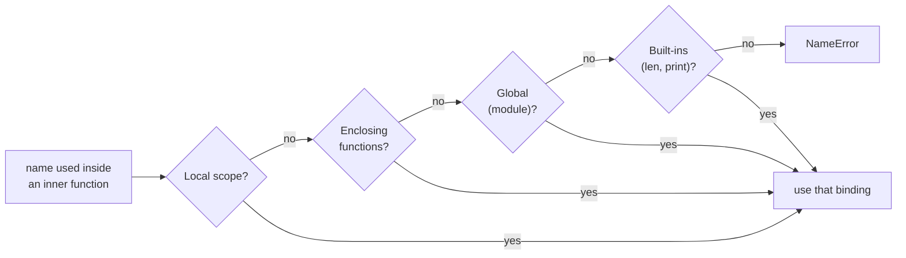

# Functions and scope

After this you can define functions with every kind of Python parameter, avoid the mutable default argument bug, and say which variable a name refers to inside nested functions.

Before this: [Control flow](02-control-flow.md).

## The idea

A call like `connect("db", timeout=3)` looks like any other language, but Python functions are objects. You can store them in lists, pass them to other functions and return them. They also carry two features that cause most of the bugs: default values that are computed once, and names resolved through nested scopes.

The mutable default argument is the standard example.

```python
def add_tag(tag, tags=[]):
    tags.append(tag)
    return tags

print(add_tag("a"))
print(add_tag("b"))
print(add_tag.__defaults__)
```

```text
['a']
['a', 'b']
(['a', 'b'],)
```

The second call did not start from an empty list. The default `[]` was created once, when the `def` statement ran, and every call that omits `tags` shares that one list.

## Key terms

A **parameter** is a name in the function definition; an **argument** is the value passed in a call. A **default value** is evaluated once, at definition time.

A **scope** is the region of code where a name is visible. Python resolves a name using the **LEGB** order: Local (the current function), Enclosing (any outer functions), Global (the module), Built-in (`len`, `print`).

A **closure** is a function that keeps access to variables from the enclosing function after that function has returned.

## How it works

Assigning to a name anywhere in a function makes it local to the whole function. Reading a name finds it by LEGB, searching outward and stopping at the first scope that has it. No keyword is needed to read an outer variable, but writing needs `global` (module level) or `nonlocal` (enclosing function).



Each call also gets its own frame holding its locals, stacked on the frames of whoever called it. In the stack below, `f` and `g` both have a local called `x`, and they never clash.

```text
def f(x): return g(x + 1)
def g(x): return x * 2
f(3)

call stack while g is running (newest on top)

+-------------------------+
| g    x = 4              |  running now
+-------------------------+
| f    x = 3              |  waiting for g's result
+-------------------------+
| <module>   f, g, ...    |  global names
+-------------------------+
```

When `g` returns 8, its frame is discarded and `f` resumes. A closure is the exception: the variables it captured stay alive after their frame is gone.

```python
counter = 0
def bump():
    counter += 1

try:
    bump()
except UnboundLocalError as e:
    print(e)

def make_counter():
    count = 0
    def step():
        nonlocal count
        count += 1
        return count
    return step

c = make_counter()
print(c(), c(), c())
```

```text
cannot access local variable 'counter' where it is not associated with a value
1 2 3
```

`counter += 1` assigns, so `counter` is local in `bump`, and reading it before the assignment fails.

The parameter list has four kinds of names. The `/` and `*` markers divide them (`/` since 3.8).

```python
def connect(host, port=5432, *, timeout=10, **options):
    return host, port, timeout, options

print(connect("db"))
print(connect("db", 5433, timeout=3, ssl=True))
args = ("db", 6000)
kwargs = {"timeout": 1}
print(connect(*args, **kwargs))
```

```text
('db', 5432, 10, {})
('db', 5433, 3, {'ssl': True})
('db', 6000, 1, {})
```

After a bare `*`, parameters can only be passed by keyword, which keeps calls readable. `*args` collects extra positional arguments into a tuple, `**options` collects extra keyword arguments into a dict, and the same stars in a call unpack a sequence or a mapping. Parameters before `/` are positional-only, so `power(base=2, exp=10)` raises `TypeError`.

A function with no `return`, or a bare `return`, returns `None`. To return several values, return a tuple and unpack it: `lo, hi = stats(xs)`.

Closures capture variables, not values. That is the second famous trap.

```python
funcs = [lambda: i for i in range(3)]
print([f() for f in funcs])
funcs = [lambda i=i: i for i in range(3)]
print([f() for f in funcs])
```

```text
[2, 2, 2]
[0, 1, 2]
```

Each lambda looks up `i` when it is called, and by then the loop has finished with `i = 2`. Binding the current value as a default (`i=i`) fixes it. A `lambda` is a one-expression anonymous function, mostly used as a sort key: `sorted(words, key=len)`.

## Worked examples

<div class="example" markdown>

### Example 1: fixing the mutable default

We want `add_tag` to start fresh on each call.

1. Use `None` as the default, since `None` is immutable and signals "not given".
2. Create the list inside the function, so each call gets its own.
3. Test by calling twice.

```python
def add_tag(tag, tags=None):
    if tags is None:
        tags = []
    tags.append(tag)
    return tags

print(add_tag("a"), add_tag("b"))
```

```text
['a'] ['b']
```

Check: the output is two separate one-item lists. Test for `is None` rather than `if not tags:` so a caller who passes their own empty list still gets that list back.

</div>

## Common mistakes

<div class="warning" markdown>

Watch out: any mutable default (`[]`, `{}`, `set()`, an object) is shared between calls. Use `None`. Dataclasses reject a list default with a `ValueError`; the fix there is `field(default_factory=list)`.

Watch out: forgetting `return`. A function ending in `x + 1` computes the value and throws it away, and the caller gets `None`.

Watch out: shadowing built-ins by naming a variable `list`, `id`, `input` or `max`. The next call to the built-in then fails with a confusing `TypeError`.

</div>

## Working with AI

<div class="ai" markdown>

Words to use: default argument, mutable default, keyword-only, `*args`, `**kwargs`, closure, LEGB, `nonlocal`.

Prompts to try:

- "Review this Python 3.12 function for mutable default arguments and late-binding closures. For each problem show a call sequence that exposes it, then the fix."
- "Add type hints and make `timeout` and `retries` keyword-only without changing existing callers. List which call sites would break."

What to check:

- A helper that takes `**kwargs` and forwards everything. Ask what happens with a misspelled option; it may be silently ignored.
- A default of `[]`, `{}` or `datetime.now()` in a signature. The latter is also computed once.
- `global` used to avoid passing a parameter. Pass the value in or return it instead.
- Lambdas created in a loop. Call each one and compare with what you intended.

</div>

## Quiz

1\. When is the default value of a parameter evaluated?

<details class="solution" markdown>
<summary>Answer</summary>

Once, when the `def` statement runs, not at each call. That is why a mutable default is shared.

</details>

2\. In what order does Python search for a name used inside a nested function?

<details class="solution" markdown>
<summary>Answer</summary>

Local, Enclosing function scopes, Global (module), then Built-in: LEGB.

</details>

3\. What does this print, and why?

```python
x = 10
def f():
    print(x)
    x = 5
f()
```

<details class="solution" markdown>
<summary>Answer</summary>

It raises `UnboundLocalError`. The assignment `x = 5` makes `x` local to the whole function, so the `print` reads a local that has no value yet.

</details>

4\. `def log(msg, *, level="info")` is called as `log("started", "debug")`. What happens?

<details class="solution" markdown>
<summary>Answer</summary>

`TypeError`: `log()` takes 1 positional argument but 2 were given. After the bare `*`, `level` can only be passed by keyword: `log("started", level="debug")`.

</details>

## Lab

<div class="lab" markdown>

### Lab: three bugs, five assertions

Goal: fix three function bugs from this lesson until the tests pass. Time: about 10 minutes. Runs in: any terminal with Python 3.

1. Save the script below as `buggy.py` and run it. Read the traceback.
2. Fix `collect` so repeated calls do not share state.
3. Fix `make_adders` so `[f(10) for f in make_adders()]` is `[10, 11, 12]`.
4. Fix `clamp` so it returns the value in range.
5. Rerun until it prints `all tests passed`.

```python
def collect(item, bucket=[]):
    bucket.append(item)
    return bucket

def make_adders():
    return [lambda x: x + n for n in range(3)]

def clamp(value, low, high):
    if value < low:
        return low
    if value > high:
        return high
    value

def run_tests():
    assert collect(1) == [1]
    assert collect(2) == [2], collect(2)
    assert [f(10) for f in make_adders()] == [10, 11, 12]
    assert clamp(5, 0, 3) == 3
    assert clamp(2, 0, 3) == 2
    print("all tests passed")

run_tests()
```

Expected result: before the fixes the last line of output is the first failing assertion, and after them the script prints `all tests passed`.

```text
AssertionError: [1, 2, 2]
```

<details class="solution" markdown>
<summary>Solution</summary>

The first failure shows `[1, 2, 2]` because the shared default already held `1`. The fixes are a `None` default, a default argument that captures `n`, and a `return` for the last line of `clamp`.

```python
def collect(item, bucket=None):
    if bucket is None:
        bucket = []
    bucket.append(item)
    return bucket

def make_adders():
    return [lambda x, n=n: x + n for n in range(3)]

def clamp(value, low, high):
    if value < low:
        return low
    if value > high:
        return high
    return value
```

```text
all tests passed
```

</details>

</div>

## Where this shows up

- Closures are the basis of decorators and of [functional programming ideas](../03-oop-and-paradigms/04-functional-programming-ideas.md).
- Methods are functions bound to objects, covered in [classes and objects](../03-oop-and-paradigms/01-classes-and-objects.md).
