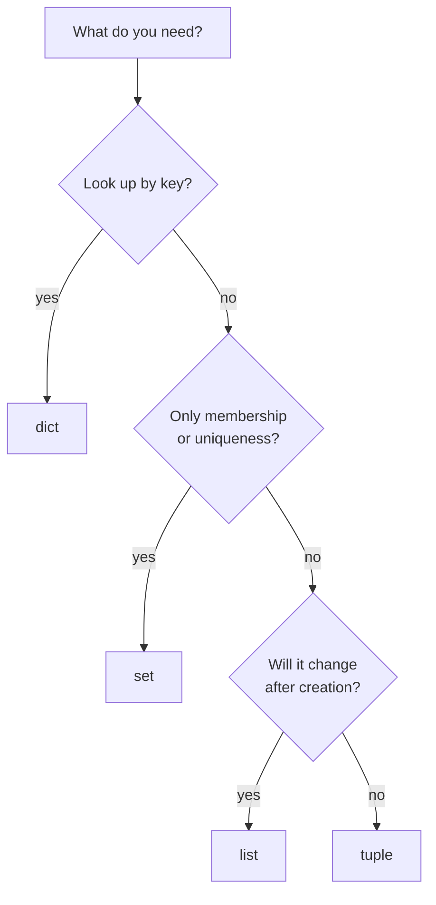
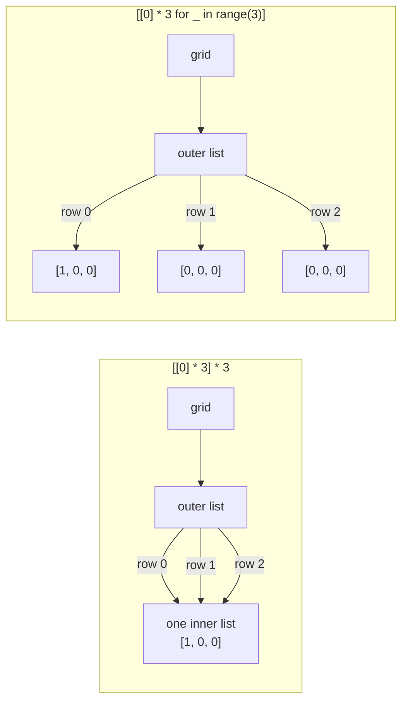

# Lists, dicts, sets and tuples

After this you can pick the right built-in collection for a job, read the cost of common operations, and avoid the aliasing and sorting traps that bite experienced developers.

Before this: [Functions and scope](03-functions-and-scope.md).

## The idea

Python's four built-in collections cover most of what you would reach for a library for in other languages. The choice comes down to a few questions, shown in the diagram, and the table gives the properties behind them.



| Type | Ordered | Mutable | Duplicates | Use it for |
|---|---|---|---|---|
| `list` | yes, by position | yes | yes | A sequence you build and change |
| `tuple` | yes, by position | no | yes | A fixed record, a key, a multi-value return |
| `dict` | yes, by insertion (3.7 and later) | yes | unique keys | Lookup by key |
| `set` | no | yes | no | Membership tests and removing duplicates |

A `list` is a dynamic array of references, so `xs[i]` is constant time and `append` is amortized constant time. A `dict` and a `set` are hash tables (see [hash tables](../../05-data-structures-and-algorithms/02-data-structures/04-hash-tables.md)), so lookup, insert and delete are constant time on average.

## Key terms

An object is **hashable** if it has a hash value that never changes during its life and it can be compared with `==`. Dict keys and set members must be hashable. In practice that means immutable types such as numbers, strings and tuples of hashable items; lists, dicts and sets are not.

A **comprehension** builds a collection from a loop in one expression: `[expr for x in xs if cond]`. Replace the brackets with braces for a set, or use `{k: v for ...}` for a dict.

**Unpacking** assigns the items of a sequence to several names at once: `a, b, *rest = t`.

## How it works

Indexing starts at 0, negative indexes count from the end, and a slice `xs[start:stop:step]` makes a new list. Dict lookup with `[]` raises `KeyError` when the key is missing; `get(key, default)` does not.

```python
xs = [5, 3, 8, 1]
print(xs[0], xs[-1], xs[1:3], xs[::-1])
print(xs.sort(), xs)
ys = [5, 3, 8, 1]
print(sorted(ys), ys)
t = (1, 2, 3)
a, b, *rest = t
print(a, b, rest)
a, b = b, a
print(a, b)
```

```text
5 1 [3, 8] [1, 8, 3, 5]
None [1, 3, 5, 8]
[1, 3, 5, 8] [5, 3, 8, 1]
1 2 [3]
2 1
```

`xs.sort()` sorts in place and returns `None`, so `xs = xs.sort()` throws the list away. `sorted(ys)` returns a new list and leaves `ys` alone. Both are stable and accept `key=` and `reverse=`. The last two lines show tuple unpacking used for a swap.

Dict and set examples:

```python
user = {"name": "Ada", "langs": ["py"]}
print(user["name"], user.get("age"), user.get("age", 0))
try:
    user["age"]
except KeyError as e:
    print("KeyError:", e)
user["age"] = 36
print({**user, "name": "Grace"} | {"age": 85})
print({x: x * x for x in range(4)})
print([n * n for n in range(10) if n % 3 == 0])
```

```text
Ada None 0
KeyError: 'age'
{'name': 'Grace', 'langs': ['py'], 'age': 85}
{0: 0, 1: 1, 2: 4, 3: 9}
[0, 9, 36, 81]
```

The `|` operator merges dicts (3.9 and later); on a repeated key the right side wins. Sets support `&` (intersection), `|` (union), `-` (difference) and `^` (symmetric difference). Sets have no order, so never depend on how one prints. `{}` is an empty dict, not an empty set; write `set()`.

The costs that matter in practice:

| Operation | list | dict or set |
|---|---|---|
| `x in c` | $O(n)$ | $O(1)$ average |
| Index or key lookup | $O(1)$ | $O(1)$ average |
| `append` or add | $O(1)$ amortized | $O(1)$ average |
| Insert or remove at the front | $O(n)$ | not applicable |

The Python wiki's [time complexity page](https://wiki.python.org/moin/TimeComplexity) lists the rest. For a queue, use `collections.deque`, which pops from the left in $O(1)$.

## Worked examples

<div class="example" markdown>

### Example 1: counting and grouping words

We want word counts, then words grouped by length.

1. A plain dict with `get(word, 0) + 1` counts without a `KeyError`.
2. `collections.Counter` does the same in one call and can rank the results.
3. `collections.defaultdict(list)` creates the missing list the first time a key is used.

```python
from collections import Counter, defaultdict

text = "the cat and the hat and the bat"
counts = {}
for word in text.split():
    counts[word] = counts.get(word, 0) + 1
print(counts)
print(Counter(text.split()).most_common(2))

groups = defaultdict(list)
for word in set(text.split()):
    groups[len(word)].append(word)
print({k: sorted(v) for k, v in groups.items()})
```

```text
{'the': 3, 'cat': 1, 'and': 2, 'hat': 1, 'bat': 1}
[('the', 3), ('and', 2)]
{3: ['and', 'bat', 'cat', 'hat', 'the']}
```

Check: the three counts add up to 8, the number of words. The groups are sorted before printing because iterating a set has no guaranteed order. Reading a missing key from a `defaultdict` inserts it, so use `in` to test for a key.

</div>

## Common mistakes

<div class="warning" markdown>

Watch out: `[[0] * 3] * 3` makes three references to one inner list. Use a comprehension for a grid.

```python
grid = [[0] * 3] * 3
grid[0][0] = 1
print(grid)
grid = [[0] * 3 for _ in range(3)]
grid[0][0] = 1
print(grid)
```

```text
[[1, 0, 0], [1, 0, 0], [1, 0, 0]]
[[1, 0, 0], [0, 0, 0], [0, 0, 0]]
```



In the diagram, the left grid has one inner list reachable three ways, so a change through row 0 shows in every row.

Watch out: testing membership in a list inside a loop. `x in some_list` scans the list on each pass, so the loop is $O(n^2)$. Build a `set` once.

Watch out: using a list as a dict key or set member raises `TypeError: unhashable type`. Convert it to a tuple.

</div>

## Working with AI

<div class="ai" markdown>

Words to use: hashable, comprehension, unpacking, insertion order, `defaultdict`, `Counter`, shallow copy, time complexity.

Prompts to try:

- "This Python 3.12 loop does `if x in seen_list` for 50,000 ids. Rewrite it with a set, keep the original order, and state the time complexity before and after."
- "Explain why `grid = [[0] * 3] * 3` gives shared rows, and show the fix. Then show the same trap with `copy.copy` on a list of lists."

What to check:

- `xs = xs.sort()` or `xs = xs.append(x)`. Both set `xs` to `None`.
- Code that depends on set order. Run it twice with different strings; string hashes are randomized per process.
- Mutating a collection while looping over it. Run it with an input where two adjacent items both match.
- Slices described as views. They are copies, and shallow ones.

</div>

## Quiz

1\. Which of `list`, `tuple`, `dict` and `set` can be a dict key?

<details class="solution" markdown>
<summary>Answer</summary>

Only `tuple`, and only when all its items are hashable. Lists, dicts and sets are mutable and so unhashable.

</details>

2\. What does `print([1, 2, 3].append(4))` print?

<details class="solution" markdown>
<summary>Answer</summary>

`None`. `append` mutates the list and returns `None`.

</details>

3\. A loop calls `if user_id in allowed_ids:` for each of 100,000 requests, and `allowed_ids` is a list of 50,000 ids. What do you change?

<details class="solution" markdown>
<summary>Answer</summary>

Build `allowed = set(allowed_ids)` once, outside the loop. Each check drops from a 50,000-item scan to an average constant-time lookup.

</details>

4\. How do you merge two dicts where the second one's values should win on conflicts?

<details class="solution" markdown>
<summary>Answer</summary>

`a | b` (3.9 and later) or `{**a, **b}`. Both give a new dict, and the right-hand value wins for repeated keys.

</details>

## Lab

<div class="lab" markdown>

### Lab: deduplicate 30,000 ids

Goal: measure how much a set changes an $O(n^2)$ loop. Time: about 10 minutes. Runs in: any terminal with Python 3.

1. Generate 30,000 random ids in the range 0 to 29,999 with a fixed seed.
2. Write `dedupe_list`, which tracks seen ids in a list, and `dedupe_set`, which tracks them in a set. Both keep the first occurrence of each id in original order.
3. Time each with `time.perf_counter()` and print the unique count.
4. Assert that both match `list(dict.fromkeys(ids))`.

Expected result: the same unique count for both, and the set version thousands of times faster. Your times will differ.

<details class="solution" markdown>
<summary>Solution</summary>

```python
import random
import time

random.seed(7)
ids = [random.randrange(30_000) for _ in range(30_000)]

def dedupe_list(items):
    seen = []
    out = []
    for x in items:
        if x not in seen:
            seen.append(x)
            out.append(x)
    return out

def dedupe_set(items):
    seen = set()
    out = []
    for x in items:
        if x not in seen:
            seen.add(x)
            out.append(x)
    return out

for f in (dedupe_list, dedupe_set):
    start = time.perf_counter()
    result = f(ids)
    print(f"{f.__name__:12} {len(result)} unique  {time.perf_counter() - start:.3f} s")

assert dedupe_list(ids) == dedupe_set(ids) == list(dict.fromkeys(ids))
print("same order, same result")
```

```text
dedupe_list  18945 unique  1.625 s
dedupe_set   18945 unique  0.002 s
same order, same result
```

The output is from the author's Windows 11 PC, Python 3.14. `dict.fromkeys` is the shortest correct answer, because dicts keep insertion order.

</details>

</div>

## Where this shows up

- [Hash tables](../../05-data-structures-and-algorithms/02-data-structures/04-hash-tables.md) explains why dict and set lookups are constant time on average.
- [References, mutability and copying](../02-thinking-like-a-programmer/02-references-mutability-and-copying.md) covers the shared-row grid bug in depth.
