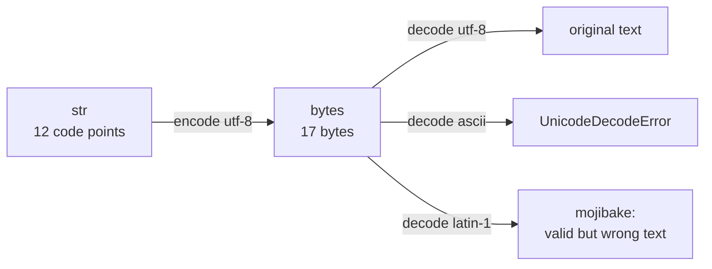
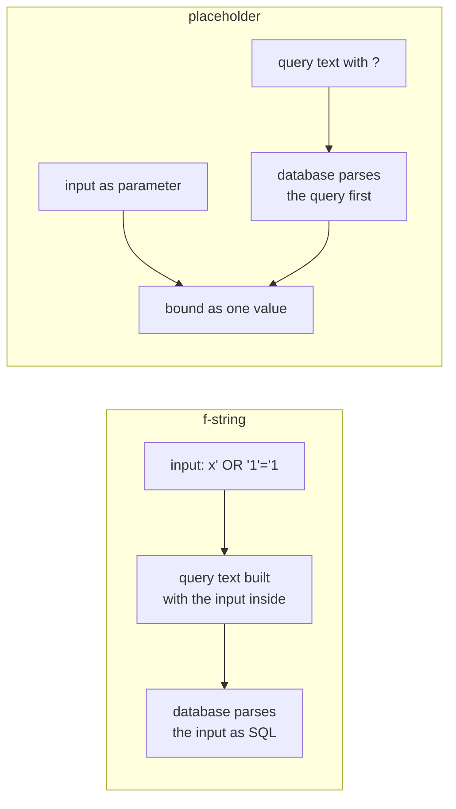

# Strings and formatting

After this you can format output with f-strings, tell text (`str`) from bytes, and avoid the string mistakes that turn into slow loops, wrong encodings and SQL injection.

Before this: [Lists, dicts, sets and tuples](04-lists-dicts-sets-and-tuples.md). For the encoding background, see [text, ASCII and Unicode](../../01-how-computers-work/01-bits-and-data/05-text-ascii-and-unicode.md).

## The idea

A Python `str` is an immutable sequence of Unicode code points. A `bytes` object is an immutable sequence of integers from 0 to 255. They are different types, and converting between them always needs an **encoding**. In Python 3 you never get that conversion silently, which is why most text bugs show up as a `UnicodeDecodeError` at the boundary where bytes come in: a file, a socket, an HTTP body.

```python
s = "na\u00efve caf\u00e9 \U0001F44D"
print(len(s), len(s.encode("utf-8")), len(s.encode("utf-16-le")) // 2)
print(s.encode("utf-8"))
data = "na\u00efve".encode("utf-8")
print(data, data.decode("utf-8"))
try:
    data.decode("ascii")
except UnicodeDecodeError as e:
    print(e)
print(data.decode("latin-1"))
```

```text
12 17 13
b'na\xc3\xafve caf\xc3\xa9 \xf0\x9f\x91\x8d'
b'na\xc3\xafve' naïve
'ascii' codec can't decode byte 0xc3 in position 2: ordinal not in range(128)
naïve
```



In the diagram, the string has 12 code points but takes 17 bytes in UTF-8, and only the matching decoder gets the text back. The wrong decoder either fails loudly (`ascii`) or produces **mojibake** like `naïve` (`latin-1`). Seeing `Ã` before an accented letter means UTF-8 bytes were decoded as Latin-1 or cp1252.

## Key terms

An **encoding** maps text to bytes. UTF-8 is the default for the web and for source files, and uses 1 to 4 bytes per code point. A **code point** is a number assigned to a character in Unicode.

An **f-string** is a string literal with an `f` prefix that evaluates expressions inside `{}`. A **format spec** after a colon controls width, alignment and number format.

A **raw string** (`r"..."`) leaves backslashes alone, so regular expressions and Windows paths read as written.

## How it works

Strings are immutable: `s[0] = "J"` raises `TypeError`, and every method such as `replace` or `upper` returns a new string. Slicing works as for lists. The methods you will use daily are `split`, `join`, `strip`, `replace`, `startswith`, `find` and the `in` operator.

```python
s = "Hello, World"
print(s[7:], s[:5], s[-5:], s[::-1])
print(s.replace("l", "L", 1), s.find("o"), s.find("z"))
print("a,b,,c".split(","), " a  b ".split(), ", ".join(["x", "y"]))
```

```text
World Hello World dlroW ,olleH
HeLlo, World 4 -1
['a', 'b', '', 'c'] ['a', 'b'] x, y
```

`split()` with no argument splits on any run of whitespace and drops empty pieces; `split(",")` keeps them. `find` returns -1 when nothing matches, which is a valid index, so prefer `in` for a yes-or-no test (`index` raises `ValueError` instead).

F-strings are the default way to build output. Everything after the colon is the format spec.

```python
name, qty, price = "widget", 1234, 5.5
print(f"{name!r} x {qty:,} @ ${price:.2f} = ${qty * price:,.2f}")
print(f"{name:>10}|{name:<10}|{name:^10}|")
print(f"{qty=}, {price=}")
print(f"{0.256:.1%} {255:#x} {255:08b} {3:03d}")
width = 8
print(f"{price:{width}.3f}|")
```

```text
'widget' x 1,234 @ $5.50 = $6,787.00
    widget|widget    |  widget  |
qty=1234, price=5.5
25.6% 0xff 11111111 003
   5.500|
```

`!r` applies `repr()`, which shows quotes and escapes and is the right choice in logs. `{qty=}` (3.8) prints the expression and its value. Before Python 3.12, an f-string could not reuse its own quote character or contain a backslash inside `{}`. Since 3.12 (PEP 701) it can, so `f"{'nested "quotes"'}"` is legal now and a syntax error on 3.11.

Python 3.14 adds **template strings**, written `t"Hello {name}"`. They do not produce a `str`: they produce a `Template` object holding the literal parts and the interpolated values separately, so a library can escape the values before joining them. Check your interpreter version before accepting a `t"..."` from an AI.

## Worked examples

<div class="example" markdown>

### Example 1: why SQL never goes in an f-string

We want rows for a user-supplied name. An f-string puts the name in the query text, so a crafted name changes the query.

1. Build the query with an f-string and pass `x' OR '1'='1` as the name.
2. Build it again with a `?` placeholder and pass the name as a parameter.
3. Compare the rows returned.

```python
import sqlite3

con = sqlite3.connect(":memory:")
con.execute("create table users (name text)")
con.execute("insert into users values ('Ada'), ('Bob')")
evil = "x' OR '1'='1"
bad = con.execute(f"select * from users where name = '{evil}'").fetchall()
good = con.execute("select * from users where name = ?", (evil,)).fetchall()
print(bad, good)
```

```text
[('Ada',), ('Bob',)] []
```



Check: in the diagram, the f-string version mixes input into the code before parsing, and it returned every row for a name that matches nobody. The parameterized version treated the whole input as one value and returned nothing. This is SQL injection<!-- link: ../../12-security/01-web-security/03-injection-and-input-validation.md -->; the same rule applies to shell commands and HTML.

</div>

## Common mistakes

<div class="warning" markdown>

Watch out: building a large string with `s += piece` in a loop. CPython has an optimization that makes it fast for a local variable, but it fails for an attribute or list item, and other implementations lack it. In a quick test with 100,000 pieces, `s += p` on a local took 0.007 s, the same on a list item took 0.49 s, and `"".join(parts)` took 0.0007 s. Collect pieces in a list and call `"".join(...)`.

Watch out: a Windows path in a normal string. `"C:\new\table"` contains a newline and a tab. Use a raw string, forward slashes, or `pathlib`.

Watch out: assuming `len(s)` counts what users see. It counts code points. `"caf\u00e9"` (one code point for the accent) and `"cafe\u0301"` (letter plus combining accent) look identical, have lengths 4 and 5, and compare unequal. Normalize with `unicodedata.normalize("NFC", s)`, and use `casefold()` for case-insensitive comparison: `"Stra\u00dfe".casefold() == "STRASSE".casefold()` is `True`.

</div>

## Working with AI

<div class="ai" markdown>

Words to use: code point, encoding, UTF-8, mojibake, f-string, format spec, raw string, parameterized query.

Prompts to try:

- "This Python 3.12 script reads a CSV and prints `Café` instead of `Café`. Explain what decoding mistake produces that and give the one-line fix."
- "Rewrite this `%`-formatting and `.format()` code as f-strings. Keep the number formats identical and show before and after output for a negative number."

What to check:

- SQL, shell or HTML built with an f-string from user input. Ask for placeholders or escaping instead.
- Strings concatenated with `+` that mix `str` and `int`, which raises `TypeError`. Run it.
- `encode` and `decode` swapped. `str.encode` gives bytes, `bytes.decode` gives text.
- A `t"..."` or nested-quote f-string on an interpreter older than 3.14 or 3.12. Check `python --version`.

</div>

## Quiz

1\. What is the difference between `str` and `bytes`?

<details class="solution" markdown>
<summary>Answer</summary>

`str` is a sequence of Unicode code points (text); `bytes` is a sequence of integers from 0 to 255. Moving between them needs an encoding: `s.encode("utf-8")` and `b.decode("utf-8")`.

</details>

2\. Predict the output: `x = 7; print(f"{x:03d} {x/3:.2f} {x=}")`.

<details class="solution" markdown>
<summary>Answer</summary>

`007 2.33 x=7`. `03d` pads with zeros to width 3, `.2f` rounds to two places, and `{x=}` prints the expression and its value.

</details>

3\. A function builds a report with `report += line` for 500,000 lines and sometimes takes minutes. What do you change?

<details class="solution" markdown>
<summary>Answer</summary>

Append each line to a list and call `"\n".join(lines)` once at the end. Strings are immutable, so repeated concatenation can copy the growing string each time.

</details>

4\. A web form value is inserted with `f"SELECT * FROM t WHERE name = '{name}'"`. What is wrong and what is the fix?

<details class="solution" markdown>
<summary>Answer</summary>

The input becomes part of the SQL text, so it can change the query (SQL injection). Pass it as a parameter: `cur.execute("... WHERE name = ?", (name,))`, using the placeholder style of your driver.

</details>

## Lab

<div class="lab" markdown>

### Lab: parse and summarize a log

Goal: split text into records and print an aligned summary. Time: about 15 minutes. Runs in: any terminal with Python 3.

1. Save the log text below in a string called `LOG`.
2. Write `parse(line)` that uses `line.split(maxsplit=4)` to return a dict with `time`, `level`, `service` and `message`.
3. Count the levels with `collections.Counter` and print a table with the level left-aligned in 7 characters and the count right-aligned in 6.
4. Print only the `ERROR` records, with the message shown through `!r`.

Expected result: the table lists INFO 2, ERROR 2, WARN 1, followed by the two error lines.

<details class="solution" markdown>
<summary>Solution</summary>

```python
from collections import Counter

LOG = """\
2026-03-01 12:00:01 INFO  api   request /users took 120ms
2026-03-01 12:00:03 ERROR db    timeout after 30s
2026-03-01 12:00:04 WARN  api   slow request /orders took 950ms
2026-03-01 12:00:09 ERROR api   bad gateway
2026-03-01 12:01:00 INFO  db    connected
"""

def parse(line):
    date, time, level, service, message = line.split(maxsplit=4)
    return {"time": f"{date}T{time}", "level": level, "service": service, "message": message}

records = [parse(line) for line in LOG.splitlines()]
by_level = Counter(r["level"] for r in records)

print(f"{'level':<7}{'count':>6}")
for level, n in by_level.most_common():
    print(f"{level:<7}{n:>6}")

errors = [r for r in records if r["level"] == "ERROR"]
for r in errors:
    print(f"{r['time']}  {r['service']:<4} {r['message']!r}")
```

```text
level   count
INFO        2
ERROR       2
WARN        1
2026-03-01T12:00:03  db   'timeout after 30s'
2026-03-01T12:00:09  api  'bad gateway'
```

`maxsplit=4` keeps the message, spaces included, in the last field.

</details>

</div>

## Where this shows up

- [Files and I/O](07-files-and-io.md) is where encodings bite: the `encoding` argument of `open`.
- Injection and escaping come back in [injection and input validation](../../12-security/01-web-security/03-injection-and-input-validation.md) and in parameterized queries in SQL.
