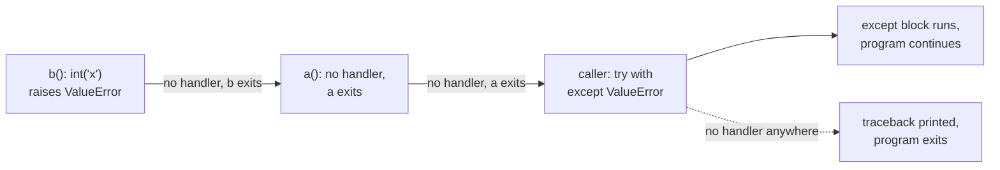
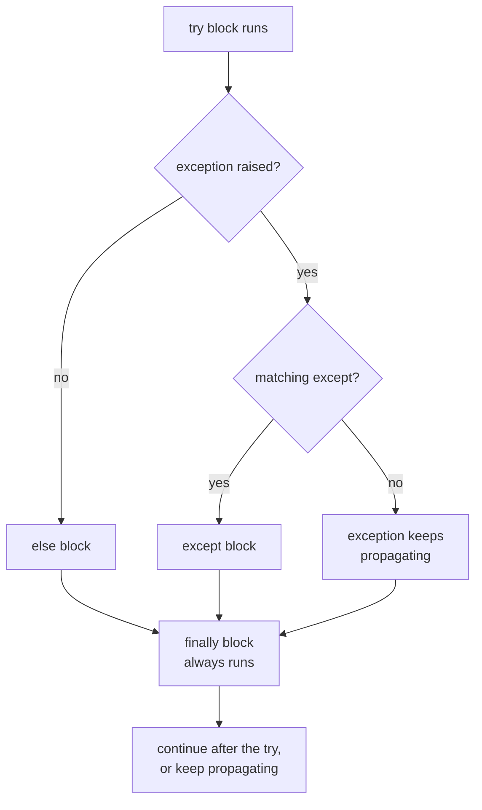

# Errors and exceptions

After this you can read a Python traceback, use `try`, `except`, `else` and `finally` correctly, and decide between raising an exception and returning an error value.

Before this: [Strings and formatting](05-strings-and-formatting.md). For reading error text in general, see [Reading docs and error messages](../../00-start-here/reading-docs-and-error-messages.md).

## The idea

In C and Go, a function reports failure through its return value (`-1`, `NULL`, an `error`), and the caller has to remember to check. In Python, a failing operation **raises** an exception. It stops the current function, then its caller, and so on up the call stack until some `except` clause handles it. If none does, the program prints a traceback and exits.



In the diagram, the exception leaves each function in turn until a matching `except` catches it.

The effect is that the happy path reads cleanly and a forgotten check cannot pass silently, because an unhandled error crashes loudly. The cost is that any line can fail, so you must decide where to handle each error instead of checking after every call.

## Key terms

An **exception** is an object describing an error; its class says what kind. All of them inherit from `BaseException`. Application code catches subclasses of `Exception`. `KeyboardInterrupt` and `SystemExit` sit beside `Exception`, not under it, so `except Exception` does not swallow Ctrl-C.

A **traceback** is the list of calls that were active when the exception was raised, oldest first, ending with the exception type and message.

**EAFP** ("easier to ask forgiveness than permission") means try the operation and handle failure. **LBYL** ("look before you leap") means check first. Python style leans on EAFP, because a check can go stale between the test and the use, for example a file deleted after `os.path.exists`.

## How it works

Read a traceback from the bottom. The last line is the exception type and message; the frames above it show how you got there, with the innermost call last. Paths are shortened here.

```text
Traceback (most recent call last):
  File "f3.py", line 5, in <module>
    a()
  File "f3.py", line 2, in a
    return b()
  File "f3.py", line 4, in b
    return int("x")
ValueError: invalid literal for int() with base 10: 'x'
```

The `try` statement has four parts, and the order matters.



```python
def parse_port(text):
    try:
        port = int(text)
    except ValueError:
        print(f"not a number: {text!r}")
        return None
    else:
        if not 0 < port < 65536:
            raise ValueError(f"port out of range: {port}")
        return port
    finally:
        print("checked", repr(text))

print(parse_port("8080"))
print(parse_port("http"))
try:
    parse_port("70000")
except ValueError as e:
    print("caught:", e)
```

```text
checked '8080'
8080
not a number: 'http'
checked 'http'
None
checked '70000'
caught: port out of range: 70000
```

`try` holds only the code that can raise the error you expect to handle. `except` clauses are tried in order, and a class matches its subclasses. `else` keeps unrelated code out of the protected block. `finally` runs even on `return` and on an uncaught exception, which makes it the place for cleanup (`with` does this for you; next lessons).

Raise your own error with `raise`. Define a class when callers need to catch it specifically. Use `raise ... from e` to keep the original as `__cause__`, so the traceback shows both.

```python
class ConfigError(Exception):
    """Raised when the configuration file is unusable."""

def load(settings):
    try:
        return settings["db"]["port"]
    except KeyError as e:
        raise ConfigError("missing setting: db.port") from e

try:
    load({"db": {}})
except ConfigError as e:
    print(type(e).__name__, e, "| cause:", repr(e.__cause__))
```

```text
ConfigError missing setting: db.port | cause: KeyError('port')
```

A few newer features are worth recognizing. `except*` and `ExceptionGroup` (3.11) handle several errors raised at once, as in `asyncio` task groups. `e.add_note("text")` (3.11) attaches extra context to an exception. From Python 3.14, `except A, B:` without parentheses is allowed when there is no `as` clause ([PEP 758](https://peps.python.org/pep-0758/)); on older versions it is a syntax error, and in most code you will see `except (A, B):`.

When should a function raise and when should it return a value? Raise for something the caller cannot reasonably continue past: invalid input, a missing file, a failed connection. Return a normal value (or `None`) when the "failure" is an expected outcome, such as `dict.get` for a missing key or `str.find` for no match. Never return a magic value like `-1` for an error and rely on the caller to check it.

## Worked examples

<div class="example" markdown>

### Example 1: a bare except that hides a bug

We want to divide two numbers and use 0 if the division fails.

1. The tempting version uses a bare `except:` and `pass`.
2. It catches `ZeroDivisionError` as intended, but it also catches typos, `KeyboardInterrupt` and everything else.
3. Catch only what you expect, and say why.

```python
def swallow():
    try:
        return 1 / 0
    except:
        pass

def safe_div(a, b):
    try:
        return a / b
    except ZeroDivisionError:
        return 0

print(swallow(), safe_div(1, 0), safe_div(6, 3))
```

```text
None 0 2.0
```

Check: `swallow()` returned `None` and hid the error entirely. If `1 / 0` were a typo such as `1 / zero`, the `NameError` would be hidden the same way, and the bare `except:` would also catch Ctrl-C. `safe_div` handles only the failure it expects.

</div>

## Common mistakes

<div class="warning" markdown>

Watch out: `except:` or `except Exception: pass`. It hides bugs, and a bare `except:` also catches Ctrl-C. Catch the specific class, and log or re-raise anything you do not handle.

Watch out: `assert` for input validation. Assertions are removed when Python runs with `-O`. In the test below, the same call raises `AssertionError` normally and returns a wrong balance with `-O`.

```python
def withdraw(balance, amount):
    assert amount > 0, "amount must be positive"
    return balance - amount
print(withdraw(100, -5))
```

```text
105
```

That output is with `python -O`. Use `assert` for internal invariants and tests, and `raise ValueError` for bad input.

Watch out: `return` inside `finally` replaces the result or exception from `try`. Don't put it there.

</div>

## Working with AI

<div class="ai" markdown>

Words to use: exception, traceback, `raise ... from`, `finally`, EAFP, custom exception class, exception chaining.

Prompts to try:

- "Here is a Python 3.12 traceback (pasted in full). Which frame is mine, which exception type is it, and what are the two most likely causes? Tell me what to print to confirm."
- "Refactor this function so it raises a custom `ConfigError` with `from e` instead of returning `None` on failure. List every caller that must change."

What to check:

- `except Exception: pass`, or a `try` block that wraps 30 lines. Narrow it to the line that can fail.
- Error handling that returns `None` and lets the caller crash later with `AttributeError`. Follow a failing case through.
- An invented exception name. Check it in `dir(builtins)` or the docs.
- Retry loops with no limit or no delay.

</div>

## Quiz

1\. What is the difference between the `else` and `finally` blocks of a `try` statement?

<details class="solution" markdown>
<summary>Answer</summary>

`else` runs only when the `try` block raised nothing. `finally` runs every time, even after a `return` or an unhandled exception.

</details>

2\. Why does `except Exception:` not catch Ctrl-C?

<details class="solution" markdown>
<summary>Answer</summary>

`KeyboardInterrupt` inherits from `BaseException`, not `Exception`. A bare `except:` does catch it, which is one reason to avoid it.

</details>

3\. A function returns `-1` when a file cannot be parsed, and a caller adds the result to a total without checking. What is the design problem, and what is the fix?

<details class="solution" markdown>
<summary>Answer</summary>

The error value is a legal number, so the bug is silent and the total is wrong. Raise an exception (for example `ValueError`), so the failure cannot be ignored.

</details>

4\. What does `raise NewError("x") from e` add to the traceback?

<details class="solution" markdown>
<summary>Answer</summary>

It sets `__cause__` to `e`, so the traceback shows the original error and then "The above exception was the direct cause of the following exception". Without `from`, you would get implicit context text instead.

</details>

## Lab

<div class="lab" markdown>

### Lab: a retry helper

Goal: write a function that retries transient failures and lets other errors through. Time: about 15 minutes. Runs in: any terminal with Python 3.

1. Define `TransientError` and `GiveUp`, both subclasses of `Exception`.
2. Write `retry(func, attempts=3, delay=0.01)` that calls `func()` and retries only on `TransientError`, printing each failed attempt. After the last failure it raises `GiveUp` from the last error.
3. Test it with a function that fails twice then succeeds, one that always fails, and `lambda: int("x")`.
4. Confirm that the `ValueError` is not retried.

Expected result: the first call returns `ok` after two printed failures, the second ends in `GiveUp`, and the third raises `ValueError` immediately.

<details class="solution" markdown>
<summary>Solution</summary>

```python
import time

class TransientError(Exception):
    """A failure that may succeed if tried again."""

class GiveUp(Exception):
    """All attempts failed."""

def retry(func, attempts=3, delay=0.01):
    for attempt in range(1, attempts + 1):
        try:
            return func()
        except TransientError as e:
            print(f"attempt {attempt} failed: {e}")
            last = e
            time.sleep(delay)
    raise GiveUp(f"gave up after {attempts} attempts") from last

calls = {"n": 0}
def flaky():
    calls["n"] += 1
    if calls["n"] < 3:
        raise TransientError(f"timeout #{calls['n']}")
    return "ok"

def broken():
    raise TransientError("server down")

print(retry(flaky))
try:
    retry(broken)
except GiveUp as e:
    print(e, "| cause:", e.__cause__)

try:
    retry(lambda: int("x"))
except ValueError as e:
    print("not retried:", e)
```

```text
attempt 1 failed: timeout #1
attempt 2 failed: timeout #2
ok
attempt 1 failed: server down
attempt 2 failed: server down
attempt 3 failed: server down
gave up after 3 attempts | cause: server down
not retried: invalid literal for int() with base 10: 'x'
```

Real retry code also backs off (a longer delay each time) and adds randomness, so many clients do not retry in step.

</details>

</div>

## Where this shows up

- [Files and I/O](07-files-and-io.md) uses `with` so cleanup happens even when an exception is raised.
- Validation and error handling<!-- link: ../../09-back-end/01-servers-and-apis/05-validation-and-error-handling.md --> turns exceptions into HTTP status codes.
