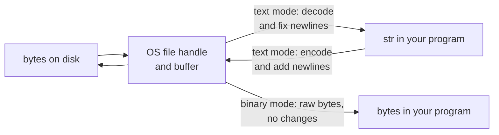
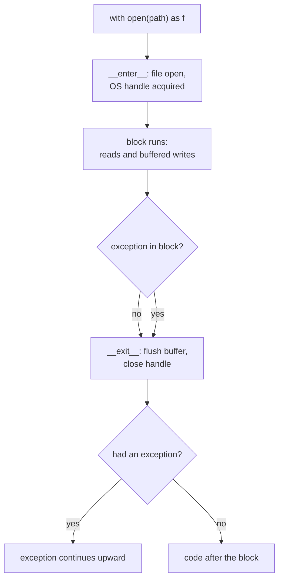

# Files and I/O

After this you can read and write text, CSV, JSON and binary files safely, always say which encoding you mean, and use `with` so files close even when something fails.

Before this: [Errors and exceptions](06-errors-and-exceptions.md) and [Strings and formatting](05-strings-and-formatting.md).

## The idea

A file on disk holds bytes. When you open it in text mode, Python decodes those bytes into `str` on the way in and encodes them on the way out. Two decisions are hidden in that sentence, and both cause real bugs: which encoding, and which newline convention.



The usual line is `open(path)` with no encoding. That works on the author's Linux machine and breaks on a colleague's Windows laptop, because the default is the platform's locale encoding, often cp1252 on Windows. The file system itself is covered in [file systems](../../02-operating-systems-and-linux/01-os-concepts/04-file-systems.md); here we only deal with the Python side.

## Key terms

A **file object** is what `open()` returns: it has `read`, `write`, `readline` and iteration, and holds an operating system file handle until it is closed.

A **context manager** is an object that sets something up when a `with` block starts and cleans it up when the block ends, even if an exception is raised. It implements `__enter__` and `__exit__`.

A **path** object from `pathlib.Path` represents a file location and joins parts with `/`, independently of the operating system.

**Text mode** reads and writes `str`. **Binary mode** (`"rb"`, `"wb"`) reads and writes `bytes` with no decoding and no newline changes.

## How it works

Use `with open(...) as f:`. As the diagram shows, the file is flushed and closed when the block exits, by either route. Without `with`, an exception between `open` and `close` leaks the handle, and buffered writes may never reach the disk.



```python
from pathlib import Path

p = Path("notes.txt")
p.write_text("caf\u00e9 \u2713\nsecond line\n", encoding="utf-8")
print(p.read_bytes())
print(ascii(p.read_text(encoding="utf-8")))

with open(p, encoding="utf-8") as f:
    for number, line in enumerate(f, start=1):
        print(number, ascii(line.rstrip("\n")))
print(f.closed)

with open(p) as f:
    print(f.encoding, ascii(f.readline()))
```

```text
b'caf\xc3\xa9 \xe2\x9c\x93\r\nsecond line\r\n'
'caf\xe9 \u2713\nsecond line\n'
1 'caf\xe9 \u2713'
2 'second line'
True
cp1252 'caf\xc3\xa9 \xe2\u0153\u201c\n'
```

This ran on Windows with Python 3.14. Three things show up. First, the bytes contain `\r\n`: in text mode, `"\n"` is translated to the platform line ending on write. Pass `newline="\n"` to `open` to turn that off. Second, iterating over the file reads one line at a time, so a 10 GB log does not need 10 GB of memory, while `f.read()` loads everything. Third, the last line decodes the UTF-8 bytes as cp1252 and silently produces mojibake (`é` instead of `é`), with no error. The `ascii()` calls print escapes so the output is the same on any terminal.

As of 2026, Python's default encoding for `open` still depends on the locale on Windows; [PEP 686](https://peps.python.org/pep-0686/) makes UTF-8 mode the default from Python 3.15. Until every interpreter you use is 3.15 or later, pass `encoding="utf-8"` explicitly. Run Python with `-X warn_default_encoding` to get an `EncodingWarning` on each `open` call that omits it.

Modes: `"r"` read (default), `"w"` write and truncate, `"a"` append, `"x"` create and fail if it exists, plus `"b"` for binary. `"w"` destroys an existing file the moment you open it.

`pathlib` replaces most `os.path` code: `Path("data") / "in.csv"`, `.exists()`, `.suffix`, `.parent`, `.glob("*.csv")`, `.mkdir(parents=True, exist_ok=True)`, `.read_text(encoding=...)`. For structured files, use the standard library. `csv` needs `newline=""` on the file so embedded newlines in fields survive, and returns every field as a string. `json.dumps` and `json.loads` convert between Python objects and JSON text (see data formats<!-- link: ../../04-developer-tools-and-workflow/02-project-plumbing/03-data-formats-json-yaml-csv.md -->).

```python
import csv, json
from pathlib import Path

rows = [{"name": "Ada", "score": 91}, {"name": "Grace, H.", "score": 99}]
Path("out").mkdir(exist_ok=True)
with open("out/scores.csv", "w", newline="", encoding="utf-8") as f:
    writer = csv.DictWriter(f, fieldnames=["name", "score"])
    writer.writeheader()
    writer.writerows(rows)
with open("out/scores.csv", newline="", encoding="utf-8") as f:
    print(list(csv.DictReader(f)))
Path("out/scores.json").write_text(json.dumps(rows, indent=2), encoding="utf-8")
print(json.loads(Path("out/scores.json").read_text(encoding="utf-8")) == rows)
```

```text
[{'name': 'Ada', 'score': '91'}, {'name': 'Grace, H.', 'score': '99'}]
True
```

The comma inside `"Grace, H."` was quoted correctly, and the scores came back as the strings `'91'` and `'99'`, so convert them with `int` before doing arithmetic. JSON round-trips integers as integers.

## Worked examples

<div class="example" markdown>

### Example 1: your own context manager

We want to guarantee that an exit message prints even when the block fails, which is what `with` gives any resource.

1. Decorate a generator function with `contextlib.contextmanager`.
2. Put the setup before `yield`, and the cleanup in a `finally` after it.
3. Use it in a `with` statement and raise inside the block to confirm the cleanup runs.

```python
from contextlib import contextmanager

@contextmanager
def announce(label):
    print("enter", label)
    try:
        yield
    finally:
        print("exit", label)

with announce("a"):
    print("working")

try:
    with announce("b"):
        raise RuntimeError("boom")
except RuntimeError as e:
    print("caught", e)
```

```text
enter a
working
exit a
enter b
exit b
caught boom
```

Check: `exit b` prints before `caught boom`, so cleanup ran while the exception was passing through. The same mechanism closes files, releases locks and ends database transactions (`with conn:` in `sqlite3`). The class form defines `__enter__` and `__exit__`; returning `True` from `__exit__` would suppress the exception, which you rarely want.

</div>

## Common mistakes

<div class="warning" markdown>

Watch out: `open(path)` with no `encoding`. The bug appears only on another machine, or when a non-ASCII character first shows up. Always write `encoding="utf-8"` for text.

Watch out: opening a file with `"w"` to check whether it exists or to append. `"w"` truncates immediately. Use `"a"` to add, `"x"` to create safely, or `Path.exists()`.

Watch out: building paths by string concatenation, as in `"data\\" + name`. Use `Path("data") / name`, which works on Windows, Linux and macOS.

</div>

## Working with AI

<div class="ai" markdown>

Words to use: file object, context manager, `with` statement, text mode, binary mode, encoding, newline translation, `pathlib`.

Prompts to try:

- "This Python 3.12 script reads a CSV on Linux but raises `UnicodeDecodeError` on a Windows machine. List the lines that depend on the default encoding and show the fix."
- "Rewrite this function to stream a 5 GB log file line by line with constant memory, and say what happens to memory if I call `readlines()` instead."

What to check:

- Any `open(...)` without `encoding=`, and any `csv` file opened without `newline=""`.
- File handles opened without `with`, especially inside loops.
- `os.path.exists()` followed by `open()`. The file can change in between; open it and handle `FileNotFoundError`.
- Generated code that reads an entire large file into memory. Look for `read()` and `readlines()`.

</div>

## Quiz

1\. What does a `with` block guarantee for a file object?

<details class="solution" markdown>
<summary>Answer</summary>

The file is closed when the block exits, whether it ends normally or by an exception. Buffered data is flushed on close.

</details>

2\. A file is written with `open("f.txt", "w")` on Windows and read on Linux. Name two things that can differ.

<details class="solution" markdown>
<summary>Answer</summary>

The encoding (cp1252 on Windows with older Python versus UTF-8 on Linux) and the line endings (`\r\n` versus `\n`). Pass `encoding="utf-8"` and `newline="\n"` to fix both.

</details>

3\. A script prints `José` where the file contains `José`. What happened, and how do you fix it?

<details class="solution" markdown>
<summary>Answer</summary>

The file holds UTF-8 bytes but was decoded as cp1252 or Latin-1. Open it with `encoding="utf-8"`.

</details>

4\. After reading a CSV, `row["score"] + 1` raises `TypeError`. Why?

<details class="solution" markdown>
<summary>Answer</summary>

`csv` returns every field as a `str`, so `"91" + 1` fails. Convert with `int(row["score"])`.

</details>

## Lab

<div class="lab" markdown>

### Lab: a CSV round trip with a deliberate encoding bug

Goal: write, read and summarize a CSV, then reproduce mojibake on purpose. Time: about 15 minutes. Runs in: any terminal with Python 3.

1. Write `students.csv` in a folder `lab7_out` with the rows `("Zo\u00eb", 88)`, `("Jos\u00e9", 92)` and `("Mei, Lin", 79)` and a header, using `newline=""` and `encoding="utf-8"`.
2. Read it back with `csv.DictReader` and convert the scores to `int`.
3. Write `summary.json` with the count and the mean.
4. Read the first data line twice, once with `encoding="cp1252"` and once with `encoding="utf-8"`, and print each with `ascii()`.
5. Cleanup: delete every file in `lab7_out`, then remove the folder.

Expected result: a summary with count 3 and mean 86.33333333333333, one mojibake line and one correct line, and `False` at the end.

<details class="solution" markdown>
<summary>Solution</summary>

```python
import csv
import json
from pathlib import Path

work = Path("lab7_out")
work.mkdir(exist_ok=True)
src = work / "students.csv"

rows = [("Zo\u00eb", 88), ("Jos\u00e9", 92), ("Mei, Lin", 79)]
with open(src, "w", newline="", encoding="utf-8") as f:
    writer = csv.writer(f)
    writer.writerow(["name", "score"])
    writer.writerows(rows)

with open(src, newline="", encoding="utf-8") as f:
    records = [{"name": r["name"], "score": int(r["score"])} for r in csv.DictReader(f)]

summary = {"count": len(records), "mean": sum(r["score"] for r in records) / len(records)}
(work / "summary.json").write_text(json.dumps(summary, indent=2), encoding="utf-8")
print((work / "summary.json").read_text(encoding="utf-8"))

with open(src, encoding="cp1252", newline="") as f:
    print(ascii(f.read().splitlines()[1]))
with open(src, encoding="utf-8", newline="") as f:
    print(ascii(f.read().splitlines()[1]))

for path in sorted(work.iterdir()):
    path.unlink()
work.rmdir()
print(work.exists())
```

```text
{
  "count": 3,
  "mean": 86.33333333333333
}
'Zo\xc3\xab,88'
'Zo\xeb,88'
False
```

The cp1252 line shows `\xc3\xab`, which is `ë`: the two UTF-8 bytes for `ë`, each read as its own character.

</details>

</div>

## Where this shows up

- [Modules, packages, pip and venv](08-modules-packages-pip-and-venv.md) shows how a script finds its own data files relative to `__file__`.
- [Pipes, redirection and text tools](../../02-operating-systems-and-linux/02-linux-command-line/04-pipes-redirection-and-text-tools.md) treat standard input and output as files, and so does Python (`sys.stdin`, `sys.stdout`).
