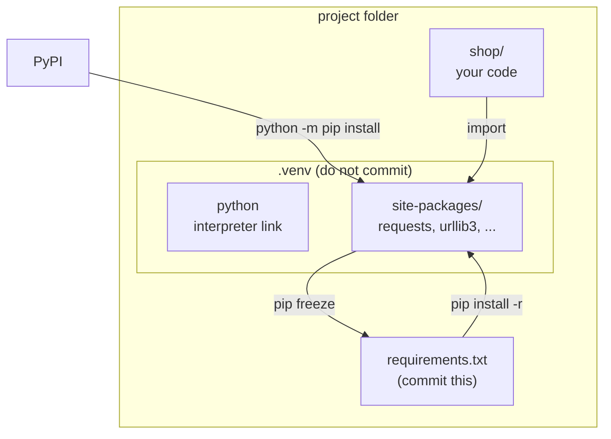
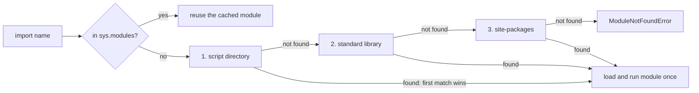

# Modules, packages, pip and venv

After this you can split Python code across files, run a package correctly, and set up one virtual environment per project with a pinned `requirements.txt`.

Before this: [Files and I/O](07-files-and-io.md). The same dependency ideas return in [package managers and dependencies](../../06-developer-tools-and-workflow/02-project-plumbing/01-package-managers-and-dependencies.md).

## The idea

A Python file is a module, a folder of modules is a package, and `import` finds them by searching a list of directories. Two kinds of trouble follow. Your own file names can collide with the standard library, and your project's third-party libraries can collide with other projects' versions of the same libraries. Virtual environments solve the second, and a few naming habits solve the first.

With one global Python, project A can need `requests` 2.28 while project B needs 2.34, and one of them breaks. The fix is one isolated environment per project, laid out like this.



In the diagram, installs land only in this project's `site-packages`, and `requirements.txt` is the recipe for rebuilding it.

## Key terms

A **module** is a single `.py` file, loaded once by `import` and cached in `sys.modules`. A **package** is a directory of modules, normally with an `__init__.py` file.

`sys.path` is the list of directories Python searches for imports, in order: the script's directory (or `''` for the current directory in interactive mode), the standard library, then `site-packages`.

**pip** is the standard installer for packages from PyPI (the Python Package Index). A **virtual environment** (venv) is a directory holding its own interpreter link and its own `site-packages`, so installs there affect only that project.

A **requirements file** lists package names and versions, one per line, for `pip install -r`.

## How it works

Imports run the module's top-level code once, the first time it is imported. Later imports reuse the cached module. Every module has a `__name__`: it is the module's import path, except for the file you run, which is `'__main__'`. That is the basis of the guard:

```python
if __name__ == "__main__":
    main()
```

The block runs when the file is executed and not when it is imported, so a file can be both a script and a library. Without the guard, importing the file (for example from a test) would run the program.

Here is a small package (output from running it on Python 3.14):

```text
shop/
    __init__.py       (empty)
    pricing.py
    cli.py
```

```python
# shop/pricing.py
TAX_RATE = 0.13

def with_tax(amount):
    return round(amount * (1 + TAX_RATE), 2)

print("pricing imported, __name__ =", __name__)

if __name__ == "__main__":
    print("pricing run directly:", with_tax(100))
```

```python
# shop/cli.py
from . import pricing
from .pricing import with_tax

def main():
    print(with_tax(19.99))

if __name__ == "__main__":
    main()
```

The `.` in `from .pricing import ...` is a relative import: "this package". It only works when the file is run as part of the package, with `python -m`, which takes a module path and not a file path.

```text
python -m shop.cli
pricing imported, __name__ = shop.pricing
22.59

python -m shop.pricing
pricing imported, __name__ = __main__
pricing run directly: 113.0

python shop/cli.py
ImportError: attempted relative import with no known parent package
```

The first command imported `pricing` under its package name. The second ran it as `__main__`. The third ran `cli.py` as a loose script, so Python did not know it belonged to a package. Run package code from the project root with `python -m package.module`. A circular import (`a` imports `b`, `b` imports `a`) fails with an `ImportError` or a half-initialized module; move the shared code into a third module.



Naming your own file `random.py`, `json.py` or `email.py` shadows the standard library module, because the script's directory is searched first, as the diagram shows. Python 3.13 and later add a hint to the error:

```text
AttributeError: module 'random' has no attribute 'randint' (consider renaming 'random.py' since it has the same name as the standard library module named 'random' and prevents importing that standard library module)
```

Path shortened. On older versions you get only the first half.

A virtual environment is made and used like this ([venv documentation](https://docs.python.org/3/library/venv.html)):

| Step | Windows PowerShell | Linux and macOS (bash, zsh) |
|---|---|---|
| Create | `python -m venv .venv` | `python3 -m venv .venv` |
| Activate | `.venv\Scripts\Activate.ps1` | `source .venv/bin/activate` |
| Install | `python -m pip install requests` | `python -m pip install requests` |
| Save | `python -m pip freeze > requirements.txt` | `python -m pip freeze > requirements.txt` |
| Recreate | `python -m pip install -r requirements.txt` | `python -m pip install -r requirements.txt` |
| Leave | `deactivate` | `deactivate` |

Activation only puts the venv's `Scripts` (Windows) or `bin` (Linux) directory first on `PATH`; running `.venv/Scripts/python` directly works the same. Use `python -m pip`, not bare `pip`, so the installer belongs to the interpreter you mean. A venv is disposable: do not commit it or copy it to another machine; delete it and rebuild it from `requirements.txt`.

On Debian and Ubuntu, `pip install` outside a venv can fail with `externally-managed-environment`. That is deliberate ([PEP 668](https://peps.python.org/pep-0668/)): the system Python belongs to the package manager, and the answer is a venv, not `--break-system-packages`.

Tools such as `uv` and `poetry` wrap the same ideas, and newer projects list dependencies in `pyproject.toml`.

## Worked examples

<div class="example" markdown>

### Example 1: pin a project's dependencies

We want a project that anyone can recreate exactly.

1. Create `.venv` and activate it.
2. Install `requests` with `python -m pip install requests`.
3. Run `python -m pip freeze`: it lists every installed package, including the ones `requests` pulled in.
4. Save that output to `requirements.txt`, and commit the file but not `.venv`.

```text
certifi==2026.10.23
charset-normalizer==3.5.2
idna==3.20
requests==2.34.2
urllib3==2.8.0
```

Check: delete `.venv`, make a new one, run `python -m pip install -r requirements.txt` and `python -m pip freeze` again. The output should match. These versions are what PyPI served on 25 October 2026; yours will be newer.

`freeze` mixes your direct dependency (`requests`) with its dependencies, so the file does not say which you chose.

</div>

## Common mistakes

<div class="warning" markdown>

Watch out: installing into the global Python. Packages from different projects mix, and later you cannot tell what a project needs. If the prompt does not show `(.venv)` and you did not use `.venv/Scripts/python`, you are probably installing globally.

Watch out: running `python shop/cli.py` for code that uses relative imports, or naming a file after a standard library module. Run `python -m shop.cli` from the project root, and rename the file.

Watch out: an unpinned `requirements.txt` (`requests` with no version). A new release can break the build next month. Pin with `==`, or with a lock file from your tool.

</div>

## Working with AI

<div class="ai" markdown>

Words to use: module, package, `sys.path`, relative import, `__main__`, virtual environment, `pip freeze`, transitive dependency.

Prompts to try:

- "I get `ImportError: attempted relative import with no known parent package` when I run `python shop/cli.py` (Python 3.12, layout pasted). Explain why and give the command that works."
- "Write a `requirements.txt` for a script that uses `requests` and `rich`, and explain which of the pinned lines are my choices and which are dependencies of those."

What to check:

- A package name that is not on PyPI, or is a near-copy of a real name (typosquatting). Look it up on pypi.org before installing.
- `sys.path.append(...)` hacks to make imports work. Fix the layout or run with `python -m` instead.
- `sudo pip install` or `--break-system-packages` in setup instructions.
- Version numbers an AI invented. Run `python -m pip index versions <name>` or check the project page.

</div>

## Quiz

1\. What does `if __name__ == "__main__":` do?

<details class="solution" markdown>
<summary>Answer</summary>

The block runs only when the file is executed directly, because then `__name__` is `'__main__'`. When the file is imported, `__name__` is the module's import path and the block is skipped.

</details>

2\. A script named `json.py` in your project raises `AttributeError: module 'json' has no attribute 'loads'`. Why?

<details class="solution" markdown>
<summary>Answer</summary>

Your file shadows the standard library `json` module, because the script's directory is first on `sys.path`. Rename your file.

</details>

3\. A teammate commits their `.venv` folder so that others "do not have to install anything". What goes wrong?

<details class="solution" markdown>
<summary>Answer</summary>

A venv is tied to the machine and interpreter that built it and is not meant to be copied; it also bloats the repository. Commit `requirements.txt` (or a lock file) and ignore `.venv`.

</details>

4\. `import utils` works when you run `python main.py` but fails under `python -m pytest` from another directory. What do you check first?

<details class="solution" markdown>
<summary>Answer</summary>

`sys.path`. A script's directory is added automatically; other launch methods may not add the project root. Run from the project root, or install the project in the venv (`pip install -e .` with a `pyproject.toml`).

</details>

## Lab

<div class="lab" markdown>

### Lab: a pinned, recreatable project

Goal: build a venv, install a package, freeze it, and rebuild from the freeze. Time: about 15 minutes. Runs in: PowerShell on Windows, or bash on Linux and macOS (the Linux commands are not tested here). Needs internet access.

1. Make a folder `venvlab` and open a terminal in it. Create `.venv` with `python -m venv .venv` (use `python3` on Linux), and activate it.
2. Run `python -m pip install requests`, then `python -m pip freeze > requirements.txt`. Count the lines.
3. Write `check.py` that prints `requests.__version__` and `sys.prefix`, and confirm that `sys.prefix` points inside `.venv`.
4. Deactivate, delete `.venv`, and create a fresh one. Run `python -m pip install -r requirements.txt`, then `python check.py` and `python -m pip freeze`. Compare with the first freeze.
5. Cleanup: deactivate and delete the `venvlab` folder.

Expected result: five lines in `requirements.txt`, the same freeze after the rebuild, and `sys.prefix` ending in `.venv`.

<details class="solution" markdown>
<summary>Solution</summary>

`check.py`:

```python
import sys
import requests

print(requests.__version__)
print(sys.prefix)
```

PowerShell commands (Windows):

```powershell
python -m venv .venv
.venv\Scripts\Activate.ps1
python -m pip install requests
python -m pip freeze > requirements.txt
python check.py
```

If PowerShell refuses to run `Activate.ps1`, run `.venv\Scripts\python` directly instead, or allow scripts for your user with `Set-ExecutionPolicy -Scope CurrentUser RemoteSigned`. Older Windows PowerShell can write redirected output as UTF-16, which may make `pip install -r` fail on the file; on the author's PC (Windows PowerShell 5.1) it wrote UTF-8 and pip read it fine. If yours fails, use `python -m pip freeze | Out-File -Encoding utf8 requirements.txt`.

Linux or macOS:

```bash
python3 -m venv .venv
source .venv/bin/activate
python -m pip install requests
python -m pip freeze > requirements.txt
python check.py
```

Output of `check.py` from the author's run (versions as of 25 October 2026):

```text
2.34.2
C:\Users\you\venvlab\.venv
```

The rebuild uses the same commands with `python -m pip install -r requirements.txt` in place of the single install, and `python -m pip freeze` should print the same five lines.

</details>

</div>

## Where this shows up

- [Package managers and dependencies](../../06-developer-tools-and-workflow/02-project-plumbing/01-package-managers-and-dependencies.md) compares pip with npm and lock files.
- [Secrets and dependency security](../../12-security/01-web-security/06-secrets-and-dependency-security.md) covers typosquatting and pinning for safety.
