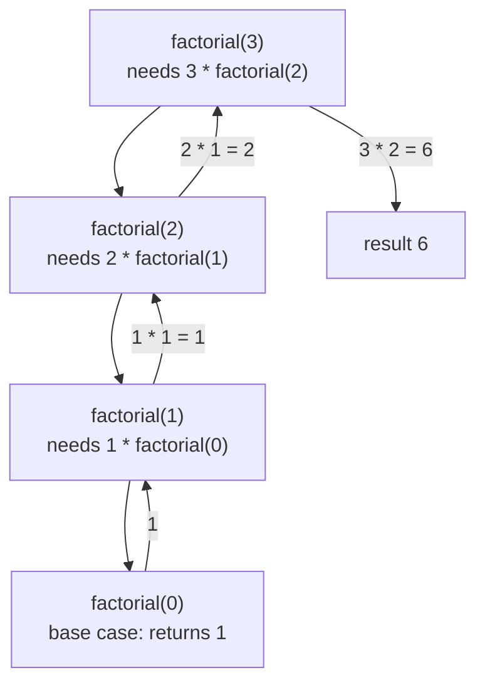

# Recursion

After this you can write a recursive function with a correct base case, draw its call stack, and say when a loop or a cache is the better tool.

Before this: [Functions and scope](../01-python-basics/03-functions-and-scope.md).

## The idea

A folder contains files and other folders. To count every file, you count the files in the folder, then do the same job again inside each subfolder. The job is the same at every level, only the folder gets smaller. That is recursion: a function solves a problem by calling itself on a smaller piece of it.



In the diagram, the calls go down until one of them can answer without calling again. Then the answers return up, and each level finishes its own multiplication.

## Key terms

A **recursive function** is a function that calls itself, directly or through another function.

The **base case** is the input for which the function returns an answer without a further recursive call. The **recursive case** is every other input; it calls the function on a smaller input that moves toward the base case.

The **call stack** is the region of memory that holds one **stack frame** per active function call: that call's arguments, local variables and the place to return to. A call pushes a frame; a return pops it.

**Memoization** is storing the result of a call, keyed by its arguments, so the same call is never computed twice.

## How it works

Every recursive function needs two things: a base case that is reached, and a recursive call on a smaller input. Without the first, the calls never stop. Without the second, the base case may never be reached.

```python
def factorial(n):
    if n == 0:                    # base case
        return 1
    return n * factorial(n - 1)   # recursive case, smaller input

print(factorial(5))
```

```text
120
```

While `factorial(3)` runs, the call stack grows by one frame for each call, and shrinks as they return:

```text
deepest point of the stack     (grows downward)

 factorial(3)   n=3   waiting for factorial(2)
 factorial(2)   n=2   waiting for factorial(1)
 factorial(1)   n=1   waiting for factorial(0)
 factorial(0)   n=0   returns 1  -> frame popped
```

The stack has a fixed size, so Python caps the depth. The limit is 1000 by default (checked on Python 3.14) and `sys.getrecursionlimit()` reports it. Past that, Python raises `RecursionError` instead of letting the real stack overflow and crash the process. `sys.setrecursionlimit()` raises the cap, but the [docs](https://docs.python.org/3/library/sys.html#sys.setrecursionlimit) warn that too high a value can crash the interpreter. If your input needs thousands of levels, reach for a loop.

Any recursion can be written as a loop (with your own stack if needed). A loop is usually faster in Python, because each call costs time and memory, and Python does not optimize tail calls. Recursion is the better fit when the data is itself nested: trees, folders, JSON, expressions, and the problems in backtracking<!-- link: ../../05-data-structures-and-algorithms/04-leetcode-patterns/06-backtracking.md -->.

The second trap is repeated work. A function that calls itself twice per level, such as Fibonacci, recomputes the same subproblems an exponential number of times. Memoization fixes this in one line: `functools.cache` wraps the function and remembers each result. Doing this systematically is dynamic programming<!-- link: ../../05-data-structures-and-algorithms/03-algorithms/06-dynamic-programming.md -->.

## Worked examples

<div class="example" markdown>

### Example 1: how much work does naive Fibonacci do?

Fibonacci numbers are defined by $F(n) = F(n-1) + F(n-2)$, with $F(0) = 0$ and $F(1) = 1$. The base cases are `n < 2`. We count how many calls `fib(25)` makes, with and without `@cache`.

1. Write the function with a counter that increases on every call.
2. Run it on 25 without a cache.
3. Add `@cache` above the definition and run it again.

```python
from functools import cache

calls = 0

def fib(n):
    global calls
    calls += 1
    return n if n < 2 else fib(n - 1) + fib(n - 2)

print(fib(25), calls)

calls = 0
fib = cache(fib)          # same as writing @cache above the def
print(fib(25), calls)
```

```text
75025 242785
75025 26
```

Check: both give 75025, so the answer is unchanged, but the calls drop from 242,785 to 26: one per value from 0 to 25. A cached `fib(90)` also returns instantly, while the naive version would not finish in your lifetime. Note that `fib` inside the function body refers to the global name, so after `fib = cache(fib)` the recursive calls go through the cache too.

</div>

<div class="example" markdown>

### Example 2: the recursion limit

```python
def forever(n):
    return forever(n + 1)    # no base case

try:
    forever(0)
except RecursionError as e:
    print(type(e).__name__, e)
```

```text
RecursionError maximum recursion depth exceeded
```

A missing or unreachable base case is the usual cause. Check what shrinks on each call.

</div>

## Common mistakes

<div class="warning" markdown>

Watch out: a base case that is never reached, such as `factorial(-1)` with the check `n == 0`. The argument goes `-2`, `-3`, and so on until `RecursionError`. Check that every call moves toward the base case, or reject bad input first.

Watch out: raising the recursion limit to hide a deep recursion. If depth grows with the input size, rewrite it as a loop or use an explicit stack.

</div>

## Working with AI

<div class="ai" markdown>

Words to use: base case, recursive case, call stack, recursion depth, memoization, tail call.

Prompts to try:

- "Rewrite this recursive Python function as a loop with an explicit stack. It walks a nested dict and can go 10,000 levels deep."
- "This recursive function raises RecursionError for input 5000. Which call never reaches the base case, and what is the maximum depth for n items?"

What to check:

- A missing base case or one that skips an input, such as negative numbers or an empty list. Run the function on `0`, `1`, and an empty input.
- A claim that Python optimizes tail recursion. It does not; test with a deep input.
- A "faster" memoized version that caches on a mutable argument. `functools.cache` needs hashable arguments, so a list argument raises `TypeError`.

</div>

## Quiz

1\. What are the two parts every recursive function needs, and what goes wrong without each?

<details class="solution" markdown>
<summary>Answer</summary>

A base case that returns without recursing, and a recursive case that moves toward it. Without the base case the calls never stop; without progress toward it the base case is never reached. Both end in `RecursionError` in Python.

</details>

2\. Predict the output.

```python
def f(n):
    if n == 0:
        return
    print(n)
    f(n - 1)
    print(n)

f(2)
```

<details class="solution" markdown>
<summary>Answer</summary>

```text
2
1
1
2
```

The first `print` runs on the way down, the second on the way back up as each frame resumes.

</details>

3\. A teammate's recursive function that sums a list works on 100 items and fails with `RecursionError` on 5,000. What are two fixes?

<details class="solution" markdown>
<summary>Answer</summary>

Rewrite it as a loop (or use `sum`), since the depth equals the list length. Raising `sys.setrecursionlimit` also works for moderate sizes but risks a crash, so it is the weaker fix.

</details>

4\. Why is a recursive Fibonacci slow, and how does `@cache` change its running time?

<details class="solution" markdown>
<summary>Answer</summary>

Each call makes two more calls, so the same values are recomputed an exponential number of times. With `@cache`, each value is computed once, so the number of calls grows linearly with $n$.

</details>

## Lab

<div class="lab" markdown>

### Lab: sum a nested list

Goal: write a recursive function, hit the limit, and fix it with a loop. Time: about 15 minutes. Runs in: any terminal with Python 3.

1. Write `total(x)` that returns the sum of all numbers in a list that can contain numbers and other lists, such as `[1, [2, 3], [[4], 5]]`. Expected: `15`.
2. Build a deeply nested list with `deep = [1]` and `for _ in range(5000): deep = [deep]`. Call `total(deep)` and note the error.
3. Write `total_loop(x)` using a list as your own stack, and run it on `deep`.
4. Print `total_loop([1, [2, 3], [[4], 5]])` to confirm both versions agree on the small input.

Expected result: step 1 prints 15, step 2 raises `RecursionError`, step 3 prints 1.

<details class="solution" markdown>
<summary>Solution</summary>

```python
def total(x):
    if isinstance(x, int):
        return x
    return sum(total(item) for item in x)

def total_loop(x):
    stack, result = [x], 0
    while stack:
        item = stack.pop()
        if isinstance(item, int):
            result += item
        else:
            stack.extend(item)
    return result

small = [1, [2, 3], [[4], 5]]
print(total(small), total_loop(small))

deep = [1]
for _ in range(5000):
    deep = [deep]
try:
    total(deep)
except RecursionError as e:
    print("recursive:", type(e).__name__)
print("loop:", total_loop(deep))
```

```text
15 15
recursive: RecursionError
loop: 1
```

The loop keeps pending work in a list on the heap, which has no depth cap, so the nesting depth no longer matters.

</details>

</div>

## Where this shows up

- Trees, folders and JSON are recursive data: trees and binary search trees<!-- link: ../../05-data-structures-and-algorithms/02-data-structures/05-trees-and-binary-search-trees.md -->.
- Counting the cost of recursive calls: analysing recursive algorithms<!-- link: ../../05-data-structures-and-algorithms/01-analysis/03-analysing-recursive-algorithms.md -->.
- SQL has recursion too, for hierarchies: CTEs and recursive queries<!-- link: ../../10-databases-sql-and-postgres/02-querying/06-ctes-and-recursive-queries.md -->.
