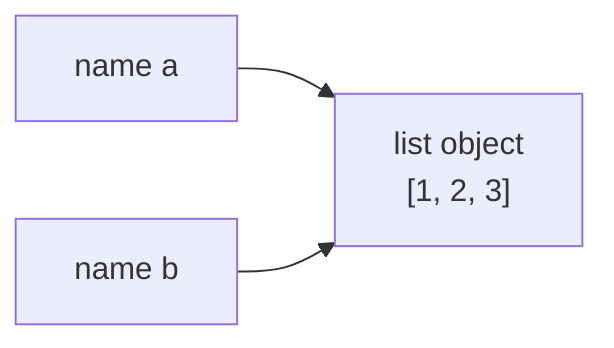
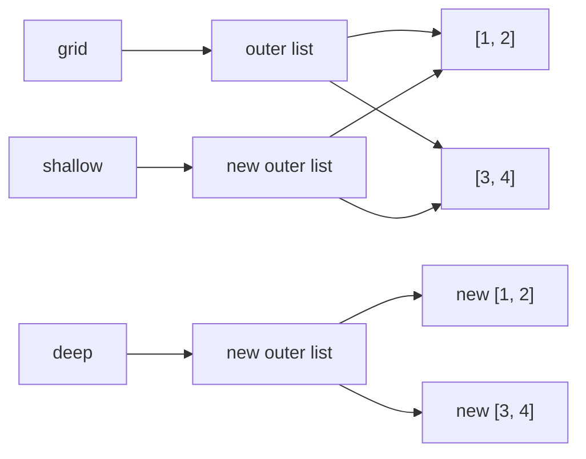

# References, mutability and copying

After this you can predict when changing one variable changes another, choose between a shallow and a deep copy, and say whether a function can modify what you pass in.

Before this: [Values, types and variables](../01-python-basics/01-values-types-and-variables.md) and [Lists, dicts, sets and tuples](../01-python-basics/04-lists-dicts-sets-and-tuples.md).

## The idea

You edit a shared document, and a colleague sees the change because you both opened the same file. If you had emailed them a copy, they would not. Variables in Python behave like the link to the shared file: assignment never copies the object, it makes another name for it.



In the diagram, `b = a` produces two names for one list. A change through either name is visible through both. This is called **aliasing**.

## Key terms

A **reference** is a value that says which object a name or a container slot refers to. In Python a variable holds a reference, not the object itself.

An object is **mutable** if its contents can change after creation (`list`, `dict`, `set`, and most objects you define). It is **immutable** if they cannot (`int`, `float`, `bool`, `str`, `bytes`, `tuple`, `frozenset`, `None`). Operations on immutable objects build a new object.

A **shallow copy** creates a new container whose slots refer to the same inner objects as the original. A **deep copy** creates a new container and new copies of everything inside it, recursively.

**Identity** is which object it is (`is`, `id()`); **equality** is whether two objects have the same value (`==`).

## How it works

Two rules explain almost everything:

1. Assignment (`b = a`), passing an argument and storing in a container all copy the reference, never the object.
2. Mutating methods (`append`, `update`, item assignment) change the object in place, so every alias sees it. Rebinding a name (`x = something`) only changes which object that one name points to.

```python
a = [1, 2, 3]
b = a
b.append(4)
print(a, a is b)

s = "hi"
t = s
t += "!"          # builds a new str, rebinds t
print(s, t)
```

```text
[1, 2, 3, 4] True
hi hi!
```

A function parameter is a new name for the caller's object, which some books call pass by object reference. So a function can mutate a list you pass it, but cannot rebind your variable:

```python
def add_item(items, x):
    items.append(x)     # mutates the caller's list

def rebind(items):
    items = [0]         # only the local name changes

nums = [1]
add_item(nums, 2)
rebind(nums)
print(nums)
```

```text
[1, 2]
```

To get an independent copy you must ask for one. `list.copy()`, `dict.copy()`, `list(x)` and `x[:]` are shallow. `copy.deepcopy(x)` is deep.



In the diagram, `shallow` has its own outer list but shares the rows with `grid`. `deep` shares nothing. A shallow copy is enough when the contents are immutable, such as a list of numbers or strings.

## Worked examples

<div class="example" markdown>

### Example 1: shallow versus deep

We copy a list of lists, change the original, and see which copy notices.

1. Build `grid`, a shallow copy and a deep copy.
2. Set `grid[0][0] = 99`.
3. Print the first element of each copy, and compare identities of the first rows.

```python
import copy

grid = [[1, 2], [3, 4]]
shallow = grid.copy()
deep = copy.deepcopy(grid)

grid[0][0] = 99
print(shallow[0][0], deep[0][0])
print(shallow[0] is grid[0], deep[0] is grid[0])
```

```text
99 1
True False
```

Check: the shallow copy shows 99 because `shallow[0]` and `grid[0]` are one object (`True`). The deep copy keeps 1 because its rows are new objects (`False`). This matches the diagram.

</div>

<div class="example" markdown>

### Example 2: three surprises from the same rule

```python
rows = [[0] * 2] * 3          # three references to one row
rows[0][0] = 1
print(rows)

t = (1, [2, 3])               # immutable tuple, mutable list inside
t[1].append(4)
print(t)

def bad(x, bucket=[]):        # default is created once
    bucket.append(x)
    return bucket
print(bad(1), bad(2))
```

```text
[[1, 0], [1, 0], [1, 0]]
(1, [2, 3, 4])
[1, 2] [1, 2]
```

The first fix is a comprehension, `[[0] * 2 for _ in range(3)]`, which builds a new row each time. The tuple is immutable only in which objects it holds, not in what those objects contain. The third fix is the `None` default from [Functions and scope](../01-python-basics/03-functions-and-scope.md).

</div>

## Common mistakes

<div class="warning" markdown>

Watch out: `b = a` to "save a copy" before changing `a`. Both names see the change. Use `a.copy()` or `copy.deepcopy(a)`.

Watch out: assuming `copy()` is deep for nested data. If the data contains lists or dicts, mutate one and check the copy; if it changes, you needed `deepcopy`.

Watch out: a function that mutates its argument without saying so. Either document it, or return a new object and leave the argument alone.

</div>

## Working with AI

<div class="ai" markdown>

Words to use: aliasing, reference, mutable, immutable, shallow copy, deep copy, identity versus equality.

Prompts to try:

- "In this Python snippet, which names refer to the same object after each line? Give the `id()` relationships and say where aliasing causes the bug."
- "Make this function pure: it currently mutates the `config` dict passed in. Return a new dict and keep the nested lists independent."

What to check:

- `copy.copy` or `.copy()` proposed for nested data. Mutate an inner list and look at both objects.
- A "fix" that adds `deepcopy` everywhere. It is slow on large data and breaks objects that hold open files or locks; ask where the sharing actually happens.
- Claims that Python is "pass by value" or "pass by reference". Run a small function that mutates and one that rebinds, as above.

</div>

## Quiz

1\. What does `b = a` do when `a` is a list?

<details class="solution" markdown>
<summary>Answer</summary>

It makes `b` another name for the same list object. Nothing is copied, so mutating through `b` is visible through `a`.

</details>

2\. Predict the output.

```python
x = [1, 2]
y = x
y = y + [3]
z = x
z += [4]
print(x, y, z)
```

<details class="solution" markdown>
<summary>Answer</summary>

`[1, 2, 4] [1, 2, 3] [1, 2, 4]`. `y + [3]` builds a new list, so `y` is rebound and `x` is untouched. `z += [4]` on a list mutates in place, and `z` is `x`, so `x` changes too.

</details>

3\. A function receives a dict of settings, sets `settings["debug"] = True`, and the caller's dict changes. Why, and what are two fixes?

<details class="solution" markdown>
<summary>Answer</summary>

The parameter and the caller's variable refer to one dict, and item assignment mutates it. Fix by copying inside the function (`settings = {**settings, "debug": True}` or `dict(settings)` first), or document that the function mutates and let the caller pass a copy.

</details>

4\. When is a shallow copy enough?

<details class="solution" markdown>
<summary>Answer</summary>

When the container holds only immutable items (numbers, strings, tuples of those), because shared immutable objects cannot be changed through either copy.

</details>

## Lab

<div class="lab" markdown>

### Lab: find the aliasing bug

Goal: reproduce and fix a bug caused by shared references. Time: about 10 minutes. Runs in: any terminal with Python 3.

1. Run the script below. It builds a three-player scoreboard from a template, and bumps the first player.
2. Predict the printed output before running it, then compare.
3. Fix `make_board` so only player 0 changes.
4. Run again. Then add `assert board["bo"] is not board["ana"]` after building the board.

```python
def make_board(names, template):
    return {name: template for name in names}

board = make_board(["ana", "bo", "cy"], {"score": 0, "log": []})
board["ana"]["score"] += 10
board["ana"]["log"].append("won round 1")
print(board["bo"])
```

Expected result before the fix: `{'score': 10, 'log': ['won round 1']}`. After the fix: `{'score': 0, 'log': []}`.

<details class="solution" markdown>
<summary>Solution</summary>

All three names map to one template dict. Build a fresh copy for each, using `deepcopy` because `log` is a list:

```python
import copy

def make_board(names, template):
    return {name: copy.deepcopy(template) for name in names}

board = make_board(["ana", "bo", "cy"], {"score": 0, "log": []})
board["ana"]["score"] += 10
board["ana"]["log"].append("won round 1")
print(board["bo"])
```

```text
{'score': 0, 'log': []}
```

`dict(template)` would not be enough: it is shallow, so the `log` list would still be shared even though `score` would be separate.

</details>

</div>

## Where this shows up

- Objects hold references to other objects: [classes and objects](../03-oop-and-paradigms/01-classes-and-objects.md).
- Avoiding mutation is a core idea of [functional programming ideas](../03-oop-and-paradigms/04-functional-programming-ideas.md).
- The same sharing exists in JavaScript objects and arrays, in React state, and in pointers in C.
