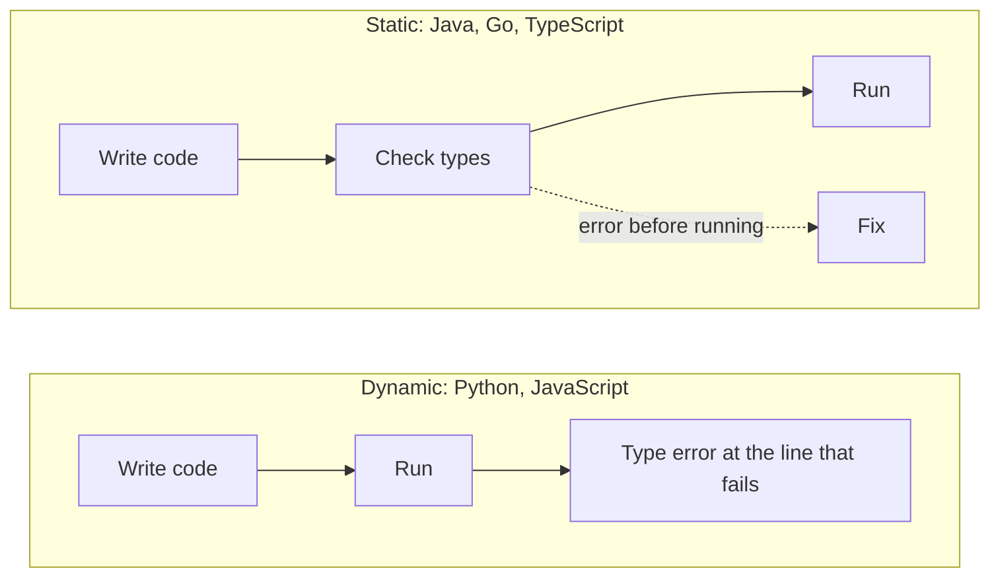
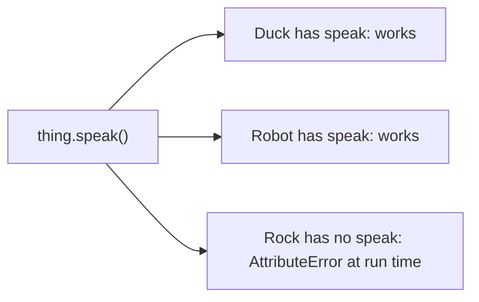

# Type systems

After this you can classify a language as static or dynamic and strong or weak, add type hints to Python, and read a type checker's error.

Before this: [Values, types and variables](../01-python-basics/01-values-types-and-variables.md).

## The idea

A function `area(width, height)` is called with `area("3", 4)`. Python does not complain, and returns `"3333"`, because multiplying a string by an integer repeats it. The bug shows up later, far from the call, as a wrong page total. Some languages would have refused to run the program at all. A **type system** is the set of rules a language uses to stop that kind of mix-up, and the main design choice is when it applies them.



In the diagram, a dynamic language finds the problem only when the bad line executes. A static language finds it in a separate checking step before anything runs.

## Key terms

A **type** is a set of values plus the operations allowed on them. In a **statically typed** language, types are checked before the program runs, from declarations or inference. In a **dynamically typed** language, they are checked while it runs, on the actual values.

A language is **strongly typed** when it refuses operations on mismatched types, and **weakly typed** when it converts silently to make them work. This is a spectrum with no formal definition, so use it as a tendency.

**Duck typing** means a function accepts any object that has the methods it calls, regardless of its class. The name comes from "if it quacks like a duck".

A **type hint** (or annotation) is a note on a variable, parameter or return value that states its intended type. A **type checker** such as mypy or pyright reads hints and reports mismatches without running the code.

## How it works

The two axes are independent:

| Language | When checked | Conversions |
|---|---|---|
| Python | Dynamic | Strong: `1 + "1"` raises `TypeError` |
| JavaScript | Dynamic | Weak: `1 + "1"` is `"11"`, `"3" * 4` is `12` |
| Java, Go | Static | Strong |
| C | Static | Weak: pointers and casts reinterpret memory |
| TypeScript | Static, checked only at build time | Inherits JavaScript: `1 + "1"` is allowed |

Python's checks happen at run time, on the values:

```python
try:
    1 + "1"
except TypeError as e:
    print(e)

def f(n):
    return n.upper()

try:
    f(5)
except AttributeError as e:
    print(e)
```

```text
unsupported operand type(s) for +: 'int' and 'str'
'int' object has no attribute 'upper'
```

Duck typing is the dynamic approach in practice: the function below works for any object with a `speak` method, with no shared base class.

```python
class Duck:
    def speak(self):
        return "quack"

class Robot:
    def speak(self):
        return "beep"

for thing in (Duck(), Robot()):
    print(thing.speak())
```

```text
quack
beep
```



In the diagram, the call succeeds for any object that has the method. The failure for `Rock` happens only when that line runs, which is the cost of checking at run time.

Python can add static checking on top. Hints do nothing at run time; a separate tool reads them. Python 3.9 and later accept `list[str]`, and 3.10 and later accept `str | None`. The official reference is the [typing documentation](https://docs.python.org/3/library/typing.html), and mypy and [pyright](https://microsoft.github.io/pyright/) are the common checkers. Editors such as VS Code use Pylance (built on pyright) for the same checks as you type. Setting these up is covered in [linters, formatters and type checkers](../../04-developer-tools-and-workflow/03-code-quality/03-linters-formatters-and-type-checkers.md).

[TypeScript](../../08-front-end/02-javascript-and-typescript/04-typescript.md) is the same idea for JavaScript, with one difference: its checker runs before the code is compiled to plain JavaScript, and the types are erased. At run time, nothing checks them.

## Worked examples

<div class="example" markdown>

### Example 1: one mistake, three tools

We call `area("3", 4)` in Python without hints, Python with hints, and TypeScript.

1. Without hints, Python runs the call. The result is wrong but there is no error.
2. With hints, the program still runs the same way. mypy reports the call before you run it.
3. In TypeScript, the same mistake stops the build.

```python
def area(width: float, height: float) -> float:
    return width * height

print(area(3, 4))
print(area("3", 4))

def first(items: list[str]) -> str | None:
    return items[0] if items else None

name = first(["ana"])
print(name.upper())
```

Running `python t2.py` prints `12`, then `3333`, then `ANA`: the hints change nothing at run time. Saved as `t2.py`, running `mypy t2.py` gives:

```text
t2.py:5: error: Argument 1 to "area" has incompatible type "str"; expected "float"  [arg-type]
t2.py:11: error: Item "None" of "str | None" has no attribute "upper"  [union-attr]
Found 2 errors in 1 file (checked 1 source file)
```

The second error is the more useful kind. `first([])` returns `None`, so `name.upper()` would crash on an empty list; mypy points to the missing check before a user finds it. The TypeScript equivalent, `function area(width: number, height: number)` called with `"3"`, fails with `error TS2345: Argument of type 'string' is not assignable to parameter of type 'number'.` (checked with `tsc --strict`, TypeScript 7.0.2, as of 2026).

Check: add `if name is not None:` around the last line and rerun mypy. The second error disappears.

</div>

<div class="example" markdown>

### Example 2: a checkable duck

A `Protocol` writes down the shape that duck typing relies on, so the checker can verify it.

```python
from typing import Protocol

class Speaker(Protocol):
    def speak(self) -> str: ...

class Rock:
    pass

def announce(thing: Speaker) -> str:
    return thing.speak()

announce(Rock())
```

```text
t3.py:12: error: Argument 1 to "announce" has incompatible type "Rock"; expected "Speaker"  [arg-type]
```

Without the checker, the same call fails only at run time with `AttributeError: 'Rock' object has no attribute 'speak'`.

</div>

## Common mistakes

<div class="warning" markdown>

Watch out: believing hints are enforced. Python ignores them at run time, so `area("3", 4)` runs. Run a checker in your editor or CI to get any benefit.

Watch out: calling Python "weakly typed" because variables have no declared type. Python refuses `1 + "1"`, so it is dynamic and strong. JavaScript is dynamic and weak.

Watch out: silencing a checker with `Any` or `# type: ignore` everywhere. Each one turns checking off for that value, and errors move back to run time.

</div>

## Working with AI

<div class="ai" markdown>

Words to use: static typing, dynamic typing, type hint, type checker, `Optional` (or `X | None`), duck typing, protocol, generics.

Prompts to try:

- "Add type hints to this Python 3.12 module and run through what mypy --strict would report. Do not use `Any` unless you explain why."
- "mypy says: Item 'None' of 'str | None' has no attribute 'upper'. Explain the cause in this function and show two fixes."

What to check:

- Hints that are wrong but plausible, such as `list` where the code returns a generator. Run mypy or pyright on the result; do not trust the reading.
- `Any`, `cast(...)` and `# type: ignore` added to make errors disappear. Search for them in the diff.
- Syntax newer than your Python version, such as `X | Y` on Python 3.9. Check `python --version` against the [typing docs](https://docs.python.org/3/library/typing.html).

</div>

## Quiz

1\. Classify Python, JavaScript and Java on both axes: static or dynamic, strong or weak.

<details class="solution" markdown>
<summary>Answer</summary>

Python: dynamic, strong. JavaScript: dynamic, weak. Java: static, strong. The axes are independent.

</details>

2\. What does this print, and does the type hint matter?

```python
def double(x: int) -> int:
    return x * 2

print(double("ab"))
```

<details class="solution" markdown>
<summary>Answer</summary>

It prints `abab`. Python ignores the hint at run time. mypy would report that `"ab"` is not an `int`.

</details>

3\. A function returns `str | None`, and the caller does `result.strip()` straight away. What does a type checker say, and what is the fix?

<details class="solution" markdown>
<summary>Answer</summary>

It reports that `None` has no attribute `strip`. Check for `None` first (`if result is not None:`) or return an empty string instead.

</details>

4\. Why do two classes with no common base class both work in a function that calls `.speak()`?

<details class="solution" markdown>
<summary>Answer</summary>

Duck typing: Python looks up `speak` on the object when the call runs, so any object with that method works.

</details>

## Lab

<div class="lab" markdown>

### Lab: run a type checker

Goal: install mypy, break a function on purpose, and read the report. Time: about 15 minutes. Runs in: any terminal with Python 3.

1. Create and activate a virtual environment, then run `pip install mypy`.
2. Save the script below as `prices.py` and run `python prices.py`. Note that it runs without error.
3. Run `mypy prices.py`. Write down both error lines.
4. Fix the call and the `None` case, then rerun until mypy prints `Success: no issues found in 1 source file`.
5. Cleanup: deactivate and delete the virtual environment.

```python
def total(prices: list[float], tax: float) -> float:
    return sum(prices) * (1 + tax)

def find(prices: dict[str, float], name: str) -> float | None:
    return prices.get(name)

print(total([10.0, 5.0], "0.13"))
print(find({"tea": 3.5}, "tea") * 2)
```

Expected result: step 2 prints a `TypeError` (the string tax breaks `1 + tax`), and step 3 reports an `arg-type` error on line 7 and an `operator` error on line 8.

<details class="solution" markdown>
<summary>Solution</summary>

Pass `0.13` as a number, and handle `None`:

```python
def total(prices: list[float], tax: float) -> float:
    return sum(prices) * (1 + tax)

def find(prices: dict[str, float], name: str) -> float | None:
    return prices.get(name)

print(total([10.0, 5.0], 0.13))
price = find({"tea": 3.5}, "tea")
if price is not None:
    print(price * 2)
```

```text
16.95
7.0
```

</details>

</div>

## Where this shows up

- Type hints, linters and CI checks: [linters, formatters and type checkers](../../04-developer-tools-and-workflow/03-code-quality/03-linters-formatters-and-type-checkers.md).
- TypeScript on top of JavaScript: [TypeScript](../../08-front-end/02-javascript-and-typescript/04-typescript.md).
- SQL columns have types too: [data types and constraints](../../10-databases-sql-and-postgres/03-schema-design/01-data-types-and-constraints.md).
