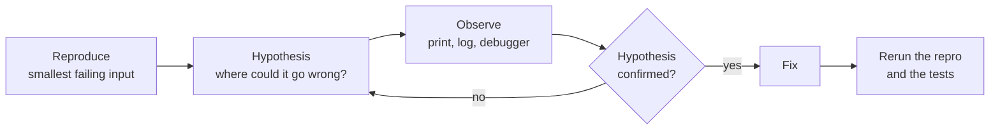

# Reading code and debugging

After this you can find your way around a codebase you did not write, and find a bug with a method instead of guessing.

Before this: [Errors and exceptions](../01-python-basics/06-errors-and-exceptions.md).

## The idea

On your first week at work you open a repository with 400 files and a bug report: "the monthly total is wrong." You cannot read it all, and you do not need to. You need to find the one path through the code that produces the total, and then watch the numbers on that path until one of them is wrong.

Debugging is the scientific method on a small scale. You state what you expect, observe what happens, and narrow the gap between the two until the cause is the only thing left.



In the diagram, the loop between hypothesis and observation is the work. Reproducing first and rerunning at the end are what make it trustworthy.

## Key terms

A **reproduction** is a small, reliable way to make the bug happen: specific input, steps and environment. If you cannot trigger it on demand, you cannot know when you have fixed it.

A **stack trace** (traceback) lists the calls active when an error was raised, with the most recent call last in Python.

**Tracing** means following a value through the code, by hand or with a tool, one step at a time.

A **debugger** pauses a running program so you can inspect variables and step through lines. A **breakpoint** is a marked line where it pauses. **Logging** writes timestamped, levelled messages to a file or stream, and stays in the code.

**Bisecting** is halving the search space repeatedly: for code, the commits or lines that could contain the bug.

## How it works

Reading an unfamiliar codebase, top-down:

1. Read the README and run the project or its tests, so you know it works before you change it.
2. Find the entry point (`main`, the route handler, the command).
3. Follow one real path from the entry point to the result, skipping the branches that do not matter.
4. Use the editor: Go to Definition and Find All References in VS Code, or `grep`, rather than scrolling.
5. Read the tests for the part you need. They show how the code is meant to be called.

Start debugging with a reproduction and read the stack trace from the bottom up: the last line is the error, the lines above it are who called whom. Most bugs are in your code or the line that calls library code, not in the library.

Here is a function with a bug. It should average only the positive numbers, so `[4, -2, 8]` should give 6.

```python
def average_of_positives(xs):
    total = 0
    count = 0
    for x in xs:
        if x > 0:
            total += x
        count += 1
    return total / count

print(average_of_positives([4, -2, 8]))
```

```text
4.0
```

There are three ways to look inside. A `print` is fastest to type but must be deleted after. Logging is the same idea, kept in the code and switchable by level:

```python
import logging
logging.basicConfig(level=logging.DEBUG, format="%(levelname)s %(message)s")
# inside the loop:
logging.debug("x=%s total=%s count=%s", x, total, count)
```

```text
DEBUG x=4 total=4 count=1
DEBUG x=-2 total=4 count=2
DEBUG x=8 total=12 count=3
```

The output shows `count` rising on the `-2` row, where `total` did not. A debugger shows the same without editing the file. Put `breakpoint()` in the loop (Python 3.7 and later, [pdb docs](https://docs.python.org/3/library/pdb.html)) and run the script. It stops at a `(Pdb)` prompt:

```text
> avg_bp.py(8)average_of_positives()
-> breakpoint()
(Pdb) p x, total, count
(4, 4, 1)
(Pdb) c
(Pdb) p x, total, count
(-2, 4, 2)
```

After each `c`, pdb also prints the location line again; those lines are left out above.

| Command | Does |
|---|---|
| `p expr` | print a value |
| `n` / `s` | next line / step into a call |
| `c` | continue to the next breakpoint |
| `l` | list source around the current line |
| `w` | show the call stack (`u` and `d` move up and down it) |
| `b 12` | set a breakpoint at line 12 |
| `q` | quit and abort the program |

In VS Code the same tools have a graphical form, from the [debugging docs](https://code.visualstudio.com/docs/debugtest/debugging) (Windows shortcuts): click the margin or press F9 to set a breakpoint, F5 to run under the debugger, F10 to step over, F11 to step into, Shift+F11 to step out. The Variables, Watch and Call Stack panes show state. A conditional breakpoint stops only when an expression is true, and a logpoint prints a message without stopping.

Use a debugger when you need to explore state you did not predict. Use logs for code running somewhere you cannot attach to, such as a server. Logging in production is covered in [logging, metrics and monitoring](../../13-devops-and-cloud/04-operations/01-logging-metrics-and-monitoring.md).

When a bug appeared "sometime this month", bisect the history. In a Git repository, `git bisect` checks out the middle commit, you say good or bad, and it halves the range. With 8 commits it needs about 3 checks. With a script that exits 0 for good and non-zero for bad, Git does it for you:

```bash
git bisect start HEAD HEAD~7
git bisect run python check.py
git bisect reset
```

Bisecting 8 commits where the bug arrived in commit 5:

```text
commits:  1  2  3  4  5  6  7  8      you mark 1 good and 8 bad
check 4:  good -> the bug is in 5 to 8
check 6:  bad  -> the bug is in 5 to 6
check 5:  bad  -> commit 5 is the first bad commit
```

Git's real output ends with:

```text
da0634583046e5099765b221ba28dfef2c29e615 is the first bad commit
bisect found first bad commit
```

The first command marks `HEAD` bad and `HEAD~7` good; `reset` returns you to your branch. See [Git basics](../../04-developer-tools-and-workflow/01-editor-and-git/02-git-basics.md) for the commit model.

Last, **rubber-ducking**: explain the code line by line to a rubber duck, a colleague or an AI chat. Having to say what each line does is often enough to hear the wrong assumption.

## Worked examples

<div class="example" markdown>

### Example 1: find the bug in `average_of_positives`

We follow the loop above with `[4, -2, 8]`, expecting 6.

1. Reproduce: the call prints `4.0`. The expected value is $(4 + 8) / 2 = 6$.
2. Hypothesis: the numerator is right (4 + 8 = 12) and the denominator is wrong. The output of the logging run says `count=3`, so the denominator is 3 and $12 / 3 = 4$.
3. Cause: `count += 1` sits outside the `if`, so every number is counted, not just the positive ones.
4. Fix: indent `count += 1` under the `if`.
5. Check: rerun the repro.

```python
def average_of_positives(xs):
    total = 0
    count = 0
    for x in xs:
        if x > 0:
            total += x
            count += 1
    return total / count

print(average_of_positives([4, -2, 8]))
```

```text
6.0
```

The fix still divides by zero for `[-1, -2]`. Fixing one case is a prompt to try the edges, such as an empty list and no positives.

</div>

<div class="example" markdown>

### Example 2: reading a stack trace

```python
def parse(row):
    return int(row["qty"])

def total(rows):
    return sum(parse(r) for r in rows)

print(total([{"qty": "2"}, {"qty": "x"}]))
```

```text
Traceback (most recent call last):
  File "boom.py", line 7, in <module>
    print(total([{"qty": "2"}, {"qty": "x"}]))
  File "boom.py", line 5, in total
    return sum(parse(r) for r in rows)
  File "boom.py", line 2, in parse
    return int(row["qty"])
ValueError: invalid literal for int() with base 10: 'x'
```

Read from the bottom: the error is a `ValueError` raised in `parse` at line 2, caused by the input `"x"`. The lines above show the route. (Recent Python versions also draw `~~^~~` markers under the failing expression; they are left out here.) The bug is in the data or in a missing check, not in `sum`.

</div>

## Common mistakes

<div class="warning" markdown>

Watch out: changing code before you can reproduce the bug. You cannot tell whether a change fixed it, and you may fix a different bug.

Watch out: changing several things at once. If the bug disappears you do not know which change did it, and you may have added new ones. Change one thing, then rerun.

Watch out: assuming the library is wrong. Check your inputs and your call first; library bugs are rare compared to wrong arguments.

</div>

## Working with AI

<div class="ai" markdown>

Words to use: reproduction, stack trace, breakpoint, step over, regression, bisect, logging level, root cause.

Prompts to try:

- "Here is a Python 3.14 stack trace and the three functions it passes through. Explain the root cause, and list what I should print or log to confirm it before I change anything."
- "This test passes on commit A and fails on commit B. Give me the `git bisect run` commands and a test script that exits non-zero on failure."

What to check:

- A fix offered without a cause. Ask for the failing line and the wrong value, then confirm it with a `print` or the debugger.
- Invented functions or flags in the suggested fix. Look up each one in the official docs.
- A patch that removes the symptom, such as a `try/except` that swallows the error. Run your reproduction and the tests, and look for a wrapper that hides the failure.

</div>

## Quiz

1\. Why reproduce a bug before trying to fix it?

<details class="solution" markdown>
<summary>Answer</summary>

Without a reliable reproduction you cannot see whether a change helped, and you cannot add a test that stops it returning.

</details>

2\. In a Python traceback, where is the error message and where is the call that started everything?

<details class="solution" markdown>
<summary>Answer</summary>

The error type and message are on the last line. The first frame (the top) is the outermost call, and the last frame is where the error was raised.

</details>

3\. A report says "it worked in January and is broken now", and 120 commits lie between. About how many bisect steps are needed, and what must you supply?

<details class="solution" markdown>
<summary>Answer</summary>

About 7, since $\log_2 120 \approx 6.9$. You need a known good commit, a known bad one, and a test that says which a given commit is.

</details>

4\. When would you choose logging over a debugger?

<details class="solution" markdown>
<summary>Answer</summary>

When the code runs where you cannot attach a debugger (a server, a scheduled job), when the failure is rare and you need a record afterwards, or when you want to see a sequence of events over time.

</details>

## Lab

<div class="lab" markdown>

### Lab: debug with pdb and bisect

Goal: use `breakpoint()` to find a bug, then bisect a small history. Time: about 20 minutes. Runs in: any terminal with Python 3 and Git.

1. Save `average_of_positives` from this lesson as `avg.py`, with the bug. Add `breakpoint()` inside the loop after `count += 1`.
2. Run `python avg.py`. At each `(Pdb)` prompt, type `p x, total, count` then `c`. Note the iteration where `count` and `total` disagree.
3. Remove the breakpoint and fix the bug. Add a second line `print(average_of_positives([]))`, run it and read the traceback. Decide what the function should do for an empty list.
4. Make a new folder, run `git init`, and commit four versions of a file `f.py`: `def f(): return 1` in commits 1 and 2, and `def f(): return 2` in commits 3 and 4. Run `git bisect start HEAD HEAD~3` (commit 4 is bad, commit 1 is good), then after each checkout run `grep "return 1" f.py` and type `git bisect good` if it matches, `git bisect bad` if not.
5. Cleanup: `git bisect reset`, then delete the folder.

Expected result: step 2 shows `count` ahead of the number of positives; step 4 ends with "is the first bad commit" for commit 3.

<details class="solution" markdown>
<summary>Solution</summary>

Step 3: a zero count raises `ZeroDivisionError`. A reasonable choice is to return `None` or raise `ValueError("no positive numbers")`, and to say so in a docstring.

```python
def average_of_positives(xs):
    total = 0
    count = 0
    for x in xs:
        if x > 0:
            total += x
            count += 1
    if count == 0:
        raise ValueError("no positive numbers")
    return total / count
```

Step 4: Git picks a commit in the middle. If `grep "return 1" f.py` finds it, run `git bisect good`; otherwise `git bisect bad`. Two or three checks are enough. You can automate it with `git bisect run grep -q "return 1" f.py`.

</details>

</div>

## Where this shows up

- Tests turn a reproduction into a permanent check: [unit testing](../../04-developer-tools-and-workflow/03-code-quality/01-unit-testing.md).
- Debugging in the editor: [VS Code and IDEs](../../04-developer-tools-and-workflow/01-editor-and-git/01-vs-code-and-ides.md).
- Reading a trace across services: [logging, metrics and monitoring](../../13-devops-and-cloud/04-operations/01-logging-metrics-and-monitoring.md).
