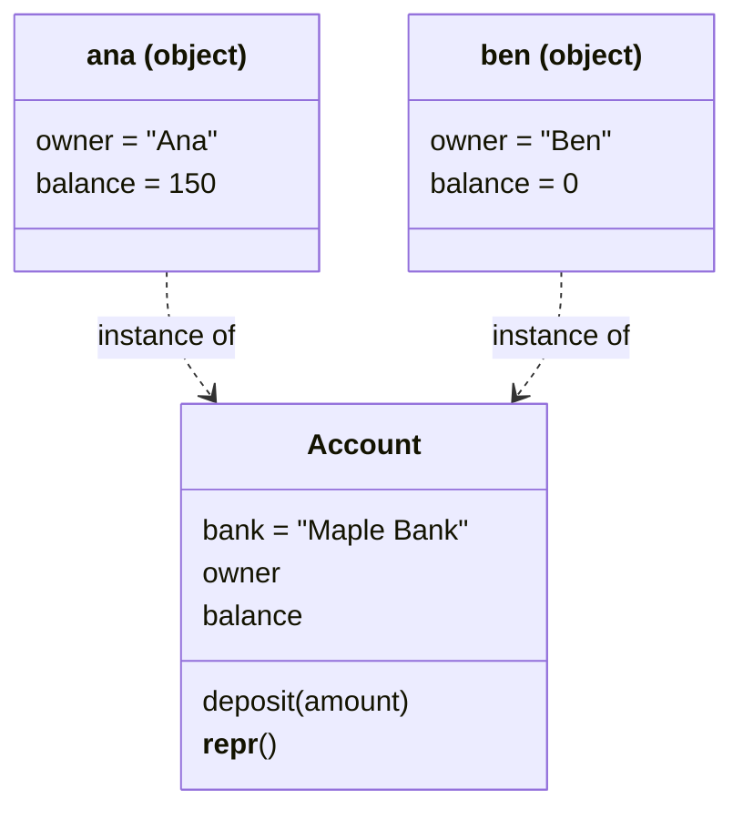
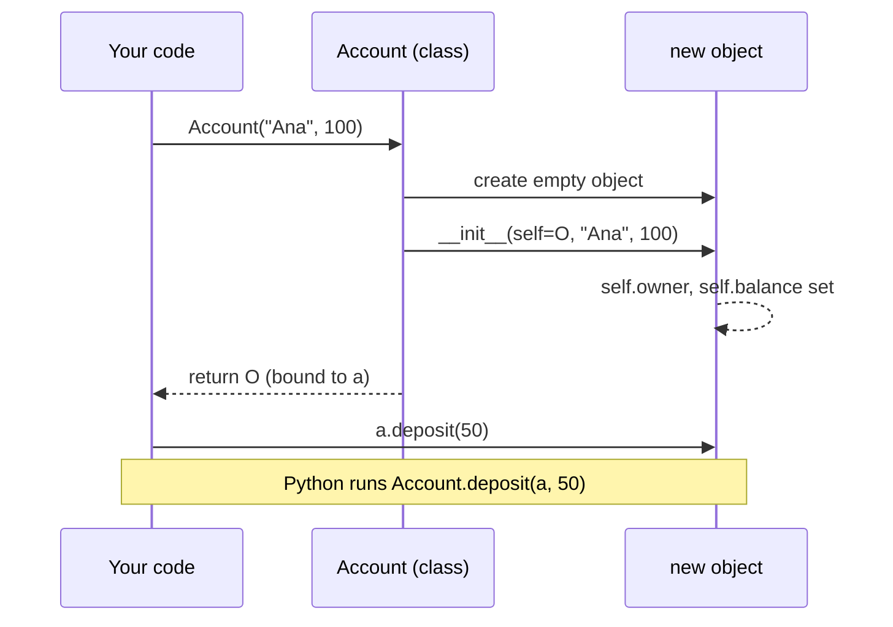

# Classes and objects

After this you can write a Python class with attributes and methods, use a dataclass for plain data, and avoid the class-attribute bug that shares state between objects.

Before this: [Functions and scope](../01-python-basics/03-functions-and-scope.md) and [Lists, dicts, sets and tuples](../01-python-basics/04-lists-dicts-sets-and-tuples.md).

## The idea

A banking script keeps an account as three loose variables: `owner`, `balance` and `history`. It works until there are two accounts, and then every function takes three arguments and you start mixing up which balance belongs to whom. A class bundles the data with the functions that use it.

A **class** is the blueprint. An **object** (also called an **instance**) is one thing built from it, with its own copy of the data. Every `Account` has a balance, but Ana's balance and Ben's balance are separate values.



In the diagram, `owner` and `balance` are stored once per object, while `bank` and the methods live once on the class and are shared by every object.

## Key terms

An **attribute** is a name attached to an object or class that holds a value. An **instance attribute** belongs to one object. A **class attribute** belongs to the class and is shared by all its objects.

A **method** is a function defined inside a class. Python passes the object it was called on as the first argument, conventionally named **self**.

`__init__` is the **initializer**, a method Python calls right after it creates a new object, to set the starting attributes. Names with double underscores on both sides are **dunder methods** (special methods); Python calls them for you.

A **dataclass** is a class decorated with `@dataclass`, which writes `__init__`, `__repr__` and `__eq__` for you from a list of annotated fields.

## How it works

Calling `Account("Ana", 100)` creates an empty object, runs `__init__` with that object as `self`, and returns it.



The last two lines of the diagram are a method call: `a.deposit(50)` is the same as `Account.deposit(a, 50)`: Python looks `deposit` up on the class and passes `a` as `self`.

```python
class Account:
    bank = "Maple Bank"

    def __init__(self, owner, balance=0):
        self.owner = owner
        self.balance = balance

    def deposit(self, amount):
        self.balance += amount

    def __repr__(self):
        return f"Account({self.owner!r}, {self.balance})"

a = Account("Ana", 100)
b = Account("Ben")
a.deposit(50)
print(a, b)
print(a == Account("Ana", 150))
```

```text
Account('Ana', 150) Account('Ben', 0)
False
```

`__repr__` returns the text shown when you print an object or look at it in a debugger. Without it you get `<Account object at 0x...>`. The last line prints `False` because the default `==` on a plain class compares identity: two objects are equal only if they are the same object. Defining `__eq__` changes that, but most data-holding classes should not write it by hand.

A dataclass does the boilerplate:

```python
from dataclasses import dataclass, field

@dataclass
class Account:
    owner: str
    balance: int = 0
    history: list = field(default_factory=list)

    def deposit(self, amount):
        self.balance += amount
        self.history.append(amount)

a = Account("Ana", 100)
a.deposit(50)
print(a)
print(a == Account("Ana", 150, [50]))
```

```text
Account(owner='Ana', balance=150, history=[50])
True
```

The fields are compared as a tuple, so equal contents mean equal objects. A mutable default such as `history: list = []` raises `ValueError: mutable default <class 'list'> for field history is not allowed: use default_factory`, the same trap as in function defaults.

JavaScript has the same shape with different words: `constructor` instead of `__init__`, `this` instead of `self` (and it is not a parameter), and `new` to create an object.

```javascript
class Account {
  constructor(owner, balance = 0) {
    this.owner = owner;
    this.balance = balance;
  }
  deposit(amount) {
    this.balance += amount;
  }
}
const a = new Account("Ana", 100);
a.deposit(50);
console.log(a);
```

```text
Account { owner: 'Ana', balance: 150 }
```

## Worked examples

<div class="example" markdown>

### Example 1: the class attribute that every object shares

We want each object to count its own bumps and keep its own list of tags.

```python
class Counter:
    count = 0
    tags = []

    def bump(self):
        self.count += 1
        self.tags.append("x")

a, b = Counter(), Counter()
a.bump()
print(a.count, b.count, Counter.count)
print(b.tags, Counter.tags is a.tags)
print(a.__dict__)
```

```text
1 0 0
['x'] True
{'count': 1}
```

1. `self.count += 1` reads `count`, finds it on the class (value 0), adds 1, and then assigns the result to `self.count`. Assignment always creates an instance attribute, so `a` gets its own `count` of 1 and the class's `count` stays 0.
2. `self.tags.append("x")` never assigns. It looks up `tags`, finds the one list on the class, and changes it in place.
3. So `b.tags` shows `['x']` although only `a` was bumped: all objects share that list.

Check: `a.__dict__` holds the instance attributes. It contains `count` but not `tags`, which confirms `tags` lives on the class. The fix is to create the list in `__init__` (`self.tags = []`), so each object gets its own.

</div>

## Common mistakes

<div class="warning" markdown>

Watch out: a mutable class attribute (a list, dict or set) is shared by every object. Put per-object state in `__init__`. Use class attributes for constants and defaults that never change in place.

Watch out: forgetting `self` in the method definition. `def deposit(amount)` fails with `TypeError: Account.deposit() takes 1 positional argument but 2 were given`, because Python passed the object as the first argument.

Watch out: assigning to an attribute you meant to read. `a.bank = "Other"` does not change the bank for everyone; it creates an instance attribute on `a` that hides the class one. Write `Account.bank = "Other"` to change the shared value.

</div>

## Working with AI

<div class="ai" markdown>

Words to use: class, instance, attribute, method, `self`, `__init__`, dataclass, `__repr__`, class attribute versus instance attribute.

Prompts to try:

- "Convert this class to a Python 3.14 dataclass. Keep the methods, and use `field(default_factory=...)` for mutable defaults."
- "This class has a bug where two instances share a list. Find the class attribute that causes it and fix it in `__init__`."

What to check:

- A mutable default in a dataclass or a class attribute. Create two objects, change one, and print the other.
- A hand-written `__eq__` without a matching `__hash__`: objects that define `__eq__` become unhashable, so they fail as dict keys.
- Classes used where a function or a plain dict would do. If a class has only `__init__` and one method, ask whether a function is simpler.

</div>

## Quiz

1\. What is the difference between a class and an object, and what does `self` refer to?

<details class="solution" markdown>
<summary>Answer</summary>

A class is the blueprint that defines the attributes and methods; an object is one instance built from it, with its own instance attributes. `self` is the object the method was called on, which Python passes as the first argument.

</details>

2\. Predict the output.

```python
class Dog:
    tricks = []

    def __init__(self, name):
        self.name = name

    def learn(self, trick):
        self.tricks.append(trick)

d, e = Dog("Rex"), Dog("Fido")
d.learn("sit")
print(e.tricks)
```

<details class="solution" markdown>
<summary>Answer</summary>

`['sit']`. `tricks` is a class attribute, so `d` and `e` share one list, and `append` changes it in place.

</details>

3\. This code raises `TypeError: Account.deposit() takes 1 positional argument but 2 were given`. Why?

```python
class Account:
    def __init__(self, balance):
        self.balance = balance

    def deposit(amount):
        self.balance += amount

a = Account(10)
a.deposit(5)
```

<details class="solution" markdown>
<summary>Answer</summary>

`deposit` is missing `self`. Python passes the object `a` as the first argument, so `amount` receives `a` and the call has one argument too many. The fix is `def deposit(self, amount):`. Without that fix the body would fail next, with a `NameError` on `self`.

</details>

4\. Two dataclass objects have the same field values. What do `==` and `is` return, and what would `==` return for a plain class with no `__eq__`?

<details class="solution" markdown>
<summary>Answer</summary>

For the dataclass, `==` is `True` (fields are compared) and `is` is `False` (two separate objects). For a plain class, `==` falls back to identity, so it is `False` for two separate objects.

</details>

## Lab

<div class="lab" markdown>

### Lab: a small task list

Goal: write a dataclass and a class that uses it. Time: about 15 minutes. Runs in: any terminal with Python.

1. Write a dataclass `Task` with a `title` (string) and `done` (bool, default `False`).
2. Write a class `TaskList` whose `__init__` creates an empty list `self.tasks`.
3. Add methods `add(title)`, `complete(title)` (marks the matching task done) and `pending()` (returns the tasks not yet done).
4. Add two tasks, complete one, and print `pending()`.
5. Print `Task("a") == Task("a")` and `Task("a") is Task("a")`, and say why they differ.

Expected result:

```text
[Task(title='run lab', done=False)]
True False
```

<details class="solution" markdown>
<summary>Solution</summary>

```python
from dataclasses import dataclass

@dataclass
class Task:
    title: str
    done: bool = False

class TaskList:
    def __init__(self):
        self.tasks = []

    def add(self, title):
        self.tasks.append(Task(title))

    def complete(self, title):
        for task in self.tasks:
            if task.title == title:
                task.done = True

    def pending(self):
        return [t for t in self.tasks if not t.done]

todo = TaskList()
todo.add("write lab")
todo.add("run lab")
todo.complete("write lab")
print(todo.pending())
print(Task("a") == Task("a"), Task("a") is Task("a"))
```

`==` compares the fields, which the dataclass wrote for you. `is` asks whether both sides are the same object, and each call to `Task(...)` makes a new one.

</details>

</div>

## Where this shows up

- Python libraries hand you objects to configure and call: a database connection, an HTTP client, a `Path`. Reading their docs means reading classes.
- Data from an API is often loaded into dataclasses (or Pydantic models) so the rest of the code can rely on named fields. Next: [Encapsulation, inheritance and polymorphism](02-encapsulation-inheritance-and-polymorphism.md).
