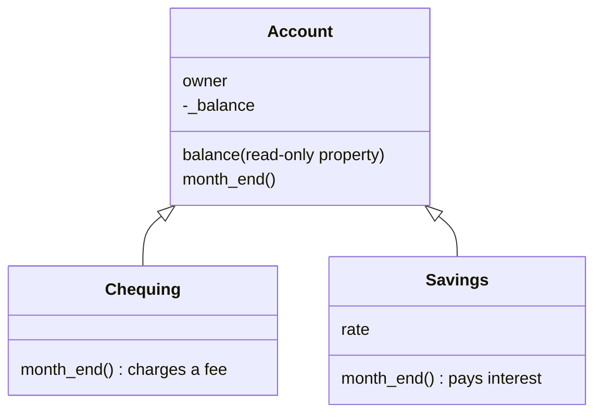
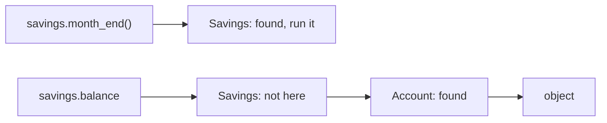

# Encapsulation, inheritance and polymorphism

After this you can hide internal state behind a clean interface, extend a class with `super()`, and write code that works on any object that has the right methods.

Before this: [Classes and objects](01-classes-and-objects.md).

## The idea

A bank has chequing and savings accounts. They share most behaviour (an owner, a balance, a month-end routine) but differ in details: chequing charges a fee, savings pays interest. A report that closes the month for every account should not need an `if` for each account type.

Object-oriented programming gives three tools for this, usually called the three pillars. **Encapsulation** keeps an object's internal data behind a small public interface. **Inheritance** lets a class reuse and specialise another class. **Polymorphism** ("many shapes") lets one piece of code work on objects of different classes, because each class answers the same method call in its own way.



In the diagram, the arrows point from the child (**subclass**) to the parent (**superclass**) and read "is a": a `Savings` is an `Account`. Both children override `month_end`, and a caller that holds an `Account` does not need to know which one it has.

## Key terms

An **interface** is the set of methods and attributes that other code is meant to use. The rest is **implementation**, which can change without breaking callers.

Python has no enforced private members. By convention, a name starting with one underscore (`_balance`) means "internal, do not touch from outside". A name starting with two underscores (`__x`) is renamed by Python to `_ClassName__x`, which avoids accidental clashes in subclasses; it is still not secure.

A **property** is a method that is accessed like an attribute (`a.balance`, without brackets), defined with the `@property` decorator. With a matching `@name.setter` it can check a value on assignment.

**Overriding** means a subclass defines a method with the same name as one in its parent. `super()` gives access to the parent's version.

The **method resolution order (MRO)** is the list of classes Python searches, in order, for an attribute: the object's class, then its parents left to right, ending at `object`.

## How it works

Encapsulation in Python is a convention plus properties. Here `_balance` is internal, and outside code reads it through `balance`, which has no setter:

```python
class Account:
    def __init__(self, owner, balance=0):
        self.owner = owner
        self._balance = balance

    @property
    def balance(self):
        return self._balance

    def withdraw(self, amount):
        if amount > self._balance:
            raise ValueError("insufficient funds")
        self._balance -= amount

a = Account("Ana", 100)
a.withdraw(30)
print(a.balance)
try:
    a.balance = 1_000_000
except AttributeError as e:
    print(e)
a._balance = 1_000_000
print(a.balance)
```

```text
70
property 'balance' of 'Account' object has no setter
1000000
```

The last two lines show the limit: Python warns you with the underscore but does not stop you. The point of the interface is that every legitimate change goes through `withdraw`, where the check lives. JavaScript and TypeScript do enforce it with `#name` fields, which cannot be read from outside the class at all.

When you call `obj.month_end()`, Python looks for the name along the MRO and uses the first match. A subclass method hides the parent's, and `super().method()` continues the search from the next class in the list.



The first call stops at `Savings`; the second moves on to `Account`. Print `Savings.__mro__` to see the order.

## Worked examples

<div class="example" markdown>

### Example 1: one loop, three behaviours

We want a month-end loop that works for every account type.

```python
class Account:
    def __init__(self, owner, balance=0):
        self.owner = owner
        self._balance = balance

    @property
    def balance(self):
        return self._balance

    def month_end(self):
        return "nothing to do"

class Chequing(Account):
    def month_end(self):
        self._balance -= 5
        return "charged $5 fee"

class Savings(Account):
    def __init__(self, owner, balance=0, rate=0.02):
        super().__init__(owner, balance)
        self.rate = rate

    def month_end(self):
        self._balance *= 1 + self.rate / 12
        return f"paid interest at {self.rate:.0%}"

accounts = [Chequing("Ana", 100), Savings("Ben", 1200), Account("Cy")]
for acct in accounts:
    print(type(acct).__name__, acct.month_end(), round(acct.balance, 2))
print([c.__name__ for c in Savings.__mro__])
print(isinstance(accounts[1], Account))
```

```text
Chequing charged $5 fee 95
Savings paid interest at 2% 1202.0
Account nothing to do 0
['Savings', 'Account', 'object']
True
```

1. `Savings.__init__` takes an extra `rate`, so it first calls `super().__init__(owner, balance)` to let `Account` set `owner` and `_balance`, and then sets its own attribute.
2. `Chequing` has no `__init__`, so Python finds `Account.__init__` along the MRO and uses it.
3. The loop calls `month_end()` on each object. Python picks the method from the object's own class, so each line behaves differently with no `if` in the loop. This is polymorphism.

Check: a 1200 balance at 2% a year gains 1200 x 0.02 / 12 = 2.00 for the month, which matches 1202.0. `isinstance` is `True` because a `Savings` is an `Account`.

</div>

The same shape in TypeScript, run with `node file.ts`. As of 2026, Node removes the type annotations and runs the file, but it accepts only [erasable TypeScript syntax](https://nodejs.org/api/typescript.html), so shortcuts such as constructor parameter properties (`constructor(public owner: string)`) are rejected and the fields are declared by hand:

```typescript
class Account {
  owner: string;
  #balance: number;

  constructor(owner: string, balance = 0) {
    this.owner = owner;
    this.#balance = balance;
  }

  get balance(): number {
    return this.#balance;
  }

  monthEnd(): string {
    return "nothing to do";
  }
}

class Savings extends Account {
  rate: number;

  constructor(owner: string, balance: number, rate = 0.02) {
    super(owner, balance);
    this.rate = rate;
  }

  override monthEnd(): string {
    return `paid interest at ${this.rate * 100}%`;
  }
}

const accounts: Account[] = [new Account("Cy"), new Savings("Ben", 1200)];
for (const a of accounts) console.log(a.monthEnd());
```

```text
nothing to do
paid interest at 2%
```

## Common mistakes

<div class="warning" markdown>

Watch out: a subclass `__init__` that skips `super().__init__(...)`. The parent's attributes are never set, and the failure comes later: `AttributeError: 'Savings' object has no attribute 'owner'`.

Watch out: inheriting only to reuse code. Inheritance says "is a", and every subclass must work wherever its parent is expected. A subclass that removes or changes what the parent promises breaks callers. If the relationship is "has a" or "uses", use composition, covered in the next lesson.

Watch out: deep or multiple inheritance. With two parents, the MRO decides which `super()` runs next, and the result is hard to predict (a `D(B, C)` calls `B`, then `C`, then `A`). Prefer one parent, and one or two levels.

</div>

## Working with AI

<div class="ai" markdown>

Words to use: encapsulation, property, `super()`, override, polymorphism, MRO, subclass, "is-a".

Prompts to try:

- "Here is a class with public attributes that other code mutates. Refactor it to use `_` attributes and a read-only property, and keep the public method names the same."
- "I have `if isinstance(x, ...)` chains in this function. Show how to replace them with a method that each class overrides, and say when the `if` version is better."

What to check:

- A subclass that calls `super().__init__` with the wrong arguments, or not at all. Create one object and print its `__dict__`.
- An overriding method with a different signature or return type than the parent's. Callers using the parent's contract will break.
- A deep hierarchy proposed for something that is really a configuration choice. Ask whether a field would do.

</div>

## Quiz

1\. What does a leading underscore on an attribute mean in Python, and does it stop other code from using it?

<details class="solution" markdown>
<summary>Answer</summary>

It marks the attribute as internal to the class, by convention. It does not stop anything: `a._balance = 5` works. Python relies on programmers respecting the convention.

</details>

2\. Predict the output.

```python
class A:
    def hello(self):
        return "A"

class B(A):
    def hello(self):
        return "B" + super().hello()

class C(A):
    def hello(self):
        return "C" + super().hello()

class D(B, C):
    pass

print(D().hello())
```

<details class="solution" markdown>
<summary>Answer</summary>

`BCA`. The MRO is `D, B, C, A, object`. `D` has no `hello`, so `B.hello` runs; its `super()` goes to the next class in `D`'s MRO, which is `C`, not `A`.

</details>

3\. `Savings("Ben", 0.02).owner` raises `AttributeError` even though `Account` sets `owner`. What is the likely cause?

<details class="solution" markdown>
<summary>Answer</summary>

`Savings.__init__` is defined and does not call `super().__init__(...)`, so `Account.__init__` never runs and `owner` is never set.

</details>

4\. A function takes a list of shapes and calls `shape.area()` on each. What lets it handle both circles and rectangles without checking the type?

<details class="solution" markdown>
<summary>Answer</summary>

Polymorphism: each class defines `area`, and Python chooses the method from the object's own class at the moment of the call.

</details>

## Lab

<div class="lab" markdown>

### Lab: shapes with a checked property

Goal: use a base class, two subclasses and a property. Time: about 15 minutes. Runs in: any terminal with Python.

1. Write `Shape` with an `area()` method that raises `NotImplementedError`.
2. Write `Rectangle(Shape)` with `width` and `height`. Make `width` a property whose setter raises `ValueError("width must be positive")` for values of 0 or less.
3. Write `Circle(Shape)` with a `radius` and an `area()` using `math.pi`.
4. Sum the areas of `[Rectangle(2, 3), Circle(1)]` and print the total rounded to 2 places.
5. Try `Rectangle(-1, 3)` and print the error message.

Expected result:

```text
9.14
width must be positive
```

<details class="solution" markdown>
<summary>Solution</summary>

```python
import math

class Shape:
    def area(self):
        raise NotImplementedError

class Rectangle(Shape):
    def __init__(self, width, height):
        self.width = width
        self.height = height

    @property
    def width(self):
        return self._width

    @width.setter
    def width(self, value):
        if value <= 0:
            raise ValueError("width must be positive")
        self._width = value

    def area(self):
        return self.width * self.height

class Circle(Shape):
    def __init__(self, radius):
        self.radius = radius

    def area(self):
        return math.pi * self.radius ** 2

shapes = [Rectangle(2, 3), Circle(1)]
print(round(sum(s.area() for s in shapes), 2))
try:
    Rectangle(-1, 3)
except ValueError as e:
    print(e)
```

`__init__` assigns `self.width`, which goes through the setter, so the check runs on construction as well as on later changes.

</details>

</div>

## Where this shows up

- Frameworks are built on overriding: you subclass a base class (a Django view, a test case) and fill in the methods the framework calls.
- Next: [Composition and interfaces](03-composition-and-interfaces.md), which covers when to avoid inheritance. The [SOLID principles](../../14-software-and-system-design/01-software-design/02-solid-principles.md) include the rule that a subclass must be usable wherever its parent is.
