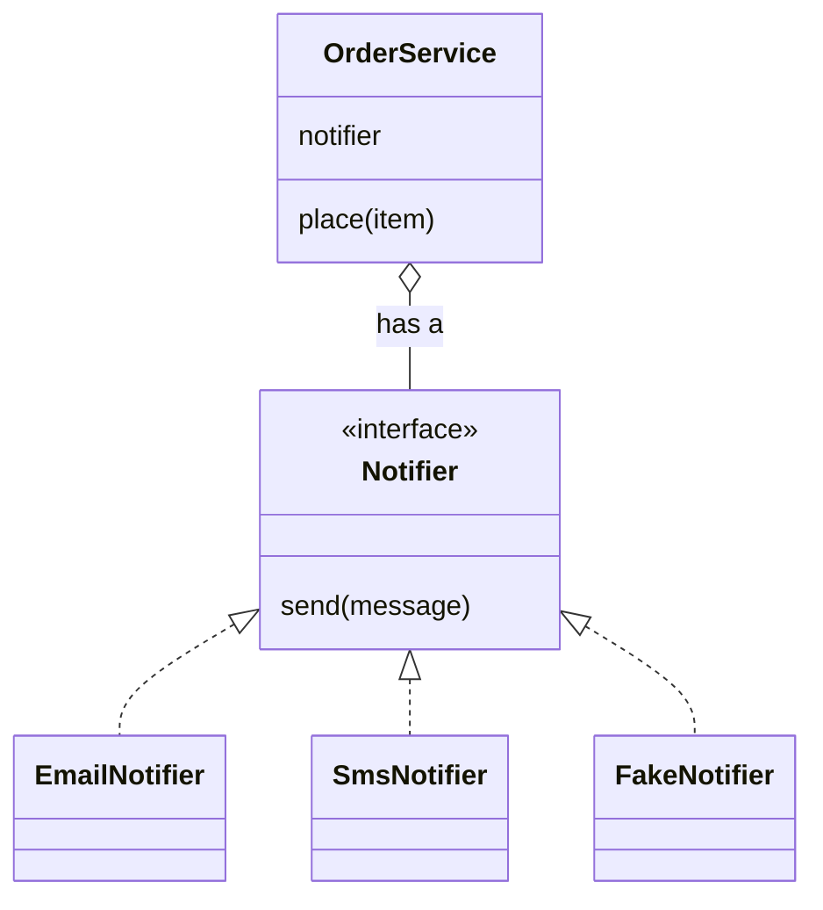
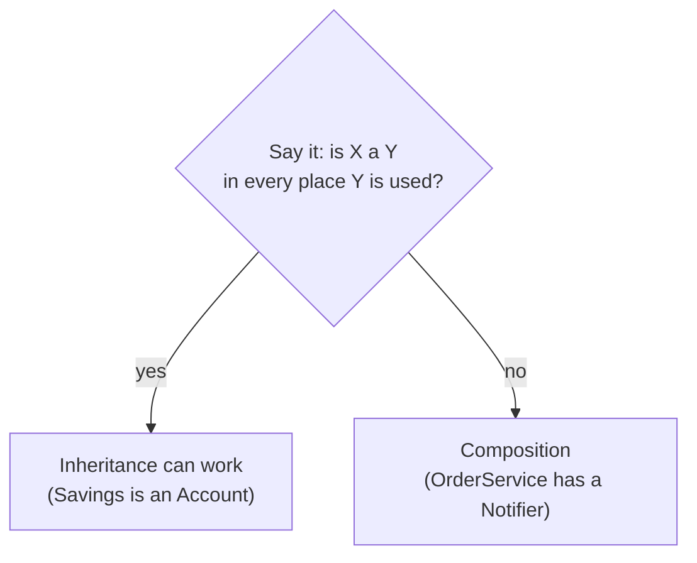

# Composition and interfaces

After this you can choose between inheritance and composition, define an interface with an abstract base class or `typing.Protocol`, and pass a dependency into a class so it can be swapped or faked in tests.

Before this: [Encapsulation, inheritance and polymorphism](02-encapsulation-inheritance-and-polymorphism.md).

## The idea

An `OrderService` must tell the customer when an order is placed. The first version sends an email inside `place()`. Then product asks for SMS, and the tests start sending real emails.

One fix is inheritance: `EmailOrderService` and `SmsOrderService`, each subclassing `OrderService`. The other is composition: `OrderService` holds a **notifier** and calls `notifier.send(...)`, and it does not care which kind it holds. The second design changes in one place when a new channel appears, and a test can hand in a fake.



In the diagram, `OrderService` depends only on the `Notifier` interface (the box on top). The three classes below it each implement that interface, and any of them can be plugged in.

## Key terms

**Composition** is building an object out of other objects that it holds as attributes and delegates work to. It models **has-a**. Inheritance models **is-a**.

An **abstract base class (ABC)** is a class that cannot be instantiated and declares methods subclasses must implement, marked with `@abstractmethod`. It is enforced when you create the object.

A **protocol** (`typing.Protocol`) describes an interface by its methods alone. A class matches it by having those methods, with no inheritance. This is **structural typing**, and it is checked by a type checker such as mypy or pyright, not at runtime. The name for it in Python culture is duck typing: if it has `send`, it can be used as a notifier.

**Dependency injection** is passing the objects a class needs into it (usually through `__init__`) instead of having it create them. The name is bigger than the idea: it means "take your helper as a parameter".

## How it works

The rule of thumb is "favour composition over inheritance". Inheritance couples the child to the parent's internals and fixes the relationship when the class is written. Composition lets you choose or replace the part at runtime, and avoids the deep hierarchies from the last lesson.



A simple test, shown in the diagram: say the sentence. "A savings account is an account" is true in every use, so inheritance can work. "An order service is an email sender" is false; it uses one.

The interface itself can be written two ways. An ABC enforces it at object creation:

```python
from abc import ABC, abstractmethod

class Notifier(ABC):
    @abstractmethod
    def send(self, message: str) -> None: ...

class EmailNotifier(Notifier):
    def send(self, message: str) -> None:
        print(f"email: {message}")

class Broken(Notifier):
    pass

EmailNotifier().send("hi")
try:
    Broken()
except TypeError as e:
    print(e)
```

```text
email: hi
Can't instantiate abstract class Broken without an implementation for abstract method 'send'
```

A Protocol needs no shared parent. Any class with a matching `send` fits, including code you do not own, and a class without one is reported by the type checker before the program runs (the example below shows both).

Use an ABC when you control all the implementations and want an error at creation time, or when the base class carries shared code. Use a Protocol when the implementations come from different places, or you only want to describe what a function needs.

TypeScript's `interface` works the same structural way: an object with the right shape matches, even a plain object literal.

## Worked examples

<div class="example" markdown>

### Example 1: injecting a notifier

We want `OrderService` to work with email in production and with a recording fake in a test.

```python
from typing import Protocol

class Notifier(Protocol):
    def send(self, message: str) -> None: ...

class OrderService:
    def __init__(self, notifier: Notifier):
        self.notifier = notifier

    def place(self, item: str) -> None:
        self.notifier.send(f"order placed: {item}")

class EmailNotifier:
    def send(self, message: str) -> None:
        print(f"email: {message}")

class FakeNotifier:
    def __init__(self):
        self.sent = []

    def send(self, message: str) -> None:
        self.sent.append(message)

OrderService(EmailNotifier()).place("book")

fake = FakeNotifier()
OrderService(fake).place("pen")
print(fake.sent)
```

```text
email: order placed: book
['order placed: pen']
```

1. `OrderService.__init__` takes a `notifier` and stores it. It never creates one, so it has no idea whether it is talking to email, SMS or a test double.
2. `EmailNotifier` and `FakeNotifier` do not inherit from `Notifier`. They match it because both have `send(message: str) -> None`.
3. The caller decides which notifier to pass in, at the place where the program is assembled.

Check: the fake's `sent` list holds the message, so a test can assert on it without sending anything. Now add a class with the wrong method and pass it in:

```python
class Pager:
    def page(self, message: str) -> None: ...

OrderService(Pager())
```

Running `python -m mypy order.py` (with the whole example in `order.py`) reports:

```text
order.py:33: error: Argument 1 to "OrderService" has incompatible type "Pager"; expected "Notifier"  [arg-type]
```

</div>

The same idea in TypeScript, where the interface is just a shape and a plain object satisfies it:

```typescript
interface Notifier {
  send(message: string): void;
}

class OrderService {
  notifier: Notifier;
  constructor(notifier: Notifier) {
    this.notifier = notifier;
  }
  place(item: string): void {
    this.notifier.send(`order placed: ${item}`);
  }
}

const logger = { send: (m: string) => console.log(`log: ${m}`) };
new OrderService(logger).place("book");
```

```text
log: order placed: book
```

## Common mistakes

<div class="warning" markdown>

Watch out: inheriting from a class just to borrow one method. `class Car(Engine)` makes every `Car` an `Engine` and exposes all of the engine's methods. Give `Car` an `engine` attribute and call `self.engine.start()`.

Watch out: expecting a Protocol to be checked when the program runs. Python only checks it when you run mypy or pyright. If you need an error at runtime, use an ABC.

Watch out: creating the dependency inside the class (`self.notifier = EmailNotifier()` in `__init__`). That hard-wires the class to one choice and makes tests send real emails. Take it as a parameter.

</div>

## Working with AI

<div class="ai" markdown>

Words to use: composition, has-a, abstract base class, `@abstractmethod`, `typing.Protocol`, structural typing, dependency injection, test double.

Prompts to try:

- "This class creates its own database client in `__init__`. Refactor it to take the client as a constructor argument, define a `typing.Protocol` for the two methods it uses, and show a fake for tests."
- "Should these three classes share a base class or be composed? Explain with the is-a / has-a test, and list what changes if I add a fourth variant."

What to check:

- A generated `Protocol` with more methods than the consumer uses. An interface should list only what the caller needs.
- Inheritance suggested for reuse of one helper method. Check whether a plain function or an attribute would do.
- "Dependency injection frameworks" suggested for a small script. Passing arguments to `__init__` is enough until the wiring gets repetitive.

</div>

## Quiz

1\. A `Logger` class is being used by `OrderService`. Is that is-a or has-a, and what does that suggest?

<details class="solution" markdown>
<summary>Answer</summary>

Has-a (or uses-a): an order service is not a logger. It suggests holding a logger as an attribute (composition) rather than inheriting from `Logger`.

</details>

2\. What is the difference between an ABC and a Protocol in how an incomplete implementation is caught?

<details class="solution" markdown>
<summary>Answer</summary>

An ABC raises `TypeError` when you try to create an object of a class that has not implemented every abstract method, so it fails at runtime. A Protocol is checked only by a static type checker such as mypy, before the program runs.

</details>

3\. Predict the output.

```python
class Engine:
    def start(self):
        return "vroom"

class Car(Engine):
    pass

c = Car()
print(c.start())
print(hasattr(c, "start"), isinstance(c, Engine))
```

<details class="solution" markdown>
<summary>Answer</summary>

```text
vroom
True True
```

`Car` inherits `start`, and an instance of a subclass is an instance of the parent. This is the problem the lesson describes: a `Car` is now an `Engine` by type, which is false in the real world.

</details>

4\. A test for `Session.expired()` takes a minute because it calls `time.time()` and waits. How does dependency injection fix it?

<details class="solution" markdown>
<summary>Answer</summary>

Pass the clock into `Session` as a parameter. Production code passes a real clock; the test passes a fake clock whose time the test sets directly, so no waiting is needed.

</details>

## Lab

<div class="lab" markdown>

### Lab: inject a clock

Goal: make time-dependent code testable. Time: about 15 minutes. Runs in: any terminal with Python.

1. Define a `Clock` Protocol with `now(self) -> int` (seconds).
2. Write `SystemClock` (returns `int(time.time())`) and `FixedClock` (stores a time `t` you can change).
3. Write `Session(clock, ttl)`. It records `clock.now()` at creation, and `expired()` returns `True` when more than `ttl` seconds have passed.
4. With a `FixedClock(1000)` and `ttl=60`, print `expired()`. Then set the clock to 1061 and print it again.

Expected result:

```text
False
True
```

<details class="solution" markdown>
<summary>Solution</summary>

```python
import time
from typing import Protocol

class Clock(Protocol):
    def now(self) -> int: ...

class SystemClock:
    def now(self) -> int:
        return int(time.time())

class FixedClock:
    def __init__(self, t: int):
        self.t = t

    def now(self) -> int:
        return self.t

class Session:
    def __init__(self, clock: Clock, ttl: int):
        self.clock = clock
        self.ttl = ttl
        self.created = clock.now()

    def expired(self) -> bool:
        return self.clock.now() - self.created > self.ttl

clock = FixedClock(1000)
s = Session(clock, ttl=60)
print(s.expired())
clock.t = 1061
print(s.expired())
```

`Session` never imports `time`; only `SystemClock` does. That keeps the time-dependent part at the edge of the program.

</details>

</div>

## Where this shows up

- [Unit tests](../../04-developer-tools-and-workflow/03-code-quality/01-unit-testing.md) rely on injecting fakes for the database, the clock and the network.
- [TypeScript](../../08-front-end/02-javascript-and-typescript/04-typescript.md) interfaces are structural in the same way as Protocols. The [SOLID principles](../../14-software-and-system-design/01-software-design/02-solid-principles.md) call this "depend on abstractions". Next: [Functional programming ideas](04-functional-programming-ideas.md).
