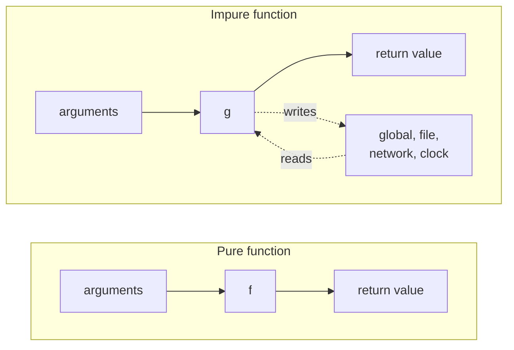
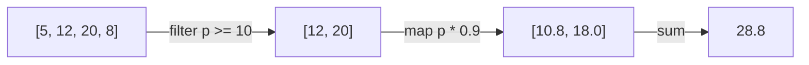

# Functional programming ideas

After this you can write pure functions, replace loops with comprehensions and `map`/`filter`, use closures and `lambda`, and explain why React and JavaScript insist on never changing data in place.

Before this: [Functions and scope](../01-python-basics/03-functions-and-scope.md) and [Classes and objects](01-classes-and-objects.md).

## The idea

A function applies a discount to a cart. One version changes the list it was given. Another returns a new list and leaves the original alone. Run the first twice and the prices are discounted twice; run the second twice and you get the same answer both times. When a bug appears, the second kind is easy to debug because everything the function did is in its return value.

**Functional programming** is a style built on that second kind: functions that compute values from their inputs, data that is not changed after it is made, and functions passed around like any other value. Python and JavaScript are not purely functional languages, but both support the style, and you will read code that uses it every day.



In the diagram, the only things that touch the pure function are its arguments and its result. The impure one also reads or changes something outside itself (the dashed lines), so its result depends on, or changes, the state of the rest of the program.

## Key terms

A **pure function** returns the same result for the same arguments and has no **side effects**. A side effect is any change outside the function's return value: modifying an argument or global, printing, writing a file, a network call, reading the clock or a random number.

**Immutable** data cannot be changed after it is created (tuples, strings, frozen dataclasses). To "change" it, you build a new value.

A function is **first-class** when it can be stored in a variable, passed as an argument and returned like any other value. A function that takes or returns a function is a **higher-order function**.

A **lambda** is an anonymous function written as one expression: `lambda p: p * 0.9`.

A **closure** is a function together with the variables it uses from the scope where it was defined. The variables stay alive after that scope has returned.

## How it works

The pure version of the cart discount, next to the in-place one:

```python
def discount_in_place(prices, pct):
    for i in range(len(prices)):
        prices[i] = prices[i] * (1 - pct)

def discounted(prices, pct):
    return [round(p * (1 - pct), 2) for p in prices]

cart = [10, 20, 30]
print(discounted(cart, 0.1), cart)
discount_in_place(cart, 0.1)
print(cart)
```

```text
[9.0, 18.0, 27.0] [10, 20, 30]
[9.0, 18.0, 27.0]
```

`discounted` leaves `cart` alone. `discount_in_place` rewrites it, so any other code holding the same list sees different prices (see [references and mutability](../02-thinking-like-a-programmer/02-references-mutability-and-copying.md)).

The usual tools for transforming a collection without mutating it are comprehensions and the higher-order functions `map` and `filter`. In Python the comprehension is the common choice; `map` and `filter` return lazy iterators, so wrap them in `list(...)` to see the results.

```python
prices = [5, 12, 20, 8]

big = [p for p in prices if p >= 10]
cheaper = [round(p * 0.9, 2) for p in big]
print(big, cheaper, sum(cheaper))

same = list(map(lambda p: round(p * 0.9, 2), filter(lambda p: p >= 10, prices)))
print(same == cheaper)

users = [{"name": "Cy", "age": 31}, {"name": "Ana", "age": 24}]
print([u["name"] for u in sorted(users, key=lambda u: u["age"])])

def make_multiplier(n):
    def times(x):
        return x * n
    return times

triple = make_multiplier(3)
print(triple(14), triple.__closure__[0].cell_contents)
```

```text
[12, 20] [10.8, 18.0] 28.8
True
['Ana', 'Cy']
42 3
```



Each arrow in the diagram makes a new value and leaves the one before it unchanged. The pipeline reads as three stages: keep the prices of at least 10, discount them, add them up. The `lambda` passed as `key=` is a first-class function used as an argument. `make_multiplier(3)` returns `times`, which still holds `n = 3` after `make_multiplier` has finished; that stored variable is the closure, visible in `__closure__`.

Immutable data is available in Python as tuples and frozen dataclasses. A "change" creates a new object:

```python
from dataclasses import dataclass, replace

@dataclass(frozen=True)
class Item:
    name: str
    qty: int

a = Item("pen", 1)
b = replace(a, qty=2)
print(a, b)
try:
    a.qty = 5
except Exception as e:
    print(type(e).__name__, e)
```

```text
Item(name='pen', qty=1) Item(name='pen', qty=2)
FrozenInstanceError cannot assign to field 'qty'
```

## Worked examples

<div class="example" markdown>

### Example 1: the same ideas in JavaScript and React

We want to filter and discount prices, and to add an item to some state without changing the old state.

```javascript
const prices = [5, 12, 20, 8];
const cheaper = prices
  .filter((p) => p >= 10)
  .map((p) => Math.round(p * 0.9 * 100) / 100);
console.log(cheaper, cheaper.reduce((a, b) => a + b, 0));

const state = { items: ["pen"], count: 1 };
const next = { ...state, items: [...state.items, "ink"], count: state.count + 1 };
console.log(state, next);
console.log(state.items === next.items);
```

```text
[ 10.8, 18 ] 28.8
{ items: [ 'pen' ], count: 1 } { items: [ 'pen', 'ink' ], count: 2 }
false
```

1. Arrays have `filter`, `map` and `reduce` as methods, and `(p) => p >= 10` is an arrow function, JavaScript's lambda. Each method returns a new array and leaves `prices` unchanged.
2. `{ ...state, ... }` copies the fields of `state` into a new object and then overrides some. `[...state.items, "ink"]` makes a new array with an extra element. The old `state` is untouched.
3. The last line confirms the two `items` arrays are different objects.

Check: `state` still shows one item, so the update did not change it.

React relies on this. A component is meant to be a pure function of its props and state: same inputs, same screen. React decides whether to re-render by checking whether the state value is a new object, not whether its contents changed. So the update is `setItems([...items, newItem])`, not `items.push(newItem)`; the push changes the array in place, React sees the same array, and the screen does not update. The React docs on [updating arrays in state](https://react.dev/learn/updating-arrays-in-state) list the non-mutating methods to use. Side effects (fetching data, timers) are kept out of the rendering function and put in effects, covered in [state and hooks](../../08-front-end/03-react/02-state-and-hooks.md).

</div>

## Common mistakes

<div class="warning" markdown>

Watch out: `nums.sort()` sorts in place and returns `None`, so `result = nums.sort()` leaves `result` as `None`. Use `sorted(nums)` for a new list. The same split exists in JavaScript: `arr.sort()` and `arr.reverse()` mutate, `arr.map()` does not.

Watch out: a closure captures a variable, not its value. `[lambda: i for i in range(3)]` creates three functions that all return 2, because they share one `i`. Bind the current value with a default argument: `lambda i=i: i`.

Watch out: nesting `map`, `filter` and `lambda` until nobody can read it. If a comprehension with a name for each step is clearer, use that. Pure functions are a tool, not a goal; a counter or a cache is fine when it is hidden behind a small interface.

</div>

## Working with AI

<div class="ai" markdown>

Words to use: pure function, side effect, immutable, higher-order function, closure, comprehension, `map`/`filter`/`reduce`, "does not mutate its input".

Prompts to try:

- "Rewrite this Python function so it does not mutate its argument and has no side effects. Return a new list, and list every place where the old version changed state."
- "Convert this `for` loop with `append` into a list comprehension, then tell me whether the comprehension is easier to read or not."

What to check:

- A generated "pure" function that still mutates an argument (`.append`, `.sort()`, `del`, item assignment). Call it twice on the same input and compare the input before and after.
- Shallow copies. `list(x)` or `{...x}` copies only the top level, so nested lists are still shared; check with an `is` comparison on inner items.
- A React update that uses `push`, `splice` or direct assignment on state. The component will not re-render.

</div>

## Quiz

1\. What are two properties that make a function pure? Is `random.randint(1, 6)` pure?

<details class="solution" markdown>
<summary>Answer</summary>

The same arguments always give the same result, and it has no side effects (it changes nothing outside itself). `random.randint` is not pure: it returns different values for the same arguments and changes the generator's internal state.

</details>

2\. Predict the output.

```python
fns = [lambda: i for i in range(3)]
print([f() for f in fns])
```

<details class="solution" markdown>
<summary>Answer</summary>

`[2, 2, 2]`. Each lambda looks up `i` when it is called, after the loop has finished and left `i` at 2. Writing `lambda i=i: i` would print `[0, 1, 2]`.

</details>

3\. A React component does `items.push(newItem); setItems(items);` and the list on screen does not change. Why?

<details class="solution" markdown>
<summary>Answer</summary>

`push` changed the existing array in place, so `setItems` received the same object as before. React compares by identity, sees no change, and skips the update. Pass a new array: `setItems([...items, newItem])`.

</details>

4\. You have `prices = [5, 12, 20, 8]`. Write one expression for the sum of the prices that are at least 10.

<details class="solution" markdown>
<summary>Answer</summary>

`sum(p for p in prices if p >= 10)`, which gives 32. In JavaScript: `prices.filter((p) => p >= 10).reduce((a, b) => a + b, 0)`.

</details>

## Lab

<div class="lab" markdown>

### Lab: orders without mutation

Goal: write three small functions that never change their input. Time: about 15 minutes. Runs in: any terminal with Python.

1. Start with a list of four order dicts, each with `id`, `total` and `paid` (a bool). Use totals 40, 150, 220 and 100, and mark the third one unpaid.
2. Write `paid_totals(orders, min_total)`: a comprehension that returns the totals of paid orders of at least `min_total`.
3. Write `make_adder(rate)`: a closure that returns a function adding `rate` to a total, rounded to 2 places.
4. Write `mark_shipped(orders)`: return new dicts with `"shipped": True` added, using `{**o, "shipped": True}`.
5. Print the totals from step 2 with a rate of 0.10 applied, then print whether the first original order has a `"shipped"` key.

Expected result:

```text
[165.0, 110.0]
False {'id': 1, 'total': 40, 'paid': True, 'shipped': True}
```

<details class="solution" markdown>
<summary>Solution</summary>

```python
orders = [
    {"id": 1, "total": 40, "paid": True},
    {"id": 2, "total": 150, "paid": True},
    {"id": 3, "total": 220, "paid": False},
    {"id": 4, "total": 100, "paid": True},
]

def make_adder(rate):
    def add(total):
        return round(total * (1 + rate), 2)
    return add

def paid_totals(orders, min_total):
    return [o["total"] for o in orders if o["paid"] and o["total"] >= min_total]

def mark_shipped(orders):
    return [{**o, "shipped": True} for o in orders]

with_tax = make_adder(0.10)
print([with_tax(t) for t in paid_totals(orders, 100)])
shipped = mark_shipped(orders)
print("shipped" in orders[0], shipped[0])
```

The first line prints `False` for the original order and the dict shown is the new copy, which proves `mark_shipped` did not change its input. `{**o, ...}` is a shallow copy; it would still share any nested lists.

</details>

</div>

## Where this shows up

- JavaScript code is full of `map`, `filter` and arrow functions, and React state updates follow the rules above: see [JavaScript for Python programmers](../../08-front-end/02-javascript-and-typescript/01-javascript-for-python-programmers.md) and [state and hooks](../../08-front-end/03-react/02-state-and-hooks.md).
- Pure functions are the easiest code to test, since a test needs only inputs and an expected output: [unit testing](../../04-developer-tools-and-workflow/03-code-quality/01-unit-testing.md). Data pipelines in Spark and pandas also read as chains of `filter` and `map`.
