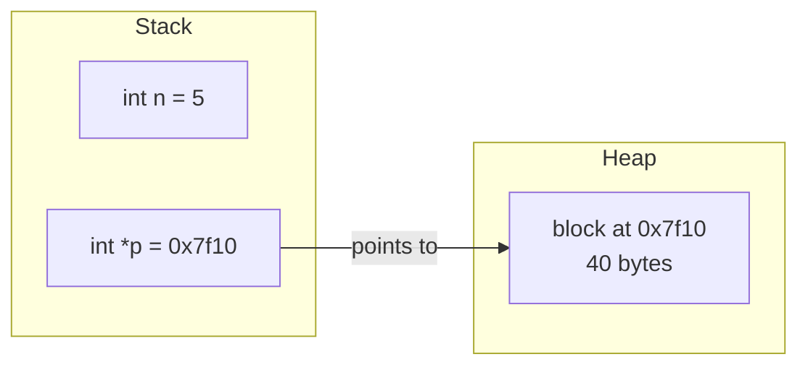
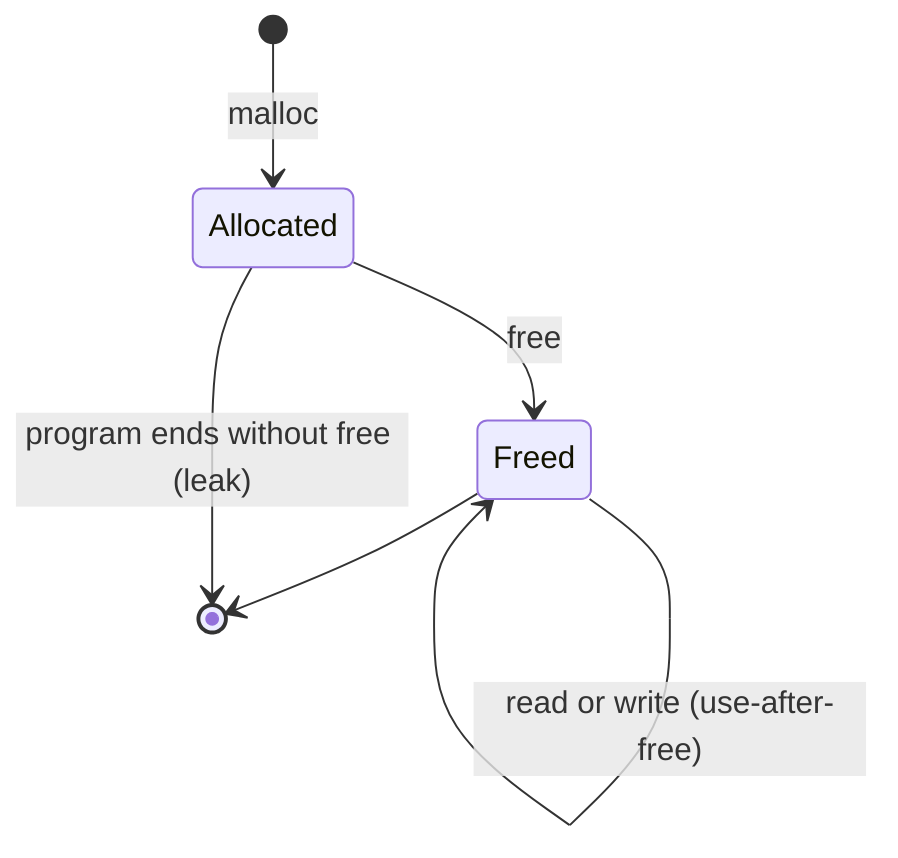

# Pointers and manual memory

After this you can explain what a pointer is, name the four classic memory bugs in C (leak, use-after-free, double free, buffer overflow), and say why they are security problems.

Before this: [Memory and virtual memory](../../02-operating-systems-and-linux/01-os-concepts/03-memory-and-virtual-memory.md) and [References, mutability and copying](../02-thinking-like-a-programmer/02-references-mutability-and-copying.md).

## The idea

Memory is a long row of numbered boxes, one byte each. The number on a box is its address. In Python you never see these numbers; a name refers to an object and the runtime does the rest. C removes that layer. You can hold the address itself, in a variable called a pointer, and you are also the one who must ask for memory and give it back.



In the diagram, `p` lives on the stack and holds the address of a block on the heap. The block stays allocated until the program frees it, even after the function that created it returns. Nobody does that for you, and that is the source of the bugs below.

## Key terms

An **address** is the number that identifies one byte in a process's virtual address space. A **pointer** is a variable whose value is an address, with a type that says what lives there (`int *p` points at an `int`).

**Dereferencing** a pointer (`*p`) reads or writes the data at the address. `&x` gives the address of `x`.

`malloc(n)` asks the allocator for `n` bytes on the heap and returns a pointer to them (or `NULL` if it fails). `free(p)` gives the block back. Memory from `malloc` is **uninitialized**: it holds whatever bytes were there before.

**Undefined behaviour** means the language standard places no requirement on what the program does. It may crash, print garbage, or appear to work today and fail after a compiler upgrade.

## How it works

Python's `ctypes` module can show a real pointer without a C compiler. In the snippet, `p` holds the address of `x`, and writing through `p` changes `x`.

```python
import ctypes
x = ctypes.c_int(5)
p = ctypes.pointer(x)
p.contents.value = 9
print(x.value, ctypes.addressof(x) == ctypes.addressof(p.contents))
```

```text
9 True
```

The C version of the same pattern, with the allocation steps, is below. These C snippets were not compiled on this machine; they follow the standard library documentation.

```c
int *a = malloc(10 * sizeof(int));   /* 1. ask for 40 bytes */
if (a == NULL) return 1;             /* 2. check it worked  */
a[0] = 7;                            /* 3. use it           */
free(a);                             /* 4. give it back     */
```

Each step has a way to go wrong. Skip step 4 and you have a **memory leak**: the block is never reused, and a long-running server slowly grows until the OOM killer ends it. Use `a` after step 4 and you have a **use-after-free**: the allocator may already have handed those bytes to someone else. Call `free(a)` twice and you have a **double free**, which corrupts the allocator's own bookkeeping.



The fourth bug is the **buffer overflow**: writing past the end of a block. C does not store a length with the pointer, so `a[10]` on the 10-element array above compiles and writes into whatever sits next to it.

```text
address:  0x00 ... 0x27 | 0x28 ...
          a[0] ... a[9] | neighbour (another variable, a return address, allocator data)
          a[10] = 99 writes into the neighbour
```

## Why these are security bugs

An attacker who controls the input controls how far a write goes and what bytes it holds. Overwriting a neighbouring variable can flip an `is_admin` flag. Overwriting a saved return address on the stack redirects the program to attacker-chosen code. Use-after-free lets an attacker place their data where the program expects its own. This class of bug is the main reason the next two lessons exist.

## Worked examples

<div class="example" markdown>

### Example 1: a toy heap that catches the bugs

Real C does not tell you about a double free; it just misbehaves. We build a tiny heap in Python that does, so the three bug types are visible.

1. `malloc` hands out an address and records it as live.
2. `free` moves the address from live to freed. Freeing an address already in the freed set is a double free.
3. `read` on a freed address is a use-after-free.
4. Whatever is still live at the end was never freed: a leak.

```python
class Heap:
    def __init__(self):
        self.live, self.freed, self.next = {}, set(), 0x1000
    def malloc(self, size):
        addr = self.next
        self.next += size
        self.live[addr] = bytearray(size)
        return addr
    def free(self, addr):
        if addr in self.freed:
            raise RuntimeError(f"double free at {addr:#x}")
        del self.live[addr]
        self.freed.add(addr)
    def read(self, addr):
        if addr in self.freed:
            raise RuntimeError(f"use after free at {addr:#x}")
        return self.live[addr]

h = Heap()
p = h.malloc(16)
q = h.malloc(16)
h.free(p)
for step in (lambda: h.read(p), lambda: h.free(p)):
    try:
        step()
    except RuntimeError as e:
        print(e)
print("leaked:", [hex(a) for a in h.live])
```

```text
use after free at 0x1000
double free at 0x1000
leaked: ['0x1010']
```

Check: `p` was freed, so reading and freeing it again both fail. `q` was never freed, so it is reported as leaked. Tools such as AddressSanitizer (`-fsanitize=address` in GCC and Clang) and Valgrind do this job for real C programs.

</div>

## Common mistakes

<div class="warning" markdown>

Watch out: using a pointer after `free`. Setting `p = NULL` right after `free(p)` turns a silent corruption into an immediate crash, and makes a second `free(p)` harmless.

Watch out: trusting a length the caller sends. Always check an index or byte count against the real size of the buffer before writing.

Watch out: `malloc` not being zeroed. Reading a field you never wrote can leak old data, including secrets from earlier allocations.

</div>

## Working with AI

<div class="ai" markdown>

Words to use: pointer, dereference, heap, use-after-free, double free, buffer overflow, undefined behaviour, AddressSanitizer.

Prompts to try:

- "This C function passes under my tests but crashes in production. Identify any use-after-free, double free or out-of-bounds write, and say which line causes each."
- "Rewrite this C function so every `malloc` has exactly one `free` on every return path, including the error paths."

What to check:

- Generated C that uses `strcpy`, `gets` or `sprintf` on a fixed buffer. Ask for bounded versions (`snprintf`) and a length check.
- A fix that adds `free` in one branch but leaves another early `return` that skips it.
- "It runs fine" as evidence of correctness. Undefined behaviour can pass every test; compile with `-fsanitize=address` and run again.

</div>

## Quiz

1\. What is the difference between a leak and a use-after-free?

<details class="solution" markdown>
<summary>Answer</summary>

A leak is memory that is never freed, so the program wastes memory. A use-after-free touches memory that was already freed, so the program reads or writes bytes that may now belong to something else.

</details>

2\. Predict the output.

```python
import ctypes
x = ctypes.c_int(5)
p = ctypes.pointer(x)
p.contents.value += 1
y = x
y.value += 1
print(x.value)
```

<details class="solution" markdown>
<summary>Answer</summary>

`7`. Writing through `p` changes `x` to 6. `y = x` is a Python name for the same object, so `y.value += 1` changes it to 7.

</details>

3\. A C server copies a username from a network packet into a 32-byte buffer using the length field in the packet. Why is this dangerous?

<details class="solution" markdown>
<summary>Answer</summary>

The sender controls the length, so a length above 32 writes past the buffer into neighbouring memory. That can overwrite other data or a return address. The code must check the length against 32 before copying.

</details>

4\. Why does setting a pointer to `NULL` after `free` help?

<details class="solution" markdown>
<summary>Answer</summary>

Freeing `NULL` does nothing, so a second `free` becomes harmless. Dereferencing `NULL` crashes right away at a clear spot instead of silently corrupting memory.

</details>

## Lab

<div class="lab" markdown>

### Lab: find the three bugs

Goal: use the toy `Heap` from Example 1 to find and fix a leak, a use-after-free and a double free in a small program. Time: about 15 minutes. Runs in: any terminal with Python 3.

1. Copy the `Heap` class from Example 1 into `heap.py`.
2. Add the program below under it. It builds a list of two buffers, then "cleans up".
3. Run it and read the error. Fix the program so it prints `leaked: []` and raises nothing.
4. Add `assert not h.live` at the end so a future leak fails loudly.

```python
h = Heap()
buffers = [h.malloc(8), h.malloc(8)]
first = buffers[0]
h.free(first)
h.free(buffers[0])      # cleanup loop, written carelessly
print(h.read(first))
print("leaked:", [hex(a) for a in h.live])
```

Expected result after the fix: `leaked: []`.

<details class="solution" markdown>
<summary>Solution</summary>

`first` and `buffers[0]` are the same address, so the second `free` is a double free and the `read` is a use-after-free. The second buffer is never freed. Free each address once, read before freeing, and free the second one.

```python
h = Heap()
buffers = [h.malloc(8), h.malloc(8)]
print(h.read(buffers[0]))
for addr in buffers:
    h.free(addr)
print("leaked:", [hex(a) for a in h.live])
assert not h.live
```

```text
bytearray(b'\x00\x00\x00\x00\x00\x00\x00\x00')
leaked: []
```

</details>

</div>

## Where this shows up

- Python and Java free memory for you; see [garbage collection and reference counting](02-garbage-collection-and-reference-counting.md).
- Rust keeps C's speed without these bugs: [ownership and borrowing in Rust](03-ownership-and-borrowing-in-rust.md).
