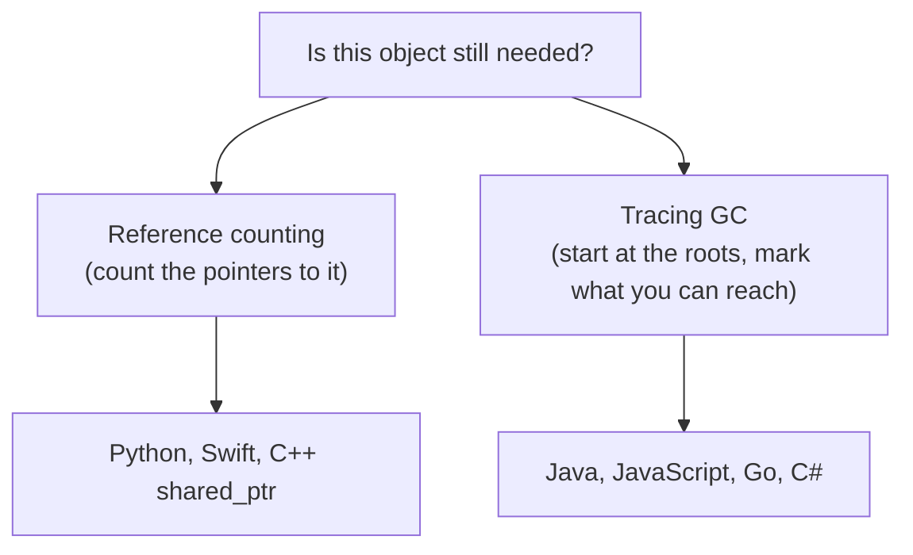
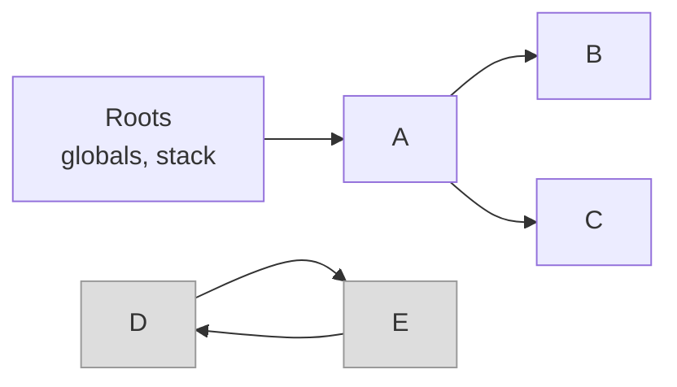

# Garbage collection and reference counting

After this you can explain how Python, Java and JavaScript free memory automatically, why a program in a garbage-collected language can still leak, and how to find the leak with `tracemalloc`.

Before this: [Pointers and manual memory](01-pointers-and-manual-memory.md) and [References, mutability and copying](../02-thinking-like-a-programmer/02-references-mutability-and-copying.md).

## The idea

In C you decide when each block is freed, and you get it wrong sometimes. A language with automatic memory management moves that decision into the runtime: the program creates objects, and the runtime frees the ones nobody can reach any more. There are two main ways to know "nobody can reach it".



In the diagram, the left branch frees an object the moment its count hits zero. The right branch pauses now and then, finds everything reachable, and throws away the rest. Python uses the left branch and adds a small right branch to handle one case the left cannot.

## Key terms

A **reference count** is the number of references to an object. When it reaches 0, the runtime frees the object at once.

A **reference cycle** is a group of objects that refer to each other, so each count stays above 0 even though nothing outside the group can reach them.

**Garbage collection** (GC) is automatic reclaiming of memory that the program can no longer reach. A **tracing** collector finds reachable objects by following references from the **roots** (global variables, local variables on the stack, CPU registers).

**Mark-and-sweep** is the basic tracing algorithm: mark every object reachable from the roots, then sweep (free) every unmarked one. A **generational** collector exploits the observation that most objects die young: it collects a small "young" area often and the "old" area rarely. A **GC pause** is the time the program is stopped while the collector runs.

## How it works

### Reference counting in Python

CPython (the standard Python) keeps a count in every object. `sys.getrefcount` reports it, and the number is one higher than you expect because passing the object as an argument adds a temporary reference.

```python
import sys
a = []
print(sys.getrefcount(a))
b = a
print(sys.getrefcount(a))
del b
print(sys.getrefcount(a))
```

```text
2
3
2
```

Counting frees memory immediately and predictably, so a file or a lock held by an object is released as soon as the last name goes away. Its weakness is the cycle: if `n.other = n`, the object points at itself, its count never reaches 0, and counting alone leaks it. Python adds a **cycle collector** (the `gc` module) that periodically looks for such groups and frees them.

```python
import gc, weakref

class Node:
    def __init__(self): self.other = None

gc.disable()                 # switch off automatic collection for the demo
n = Node(); n.other = n      # an object that refers to itself
r = weakref.ref(n)           # a reference that does not keep n alive
del n
print(r() is not None)       # still alive: the cycle keeps the count at 1
gc.collect()
print(r() is None)           # the cycle collector freed it
```

```text
True
True
```

### Tracing collectors

Java and JavaScript engines do not count. They run mark-and-sweep, usually generational and mostly concurrent with your code.



In the diagram, A, B and C are reachable from the roots and are marked, so they survive. D and E point at each other, but no path from a root reaches them, so the sweep frees them. Cycles are not a problem for a tracing collector, which is its advantage over counting. The costs are that memory is freed later than the moment it became unreachable, and that the collector may stop the program. Modern collectors keep pauses short (milliseconds or less) but cannot promise zero, which matters for latency-sensitive services such as trading systems and games.

## Leaks in garbage-collected languages

GC frees what is unreachable. A leak is memory that is reachable but no longer useful, so the collector is right to keep it. The usual sources:

- A cache or dict that only grows (no size limit, no expiry).
- A module-level list or global that every request appends to.
- Event listeners and callbacks that are registered and never removed: the registry holds the callback, and the callback holds everything it captured.

## Worked examples

<div class="example" markdown>

### Example 1: find a leak with tracemalloc

`tracemalloc` is in Python's standard library. It records where each allocation came from. We take a snapshot before and after the suspect code, and ask which line grew the most.

1. Start tracing and take a first snapshot.
2. Run the code that you suspect.
3. Take a second snapshot and call `compare_to` with `"lineno"` to group by source line.
4. Read the top entry.

Saved as `leak.py`:

```python
import tracemalloc

cache = {}
def handle(request_id):
    cache[request_id] = "x" * 10_000    # never removed

tracemalloc.start()
before = tracemalloc.take_snapshot()
for i in range(1000):
    handle(i)
after = tracemalloc.take_snapshot()
print(after.compare_to(before, "lineno")[0])
```

```text
leak.py:5: size=9842 KiB (+9842 KiB), count=1001 (+1001), average=10068 B
```

Check: 1000 strings of about 10 KB each is about 9.8 MB, matching the line. The top entry names line 5, the assignment into `cache`. The fix is a bounded cache, for example `functools.lru_cache(maxsize=...)`, or deleting entries when they expire. (The absolute path is shown in the real output; it is shortened here.)

</div>

## Common mistakes

<div class="warning" markdown>

Watch out: assuming "garbage collected" means "cannot leak". Anything reachable from a global, a cache or a listener list stays alive. Look for collections that only grow.

Watch out: relying on `__del__` or on GC timing to close files and locks. Under a tracing collector the moment is unpredictable; use `with` (context managers) so release happens at a known point.

Watch out: calling `gc.collect()` to "fix" growing memory. If the memory is still reachable, collecting frees nothing.

</div>

## Working with AI

<div class="ai" markdown>

Words to use: reference count, reference cycle, mark-and-sweep, generational GC, GC pause, reachable, `tracemalloc`, weak reference.

Prompts to try:

- "This Python service grows from 200 MB to 2 GB over a day. Show me how to use `tracemalloc` snapshots to find which lines allocate the memory that is never released."
- "Explain why this JavaScript component leaks: it calls `addEventListener` in an effect and I never see the memory drop after the component unmounts."

What to check:

- Advice to "just call `gc.collect()`" or "set the variable to `None`". Confirm the object really becomes unreachable, using a weak reference as in the snippet above.
- An unbounded cache replaced by another unbounded structure. Check that the new one has a size or time limit and test it with a loop.
- Claims about exact pause times or collector settings for a given Java or Node version. Those change; check the runtime's own documentation.

</div>

## Quiz

1\. Why can reference counting alone not free two objects that point at each other?

<details class="solution" markdown>
<summary>Answer</summary>

Each object holds one reference to the other, so both counts stay at 1 or more even when nothing else can reach them. Python's cycle collector exists for this case.

</details>

2\. Predict the output.

```python
import sys
a = []
b = a
c = [a]
print(sys.getrefcount(a))
```

<details class="solution" markdown>
<summary>Answer</summary>

`4`: the names `a` and `b`, the slot in the list `c`, and the temporary reference made by passing `a` to the function.

</details>

3\. A Node.js API server restarts every few days with out-of-memory errors. A garbage collector is running. What do you look for?

<details class="solution" markdown>
<summary>Answer</summary>

Objects that are still reachable but no longer useful: a module-level array or map that grows with each request, an unbounded cache, or listeners that are never removed. Take heap snapshots over time and compare which objects grow.

</details>

4\. What is the trade-off between reference counting and a tracing collector?

<details class="solution" markdown>
<summary>Answer</summary>

Counting frees memory immediately and has no long pauses, but needs extra work on every assignment and cannot free cycles by itself. Tracing handles cycles and has cheap assignments, but frees memory later and may pause the program.

</details>

## Lab

<div class="lab" markdown>

### Lab: find the leak

Goal: use `tracemalloc` to find which line keeps objects alive, then fix it. Time: about 15 minutes. Runs in: any terminal with Python 3.

1. Save the program below as `sessions.py` and run it.
2. Read the printed line. Which source line grew, and by how much?
3. Explain why the objects are still reachable after `login` returns.
4. Fix it so the server keeps only the 10 most recent sessions, and run again. The growth should drop to about 10 sessions.

```python
import tracemalloc

class Session:
    def __init__(self, user):
        self.user = user
        self.data = bytearray(50_000)

all_sessions = []

def login(user):
    s = Session(user)
    all_sessions.append(s)
    return s

tracemalloc.start()
before = tracemalloc.take_snapshot()
for i in range(200):
    login(f"user{i}")
after = tracemalloc.take_snapshot()
print(after.compare_to(before, "lineno")[0])
```

Expected result before the fix: about 9.8 MB on the `bytearray` line, count 400 (the `Session` and its bytes).

<details class="solution" markdown>
<summary>Solution</summary>

Output before the fix (path shortened):

```text
sessions.py:6: size=9777 KiB (+9777 KiB), count=400 (+400), average=24.4 KiB
```

Line 6 allocates 50,000 bytes per session. Every session is appended to the global `all_sessions`, so it stays reachable and the collector cannot free it. Keep only the newest ten:

```python
from collections import deque
all_sessions = deque(maxlen=10)
```

With the rest unchanged, the top line shrinks to `size=489 KiB (+489 KiB), count=20`, which is 10 sessions. A deque with `maxlen` drops the oldest item on each append.

</details>

</div>

## Where this shows up

- Rust avoids both a collector and manual `free`: [ownership and borrowing in Rust](03-ownership-and-borrowing-in-rust.md).
- Caches with size limits appear in system design, and `lru_cache` appears again in dynamic programming.
- The OS side of "memory keeps growing" is in [memory and virtual memory](../../02-operating-systems-and-linux/01-os-concepts/03-memory-and-virtual-memory.md).
