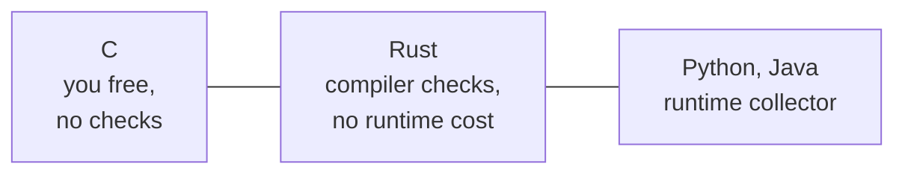
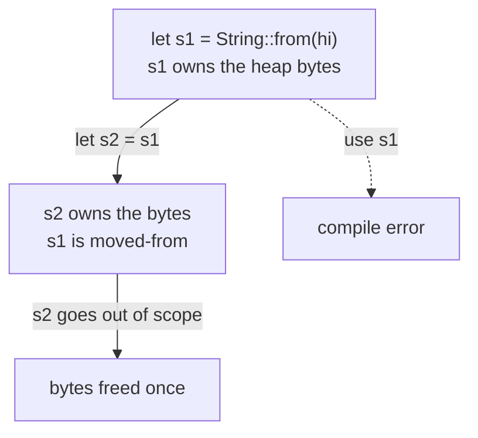

# Ownership and borrowing in Rust

After this you can describe Rust's ownership rules, read the borrow checker's most common error, and explain how Rust avoids both manual `free` and a garbage collector.

Before this: [Pointers and manual memory](01-pointers-and-manual-memory.md) and [Garbage collection and reference counting](02-garbage-collection-and-reference-counting.md).

This lesson is for awareness. You will not write Rust here; you will know what the language does, why, and what its errors mean when you meet them in a code review or an AI answer.

## The idea

C gives speed but lets you free memory twice or use it after freeing. Python and Java prevent that with a runtime collector, which costs extra memory and occasional pauses. Rust takes a third route: the compiler checks, before the program runs, that every block of memory has exactly one owner and that nobody uses it after it is gone. If the check fails, the program does not compile.



In the diagram, Rust sits between the two: it keeps C's lack of a runtime collector and gets Python-style safety, at the price of rules the programmer must follow.

## Key terms

**Ownership** is the rule that each value has one variable that owns it. When the owner goes out of scope, Rust frees the value automatically (it calls `drop`). That is why no `free` appears in Rust code.

A **move** transfers ownership to another variable. The old variable can no longer be used.

**Borrowing** lends access without transferring ownership. A shared borrow `&x` allows reading. A mutable borrow `&mut x` allows writing.

The **borrow checker** is the part of the compiler that enforces the rules below.

A **lifetime** is the stretch of code during which a reference is valid. Most are worked out by the compiler. When it cannot, you write a label like `'a` to say that a returned reference lives no longer than the argument it came from, so a reference can never outlive the data it points to.

## How it works

The rules are short:

1. Each value has exactly one owner.
2. Assigning or passing a value moves it (for types that own heap data, such as `String` and `Vec`).
3. You may have many `&` borrows, or one `&mut` borrow, but not both at the same time.
4. A reference cannot outlive its owner.

Rule 3 is the key one. It is the same condition that makes data races and iterator invalidation bugs possible in other languages: one party reading while another writes. Rust makes it impossible at compile time.



In the diagram, ownership travels from `s1` to `s2` and the memory is freed exactly once, when `s2` ends. Using `s1` after the move is rejected. This removes the double free and the use-after-free from the previous lesson. The code below was not compiled on this machine; it follows the Rust Book ([ch. 4](https://doc.rust-lang.org/book/ch04-00-understanding-ownership.html)).

```rust
fn main() {
    let s1 = String::from("hi");
    let s2 = s1;              // move: s2 is the owner now
    println!("{s1}");         // error: s1 was moved
}
```

The error you will see most often has this shape (shortened, and checked against the Rust Book rather than run here):

```text
error[E0382]: borrow of moved value: `s1`
  |     let s2 = s1;
  |              -- value moved here
  |     println!("{s1}");
  |               ^^^^ value borrowed here after move
```

Read it from the bottom: the line that uses the value, the line that moved it. The usual fixes are to borrow instead (`let s2 = &s1;`), to clone the data (`s1.clone()`, a deliberate and visible copy), or to restructure so one owner is enough.

The second common error breaks rule 3:

```rust
let mut v = vec![1, 2, 3];
let first = &v[0];        // shared borrow
v.push(4);                // needs &mut v while `first` is still in use
println!("{first}");
```

```text
error[E0502]: cannot borrow `v` as mutable because it is also borrowed as immutable
```

This is a real bug in C++ and other languages: `push` may move the vector's storage, leaving `first` pointing at freed memory. Rust refuses to compile it.

## Worked examples

<div class="example" markdown>

### Example 1: a move, simulated in Python

Python has no ownership, so to feel the rule we model it. The class below marks the old holder as moved when ownership is transferred, and refuses any later use. This is only a simulation; Rust does this check at compile time, with no cost when the program runs.

1. `a` owns a list.
2. `a.move()` returns a new owner and marks `a` as moved-from.
3. Using `a` again raises an error, like the compile error above.

```python
class Owned:
    def __init__(self, value):
        self._value, self._moved = value, False
    def move(self):
        if self._moved:
            raise RuntimeError("use of moved value")
        self._moved = True
        return Owned(self._value)
    def get(self):
        if self._moved:
            raise RuntimeError("use of moved value")
        return self._value

a = Owned([1, 2, 3])
b = a.move()
print(b.get())
try:
    a.get()
except RuntimeError as e:
    print(e)
```

```text
[1, 2, 3]
use of moved value
```

Check: `b` works and `a` does not. In real Rust the second case never reaches runtime, because the program is not built.

</div>

## Common mistakes

<div class="warning" markdown>

Watch out: fixing every borrow error with `.clone()`. It compiles, but it copies data and hides a design problem. Ask first whether a borrow (`&`) is enough.

Watch out: expecting Rust to be leak-free. Safe Rust prevents use-after-free and double free, not logic leaks such as an ever-growing `HashMap`, or reference-count cycles with `Rc`.

Watch out: reaching for `unsafe` to silence the checker. Inside an `unsafe` block the compiler stops checking some rules and the C-style bugs return. Treat each `unsafe` as something to review.

</div>

## Working with AI

<div class="ai" markdown>

Words to use: ownership, move, borrow, mutable borrow, lifetime, borrow checker, `Clone`, `unsafe`.

Prompts to try:

- "Here is a Rust compiler error (E0382, borrow of moved value) and the function. Explain which line moved the value and show a fix that borrows instead of cloning."
- "Review this Rust code for unnecessary `.clone()` calls and any `unsafe` blocks, and explain what each `unsafe` block assumes."

What to check:

- A fix that adds `.clone()` or `Rc<RefCell<...>>` everywhere. Ask whether a plain `&` or `&mut` works, and compare the cost.
- Lifetime annotations that were added until the compiler stopped complaining. Ask what each `'a` claims, and whether the claim matches the code.
- Any `unsafe` block with no comment explaining why it is sound.
- Code that does not compile. Paste it into `cargo check`; AI-written Rust often fails on borrow rules.

</div>

## Quiz

1\. What does a move do, and what happens to the old variable?

<details class="solution" markdown>
<summary>Answer</summary>

It transfers ownership of the value to a new variable. The old variable is no longer valid, and using it is a compile error.

</details>

2\. Predict the output. This is Python, so nothing is moved.

```python
a = [1]
b = a
del a
print(b)
```

<details class="solution" markdown>
<summary>Answer</summary>

`[1]`. `del a` removes one name, and the list lives on because `b` still refers to it. The equivalent Rust assignment `let b = a;` would move the value and forbid any further use of `a`.

</details>

3\. The borrow checker reports "cannot borrow `v` as mutable because it is also borrowed as immutable". What rule was broken and why does it matter?

<details class="solution" markdown>
<summary>Answer</summary>

Many readers or one writer, never both. If code reads through a reference while another part changes the data, the change can move or free the data, leaving the reader with a dangling reference. Fix it by ending the shared borrow before mutating, or by copying the needed value out first.

</details>

4\. Why does Rust need neither `free` nor a garbage collector?

<details class="solution" markdown>
<summary>Answer</summary>

Every value has one owner, and the compiler inserts the cleanup when that owner goes out of scope. The compiler also proves no reference outlives the value, so no runtime tracing is needed.

</details>

## Lab

<div class="lab" markdown>

### Lab: model the borrow rule

Goal: extend the `Owned` simulation with "many readers or one writer" to see rule 3 in action. Time: about 15 minutes. Runs in: any terminal with Python 3.

1. Create `own.py` with a class `Cell` that has a counter `readers` and a flag `writer`, both starting at 0 and `False`.
2. Keep it small: no value, only the two fields.
3. Add `borrow()` (raises if `writer` is set, otherwise `readers += 1`) and `borrow_mut()` (raises if `readers > 0` or `writer` is set, otherwise sets `writer`).
4. Add `release_read()` and `release_write()` to undo them.
5. Test: two `borrow()` calls succeed, `borrow_mut()` then fails, and after two `release_read()` calls it succeeds.

Expected result:

```text
two readers ok
writer refused: cannot borrow mutably while borrowed
writer ok after releases
```

<details class="solution" markdown>
<summary>Solution</summary>

```python
class Cell:
    def __init__(self):
        self.readers, self.writer = 0, False
    def borrow(self):
        if self.writer:
            raise RuntimeError("cannot borrow while mutably borrowed")
        self.readers += 1
    def borrow_mut(self):
        if self.readers or self.writer:
            raise RuntimeError("cannot borrow mutably while borrowed")
        self.writer = True
    def release_read(self):
        self.readers -= 1
    def release_write(self):
        self.writer = False

c = Cell()
c.borrow(); c.borrow()
print("two readers ok")
try:
    c.borrow_mut()
except RuntimeError as e:
    print("writer refused:", e)
c.release_read(); c.release_read()
c.borrow_mut()
print("writer ok after releases")
```

Rust's real borrow checker does this at compile time and tracks the releases for you, by scope.

</details>

</div>

## Where this shows up

- Rust is used for systems code where C was the default: browsers, operating system components and command-line tools.
- The "one writer at a time" idea returns in [concurrency, parallelism and race conditions](../05-concurrency/01-concurrency-parallelism-and-race-conditions.md).
